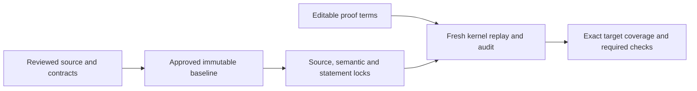

# Fixed questions, editable proofs

A proof may change. The question it answers requires independent review before it changes.
The kernel checks a term against its type. The verification gate also checks that the type is
an exact registered target and that its meaning matches an approved baseline.

A successful development build is not final acceptance. [Progress](progress.md) records current
status. The [checking guide](checking/goals.md) gives commands and acceptance scope; the
[trusted base](trusted-base.md) explains the semantic judgments that automation cannot make.



## What the gate fixes

| Input | Protection |
| --- | --- |
| Public entries and required target names | `tests/audit/public-api.json` is checked against the pinned header, translated entries and manual sections. |
| Normative documents, runtime, translation, specifications, patches, configuration and test/audit code | `tests/audit/policy.lock` records SHA-256 source fingerprints. Proof registrations and their types have separate checks. |
| Every compiled non-theorem declaration in the root import closure | `tests/audit/trusted.lock` records SHA-256 fingerprints of full exported kernel syntax. This includes private helpers, constructors, recursor rules and definitions in proof namespaces. |
| Registered theorem types | `tests/audit/statements.lock` records full kernel-type fingerprints and readable types. Approved registrations cannot be removed or changed. |
| Goal coverage | Every standalone `Goal` proposition in the audited closure must be registered. Public readiness also requires the inventory's complete target set. |

Exported syntax includes universe parameters, types, bodies, constructor data and recursor
rules. Source-position metadata is ignored. Small diagnostic hashes are not semantic locks.
Audited functions are not evaluated to compute the fingerprints.

A namespace named `Proofs` grants no exemption. Any definition can change a target's meaning,
so every semantic helper is locked. Proof terms and auxiliary theorems may change.
`ZlibF/Proof/Index.lean` admits new proof imports; the root remains source-locked and imported
definitions remain semantically locked. A theorem-only addition can retain the baseline locks.
A semantic helper requires reviewed regeneration.

The root must import every source module. Missing source is rejected even if a stale compiled
object exists. Readiness and final checks also reject locked inputs absent from the version-control
index, including ignored generated files. Generated test-project manifests and their locks must
be committed. A file present in one working tree cannot supply a reproducible baseline.

## What counts as a proof

The registered theorem's type must be exactly the target constant. An extra premise, a similar
name or an abstract-model theorem cannot discharge a concrete implementation target.

Only `propext`, `Classical.choice` and `Quot.sound` are allowed axioms. Compiled declarations
are replayed in a fresh environment of the same Lean kernel; a cached execution trace is not
a certificate. The declaration audit checks the import closure for unsupported assumptions and
forbidden declaration kinds. Missing, empty or duplicate registries fail.

Compiler-generated execution helpers are enumerated in `tests/audit/compiler-helpers.txt` and
their bodies are locked. Private names alone grant no exception. New helpers require independent
review; ordinary private unsupported definitions are rejected.

Initialisation must establish the shared invariant over the permitted domain. Top-level concrete
witnesses supplement this obligation and never replace universal coverage. No final result may
assume an unproved library callee contract. An invariant that no permitted heap satisfies cannot
justify a public claim.

The gate has three levels:

| Level | Meaning |
| --- | --- |
| `check` | Development audit; open proofs are permitted. |
| `specs` | Also requires all public targets as closed propositions. Their existence is not a proof of them. |
| `final` | Requires all goals proved, an approved baseline and a clean named commit. It runs the no-placeholder, audit self-test, differential and mutation checks. |

The four CI jobs are `build`, `no-sorry`, `audit` and `difftest`. Final reporting requires all
four green on the named commit. A check must be run before it is reported as passing.
Differential tests are finite evidence of fidelity, not proof.

## Proof mutants

Every exactly proved public entry needs a reviewed record in
`tests/audit/public-mutants.json`. Each mutation changes that function's translated body while
retaining its signature. Mutation parsing uses the pinned standard parser without candidate
imports. Lean command syntax delimits the declaration, including private names and binder
defaults. Signatures, suffixes and all other commands must remain identical; injected declarations
are rejected.

A missing record, a mutation of another function, a specification-only change or a marked proof
gap fails the check. The strict runner checks designated proof modules and requires their
positive baseline. A separate fresh-kernel replay substitutes only mutated source declarations
into the original exact registered proof's dependency closure. That original proof must check
before the mutation and fail afterwards. Failure only in an unrelated or stronger theorem does
not count.

Proof sensitivity alone does not establish a behavioural difference. An equivalent rewrite can
break a particular proof term. Independent review must identify a changed behaviour on an allowed
input. Historical review of the five error-clearing and code-count mutants is evidence for those
mutations, not approval of every later mutation.

`verification.py mutants` runs both the model list and every referenced public-function list.
CI invokes it. A mapping to a list that was never executed cannot satisfy the requirement.
The [mutant guide](checking/proof-mutants.md) explains the checks.

## Who can approve a baseline

Matching candidate files against candidate locks detects drift. It cannot establish that the
candidate was authorised to replace its locks. Final acceptance compares against an independently
approved immutable commit, including its auditor and goal registry.

The final workflow takes the auditor and baseline from `main` and fails if that auditor is
absent. Development CI has a bootstrap path for the first baseline. Bootstrap is not final
acceptance. Protected source changes require independent review before becoming a new baseline.

Repository settings must require pull requests, code-owner review of protected paths and passing
required checks on `main`. New changes must dismiss stale approvals. Direct pushes and bypasses
must be restricted. Proof-work credentials must not administer those protections. `CODEOWNERS`
alone does not enforce them; hosting settings are outside the Lean proof.

## Changing protected material

Keep semantic changes separate from proof-only work. Explain the changed domain or behaviour,
its relation to C and the public contract, and every lock difference. Regenerate locks through
the audit; never edit them by hand. Regeneration computes evidence and does not approve it.

```sh
python3 scripts/verification.py regenerate
python3 scripts/verification.py check
python3 tests/verification/test_audit.py
python3 -O tests/verification/test_audit.py
```

The source policy includes the auditor and generated call table. Repository working rules also
protect `tests/audit/`, `.github/`, `scripts/`, `patches/`, `lakefile.toml`, `lean-toolchain`,
`docs/api/`, `docs/format/`, `docs/README.md`, `docs/design/api-model.md`,
`docs/design/internal-contracts.md`, `docs/checking/goals.md`,
`docs/checking/contract-review.md`, `ZlibF/Runtime/` and `AGENTS.md`. Change them only when the task explicitly concerns
that material, and disclose it in the pull request. A documentation move does not waive existing
source-policy protection; the reviewed policy must follow the normative documents.

Do not alter a statement, specification or translation to make a proof succeed. If a statement
is wrong, report why and stop that proof. Correct the semantic layer in its own reviewed change.
Never add an unproved theorem registration, remove an approved registration or introduce
`sorry`, `axiom`, `native_decide`, `bv_decide`, `implemented_by`, `extern`, `unsafe`, `partial`
or `opaque` into Lean sources. Report an audit obstacle instead of bypassing it.

## Tests and human review

Audit tests cover a passing exact proof, an extra-premise proof that stays open, an unregistered
goal, missing and duplicate registries, unsupported assumptions, and changed private or proof-namespace
definitions. They also require proof completion to preserve the semantic lock and reject removal
or type changes of approved registrations. Negative tests and the cheat self-test require a
passing positive baseline before attempting mutations.

Independent review still determines whether the contracts are complete, the runtime represents
the selected C semantics and the translation matches the source. A lock preserves an incorrect
specification as faithfully as a correct one. Review statements, preconditions, runtime, audit
code, deviations and patches; kernel checking of proof bodies cannot replace that review.
