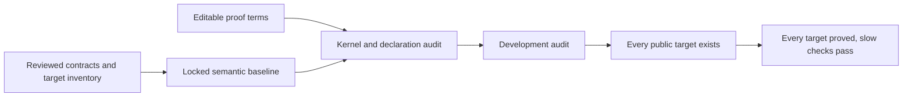

# Fixed questions, editable proofs

A proof may change. The question it answers may not change without independent review.
The kernel checks a term against its type. The verification gate checks that the type is a
registered target and that the definitions giving it meaning still match the approved baseline.



## What is fixed

| Content | Protection |
| --- | --- |
| Public function inventory and required target names | `tests/audit/public-api.json`, checked against the pinned `zlib.h`, translated entry names and function manual sections |
| Normative documentation, runtime, translation, specifications, patches, configuration and test/audit code | SHA-256 source policy in `tests/audit/policy.lock`; proof registrations and their type lock are checked separately |
| Every compiled non-theorem declaration in the root import closure | SHA-256 kernel-syntax fingerprints in `tests/audit/trusted.lock`, including private helpers, constructors, recursor rules and definitions in proof namespaces |
| Registered theorem types | Full kernel-type fingerprints and readable types in `tests/audit/statements.lock`; approved registrations cannot be removed or have their types changed |
| Target coverage | Every standalone `Goal` proposition in the audited closure must be registered. Public readiness additionally requires the targets named by the public inventory. |

The auditor exports kernel syntax without evaluating the audited functions. Source metadata is
ignored; constructor data, recursor rules, universe parameters, types and definition bodies are
included. The small `Expr.hash` values printed by the auditor are diagnostics, not the accepted
semantic fingerprints. The gate computes SHA-256 from the complete exported syntax.

`Proofs` is not a permission boundary. A definition there can determine a precondition or a
postcondition. It is locked like every other definition. Proof terms and auxiliary theorems may
change. A new or changed semantic helper needs a reviewed lock update.

New proof modules can be imported through `ZlibF/Proof/Index.lean`. Its source is editable,
but all imported definitions remain semantically locked. A theorem-only extension can keep
the approved semantic and source-policy locks; a new semantic helper cannot use this route
to avoid review. The root imports the index and remains source-locked.

Readiness and final checks reject locked inputs absent from the version-control index,
including ignored generated files. Commit the generated test-project manifest with its lock.
Regeneration can inspect draft files, but their presence in one working tree is insufficient.

Every exactly proved public entry also needs a record in `tests/audit/public-mutants.json`.
It names reviewed translation mutations in that function's own body, keeping its signature.
Lean command syntax delimits the body, including private declarations and binder defaults.
Both files are parsed using only the pinned standard parser, without loading candidate imports.
Their signatures, suffixes and other commands must stay identical; injected declarations reject.
Missing records, another function's mutations, specification-only changes and marked proof gaps are rejected.
The strict runner checks the designated proof modules. A separate fresh-kernel replay substitutes
only the changed source declarations into the original registered exact proof's dependency closure.
That original proof must check before the mutation and fail afterwards. Failure of an unrelated
or stronger theorem alone cannot satisfy this check.

Proof sensitivity does not establish semantic non-equivalence: even equivalent rewrites can
invalidate a particular proof term. Independent review must establish a behavioral difference
on an allowed input. The five current public mutants change clearing of error/EOF/past-EOF
state or the code-table count; their source effects have been independently reviewed.
The automated gate does not replace this semantic review.
`verification.py mutants` runs the model list and every referenced public-function list.
CI invokes it; a mapping to an untested list cannot substitute for an executed mutation check.

A completed proof may be added to the theorem registry. Regeneration adds its checked type to
the statement lock. Final acceptance requires every approved registration and its original type
to remain present. The semantic and source-policy locks must stay identical to the baseline.
This permits proof progress without reopening the public goals or their definitions.

The root must import every source module. An import whose source has disappeared is rejected,
even if a stale compiled object would make a local build succeed.

## What counts as a proof

A registered theorem must have exactly the target constant as its type. A theorem with an
additional premise does not count. A similarly named theorem does not count. A theorem about
an abstract model does not discharge a concrete implementation target.

Only the three standard axioms `propext`, `Classical.choice` and `Quot.sound` are allowed.
The gate first replays the compiled declarations in a fresh environment of the same Lean
kernel. It does not accept a cached build trace as a proof certificate. The declaration auditor
then checks the compiled import closure for unsupported assumptions and
forbidden declaration kinds. Missing, empty and duplicate registries fail.
Compiler-generated execution auxiliaries are enumerated in `tests/audit/compiler-helpers.txt`.
Their bodies are locked. A private name alone grants no exemption. A new auxiliary requires
independent review; ordinary private unsupported definitions are rejected.

`check` permits open proofs for development. `specs` additionally requires every public target
to exist as a closed proposition. `final` additionally rejects every open goal, requires an
approved baseline and a clean named commit, and runs the no-placeholder, audit self-test,
differential and mutation checks. Commands and scope are in [spec/public-goals.md](spec/public-goals.md).
The final proof-mutant runs require their positive baseline and reject every recorded proof gap.

Initialisation must establish the shared representation invariant. A predicate that no permitted
heap satisfies cannot establish the public domain. Top-level witnesses supplement this obligation;
they do not replace universal parameter coverage. No unproved library callee contract may remain
as a hypothesis of a final result.

## The authority boundary

Locks checked against files from the same candidate prevent accidental drift. They do not prove
that a candidate was authorised to replace its own locks. Final acceptance compares the candidate
with an independently approved immutable commit, including the audit code and goal registry.

The final workflow takes its auditor and baseline from `main`. If that auditor does not exist,
it fails. Development CI has an explicit bootstrap path for the first baseline; that path is not
final acceptance. A protected source change needs independent review before it becomes a new baseline.

The repository owner must require pull requests, code-owner review of protected paths and passing
required checks on `main`. Stale approvals must be dismissed after new changes. Direct pushes and
bypasses must be restricted. The credentials used for proof work must not administer these rules.
`CODEOWNERS` alone does not enforce any of this. These are hosting settings, outside the Lean proof.

## Updating an approved definition

Keep a semantic change separate from proof-only work. Explain the changed domain or behaviour,
its correspondence to the C and public contract, and the lock diff. Run:

```sh
python3 scripts/verification.py regenerate
python3 scripts/verification.py check
python3 tests/verification/test_audit.py
python3 -O tests/verification/test_audit.py
```

Regeneration computes locks from successful audit output. It does not approve them. Never edit
lock contents by hand. The source policy includes the audit program and the generated call table.

## Tests and limits

The auditor tests include a passing exact proof, an extra-premise proof that stays open, an
unregistered goal, missing or duplicate registries, an unsupported assumption, a changed private
helper and a changed definition in a proof namespace. Negative tests need a passing positive baseline.
They also check that completing a fixed goal adds a proof without changing the semantic lock,
and that removing an approved registration or changing its type is rejected.
The existing cheat self-test also requires a passing baseline before testing any mutation.

Human review still decides whether the contracts are complete and correct, whether the runtime
models the selected C semantics, and whether the translation matches the source. A lock preserves
an incorrect specification just as well as a correct one. Differential tests are finite evidence,
not proof. The remaining work is in [overview.md](overview.md).
