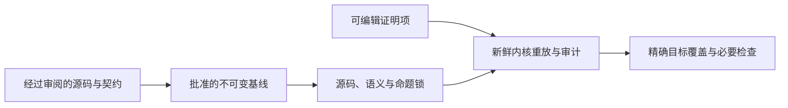

<!-- source-sha256: 198e09684991a199a7b7a2031cd6a38f65b2bf8e97a9606d8668db27f7864ba1 -->
# 固定问题，可编辑证明

证明可以改变。它回答的问题若要改变，必须先经过独立审阅。内核检查项是否符合其类型；验证关卡还检查该类型是否为精确登记目标，以及其含义是否匹配批准的基线。

开发构建成功不是最终验收。[进度](progress.md)记录当前状态，[检查指南](checking/goals.md)给出命令和验收范围，[可信基础](trusted-base.md)解释自动化无法作出的语义判断。



## 受固定关卡保护的输入

这里的“锁”是一份经过批准的指纹记录。它像给试题、参考定义和答题范围分别封存：证明项可以继续改进，但不能顺手把待证明问题换成更容易的问题。指纹只能发现内容发生变化，不能判断新内容在语义上是否正确。

| 输入 | 保护 |
| --- | --- |
| 公开入口与必要目标名称 | `tests/audit/public-api.json` 与固定头文件、翻译入口和手册章节对照检查。 |
| 规范性文档、运行时、翻译、规范、补丁、配置和测试/审计代码 | `tests/audit/policy.lock` 记录 SHA-256 源码指纹。证明登记及其类型独立检查。 |
| 根导入闭包内每个已编译非定理声明 | `tests/audit/trusted.lock` 记录完整导出内核语法的 SHA-256 指纹，包括私有辅助函数、构造器、递归消去规则和证明命名空间中的定义。 |
| 已登记定理类型 | `tests/audit/statements.lock` 记录完整内核类型指纹与可读类型。不能删除或改变已批准登记。 |
| 目标覆盖 | 审计闭包中每个独立 `Goal` 命题都必须登记。公开就绪还要求清单中的完整目标集合。 |

导出语法包括宇宙参数、类型、定义体、构造器数据和递归消去规则，忽略源码位置元数据。短诊断哈希不是语义锁。计算指纹时不会求值被审计函数。

名为 `Proofs` 的命名空间不享有豁免。任何定义都可能改变目标含义，所以每个语义辅助定义都锁定。证明项和辅助定理可改变。`ZlibF/Proof/Index.lean` 允许新增证明导入；根仍受源码锁定，导入定义仍受语义锁定。只加定理可保留基线锁。语义辅助定义需要经过审阅的重新生成。

根必须导入每个源码模块。即使存在陈旧编译对象，缺失源码仍会被拒绝。就绪和最终检查还拒绝版本控制索引中缺失的锁定输入，包括被忽略的生成文件。生成的测试项目清单及其锁必须提交。仅在一个工作树里存在的文件不能提供可复现基线。

## 证明的验收条件

已登记定理的类型必须恰为目标常量。额外前提、相似名称或抽象模型定理都不能满足具体实现目标。

只允许 `propext`、`Classical.choice` 和 `Quot.sound` 三个公理。编译声明在同一个 Lean 内核的新鲜环境中重放；缓存执行轨迹不是证书。声明审计检查导入闭包中的不受支持假设和禁止声明种类。缺失、空或重复的登记表都会失败。

编译器生成的执行辅助函数枚举在 `tests/audit/compiler-helpers.txt`，其定义体锁定。仅有私有名称不构成例外。新增辅助函数需要独立审阅；普通私有不受支持定义仍被拒绝。

初始化必须在允许定义域上建立共享不变量。顶层具体见证补充该义务，绝不替代全称覆盖。任何最终结果都不能假设未证明的库被调用者契约。没有允许堆能满足的不变量，不能支持公开结论。

关卡分为三级：

| 级别 | 含义 |
| --- | --- |
| `check` | 开发审计；允许未完成证明。 |
| `specs` | 还要求所有公开目标都是闭合命题。命题存在不等于已证明。 |
| `final` | 要求全部目标已证明、批准的基线和干净的具名提交。运行无占位符、审计自测、差分和变异检查。 |

快速关卡（`build`、`no-sorry`）在每次推送时运行；验收套件（`audit`、`difftest`）每晚并按需运行。报告某结论“已验收”时，要求套件在所指提交上全绿。只有实际运行后才能报告检查通过。差分测试是有限忠实性证据，不是证明。

## 证明变异

每个精确证明的公开入口都需要 `tests/audit/public-mutants.json` 中经过审阅的记录。每个变异改变该函数翻译主体，保留签名。变异解析使用固定的标准解析器，不导入候选。Lean 命令语法划定声明边界，包括私有名称和绑定器默认值。签名、后缀及其他所有命令必须相同；注入声明被拒绝。

缺失记录、修改其他函数、只改规范或标记的证明缺口都会失败。严格运行器检查指定证明模块，要求正向基线通过。另一次新鲜内核重放只将变异源码声明替换进原始精确登记证明的依赖闭包。原证明必须在变异前通过、变异后失败。仅在无关或更强定理中失败不算。

证明敏感性本身不能建立行为差异。等价改写也可能破坏某个具体证明项。独立审阅必须指出允许输入上的行为变化。五个清错和代码计数变异的历史审阅是那些变异的证据，不批准之后每个变异。

`verification.py mutants` 运行模型清单和每个引用的公开函数清单，CI 会调用它。映射到从未执行的清单不能满足要求。[变异指南](checking/proof-mutants.md)解释这些检查。

## 基线批准权

将候选文件与候选锁比较能检测漂移，不能建立候选获准替换锁的权限。最终验收与独立批准的不可变提交比较，包括其审计器和目标登记表。

最终工作流从 `main` 取得审计器和基线，缺少审计器则失败。开发 CI 有首次基线的引导路径。引导不是最终验收。受保护源码改动成为新基线前必须经过独立审阅。

仓库设置必须要求 `main` 的拉取请求、受保护路径的代码所有者审阅及必需检查通过。新增改动必须撤销陈旧批准。直接推送和绕过必须受限。证明工作凭据不能管理这些保护。仅有 `CODEOWNERS` 不会强制执行；托管设置在 Lean 证明之外。

## 修改受保护内容

语义改动与纯证明工作分开。解释定义域或行为变化、其与 C 和公开契约的关系，以及每项锁差异。通过审计重新生成锁，绝不手工编辑。重新生成计算证据，并不批准证据。

```sh
python3 scripts/verification.py regenerate
python3 scripts/verification.py check
python3 tests/verification/test_audit.py
python3 -O tests/verification/test_audit.py
```

源码策略包含审计器和生成调用表。仓库工作规则还保护 `tests/audit/`、`.github/`、`scripts/`、`patches/`、`lakefile.toml`、`lean-toolchain`、`docs/spec/`、`docs/README.md`、`docs/design/api-model.md`、`docs/spec/internal-contracts.md`、`docs/checking/goals.md`、`docs/checking/contract-review.md`、`ZlibF/Runtime/` 和 `AGENTS.md`。只有任务明确涉及这些内容时才修改，并在拉取请求披露。移动文档不会解除现有源码策略保护；审阅后的策略必须跟随规范性文档。

不能为使证明成功而修改命题、规范或翻译。若命题错误，报告原因并停止该证明。在独立审阅的改动中修正语义层。绝不登记未证明定理、删除批准登记，或在 Lean 源码引入 `sorry`、`axiom`、`native_decide`、`bv_decide`、`implemented_by`、`extern`、`unsafe`、`partial`、`opaque`。遇到审计障碍应报告，不能绕过。

## 测试与人工审阅

审计测试覆盖：通过的精确证明、仍未闭合的额外前提证明、未登记目标、缺失和重复登记表、不受支持假设，以及改变的私有或证明命名空间定义。测试还要求完成证明时保留语义锁，并拒绝删除或改变批准登记的类型。负向测试和作弊自测在尝试变异前都要求正向基线通过。

独立审阅仍须判断契约是否完整、运行时是否表示所选 C 语义、翻译是否匹配源码。锁保存错误规范和正确规范一样忠实。应审阅命题、前置条件、运行时、审计代码、偏离和补丁；证明体的内核检查不能替代该审阅。
