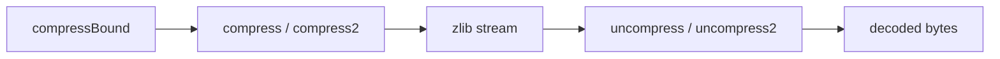

# Buffer utilities and library information

[API manual](README.md) · [Shared stream rules](streams.md) · [Checksums](checksums.md)

Use the buffer utilities when the complete input and output capacity are known at the call.
They manage a temporary stream internally. Use the stream pages when you need incremental
I/O, a different wrapper, a dictionary or explicit flush boundaries.

| Task | Entries |
| --- | --- |
| Compress a buffer | [Choose a level](#compress2_z), [default level](#compress_z), [size the destination](#compressbound_z) |
| Decompress a buffer | [Report input consumed](#uncompress2_z), [output only](#uncompress_z) |
| Inspect the library | [Version](#zlibversion), [compile flags](#zlibcompileflags), [error text](#zerror) |

The focused contracts follow `compress.c`, `uncompr.c`, `zutil.c` and `zlib.h` in the default
LP64 Linux build. `_z` forms use `z_size_t`; plain forms use `uLong`. Both are 64-bit here.
Source readings are **to confirm** by proof. They do not narrow the registered targets in
[Utilities.lean](../../ZlibF/Spec/Public/Utilities.lean) and
[Queries.lean](../../ZlibF/Spec/Public/Queries.lean).
[Calls.lean](../../ZlibF/Spec/Public/Calls.lean) fixes translated arguments and results.
See [contract conventions](contracts.md) for domain/effect labels and
[overview](../overview.md) for proof status and remaining work.

The buffer utilities create and release a local stream with the zlib wrapper and default settings.



### Common conventions

For buffer calls, the domain is restricted to valid memory:
non-NULL sources cover the stated readable input; non-NULL destinations cover the stated
writable capacity. Non-NULL length pointers name readable, writable scalar cells.
Input, output and length cells are separate, including the two length cells when both occur.
The caller keeps those objects live and does not modify them during the call.
Each entry states its allowed NULL cases. Other invalid pointers are outside this scope.
Decompression error handling needs no valid compressed-data assumption.

**Common effects.** Every in-scope call terminates without a fault. Buffer calls preserve input
and memory outside the output and length cells. They write at most the original capacity.
All internal allocations are released before return, including on allocation failure;
no local stream or owned allocation is returned. Pointer-valued queries return borrowed immutable storage.
These are contract requirements, not claims that the implementation proofs are complete.

## compress2_z

```c
int ZEXPORT compress2_z(Bytef *dest, z_size_t *destLen, const Bytef *source,
                        z_size_t sourceLen, int level);
```

Compresses the input into one complete zlib stream at the requested level.

**Domain.** Restricted domain.

**Pre.** Restricted buffer domain above. `source` may be NULL for zero input or checked rejection.
`destLen` may be NULL for checked rejection. `dest` may be NULL for checked rejection,
including the zero-capacity case below. Levels -1 and 0–9 are valid; -1 selects level 6.

**Post.** `Z_OK` means the output is a complete zlib encoding of the input and `*destLen`
is its length. `Z_BUF_ERROR` means the capacity was filled with a prefix of that encoding.
`Z_MEM_ERROR` means allocation failed and no output was written.

**Effects.** Stateful; common effects apply. A NULL source with nonzero input, NULL `destLen`,
or NULL destination with nonzero capacity gives `Z_STREAM_ERROR` before any length write.
Otherwise `*destLen` is cleared before initialisation. A bad level returns `Z_STREAM_ERROR`
with length zero before any allocation. Later returns store the number of bytes written.

**Edges.** NULL destination with zero capacity reaches initialisation: it returns `Z_MEM_ERROR`
if allocation fails, otherwise `Z_STREAM_ERROR`, with length zero. A non-NULL destination
with zero capacity gives `Z_BUF_ERROR` after successful initialisation. Empty input is valid.

## compress2

```c
int ZEXPORT compress2(Bytef *dest, uLongf *destLen, const Bytef *source,
                      uLong sourceLen, int level);
```

The `uLong` form of [compress2_z](#compress2_z).

**Domain.** Restricted domain.

**Pre.** Restricted domain of `compress2_z`, with a non-NULL `destLen` cell.
The wrapper reads that cell before calling the checked `_z` entry.

**Post.** Same encoding and return-code contract as `compress2_z`.

**Effects.** Stateful; same buffer and cleanup effects. The wrapper copies the length back
on every return, including errors. Early argument rejection preserves its original value;
invalid level or allocation failure leaves it zero.

## compress_z

```c
int ZEXPORT compress_z(Bytef *dest, z_size_t *destLen, const Bytef *source, z_size_t sourceLen);
```

Compresses at the default level (-1, selecting level 6).

**Domain.** Restricted domain.

**Pre.** Restricted domain of [compress2_z](#compress2_z), without a level argument.

**Post.** Same as `compress2_z` at the default level.

**Effects.** Stateful; same length writes, checked NULL cases and complete cleanup.

## compress

```c
int ZEXPORT compress(Bytef *dest, uLongf *destLen, const Bytef *source, uLong sourceLen);
```

The `uLong` compressor at the default level.

**Domain.** Restricted domain.

**Pre.** Restricted domain of [compress2](#compress2); `destLen` must be non-NULL.

**Post.** Same as `compress2` at level -1.

**Effects.** Stateful; same length writes and complete cleanup as `compress2`.

## compressBound_z

```c
z_size_t ZEXPORT compressBound_z(z_size_t sourceLen);
```

Calculates the numeric bound used to size a default zlib compression buffer.

**Domain.** Full type domain.

**Pre.** Full type domain: every 64-bit `sourceLen`, including zero and the maximum.

**Post.** Returns `min(2^64 - 1, n + (n >> 12) + (n >> 14) + (n >> 25) + 13)`
for `n = sourceLen`, with the sum interpreted mathematically. Zero gives 13;
an overflowing sum gives the maximum value.

**Effects.** Pure. No pointer access, allocation, state change or error return.

**Scope.** This contract specifies the number. Output adequacy is a separate property
for valid compression calls with the default wrapper, window and memory settings.
It gives no bound for arbitrary raw or gzip stream settings.

## compressBound

```c
uLong ZEXPORT compressBound(uLong sourceLen);
```

The `uLong` form of the numeric bound.

**Domain.** Full type domain.

**Pre.** Full type domain: every 64-bit `sourceLen`.

**Post.** Same formula and saturation as [compressBound_z](#compressbound_z) on this build.

**Effects.** Pure. No memory access or error return. The same output-adequacy scope applies.

## uncompress2_z

```c
int ZEXPORT uncompress2_z(Bytef *dest, z_size_t *destLen, const Bytef *source, z_size_t *sourceLen);
```

Decodes the first zlib stream and reports both output size and input consumption.

**Domain.** Restricted domain.

**Pre.** Restricted buffer domain above. `*sourceLen` is the available input and `*destLen`
the output capacity. Either length pointer may be NULL for checked rejection.
A NULL data pointer is allowed only with a zero corresponding length, or for checked rejection.
Malformed, truncated, raw, gzip and dictionary-dependent input are included as error cases.

**Post.** `Z_OK` means a complete checked zlib stream decoded to the output.
Trailing input is unused. `Z_BUF_ERROR` means output filled the capacity and input remains.
`Z_DATA_ERROR` covers malformed or incomplete input and a required preset dictionary.
`Z_MEM_ERROR` means allocation failed and can follow partial output.

**Effects.** Stateful; common effects apply. The argument checks precede initialisation:
NULL `sourceLen`, nonempty NULL source, NULL `destLen`, or positive-capacity NULL destination
returns `Z_STREAM_ERROR` with both existing length cells unchanged.
Initialisation failure also preserves both lengths and writes no output.
After initialisation, every return stores bytes consumed in `*sourceLen` and bytes produced
in `*destLen`, including later memory failure. Output already written remains available.

**Edges.** NULL destination with zero capacity is accepted using a private output pointer;
a complete empty stream can succeed. Empty input is a data error after successful initialisation.
The exact final mapping is `Z_STREAM_END` to `Z_OK`, `Z_NEED_DICT` to `Z_DATA_ERROR`,
and `Z_BUF_ERROR` to `Z_DATA_ERROR` when no input remains. Other decoder codes are retained.

## uncompress2

```c
int ZEXPORT uncompress2(Bytef *dest, uLongf *destLen, const Bytef *source, uLong *sourceLen);
```

The `uLong` decoder with an input-consumption count.

**Domain.** Restricted domain.

**Pre.** Restricted domain of [uncompress2_z](#uncompress2_z), with both length cells non-NULL
because the wrapper reads them before the `_z` checks.

**Post.** Same decoding, return codes and consumed count as `uncompress2_z`.

**Effects.** Stateful; same output and cleanup effects. Both lengths are copied back on every
return, including errors. Argument rejection and initialisation failure preserve their values.

## uncompress_z

```c
int ZEXPORT uncompress_z(Bytef *dest, z_size_t *destLen, const Bytef *source, z_size_t sourceLen);
```

Decodes without exposing the consumed-input count.

**Domain.** Restricted domain.

**Pre.** Restricted domain of [uncompress2_z](#uncompress2_z); `sourceLen` is passed by value.
`destLen` may be NULL for checked rejection.

**Post.** Same output and return codes as `uncompress2_z`. Trailing bytes are ignored;
the caller receives no count with which to locate them.

**Effects.** Stateful; same output-length writes and complete cleanup. The consumed count is local.

## uncompress

```c
int ZEXPORT uncompress(Bytef *dest, uLongf *destLen, const Bytef *source, uLong sourceLen);
```

The `uLong` decoder without a consumed-input count.

**Domain.** Restricted domain.

**Pre.** Restricted buffer domain of [uncompress2](#uncompress2), with non-NULL `destLen`.

**Post.** Same output and return codes as `uncompress2`; trailing input is ignored.

**Effects.** Stateful; same output-length writes, retained partial output and complete cleanup.

## zlibVersion

```c
const char * ZEXPORT zlibVersion(void);
```

Returns the linked library's release string.

**Domain.** Full type domain.

**Pre.** Full type domain; no arguments or caller state are required.

**Post.** Returns a non-NULL pointer to NUL-terminated `ZLIB_VERSION` (`1.3.2.1-motley`).

**Effects.** Read-only. The result is borrowed immutable static storage;
the caller must neither write it nor free it. No allocation or heap change occurs.

## zlibCompileFlags

```c
uLong ZEXPORT zlibCompileFlags(void);
```

Reports the build's type sizes and compile-time options.

**Domain.** Full type domain.

**Pre.** Full type domain; no arguments or caller state are required.

**Post.** Returns 169 (`0xa9`) for this build: `uInt` is 4 bytes; `uLong`, pointers
and `z_off_t` are 8 bytes. Their two-bit fields encode sizes 2, 4, 8 and other
as 0, 1, 2 and 3. Other flags are zero in the selected build.

**Effects.** Pure scalar query. No allocation, memory write or error return.

## zError

```c
const char * ZEXPORT zError(int err);
```

Returns the text associated with a zlib result code.

**Domain.** Full type domain.

**Pre.** Full type domain: every `int`, including its minimum and maximum values.

**Post.** Returns a non-NULL pointer to the following NUL-terminated text.

| `err` | Text |
| --- | --- |
| 2 | `need dictionary` |
| 1 | `stream end` |
| -1 | `file error` |
| -2 | `stream error` |
| -3 | `data error` |
| -4 | `insufficient memory` |
| -5 | `buffer error` |
| -6 | `incompatible version` |
| 0 or any other value | empty string |

**Effects.** Read-only. The result is borrowed immutable static storage; do not write or free it.
No allocation, heap change or error return occurs. Values outside -6–2 are checked before
index arithmetic, so both scalar extremes safely return empty text.

[Back to the API manual](README.md) · [Contract conventions](contracts.md)
