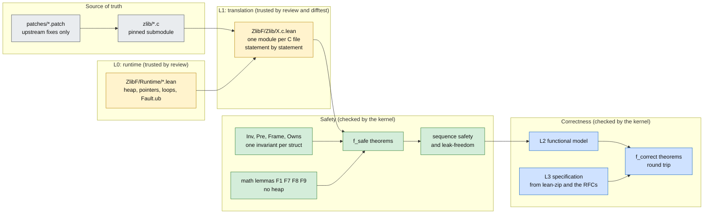
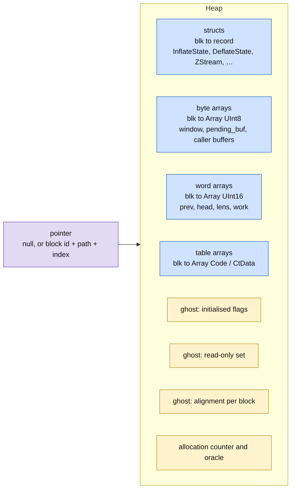
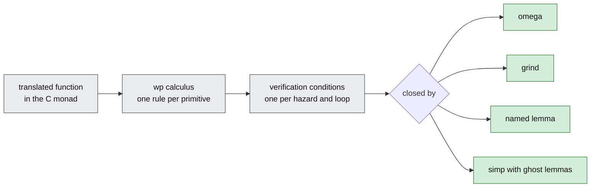
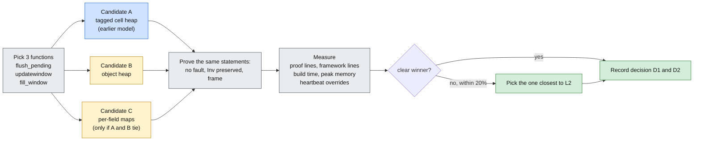
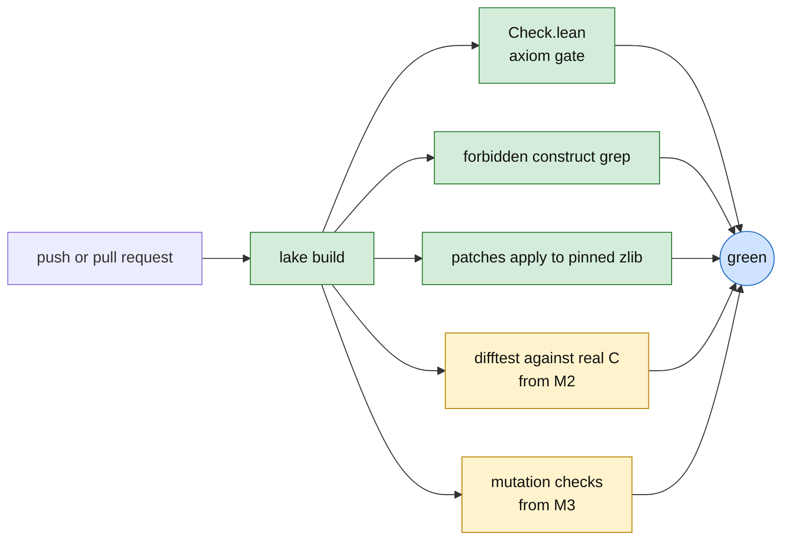
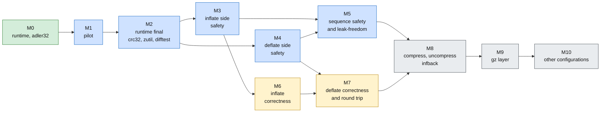

# Architecture

The layers, the runtime, the pilot that chooses the heap model, and the checks. Safety goals:
[safety.md](safety.md). Proof method and order: [method.md](method.md).

## 1. Layers



Yellow is trusted: the kernel does not check that the translation matches the C or that the
runtime matches the C standard. Those two are covered by review and by differential tests.
Green is the safety proof, blue is the correctness proof. Both are checked by the kernel, and both
are built on the same state records.

## 2. Repository layout

```
zlib/                      upstream submodule, never modified
patches/                   upstream fixes, applied in name order
ZlibF/
  Runtime/                 the runtime
    Core.lean              heap, pointers, loops, faults
    Reasoning.lean         rules for reasoning about runtime programs
  Zlib/                    mirrors zlib/: same names, with .lean appended
    zlib.h.lean            constants, return codes, z_stream layout
    zutil.h.lean  zutil.c.lean
    adler32.c.lean         translation + invariant + proofs of adler32.c
    crc32.c.lean
    inftrees.h.lean  inftrees.c.lean
    inffast.c.lean
    inflate.h.lean  inflate.c.lean   (split into inflate.c/*.lean when large)
    deflate.h.lean  deflate.c.lean
    trees.h.lean  trees.c.lean
  Math/                    heap-free lemmas: Kraft, Huffman, cost model
Check.lean                 axiom gate over the listed theorems
Tests/                     differential tests against the real C
docs/
  spec/                    the specification in natural language
  proof/                   the proofs in natural language
```

A module name follows the C file: `zlib/X.c` maps to `ZlibF/Zlib/X.c.lean`. Math lemmas live in
`Math/` and import nothing from the runtime, so people can work on them in parallel.

## 3. The heap model (decision D1)

The recommendation is the **object heap**. Its parts:



### Why this shape

| Property | Effect on proofs |
| --- | --- |
| A struct is a Lean `structure`. Reading a field is a projection. Writing is `{ s with f := v }` | `simp` computes read-after-write; no `Array.set!` |
| Arrays of different element types sit in different tables | writing a byte array cannot change a struct; framing between kinds is free |
| Pointers carry a path (`state.codes[i]`) instead of an ABI offset | `lencode` pointing into `codes[]` or into a static table is a value, not an address trick |
| A struct is one value | `memcpy` of a whole struct is a value copy; an embedded struct can be copied too |
| The initialised flag is a separate table | values have no `Option` wrapper, so the `Inv` clauses stay readable |

### What it costs

| Cost | Answer |
| --- | --- |
| Not ABI-faithful: a struct cannot be read as bytes | accepted (decision D6); the only default-build case is `(Bytef *)&stream.reserved`, never dereferenced |
| `sizeof(struct)` is needed for `ZALLOC` | recorded as a constant per struct, checked against the real compiler by a difftest |
| Pointer comparison across objects | model keeps `==` defined, relational operators across objects are a fault; `ub.patch` removes the one use |
| Alignment | each block carries a ghost alignment (section 4) |

The alternative models (tagged cells as before; per-field maps) are tested against it in the
pilot (section 6), because "simpler" is a claim to measure.

## 4. Memory operations: the semantics the runtime must give

The runtime is where a mistake costs the most, so each operation is a row to review.

| Operation | Result | Fault when |
| --- | --- | --- |
| `p + n` | pointer in the same object | result outside `0 .. size` (one past the end is allowed); `NULL + n` for `n ≠ 0` |
| `NULL + 0`, `NULL - NULL` | `NULL`, `0` | never (decision: allowed; C17 says undefined, C2y defines it) |
| `*p` read | value; for an uninitialised **integer** an arbitrary value (every theorem holds for all values); for an uninitialised **pointer**, a fault | null; freed; out of bounds; wrong type |
| `*p = v` write | updated heap, flag set | null; freed; out of bounds; read-only; wrong type |
| `memcpy(d, s, n)` | bytes copied, **flags copied** | null with `n > 0`; either range out of bounds; ranges overlap; destination read-only |
| `memset`, `zmemzero` | bytes set, flags set | like write |
| `malloc`/`zcalloc` | fresh block, flags clear (or set for `calloc`) | `items * size` wraps (the C wraps; the model reports it) |
| `free(p)` | block marked freed | not a block start; already freed |
| `p == q` | defined for all pointers | never |
| `p < q` | defined only inside one object | different objects |
| `(z_size_t)p & 7` | `(alignment(blk) + offset) % 8` | never |
| loop | runs body until the condition fails | fuel bound reached (`2^64` iterations) |

Two rows are subtle and wrong in the earlier attempt:

- **`memcpy` copies flags.** The C allows copying indeterminate bytes. The earlier model refused
  a copy of an uninitialised cell, which would block `deflateCopy` (`prev`). Reading garbage is not
  a fault either (D5): `slide_hash` reads all of `prev`.
- **Alignment is per block, not assumed.** The earlier model assumed every block starts at an
  8-byte boundary, which cannot hold for a caller's buffer. The `crc32_z` theorem must be stated
  for all alignments.

### Review checklist for the runtime

1. Every row above matches the C standard (C17, with the two documented relaxations).
2. Every `Fault.ub` the runtime raises corresponds to a real undefined behaviour, and every
   undefined behaviour zlib can reach corresponds to a fault.
3. The loop rule is sound: fuel exhaustion is a fault, never a silent exit.
4. A small set of programs is run both in the model and, compiled, in the real C under
   ASan and UBSan; results and faults agree.

## 5. Verification-condition generation (decision D2)



Each runtime primitive (`load`, `store`, `memcpy`, `alloc`, `free`, `ptr+`, loops) gets one
weakest-precondition rule, proved once. A function's verification conditions are then
generated, not written.

Lean ships a generator for monadic `do` code (`mvcgen`). Current releases are moving it to a new
tactic (`vcgen`) and the migration has open issues. We pin the toolchain and decide in the pilot
between that tool and a small own `wp` tactic for our monad. The runtime rules are the same for
both, so the choice is reversible.

## 6. The pilot (milestone M1)



The three functions cover three shapes of memory access:

| Function | Shape |
| --- | --- |
| `flush_pending` with `putShortMSB` | struct fields plus a caller buffer plus `memcpy` |
| `updatewindow` | lazy allocation plus ring-buffer arithmetic plus copy from the caller's output |
| `fill_window` | a loop with a sliding copy, hash rewriting, and the in-bounds bound for later matches (F6) |

Pass criteria, written before the run so the result cannot be bent afterwards:

1. All three theorems (no fault, `Inv` preserved, frame) proved with no `sorry` and no
   heartbeat override.
2. The best candidate uses at most 5 proof lines per translated line, or is at least 2 times
   shorter than the worst candidate.
3. The statements read like the English description of the function.

## 7. Gates



| Gate | What it catches |
| --- | --- |
| `lake build` | a proof that does not check |
| `Check.lean` | a theorem that uses `sorry`, `native_decide` or another axiom |
| forbidden grep | the same constructs written in the source |
| patch check | a patch that no longer applies to the pinned source |
| difftest | a translation that differs from the real C on sampled inputs (evidence, not proof) |
| mutation | a theorem that still checks after the translation is broken, so it constrains nothing |

Green means "checked by the kernel, within the trusted base of [trusted-base](trusted-base.md)
(created with the first code change)". It never means "the C is correct": only that the stated
theorems hold of the translation.

## 8. Milestones



Green is prepared, blue is safety, yellow is correctness of `inflate` and `deflate`, grey is the rest of the library and the other configurations.
