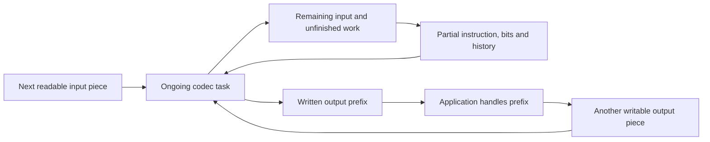
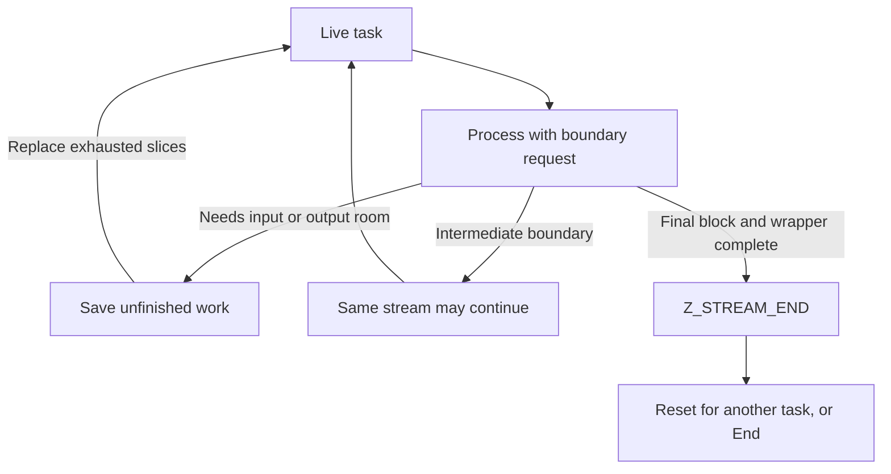

A complete DEFLATE packet answers a compact question: which literals and backward copies recover these bytes, and which bits describe those instructions? An application needs more. Its file may be larger than memory. Its network peer may pause halfway through a code. It may need to publish a prefix now, begin with an agreed vocabulary, detect damage, or branch from a saved decoding position.

These requirements determine how the compression algorithm’s work is divided, remembered, framed and delivered. We will derive those capabilities from application needs, then follow the objects and C operations that implement them. The running payload is the eight bytes `ABABABAB`. Its small size lets us inspect boundaries that also govern much larger streams.

## Why complete buffers are not enough {#needs}

Imagine compressing a log that grows for hours. A function requiring the complete log cannot transmit its beginning promptly. A function requiring one destination for the whole answer cannot operate with a small fixed memory budget. On reception, the compressed byte count does not determine how much storage restored data will need.

Instead, give one ongoing task a readable input piece and a writable output piece. Let it do the work possible now, return both pieces’ remaining ranges, and remember unfinished work. The application stores or transmits the produced prefix, refills input or replaces output, and calls again. A **stream** is this continuing compression or decompression task. Its complete sequence can cross many buffers; it need not correspond to a file or a socket.

Input can end before the decoder knows a whole instruction. Output can fill while a known instruction still has bytes to produce. Compression adds delays: accepted input may await a better match, a block decision or delivery of encoded bytes. Input acceptance, instruction completion and output delivery therefore need separate positions.



A complete memory record remains a useful special case. Later we will see how buffer utilities drive this same protocol internally. The continuing task explains why a single-call convenience function can contain a loop.

## What must survive between calls {#stream}

Raw DEFLATE bytes `73 74 82 40 00` describe our payload. **Raw** means the DEFLATE body alone, without an enclosing zlib or gzip format. Supply a five-byte destination. The decoder delivers `ABABA`, then pauses with three bytes of the same distance-two match left. The next destination must receive `BAB`, without reading another length or restarting the match.

The task needs a saved phase, such as reading a block description, decoding a symbol or copying a match. It needs bits taken from input but not yet used. It also needs recent restored bytes, since a backward reference can name them after the application recycles an earlier destination. This bounded recent-byte store is the **history window**. DEFLATE permits up to 32768 bytes of history. Capacity and the amount of valid history are distinct.

Now introduce the C representation. The public task record is `z_stream`. Its `state` pointer leads to private codec storage. In the decoder, `mode` records the phase; `hold` and `bits` store the low-bit-first accumulator and valid bit count. For an unfinished match, `length` counts bytes still to write and `offset` is its distance. Private window fields preserve older sources. Compression has its own lookahead, search indexes, symbols, held bits and pending encoded bytes.

Initialization selects capacities/configuration and obtains private storage, separately from supplying payload. [`deflateInit2`](/reference/functions/deflateInit2_.html) and [`inflateInit2`](/reference/functions/inflateInit2_.html) are the configurable entry points. Allocator functions obtain and release private memory. A zero-initialized public record selects the ordinary default pair supplied by the library. The compressor obtains its window, indexes and pending/symbol storage up front. The decoder initially obtains state and can defer window allocation until output must survive a return. Initialization consumes no payload.

Applications can supply compatible allocation/free functions and their own context pointer, called `opaque` in the record. These must remain usable throughout the lifetime. Input/output buffers are separately owned by the application. Switching one does not replace the allocator or private codec. End later releases private storage.

### One finite call, then a continuing driver {#call-loop}

The decoder’s actual C loop dispatches on its saved phase. Missing input or output room exits through a shared return path, which saves local cursors and held bits. The next call dispatches from that state; it does not read the header again.

An ordinary successful return that has not completed the stream is called `Z_OK`. The normal return path also tests progress. Here `in` and `out` are actual consumed/produced counts, `ret` is the selected result, and `flush` is a boundary request explained below. The [actual `inflate.c` test](https://github.com/madler/zlib/blob/757f0527154291bcf6bfbd6396ecde6bedd2db95/inflate.c#L1159-L1161) is:

```c
    if (((in == 0 && out == 0) || flush == Z_FINISH) && ret == Z_OK)
        ret = Z_BUF_ERROR;
    return ret;
```

For an ordinary request, no consumed input and no produced output becomes `Z_BUF_ERROR`: change conditions rather than repeat exhausted buffers forever. A finish request also gets this result if it cannot finish in one call, even if bytes moved. A buffer error does not by itself mean damaged data.

With finite current pieces, inner loops consume bits/bytes, fill a bounded destination or advance parsing phases before returning. The application loop has another obligation: eventually supply a complete stream, report exhausted source as truncation, or stop after error. A peer sending nonfinal blocks forever need not produce completion. Unchanged no-progress calls cannot manufacture input or room.

## Two cursors, two kinds of progress {#buffers}

Each input piece needs an address and available count; each output piece needs an address and writable capacity. In `z_stream`, `next_in`/`avail_in` name the first pair and `next_out`/`avail_out` the second. Save availability before the call and subtract afterward:

```text
input_taken    = old_avail_in  - new_avail_in
output_written = old_avail_out - new_avail_out
```

Only the consumed input prefix can be reused; preserve the unread suffix. Only the written output prefix is ready. After handling it, bind another destination without resetting. Cumulative `total_in` and `total_out` summarize normal processing, while slice differences locate each call’s effects directly.

A consumed compressed byte can leave unused bits in `hold`. Conversely, a saved match can produce output without new input. Step through the five-byte-output example: `ABABA` and then `BAB` continue one match.

<div class="zl-demo-mount"><zlib-demo kind="stream"><p>The first five-byte destination receives ABABA. A distance-two match has three bytes left. Replacing the destination produces BAB without starting another instruction. Input-byte consumption, held bits and output production need not advance together.</p></zlib-demo></div>

Compression adds a delivery queue. Encoded bytes can already exist privately while the caller lacks room. Private `pending_out` selects the next undelivered byte and `pending` counts waiting bytes. Before this excerpt, `len` is limited by waiting bytes and output room. `strm` points to the public record and `s` to private compressor state. The [actual pending-output copy](https://github.com/madler/zlib/blob/757f0527154291bcf6bfbd6396ecde6bedd2db95/deflate.c#L969-L986) advances both views:

```c
zmemcpy(strm->next_out, s->pending_out, len);
strm->next_out  += len;
s->pending_out  += len;
strm->total_out += len;
strm->avail_out -= len;
s->pending      -= len;
```

Accepted input can still be lookahead, and committed symbols can await block emission. Thus `avail_in == 0` does not mean all corresponding encoded bytes reached the caller. Calls without new input can drain pending bytes and finish output.

## Request a boundary without confusing it with an end {#flush}

A connection may need everything accepted so far delivered while more source arrives later. A block editor may need to stop after a block description. A writer eventually declares no more original bytes. The processing call’s `flush` argument describes these distinct boundaries. It does not release storage.

Compression normally uses `Z_NO_FLUSH`, permitting buffering for matching and block decisions. `Z_SYNC_FLUSH` makes the current prefix promptly decodable: it completes the current block and emits an empty stored-block boundary aligned to a byte. After alignment the marker includes `00 00 ff ff`. It does not end the stream. Later blocks can still refer to earlier history.

`Z_FULL_FLUSH` makes a similar boundary and discards preceding compressor match history. Future references cannot depend on bytes before it. This supports controlled restart/recovery points at a compression-ratio cost. Its marker is not a new wrapper header; restarting there does not validate skipped data.

`Z_BLOCK` ends a block without forcing byte alignment: up to seven bits can remain held. `Z_PARTIAL_FLUSH` emits an empty fixed-code block without sync flush’s alignment guarantee. These finer distinctions matter to an enclosing bit-oriented format. Neither declares final input.

To finish, request `Z_FINISH` after supplying the last source slice. Preserve its unread suffix, add output room and keep `Z_FINISH` until `Z_STREAM_END`. This means the final block and applicable trailer have been delivered. `deflateEnd` subsequently frees storage; it does not finish pending data. A full destination with `Z_OK` asks for continuation, not reset or End.

For a nonfinal flush, continue the same request with more room until it completes, normally leaving output room. A later new flush can request another boundary. The API recommends more than six output bytes when beginning sync/full flush to avoid repeated marker creation around an exactly filled destination.

The decoder observes boundaries already in input. Its `Z_SYNC_FLUSH` inserts no marker and clears no history. `Z_BLOCK` returns at a wrapper-header or block boundary; `Z_TREES` also stops after a block description, before payload. A reporting field, `data_type`, combines unused-bit count with flags for final block, header/block boundary and completed description. These locate a point in bits. Only `Z_STREAM_END` reports completed body and applicable trailer checks.



Changing compression policy can require a boundary too. [`deflateParams`](/reference/functions/deflateParams.html) changes the level’s matching effort or strategy’s symbol policy. When necessary it first calls `deflate` with `Z_BLOCK` under old settings. Insufficient output returns `Z_BUF_ERROR` with old policy selected even though bytes may have moved. Retry with room; it is not a rollback. Lower-level `deflateTune` stores search-budget arguments without checking sensible budgets. Ordinary level selection suits applications that do not intentionally manage those details.

## Begin with shared context: dictionaries and bits {#dictionary}

Many independent messages share a vocabulary, such as repeated field names. A fresh compressor lacks earlier message bytes for backward references. Supply agreed bytes as **preset history**, called a dictionary. Those bytes are match sources before the first payload byte. They are not payload to deliver again.

Suppose both sides agree on a dictionary ending in `AB`. A message starting `ABABABAB` can reference it without first spelling `AB` as literals. Both sides must agree on the usable suffix and order. A different dictionary can produce wrong output from syntactically valid instructions. The enclosing format must arrange identity as well as storage.

For zlib compression, [`deflateSetDictionary`](/reference/functions/deflateSetDictionary.html) precedes compression. The wrapper sets its dictionary flag and carries an Adler-32 identifier of the full supplied dictionary; bounded match history retains a suitable trailing portion. When decoding reaches this requirement, `inflate` returns `Z_NEED_DICT`, exposing the expected identifier in its `adler` field. [`inflateSetDictionary`](/reference/functions/inflateSetDictionary.html) checks supplied bytes before installing history. A wrong dictionary returns `Z_DATA_ERROR`; another may be tried. Gzip has no preset-dictionary field.

Raw DEFLATE has no dictionary identifier: its application must arrange matching context. Raw compressor installation is allowed only at suitable boundaries without lookahead or a partially accumulated original-byte block. In the C guard, `wrap` distinguishes raw/zlib/gzip; `status` is compression phase; `lookahead` counts accepted bytes awaiting representation; `strstart` and `block_start` locate current original-byte position and block start. The [actual guard](https://github.com/madler/zlib/blob/757f0527154291bcf6bfbd6396ecde6bedd2db95/deflate.c#L558-L573) is:

```c
if (wrap == 2 || (wrap == 1 && s->status != INIT_STATE) || s->lookahead ||
    (wrap == 0 && (long)s->strstart != s->block_start))
    return Z_STREAM_ERROR;
```

Compressor installation temporarily binds dictionary bytes as input, fills the window/search index, then restores caller input. It can increase `total_in` without adding dictionary bytes to message output. Decoder installation copies history without moving input/output cursors or totals, and allocation can fail. Raw decoder installation works at call boundaries without an identifier check. Query functions can copy out available dictionary history for application-managed context.

### An enclosing format may already own some bits {#prime}

A container may place DEFLATE after a bit prefix, or consume some bits before handing the remainder to zlib. Byte buffers cannot describe half-byte positions. **Priming** transfers boundary bits into the codec’s held-bit machinery.

For raw compression, [`deflatePrime`](/reference/functions/deflatePrime.html) inserts low 0–16 value bits into pending output at the documented start point. For raw decoding, [`inflatePrime`](/reference/functions/inflatePrime.html) appends 1–16 low bits above held bits when the total fits 32; zero does nothing and a negative count clears held bits. It belongs before relevant raw decoding begins. For example, if three valid held bits are `101` and two newly supplied low bits are `11`, appending them gives five held bits `11101`: the old low bits will be consumed first. These transfer bit context, not dictionary bytes. The application must still arrange a valid complete DEFLATE bit sequence.

Invalid decoder counts return `Z_STREAM_ERROR`; compressor count/space failures return `Z_BUF_ERROR`. Compressor priming can compact pending bytes before discovering insufficient space. Failure therefore need not leave private bytes untouched. Ordinary byte-aligned zlib/gzip messages need no priming.

## Reuse storage for another task {#reset}

A server should not reallocate identical capacities between messages. It needs to discard the old task’s meaning while retaining reusable storage. **Reset** does this. It neither completes an abandoned message nor erases output already returned.

After decoding `ABAB`, reset means “start a new independent stream,” not “produce the remaining `ABAB`.” Bind a fresh complete encoding. Ordinary decoder reset clears bits, restarts header parsing, clears cumulative counters and header registration, and invalidates old history. Usually it retains a compatible allocated window. In C, `wsize` is active ring size, `whave` counts valid bytes and `wnext` is next write position; `reqwrap` saves the requested wrapper. The [reset tail](https://github.com/madler/zlib/blob/757f0527154291bcf6bfbd6396ecde6bedd2db95/inflate.c#L125-L141) is:

```c
state->wrap = state->reqwrap;
state->wsize = 0;
state->whave = 0;
state->wnext = 0;
return inflateResetKeep(strm);
```

Retained allocation is not retained valid history. If effective window size changes, reset can release an incompatible window; `inflateReset2` selects a new wrapper/window request and resets together.

Compressor reset retains capacity while clearing pending data, history and ordinary search state; it restarts the level’s standard tuning. `ResetKeep` variants deliberately preserve more context, notably decoder history or compressor window/hash context. They serve protocols intentionally sharing context and should not replace ordinary independent-message reset. Caller slices still need rebinding. Reset does not rewind an external file.

## Branch from a checkpoint {#copy}

An application may want two continuations from one prefix. Restarting repeats earlier decoding. Simply assigning the public record points both copies at the same private state; advancing or ending either affects the other. A **checkpoint copy** must duplicate the continuation and its private storage.

At the four-byte destination checkpoint in `ABABABAB`, the caller has `ABAB` and a distance-two match has four bytes left. Continue preserves it. Reset discards it. Copy preserves it in two tasks, each able to produce the remaining `ABAB`.

<div class="zl-demo-mount"><zlib-demo kind="checkpoint"><p>At the checkpoint, ABAB has been delivered and four match bytes remain. Continue replaces output room. Reset needs a fresh complete stream. Copy duplicates private state/history; bind separate caller destinations before advancing branches. Ending one private copy leaves the other live.</p></zlib-demo></div>

[`inflateCopy`](/reference/functions/inflateCopy.html) allocates destination state/window, copies phase, bits and valid history, and repairs private pointers. Embedded decoding tables must point into destination state; immutable fixed tables remain shared. The selected source includes the registered correction for that distinction. Copying pointer values without relocating private targets would not create independence.

[`deflateCopy`](/reference/functions/deflateCopy.html) duplicates window, indexes and pending/symbol storage and repairs internal positions. Allocation failure cleans up the new attempt without destroying the source. Each successful copy needs its own End.

Public buffer pointers are copied too, so both initially name the same caller ranges. Header pointers and allocator context can remain shared caller objects. Bind distinct destinations before independent output and preserve shared unread input for both. A copied decoder is only half a file checkpoint: also save compressed-source position and unread input bytes. Copy does not rewind that source.

## Add a message envelope: wrapper contracts {#wrappers}

DEFLATE already has essential structure: final-block bit, block type and, for dynamic blocks, Huffman codebook descriptions. These are needed to interpret instructions. A zlib or gzip **wrapper** adds an envelope around that body. It identifies accepted format, supplies format-specific context or metadata, and adds integrity information. Wrapper headers are not a match-search or table-decoding speed optimization.

A writer chooses an envelope; a reader chooses which envelopes it admits. A format’s magic bytes are fixed identifying byte values. The common body does not make these encodings interchangeable:

| Encoding | Before the DEFLATE body | After the body |
| --- | --- | --- |
| Raw DEFLATE | No wrapper; application supplies context | No wrapper checksum/size |
| zlib | Method/window, header check, optional dictionary identifier | Adler-32, most significant byte first |
| gzip | Magic, method, flags, timestamp, optional metadata | CRC-32 and original length modulo `2^32`, least significant byte first |

Zlib’s first two bytes describe method/window; their combined 16-bit value must be divisible by 31. A dictionary identifier follows if flagged. Gzip begins with magic `1f 8b`, method `08` and flags for optional extra data, name, comment and header checksum. Reserved flag bits must be clear. A header check establishes header consistency separately from payload integrity. Gzip’s optional `FHCRC` field stores the low 16 bits of CRC-32 over preceding header bytes, excluding that field itself.

The initialization argument `windowBits` encodes wrapper choice and power-of-two history capacity. For 32768-byte capacity, compressor requests 15, −15 and 31 choose zlib, raw and gzip. Decoder requests 15, −15 and 31 admit the corresponding forms; 47 admits zlib or gzip after header inspection. This automatic choice does not include raw. A zero decoder request derives window size from a zlib header. Compare encoder/decoder by format and effective window, rather than integer equality alone.

A zlib compressor request of eight bits is promoted to nine; raw/gzip compression rejects that eight-bit case. The decoder has its own admission rules. Compressor memory level selects search/symbol capacities; level selects work policy. Neither is a decoder parameter: the encoded stream carries necessary coding descriptions.

### Optional metadata is borrowed storage {#headers}

An application may want a gzip file name or comment. These optional objects have a C record, `gz_header`, and referenced extra/name/comment byte ranges. [`deflateSetHeader`](/reference/functions/deflateSetHeader.html) registers them before emission. The compressor borrows the record and bytes. Finishing header output does not unregister those pointers, and a copied compressor can retain the association.

For reception, [`inflateGetHeader`](/reference/functions/inflateGetHeader.html) registers a writable record and bounded capture destinations before parsing. A short destination captures only its fitting prefix; a string terminator is stored only if it fits. A completion indicator says metadata parsing finished, or automatic detection chose zlib. It does not say the payload trailer passed. Reset clears registration; End does not free caller metadata.

At the final body block, a raw decoder can complete. A wrapped decoder still needs the trailer and comparison. Earlier restored bytes can already have reached the caller when a bad trailer is discovered. Ordinary `inflate` ends one encoding and leaves trailing input for its caller; a file interface can explicitly continue into another gzip member: one complete gzip header, DEFLATE body and trailer.

### The complete calling sequence {#program}

The application initializes a task with the chosen wrapper, binds input and output pieces, processes and handles every written prefix, then distinguishes pause from end/error. Compression uses its last-input declaration until final output is delivered. Cleanup follows every successfully initialized task, including failures.

The buffer utility’s following real C loop makes the sequence concrete. `stream` is its temporary task, `sourceLen` counts input not yet offered, `dest` is the initial output address, and `err` is the codec result. Wider lengths are offered in pieces fitting availability fields. Once all source has been offered, the loop requests finish. The [actual utility tail](https://github.com/madler/zlib/blob/757f0527154291bcf6bfbd6396ecde6bedd2db95/compress.c#L60-L65) is:

```c
        err = deflate(&stream, sourceLen ? Z_NO_FLUSH : Z_FINISH);
    } while (err == Z_OK);

    *destLen = (z_size_t)(stream.next_out - dest);
    deflateEnd(&stream);
    return err == Z_STREAM_END ? Z_OK : err;
```

The pointer difference records delivered bytes, End releases private storage, and stream completion becomes utility success. Decoding follows the complementary sequence with `inflate`, interpreting exhaustion of finite source before completion as incomplete data rather than looping unchanged.

### Run the actual C and inspect its saved calls {#playground}

The executable example below performs initialization, compression finish, decoding, cleanup and full byte comparison using the selected C compiled to WebAssembly. Enter original UTF-8 text or hexadecimal bytes. The program produces encoded bytes and restores them; after the run, Back/Next inspect **saved call records**, not single-step the C interpreter. Those records show availability and return values at the boundaries just explained.

<div class="zl-demo-mount"><zlib-demo kind="playground"><p>Enter up to 256 KiB of original bytes and run the actual C round trip. Then inspect saved calls: input accepted, output delivered and completion. Equality covers the complete restored data even when byte previews are shortened.</p></zlib-demo></div>

The [C calling program](/static/examples/codec-playground.c) and [artifact build record](/static/examples/codec-playground-provenance.json) identify source and settings. Try empty input, a short varied message and a long repetition. A wrapper can enlarge a small message. An empty input counter can precede final output; the return code marks completion. These are concrete runs, whereas the earlier stream/checkpoint scenes illustrate selected state transitions.

## What an integrity check checks {#checksums}

Damage can turn an encoding of `AB` into a syntactically valid encoding restoring `AC`. Parsing successfully cannot reveal what the sender intended. A wrapper therefore carries a numeric summary, a **checksum**. The sender calculates it over original uncompressed bytes; the receiver recalculates it over restored bytes and compares the trailer. Neither uses compressed codes or compressed-buffer bytes instead.

Zlib uses Adler-32; gzip uses CRC-32. Gzip’s optional header CRC separately covers header bytes. Normal wrapped decoding performs these comparisons; `inflateValidate` explicitly enables or disables wrapper check validation, changing what successful completion guarantees. The payload checksum continues across processing calls and restarts at each gzip member. Gzip’s size field checks restored length modulo `2^32`; it does not reveal a complete allocation size in advance.

A mismatch rejects the wrapped message. Agreement detects many accidental changes but is not a unique identity. A 32-bit result cannot distinguish all messages; Adler’s reduced component pairs offer at most `65521²` values. CRC’s familiar `2^-32` estimate needs suitably distributed differences; it is not a bound for every alteration or adversary. Neither algorithm authenticates a sender who can replace both payload and checksum.

An **incremental update** takes a prior checksum and the next readable original/restored range, returning the summary through that range. It keeps no earlier bytes. We will derive both calculations, then their local C optimizations.

## Adler-32: byte sums and their order {#adler}

A plain sum notices changed byte values but misses reordering. Add a second sum of all first-sum prefixes, so early bytes contribute more times. Call the sums `a` and `s`, start at `a=1,s=0`, and reduce modulo `M=65521`. Modulo means retaining the remainder after division. For each next byte `b`:

```text
a := (a + b) mod M
s := (s + a) mod M
checksum = a | (s << 16)
```

The second line uses the updated first sum. Packing places `a` in the low 16 bits and `s` in the high 16; shift and OR join disjoint halves. Equivalently the result is `a + 65536·s`. Numeric packing differs from trailer byte order.

ASCII A is 65 and B is 66. A makes `(66,66)`; B then makes `(132,198)`, since `s=66+132`. No reduction changes this short example:

| Processed bytes | `a` | `s` | Hexadecimal checksum |
| --- | --- | --- | --- |
| Empty | 1 | 0 | `00000001` |
| A | 66 | 66 | `00420042` |
| AB | 132 | 198 | `00c60084` |
| ABA | 197 | 395 | `018b00c5` |
| ABAB | 263 | 658 | `02920107` |
| ABABA | 328 | 986 | `03da0148` |
| ABABAB | 394 | 1380 | `0564018a` |
| ABABABA | 459 | 1839 | `072f01cb` |
| ABABABAB | 525 | 2364 | `093c020d` |

In the animation, observe both additions per byte: first to `a`, then the new `a` to `s`. The state starts at the normal initial seed; shorter example selections expose each dependency.

<div class="zl-demo-mount"><zlib-demo kind="adler"><p>Start a=1,s=0. A updates both to 66. B updates a to 132 and adds 132 to s, giving 198. ABABABAB finishes at a=525,s=2364 and checksum 093c020d. These examples illustrate normal incremental arithmetic.</p></zlib-demo></div>

Expanding for bytes `b₁…bₙ` gives, modulo 65521:

```text
a = 1 + b₁ + b₂ + … + bₙ
s = n + n·b₁ + (n−1)·b₂ + … + bₙ
```

The weights explain order sensitivity, while still allowing collisions. The zlib trailer for our payload is `09 3c 02 0d`. Split output as `ABABA` then `BAB`: pass the first result `03da0148` as the next seed to reach `093c020d`. Restarting at 1 computes only `BAB`.

### Delay reductions and unroll additions {#adler-batches}

A remainder after every addition is unnecessary. Add first and reduce later if machine sums cannot overflow. In [`adler32.c`](https://github.com/madler/zlib/blob/757f0527154291bcf6bfbd6396ecde6bedd2db95/adler32.c#L14-L18), `adler` is the first sum, `sum2` the second, `buf` the next address, `len` the remaining count, and `BASE` the modulus. The following are two separate excerpts: the byte macro and the [full-batch loop](https://github.com/madler/zlib/blob/757f0527154291bcf6bfbd6396ecde6bedd2db95/adler32.c#L97-L106).

```c
#define DO1(buf,i)  {adler += (buf)[i]; sum2 += adler;}

    while (len >= NMAX) {
        len -= NMAX;
        n = NMAX / 16;          /* NMAX is divisible by 16 */
        do {
            DO16(buf);          /* 16 sums unrolled */
            buf += 16;
        } while (--n);
        MOD(adler);
        MOD(sum2);
    }
```

`DO16` expands sixteen byte steps in original order. `n` counts groups. `NMAX=5552` gives 347 groups, advancing 16 bytes each. Then two `MOD` operations reduce sums; the default branch uses `% BASE`. Unrolling saves loop overhead; delayed reduction saves divisions while retaining every new first sum’s contribution.

Starting from reduced components at most `M−1` and bytes at most 255, after `m` unreduced steps:

```text
a ≤ (M−1) + 255m
s ≤ (m+1)(M−1) + 255m(m+1)/2
```

The second bound covers initial second sum, copies of initial first sum and triangular byte weights. At 5552 it is `4294690200`, below `2^32−1`; at 5553 it is `4296171735`, above. This explains the portable 32-bit limit. Default x86_64 Linux has 64-bit `unsigned long` sums and retains that limit. Unsigned wrap is not the intended modulo: `2^32 mod 65521=225`, so an intervening wrap could change the answer.

The suffix uses sixteen-step groups and individual steps before reduction. Short and one-byte branches avoid setup. An optional `NO_DIVIDE` branch folds high parts using `2^16 ≡ 15 (mod 65521)`; the default uses remainder operators.

### Seeds and query arguments {#adler-domain}

[`adler32_z`](/reference/functions/adler32_z.html) uses wide `z_size_t` length; `adler32` uses `uInt`. Do not truncate a large range. They read bytes without retaining pointers or allocating. Normal initial checksum is 1, commonly obtained by the NULL/zero-length query.

The one-byte fast path reads before the NULL check, so NULL with length one is not an initialization query. A fabricated seed with unreduced halves can also differ from a fully canonical recurrence: `fffffff0` followed by one zero byte returns `fffefff0`, due to single conditional subtractions. Normal incremental seeds have reduced components. A numeric argument need not summarize a real prefix.

## CRC-32: shifts and XOR become polynomial arithmetic {#crc}

Begin with a small bit machine. Its **register** `r` is a working 32-bit value. XOR operates independently on bits: equal bits give zero, different bits give one, with no carries. One step shifts right by one. If the removed low bit was one, XOR the shifted result with `edb88320`:

```text
T(r) = (r >> 1) XOR (0xedb88320 if (r & 1) else 0)
```

To consume byte `b`, XOR it into the register’s low eight bits, then apply `T` eight times. Least significant input bits enter first: the **reflected** convention. The public checksum complements this internal register, flipping every bit. Public initial value zero therefore means internal `ffffffff`. Updates complement on entry and return. Pass the returned public value directly to the next update.

For A, `b=41` hexadecimal. XOR with `ffffffff` gives `ffffffbe`. Eight steps yield:

| Steps completed | Internal register, hexadecimal |
| --- | --- |
| Before stepping | `ffffffbe` |
| 1 | `7fffffdf` |
| 2 | `d2477ccf` |
| 3 | `849b3d47` |
| 4 | `aff51d83` |
| 5 | `ba420de1` |
| 6 | `b09985d0` |
| 7 | `584cc2e8` |
| 8 | `2c266174` |

The first outgoing bit is zero: shift only. The next is one: `3fffffef XOR edb88320 = d2477ccf`. Complement the final register to obtain public CRC `d3d99e8b`. Continue with B to obtain `30694c07`; all eight payload bytes give `94b093a4`.

The animation exposes the outgoing-bit decision before shifting. Input byte, internal register and public result are distinct objects. Follow each while stepping; the public result alone is sufficient continuation state at a byte boundary.

<div class="zl-demo-mount"><zlib-demo kind="crc"><p>Start with public zero and internal ffffffff. XOR the next byte into the low eight bits. For each of eight steps, inspect the low bit, shift right and XOR edb88320 only if that bit was one. After A, complement 2c266174 to obtain d3d99e8b. ABABABAB gives public CRC 94b093a4.</p></zlib-demo></div>

### Why the constant is a polynomial {#crc-polynomial}

Read bits as coefficients of a polynomial in `x`, each coefficient zero or one. Coefficients add modulo two, so addition and subtraction are XOR. Multiplying by `x` moves coefficients one position; division by a degree-32 polynomial leaves a remainder fitting 32 bits. CRC maintains such a remainder as message bits enter.

The gzip CRC generator is:

```text
P(x) = x^32 + x^26 + x^23 + x^22 + x^16 + x^12 + x^11
       + x^10 + x^8 + x^7 + x^5 + x^4 + x^2 + x + 1
```

With `x^32` implicit, the usual bit spelling is `04c11db7`. Reversing its 32 coefficient bits gives `edb88320` for rightward register movement and least-significant-first input. The conditional XOR performs the remainder correction when a shifted-out coefficient requires subtracting the generator. Initial/final complements are additional format conventions; the public value is not a bare unconditioned remainder.

A nonzero error burst of at most 32 bits cannot be divisible by the degree-32 generator after removing leading/trailing zero positions, so this CRC detects all such bursts. A burst spans first to last changed bit, including unchanged positions between them. Longer bursts can escape. This specific algebraic guarantee differs from assuming uniformly random errors and still does not authenticate messages.

### Eight bit steps become one lookup {#crc-table}

Only 256 low-byte values influence eight consecutive corrections. Precompute their results in a byte table. Since bit stepping preserves XOR, shift upper bits separately and combine the low-byte contribution:

```text
table[i] = T⁸(i)
byte_step(r,b) = (r >> 8) XOR table[(r XOR b) & 255]
```

For A, index `be` has entry `2cd99e8b`; XOR `00ffffff` gives `2c266174`, as before. The table saves shifts/branches without changing meaning.

In C, `crc_table` is that array, `buf` the next address, `len` the remaining count and local `crc` the internal register. The [actual byte tail](https://github.com/madler/zlib/blob/757f0527154291bcf6bfbd6396ecde6bedd2db95/crc32.c#L934-L940) is:

```c
    while (len) {
        len--;
        crc = (crc >> 8) ^ crc_table[(crc ^ *buf++) & 0xff];
    }

    /* Return the CRC, post-conditioned. */
    return crc ^ 0xffffffff;
```

The mask bounds the index to 0–255; the read advances `buf` once. Earlier `crc = (~crc) & 0xffffffff` prepared the internal register; the final XOR restores the public convention. [`get_crc_table`](/reference/functions/get_crc_table.html) exposes this immutable table, without permission to modify/free it or inspect neighboring arrays.

### Long buffers: five word lanes {#crc-braid}

Each byte-table update still depends on the previous register. With enough input, zlib exposes independent work through **braided lanes**. A word is a group loaded as one machine value: eight bytes in the selected default x86_64 build, with five lanes. Number words after initial alignment: lane zero handles 0,5,10,…; lane one handles 1,6,11,…; others follow that spacing.

These interleaved subsequences are not five ordinary contiguous-chunk CRCs. Special tables account for the distance between words in the same lane. Lane zero starts with incoming internal register, the rest with zero. Separate dependency chains allow overlapping work. The last complete block merges contributions back in original order before the byte tail.

Addresses must be aligned for word loads. `N` counts lanes and `W` bytes per word. The [entry guard and alignment loop](https://github.com/madler/zlib/blob/757f0527154291bcf6bfbd6396ecde6bedd2db95/crc32.c#L640-L650) reserve a complete block even after alignment:

```c
    if (len >= N * W + W - 1) {
        z_size_t blks;
        z_word_t const *words;
        unsigned endian;
        int k;

        /* Compute the CRC up to a z_word_t boundary. */
        while (len && ((z_size_t)buf & (W - 1)) != 0) {
            len--;
            crc = (crc >> 8) ^ crc_table[(crc ^ *buf++) & 0xff];
        }
```

The default threshold is `5×8+7=47` bytes. At most seven byte updates reach alignment, leaving at least one 40-byte lane block. The code counts complete blocks, leaves a short suffix and treats the final block specially in the merge. Short inputs use byte processing.

On little-endian machines, the low word byte is earliest in the input. Each lane XORs its register into the loaded word, looks up byte zero in braid-table row zero and XORs rows 1–7 indexed by shifts 8–56. A row is a byte position within a word, not a lane number. The last block merges lanes with ordinary word-advance operations in order. Big-endian machines use the corresponding reversed-word/table branch; the C checks byte order at execution time. Alignment and byte order connect the loads to input order, while polynomial tables account for skipped positions.

This optimization applies whether the data compresses well or poorly. Other compile-time settings can select different lane counts, word widths or specialized platform paths. Five eight-byte lanes describe the selected ordinary build.

### Return the result to the trailer {#crc-domain}

Gzip stores our CRC `94b093a4` as `a4 93 b0 94`, followed by length `08 00 00 00`. Output pieces `ABABA` and `BAB` must contribute once each, with comparison after the complete member. Failure can follow delivery of earlier prefixes.

[`crc32_z`](/reference/functions/crc32_z.html) accepts wide `z_size_t` count; `crc32` uses `uInt`. NULL returns initial public zero before any byte read, even for other supplied lengths. A non-NULL empty update preserves incoming low 32 bits. CRC defines a transition for arbitrary incoming words after that projection, but a checksum of a particular message still requires a seed describing its real prefix.

## Join independent chunks without their bytes {#combine}

Incremental updates need the next bytes. A parallel file scan may have already computed independent summaries and discarded the buffers. It retains checksums for X and Y plus Y’s length. Joining those summaries is not passing Y’s checksum to a byte-update function.

### Adler removes the duplicate starting one {#combine-adler}

Write independent components `(aX,sX)` and `(aY,sY)`, and let `n` be Y’s length. Both began with first sum 1. Concatenation needs one initial value, while X’s byte sum contributes to all new Y prefixes. Modulo 65521:

```text
aXY = aX + aY − 1
sXY = sX + sY + n·(aX − 1)
```

For A and B, pairs `(66,66)` and `(67,67)` with `n=1` yield `(132,198)`, hence `00c60084`. Use Y’s length, not X’s or the total. C reduces that nonnegative length modulo 65521 and calculates the components without scanning data. [`adler32_combine`](/reference/functions/adler32_combine.html) and its `64` form expose this; negative length returns `ffffffff`. A genuine empty Y has checksum 1 and preserves X. Arbitrary numbers without genuine chunk meaning do not gain a concatenation guarantee.

### CRC advances X across Y’s positions {#combine-crc}

The earlier `T` is a linear zero-input advance. `T⁸ⁿ` applies it `8n` times, moving X’s contribution across Y’s positions. Independently started public values satisfy:

```text
CRC(X ++ Y) = T⁸ⁿ(CRC(X)) XOR CRC(Y)
```

Here `++` means concatenation. Complement terms cancel; do not implement this advance by calling the public update on zero bytes, which introduces that function’s complements again. For A then B, `T⁸(d3d99e8b)=7ab98336`; XOR B’s independent `4ad0cf31` gives `30694c07`.

Instead of walking `8n` steps, encode advance as multiplication modulo the generator polynomial. Precompute powers for 1,2,4,8,… bytes and multiply those selected by set bits of `n`. Thirteen bytes uses 8+4+1, totaling 104 bit positions. Work follows length bits instead of bytes.

The C helper `x2nmodp` assembles powers from repeated-square `x2n_table`; `multmodp` performs shift/XOR polynomial multiplication. Reflected identity is `80000000`, not integer 1. The [actual operator loop](https://github.com/madler/zlib/blob/757f0527154291bcf6bfbd6396ecde6bedd2db95/crc32.c#L184-L194) is:

```c
    p = (uLong)1 << 31;             /* x^0 == 1 */
    while (n) {
        if (n & 1)
            p = multmodp(x2n_table[k & 31], p);
        n >>= 1;
        k++;
    }
    return p;
```

The generator passes `k=3`, meaning eight bit steps per length unit. Shifting `n` visits its next bit and incrementing `k` selects the squared advance. [`crc32_combine`](/reference/functions/crc32_combine.html) and its `64` form generate/apply the operator to X, then XOR Y.

For repeated second-chunk lengths, [`crc32_combine_gen`](/reference/functions/crc32_combine_gen.html) or its `64` form generates once; [`crc32_combine_op`](/reference/functions/crc32_combine_op.html) reuses it. Supply a generated operator. Internal multiplication requires a nonzero low-32-bit multiplier and scans to a set bit; arbitrary integers are not interchangeable. The public zero guard returns zero before multiplication. Negative lengths generate zero and return zero. Length zero generates identity, so arbitrary scalar inputs yield low-32-bit XOR; genuine empty Y has CRC zero, thus preserves X.

The different combine mechanisms follow from the retained information: Adler’s weighted integer sums and CRC’s polynomial positions.

## Choose who owns the driving loop {#interfaces}

The ordinary stream gives the application control over buffers, boundaries and backpressure: the receiver’s temporary inability to accept more output. Sometimes the application already has a stronger object: a complete record, a pair of input/output functions or a file. Zlib supplies interfaces owning more of the loop. They retain the same format and integrity rules.

### Complete records in memory {#whole-buffers}

If all original bytes and enough destination storage exist, a utility can initialize, process and end a temporary stream inside one call. [`compress2_z`](/reference/functions/compress2_z.html) writes a complete zlib-wrapped value. Its destination-length cell enters as capacity and returns as compressed size. `compress_z` selects default level. `_z` lengths use `z_size_t`; corresponding plain forms adapt `uLong` lengths.

[`compressBound_z`](/reference/functions/compressBound_z.html) supplies conservative capacity for that utility’s configuration. For length `n`, the selected sum saturates at the size type’s maximum:

```text
n + floor(n/4096) + floor(n/16384) + floor(n/33554432) + 13
```

Eight bytes give 21, not a prediction of actual size. Saturation prevents wrap, without promising an allocation that large exists. An initialized compressor with other settings has the separate `deflateBound_z` query.

[`uncompress2_z`](/reference/functions/uncompress2_z.html) restores complete zlib-wrapped data into a caller-sized destination. An output-length cell enters as capacity and returns as produced bytes; a separate input-length cell enters as available bytes and returns as consumed bytes. If unrelated application bytes such as ASCII `TAIL` follow the complete zlib value in a record, successful consumption locates that still-unread suffix. Those writable cells must be distinct with documented separation from data buffers.

`uncompress_z` takes source length by value and cannot return that boundary. These utilities do not discover the required complete output allocation or accept raw/gzip instead of zlib. A dictionary request maps to data error because there is no dictionary-supply continuation. They drive the temporary stream as shown above, adapting wide remaining lengths to `uInt` pieces. After return no temporary codec remains to resume. Failure can still leave a written prefix and updated lengths.

### Let decoding call the application {#callbacks}

A container may already supply chunks through one application function and accept restored chunks through another. Such functions called by the decoder are **callbacks**. [`inflateBack`](/reference/functions/inflateBack.html) owns its own raw-DEFLATE loop, rather than asking the application to wrap ordinary `inflate`.

It borrows a writable history window. `inflateBackInit` accepts 8–15 window bits, attaches `2^windowBits` caller bytes and allocates private state. The input callback supplies a pointer/count whose active bytes remain readable until consumed. The output callback receives a full window or final prefix and reports acceptance; it must not modify active input or window. Separate context objects track application input/output positions.

For our raw input, callbacks might supply `73 74`, then `82`, then `40 00`. Eight restored bytes do not fill a 32768-byte window, so final delivery is one `ABABABAB` prefix. Held bits and phase bridge fields split across input callbacks. In the [actual final-delivery code](https://github.com/madler/zlib/blob/757f0527154291bcf6bfbd6396ecde6bedd2db95/infback.c#L562-L566), capacity is `state->wsize`, remaining room is `left`, and `out`/`out_desc` are the delivery function/context:

```c
    if (left < state->wsize) {
        if (out(out_desc, state->window, state->wsize - left) &&
            ret == Z_STREAM_END)
            ret = Z_BUF_ERROR;
    }
```

This shared exit can deliver partial output on error. Earlier accepted events do not roll back; refusal of final delivery changes otherwise successful completion to `Z_BUF_ERROR`. It is not an exactly-once retry protocol for arbitrary callback side effects. On return, input fields locate the last chunk’s unread suffix; ordinary output fields/totals do not summarize callback events.

A later `inflateBack` call starts a new raw task, unlike ordinary stream continuation. Prompt callbacks can still supply nonfinal blocks forever; finite supply or eventual completion is needed for the application to finish. `inflateBackEnd` frees private state, leaving caller window and callback resources to their owner.

### Let a handle manage gzip files {#gzip}

An operating-system file descriptor is a number identifying an already open file. For a path or such a descriptor, an application may want ordinary byte operations while zlib manages file I/O, detection, buffering and codec calls. The persistent object is `gzFile`. [`gzopen`](/reference/functions/gzopen.html) opens a path; `gzdopen` wraps a descriptor without duplicating it. On successful `gzdopen`, closing the handle closes that descriptor. Duplicate first if another user needs an independently managed descriptor. Failure leaves ownership with the caller.

An ordinary reader detects gzip or returns plain-file bytes transparently. Initial detection checks magic, DEFLATE method and legal flags; the decoder validates the rest. This is not raw-DEFLATE detection. It also joins concatenated gzip members: gzip(`ABC`) followed by gzip(`DEFG`) yields logical `ABCDEFG`, each member separately checked. The subsequent-member path does not turn arbitrary trailing junk into transparent output.

`gzread` can fetch extra compressed input and retain decoded output. Three-byte requests can return `ABC`, `DEF`, `G`, then zero although file position advanced much earlier. For sufficiently large destinations it can decode directly into caller storage, avoiding an internal copy; otherwise it serves/refills internal output.

Consequently `gztell` reports uncompressed logical position and `gzoffset` compressed-file position adjusted for unread compressed input. There is no fixed conversion. [`gzseek`](/reference/functions/gzseek.html) uses uncompressed positions: forward seeking can defer a skip to later decoding/discarding, while backward seeking can rewind and decode again. Initial seek success need not mean deferred work can finish. Transparent reading can use descriptor seek. Writer forward seeks generate zeros; backward writer seek and `SEEK_END` are not ordinary supported operations.

Opening defers payload-buffer/codec allocation. `gzbuffer` changes requested buffer size before allocation; success does not guarantee later allocation. Even inspection through `gzdirect` can trigger allocation and reads, making it too late to change buffering. Default requested size is 8192 bytes, with additional internal storage around it.

`gzwrite` reports accepted original bytes, which may still await compression/file delivery. Small writes buffer; large writes can avoid copying. `gzflush` requests a codec boundary and delivery. Writer `gzclose` finishes pending work, emits the trailer, releases storage and attempts descriptor close. Check close even after successful writes. An error does not keep a usable handle to retry close. Reader close releases resources without decoding unread input to validate it.

For reads, interpret zero with `gzerror`: truncated input differs from complete end. `gzeof` records an attempted read beyond available data. Check borrowed error text while live; later operations can replace it, and close destroys it. Item interfaces `gzfread`/`gzfwrite` count complete items even when a partial item transferred, so item counts do not provide byte-level rollback positions. The [public API reference](/reference/api.html) retains all precise entry contracts.

## Completion, failure and cleanup are separate {#errors}

An ordinary `Z_OK` means progress with work potentially remaining. `Z_STREAM_END` marks a completed encoding and applicable checks. `Z_NEED_DICT` asks for shared context. `Z_BUF_ERROR` often asks for changed resources or relaxation of one-call finishing. `Z_DATA_ERROR` covers malformed data, invalid required distance and failed header/trailer checks. `Z_STREAM_ERROR`, `Z_VERSION_ERROR` and `Z_MEM_ERROR` concern calling state/configuration, initialization compatibility and allocation respectively.

Inspect returned slices before deciding what to keep or retry. Input/output effects can precede failure. Ordinary `inflate` restores buffer pointers before its return-time window update; allocation failure there can leave output while skipping normal final counter/checksum updates. An error or unchanged totals alone does not mean no bytes touched. A receiver needing all-or-nothing acceptance should stage prefixes until completion and validation.

A full-flush marker offers controlled recovery, and `inflateSync` scans for `00 00 ff ff`. Finding that pattern neither reconstructs skipped bytes nor confirms their checksum. Recovery changes framing/checking context; it is not ordinary continuation or reset. Without an application recovery protocol, a data error fails the current message.

Finally, **End** closes private storage lifetime after completion or abandonment. Decoder End releases state/window; compressor End releases indexes and pending storage too. The latter can return `Z_DATA_ERROR` for an abandoned busy task after freeing it. It does not supply missing finish output. Caller buffers, metadata and callback windows remain caller-owned.

The application can choose its unit of control: replaceable stream buffers, an intermediate block boundary, a dictionary-backed message, a copied continuation, a complete memory record, callbacks or a gzip handle. Each adds concrete context and ownership around the same byte-recovery task, with a specific protocol for pausing, completing and releasing it.
