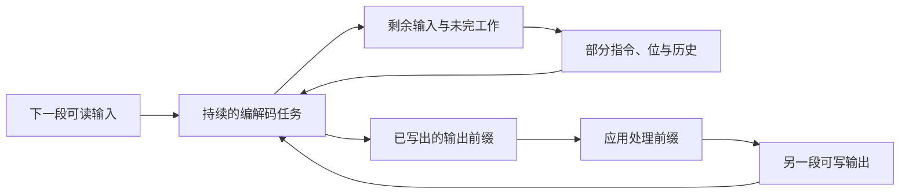
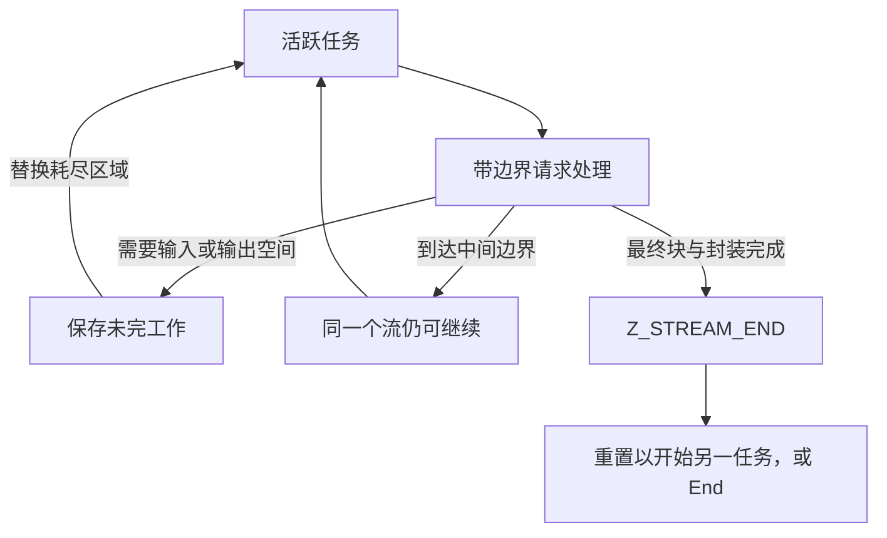

一个完整的 DEFLATE 数据包回答的是：哪些字面量和向后复制能还原这些字节，又用哪些位来描述它们？应用还需要更多能力。文件可能大于内存。网络发送方可能停在一个编码的中间。应用可能希望立即发出已有前缀、预先共享词汇、检测损坏，或从保存的位置分出两条解码路线。

这些要求决定压缩算法的工作如何分批、保存、封装和交付。本文先从应用需要推导机制，再介绍表示这些机制的对象和 C 操作。贯穿全文的数据仍是八个字节 `ABABABAB`。它足够小，可以逐一观察边界；同样的调用协议也适用于很大的数据流。

## 为什么完整输入和完整输出不够用 {#needs}

设想压缩一份持续增长数小时的日志。必须拿到完整日志才开始的函数，无法及时发送开头。要求一个目的缓冲区容纳全部结果的函数，也无法遵守较小的固定内存预算。接收时，压缩数据的字节数并不能决定还原数据需要多大空间。

可以给一个持续任务提供一段可读输入和一段可写输出。任务完成当前能做的工作，返回两个区域尚未使用的范围，并保存未完工作。应用存储或发送已产生的前缀，补充输入或更换输出，再调用一次。**流**就是这样的持续压缩或解压任务。完整序列可以横跨许多缓冲区；它不必对应一个文件或网络连接。

输入可能在一条指令还没读完整时耗尽。输出也可能在一条已知指令尚未执行完时填满。压缩还有额外延迟：接受的输入可能等待更好的匹配、块选择，或已编码字节的交付。因此，接受输入、完成指令、交付输出需要不同的位置。



完整记录已经在内存中，仍然是有用的特例。后面会看到，整块缓冲区工具在内部驱动同一协议。先理解持续任务，也就能理解为何一次应用调用内部仍需要循环。

## 两次调用之间必须保留什么 {#stream}

原始 DEFLATE 字节 `73 74 82 40 00` 描述我们的数据。这里的**原始**指只有 DEFLATE 主体，没有外层 zlib 或 gzip 格式。提供五字节目的区，解码器写出 `ABABA`，随后暂停：同一个距离二匹配还剩三字节。下一段目的区必须得到 `BAB`，不能重新读取长度，也不能重新开始匹配。

任务需要保存阶段，例如读取块描述、解码符号或复制匹配。它需要保存已从输入取走、却尚未使用的位。它还需要保存最近还原的字节，因为应用回收先前目的区之后，后续向后引用仍可能用到它们。这个有界的近期字节存储叫**历史窗口**。DEFLATE 允许最多 32768 字节历史。分配容量和实际有效历史量是两回事。

现在再引入 C 表示。公开任务记录是 `z_stream`，其中的 `state` 指针通向私有编解码存储。解码器的 `mode` 表示阶段；`hold` 和 `bits` 保存低位先读的累积值及有效位数。未完匹配的 `length` 记录还需写多少字节，`offset` 是向后距离。窗口字段保存较早来源。压缩器则有自己的前瞻输入、搜索索引、符号、暂存位和待交付编码字节。

初始化选择容量和配置，取得私有存储，与提供数据分开。可配置入口是 [`deflateInit2`](/reference/functions/deflateInit2_.html) 和 [`inflateInit2`](/reference/functions/inflateInit2_.html)。分配与释放函数负责取得、归还私有内存；全零初始化的公开记录选择库提供的默认函数对。压缩器预先取得窗口、索引和待输出／符号存储。普通解码器先取得状态，可以等到输出必须跨调用保留时才分配窗口。初始化不消费数据。

应用也可以提供兼容的分配／释放函数及其上下文指针，记录中将上下文叫作 `opaque`。它们必须在整个流生命周期中可用。输入输出缓冲区另由应用拥有；更换缓冲区不会更换分配函数或私有编解码器。最后由 End 释放私有存储。

### 一次有限调用与持续驱动 {#call-loop}

解码器的实际 C 循环按照保存的阶段分派。缺少输入或输出空间时，走共同返回路径，把局部游标和暂存位写回。下次调用从该状态继续，而不是重读头部。

尚未完成整个流的普通成功返回叫 `Z_OK`。共同返回路径还检查进展。下面 `in`、`out` 是本次实际消费／产生的字节数，`ret` 是选定结果，`flush` 是后文解释的边界请求。[`inflate.c` 的实际检查](https://github.com/madler/zlib/blob/757f0527154291bcf6bfbd6396ecde6bedd2db95/inflate.c#L1159-L1161) 是：

```c
    if (((in == 0 && out == 0) || flush == Z_FINISH) && ret == Z_OK)
        ret = Z_BUF_ERROR;
    return ret;
```

普通请求既没消费输入、也没产生输出，就变为 `Z_BUF_ERROR`：应用应改变条件，不能对耗尽的缓冲区无限重试。请求一次完成却未完成时，即使有字节移动，也会得到这个结果。缓冲区错误本身不等于数据损坏。

对于有限的当前区域，内部循环消耗位或字节、填满有界目的区，或推进解析阶段后返回。应用循环另有责任：最终给出完整流，或把源耗尽判为截断，或在错误后停止。对方若一直发送非最终块，不一定会完成。原样重复无进展调用，不会凭空产生输入或空间。

## 两组游标，两种进展 {#buffers}

每段输入需要地址和可用数；每段输出需要地址和可写容量。在 `z_stream` 中，`next_in`／`avail_in` 表示前一组，`next_out`／`avail_out` 表示后一组。调用前保存可用数，调用后相减：

```text
input_taken    = old_avail_in  - new_avail_in
output_written = old_avail_out - new_avail_out
```

只有已消费输入前缀可以复用，未读后缀必须保留。只有已写输出前缀可供处理。处理后可以绑定新的目的区，不必重置。累计 `total_in`、`total_out` 概括普通处理进度；切片差值直接定位每次调用的作用。

一个已消费的压缩字节仍可能在 `hold` 中留下未用位。反过来，保存的匹配可以不读新输入就产生输出。逐步观察五字节输出例子：`ABABA` 和后来的 `BAB` 执行的是同一个匹配。

<div class="zl-demo-mount"><zlib-demo kind="stream"><p>第一个五字节目的区收到 ABABA。距离二匹配还剩三字节。更换目的区后写出 BAB，不会开始新指令。输入字节消费、暂存位和输出产生不必同步前进。</p></zlib-demo></div>

压缩还增加一个交付队列。调用者没有空间时，编码字节可能已经在私有存储中。私有 `pending_out` 指向下个未交付字节，`pending` 记录待交付数。下面之前，`len` 已受待交付数和输出空间共同限制。`strm` 指向公开记录，`s` 指向压缩私有状态。[实际待输出复制](https://github.com/madler/zlib/blob/757f0527154291bcf6bfbd6396ecde6bedd2db95/deflate.c#L969-L986) 同时推进两边：

```c
zmemcpy(strm->next_out, s->pending_out, len);
strm->next_out  += len;
s->pending_out  += len;
strm->total_out += len;
strm->avail_out -= len;
s->pending      -= len;
```

已接受输入可能仍是前瞻数据，已确定符号可能仍等着块发射。所以 `avail_in == 0` 不代表相应编码字节都已交给调用者。没有新输入的调用，也可以继续排空待输出并完成编码。

## 请求边界，不要与结束混淆 {#flush}

连接可能需要立即交付此前接受的全部内容，而后面还有输入。块编辑器可能要停在块描述之后。写入者最终要声明不再有原始字节。处理调用的 `flush` 参数表达这些不同边界，不负责释放存储。

压缩通常用 `Z_NO_FLUSH`，允许为匹配和块选择缓存数据。`Z_SYNC_FLUSH` 让当前前缀及时可解码：完成当前块，再发出按字节对齐的空存储块边界。对齐后标记包含 `00 00 ff ff`。它不结束流，后续块仍可引用较早历史。

`Z_FULL_FLUSH` 建立类似边界，并丢弃此前压缩匹配历史。未来引用不能依赖边界前的字节。这以压缩率为代价，支持受控重启或恢复点。标记不是新的封装头；从此重启也不代表跳过的数据已通过检查。

`Z_BLOCK` 结束块但不强制按字节对齐，最多七位可以仍被暂存。`Z_PARTIAL_FLUSH` 发出空固定编码块，没有同步刷新的对齐保证。这些细微区别对外层位格式有用，二者都不声明最终输入。

最后一段输入提供后，用 `Z_FINISH` 请求完成。保留未读后缀，补充输出空间，持续使用 `Z_FINISH`，直到 `Z_STREAM_END`。这代表最终块及适用尾部已经交付。随后 `deflateEnd` 释放存储，却不会替你补完未输出数据。目的区满而返回 `Z_OK`，应继续，不应重置或 End。

非最终刷新也要以相同请求、更多空间继续，直到完成，通常会留下输出余量。完成后再请求刷新，可能是在要求另一个边界。API 建议开始同步／完全刷新时提供超过六字节空间，避免目的区恰好填满时反复创建标记。

解码器观察输入中已有的边界。它的 `Z_SYNC_FLUSH` 不插入标记，也不清空历史。`Z_BLOCK` 在封装头或块边界返回；`Z_TREES` 还会在块描述完成、数据尚未开始时停止。报告字段 `data_type` 把未用位数与最终块、头／块边界、完整描述等标志组合起来。它们定位位边界。只有 `Z_STREAM_END` 表示主体及适用尾部检查完成。



改变压缩策略也可能需要边界。[`deflateParams`](/reference/functions/deflateParams.html) 修改等级对应的匹配力度或策略对应的符号政策。必要时，它先以旧设置调用 `deflate(..., Z_BLOCK)`。输出不足会返回 `Z_BUF_ERROR`，仍保留旧策略，即使已经移动了字节。补空间后重试；这不是回滚。更底层的 `deflateTune` 保存搜索预算参数，不检查预算是否合理。不打算直接管理这些细节的应用，应使用普通等级选择。

## 带着共享上下文开始：字典和位 {#dictionary}

许多独立消息共享词汇，例如重复字段名。新压缩器却没有先前消息字节可供向后引用。可以提供双方约定的字节作为**预置历史**，称为字典。它们在第一个数据字节前就能成为匹配来源，不是需要再次交付的消息内容。

假设双方字典以 `AB` 结尾，以 `ABABABAB` 开头的消息就能引用它，无须先用字面量写出 `AB`。双方必须约定有效后缀和顺序。错误字典可以让语法正确的指令产生错误字节，所以外层格式必须管理身份和存储。

zlib 压缩在开始前调用 [`deflateSetDictionary`](/reference/functions/deflateSetDictionary.html)。封装设置字典标志，携带完整所供字典的 Adler-32 标识；有界匹配历史只保留合适的末尾部分。解码到这一要求时，`inflate` 返回 `Z_NEED_DICT`，在 `adler` 字段暴露预期标识。[`inflateSetDictionary`](/reference/functions/inflateSetDictionary.html) 先检查所供字节，再安装历史。错误字典返回 `Z_DATA_ERROR`，还可以尝试另一个。gzip 没有预置字典字段。

原始 DEFLATE 没有字典标识，应用必须安排一致上下文。原始压缩器只能在合适边界安装：不能有前瞻输入，也不能有部分积累的原始字节块。C 检查中的 `wrap` 区分原始／zlib／gzip，`status` 是压缩阶段，`lookahead` 是已接受而待表示的字节数，`strstart` 与 `block_start` 定位当前位置和块开始。[实际检查](https://github.com/madler/zlib/blob/757f0527154291bcf6bfbd6396ecde6bedd2db95/deflate.c#L558-L573) 是：

```c
if (wrap == 2 || (wrap == 1 && s->status != INIT_STATE) || s->lookahead ||
    (wrap == 0 && (long)s->strstart != s->block_start))
    return Z_STREAM_ERROR;
```

压缩器安装时临时把字典绑定为输入，填充窗口与搜索索引，再恢复调用者输入。因此它可能增加 `total_in`，却不把字典加入消息输出。解码器复制历史而不移动输入／输出游标或累计数；这时可能分配失败。原始解码器可在调用边界安装，无标识检查。查询函数可以复制当前可用字典历史，让应用管理后续上下文。

### 外层格式可能已经拥有一些位 {#prime}

容器可能把 DEFLATE 放在一个位前缀之后，或先消费若干位再把剩余部分交给 zlib。字节缓冲区不能表达半字节位置。**预置位**把这样的边界上下文转交给编解码器的暂存位机制。

原始压缩的 [`deflatePrime`](/reference/functions/deflatePrime.html) 在文档规定的起点，把参数低 0–16 位插入待输出。原始解码的 [`inflatePrime`](/reference/functions/inflatePrime.html) 把低 1–16 位追加到已有暂存位之上，总量不能超过 32 位；零不做事，负数清空暂存位。它应在相关原始解码开始前使用。

例如已有三个有效位 `101`，新提供的两个低位为 `11`，追加后得到五位 `11101`；旧的低位先被消费。这里交接的是位上下文，不是字典字节。应用仍须保证完整位序列是所需的合法 DEFLATE。

解码计数非法返回 `Z_STREAM_ERROR`；压缩计数／空间失败返回 `Z_BUF_ERROR`。压缩预置位可能先整理待输出字节，再发现空间不足，所以失败不保证私有字节未改变。普通字节对齐 zlib／gzip 消息不需要这一步。

## 为另一任务复用存储 {#reset}

服务器不应每条消息都重新分配同样容量。它需要丢弃旧任务含义，同时保留可复用存储。**重置**完成这一转变，不会补完放弃的消息，也不会抹去已经返回的输出。

解码 `ABAB` 后重置，含义是“开始新的独立流”，不是“再产生剩余 `ABAB`”。下一步应绑定新的完整编码。普通解码重置清空位进度，重新解析头，清零累计数和头注册，并使旧历史失效。通常可保留容量合适的已分配窗口。C 的 `wsize` 是活跃环大小，`whave` 是有效字节数，`wnext` 是下一写入位置，`reqwrap` 保存请求封装。[重置尾部](https://github.com/madler/zlib/blob/757f0527154291bcf6bfbd6396ecde6bedd2db95/inflate.c#L125-L141) 为：

```c
state->wrap = state->reqwrap;
state->wsize = 0;
state->whave = 0;
state->wnext = 0;
return inflateResetKeep(strm);
```

保留分配不等于保留有效历史。有效窗口大小改变时，重置可以释放不兼容窗口；`inflateReset2` 同时选择新封装／窗口请求并重置。

压缩重置保留容量，清除待输出、历史和普通搜索状态，并恢复等级的标准调优。`ResetKeep` 版本有意多保留上下文，尤其是解码历史或压缩窗口／哈希上下文。它们用于明确共享上下文的协议，不能代替独立消息的普通重置。调用者仍须绑定新区域；重置不会倒回外部文件。

## 从检查点分支 {#copy}

应用可能希望从同一前缀尝试两种后续。重头解码会重复工作。直接赋值公开记录，则两份记录指向同一私有状态，推进或结束一方会影响另一方。**检查点复制**必须复制延续状态及其私有存储。

在 `ABABABAB` 的四字节目的区检查点，调用者已得 `ABAB`，距离二匹配还剩四字节。继续会保留它，重置会丢弃它，复制则在两个任务中保留它，各自都能写出剩余 `ABAB`。

<div class="zl-demo-mount"><zlib-demo kind="checkpoint"><p>检查点已交付 ABAB，匹配还剩四字节。继续会更换输出空间。重置需要新完整流。复制产生独立私有状态／历史；推进分支前应绑定不同的调用者目的区。结束其中一份不会结束另一份。</p></zlib-demo></div>

[`inflateCopy`](/reference/functions/inflateCopy.html) 分配目的状态／窗口，复制阶段、位和有效历史，并修复私有指针。嵌入的解码表必须指向目的状态内部；不可变固定表仍可共享。所选源码包含区分两者的已登记修正。不重定位私有目标而只复制指针值，不能得到独立解码器。

[`deflateCopy`](/reference/functions/deflateCopy.html) 复制窗口、索引和待输出／符号存储，并修复内部位置。分配失败清理新尝试，不销毁源。每个成功副本都需要自己的 End。

公开缓冲区指针也会被复制，所以最初两份都指向同一调用者区域。头指针和分配上下文也可能继续共享。独立输出前要绑定不同目的区；共享未读输入须供双方使用完。复制解码器只是文件检查点的一半：还要保存压缩源位置和未读输入。Copy 不会倒回源。

## 增加消息外层：封装契约 {#wrappers}

DEFLATE 已有必要结构：最终块位、块类型，以及动态块的 Huffman 编码表描述。这些信息用于解释指令。zlib 或 gzip **封装**在主体外增加外层：标识格式，提供专用上下文或元数据，再增加完整性信息。封装头不是匹配搜索或解码表加速优化。

写入者选择封装，读取者选择接受哪些封装。格式的魔数字节是用于识别的固定字节值。主体相同不表示以下编码可以互换：

| 编码 | DEFLATE 主体之前 | 主体之后 |
| --- | --- | --- |
| 原始 DEFLATE | 无封装，由应用提供上下文 | 无封装校验和／大小 |
| zlib | 方法／窗口、头检查、可选字典标识 | Adler-32，最高字节先写 |
| gzip | 魔数、方法、标志、时间戳、可选元数据 | CRC-32 和原始长度模 `2^32`，最低字节先写 |

zlib 前两字节描述方法和窗口，其合成的 16 位值必须能被 31 整除。设置相应标志时，后面还有字典标识。gzip 以魔数 `1f 8b`、方法 `08` 及额外数据、名称、注释、头校验和等标志开始。保留标志位必须为零。头检查验证头的一致性，与数据完整性分开。gzip 可选 `FHCRC` 字段保存此前头字节 CRC-32 的低 16 位，不包含该字段自身。

初始化参数 `windowBits` 编码封装选择和二的幂窗口容量。32768 字节容量下，压缩请求 15、−15、31 分别选择 zlib、原始、gzip。解码请求 15、−15、31 分别接受对应形式；47 根据头自动接受 zlib 或 gzip，不包括原始格式。解码请求零可以从 zlib 头取得窗口大小。比较双方配置应看格式和有效窗口，不应只看参数整数相等。

zlib 压缩请求八位会升为九位，原始／gzip 压缩拒绝八位情况。解码器有自己的接受规则。压缩内存等级选择搜索／符号容量，等级选择工作政策；二者都不是解码参数，因为编码流携带所需编码描述。

### 可选元数据是借用存储 {#headers}

应用可能想写入 gzip 文件名或注释。这些可选对象用 C 记录 `gz_header` 及其引用的额外数据／名称／注释区域表示。[`deflateSetHeader`](/reference/functions/deflateSetHeader.html) 在发射前注册它们。压缩器借用记录和字节；头输出完不代表指针已注销，复制压缩器也可以保留这种关联。

接收时，[`inflateGetHeader`](/reference/functions/inflateGetHeader.html) 在解析前注册可写记录及有界捕获目的区。空间小就只捕获放得下的前缀，字符串终止符也只有放得下才写入。完成标记表示元数据解析完成，或自动识别选择了 zlib，不表示数据尾部已通过。重置清除注册；End 不释放调用者元数据。

最终主体块结束时，原始解码器可以完成；有封装者仍需读取并比较尾部。发现坏尾部之前，较早还原字节可能已交付。普通 `inflate` 结束一个编码，把后续输入留给调用者；文件接口可以明确继续下一个 gzip 成员，即一组完整 gzip 头、DEFLATE 主体和尾部。

### 完整调用顺序 {#program}

应用以所选封装初始化，绑定输入输出区域，处理并接收每次写出的前缀，再区分暂停、结束和错误。压缩在最后输入之后持续请求完成，直至最终输出交付。每个成功初始化的任务，无论后面是否失败，都需要清理。

整块缓冲区工具中的真实 C 循环让顺序更具体。`stream` 是临时任务，`sourceLen` 是尚未提供的输入数，`dest` 是输出起点，`err` 是编解码结果。宽长度按可用数字段能容纳的片段提供；源全部提供后请求完成。[实际工具尾部](https://github.com/madler/zlib/blob/757f0527154291bcf6bfbd6396ecde6bedd2db95/compress.c#L60-L65) 是：

```c
        err = deflate(&stream, sourceLen ? Z_NO_FLUSH : Z_FINISH);
    } while (err == Z_OK);

    *destLen = (z_size_t)(stream.next_out - dest);
    deflateEnd(&stream);
    return err == Z_STREAM_END ? Z_OK : err;
```

指针差记录已交付字节，End 释放私有存储，流完成映射为工具成功。解码用 `inflate` 执行相应顺序；有限输入在完成前耗尽，应判为不完整数据，而不是不改变条件地循环。

### 运行实际 C，查看保存的调用 {#playground}

下面的可执行例子把所选 C 编译为 WebAssembly，执行初始化、压缩完成、解码、清理和全字节比较。输入原始 UTF-8 文本或十六进制字节，程序产生编码并还原。运行后的前后按钮查看**已保存调用记录**，不是逐条解释执行 C。记录中的可用数和返回值，就是刚才解释的边界。

<div class="zl-demo-mount"><zlib-demo kind="playground"><p>输入最多 256 KiB 原始字节，运行实际 C 往返，再检查保存的调用：接受输入、交付输出、完成。即使字节预览被缩短，相等比较仍覆盖完整还原数据。</p></zlib-demo></div>

[C 调用程序](/static/examples/codec-playground.c) 与[构建记录](/static/examples/codec-playground-provenance.json) 标明源码和设置。试试空输入、短而多变的消息、长重复文本。封装可能让短消息变大。输入计数变空后仍可能有最终输出，返回码才标记完成。这些是具体执行；前面的流／检查点场景是选定状态转变的示意。

## 完整性检查究竟检查什么 {#checksums}

损坏可能把 `AB` 的编码变为语法合法、却还原 `AC` 的编码。成功解析并不能揭示发送方意图。因此封装携带数字摘要，称为**校验和**。发送方对原始未压缩字节计算，接收方对还原字节重新计算，再比较尾部。两边都不能改为计算压缩编码或压缩输入缓冲区。

zlib 用 Adler-32，gzip 用 CRC-32。gzip 可选头 CRC 单独覆盖头字节。普通封装解码执行这些比较；`inflateValidate` 明确启用或禁用封装校验验证，改变成功完成所保证的内容。数据校验和跨处理调用延续，在每个 gzip 成员开始时重启。gzip 大小字段检查还原长度模 `2^32`，不能预先告知完整分配大小。

不一致就拒绝有封装消息。一致能发现许多意外改变，却不是唯一身份。32 位结果不能区分所有消息；Adler 的约化分量对最多只有 `65521²` 种。CRC 常见的 `2^-32` 估计需要差异分布满足条件，不是对任意改变或攻击者的保证。能够同时替换数据和校验和的发送者，不会被这两种算法认证。

**增量更新**接受前一个校验和及下一段可读原始／还原字节，返回截至该段的摘要，无须保留更早字节。下面推导两个计算，再解释局部 C 优化。

## Adler-32：记录字节和与顺序 {#adler}

单纯求和能发现字节值改变，却会漏掉重排。再对所有第一层前缀和求和，较早字节就会贡献更多次。把两和叫 `a`、`s`，从 `a=1,s=0` 开始，按 `M=65521` 取模。取模即保留除法余数。对下一个字节 `b`：

```text
a := (a + b) mod M
s := (s + a) mod M
checksum = a | (s << 16)
```

第二行使用更新后的第一和。打包把 `a` 放低 16 位、`s` 放高 16 位；移位与按位或连接互不重叠的两半。等价数值是 `a + 65536·s`。数值布局与尾部字节顺序不同。

ASCII A 为 65，B 为 66。A 得到 `(66,66)`；随后 B 得到 `(132,198)`，因为 `s=66+132`。这个短例子中取模不改变结果：

| 已处理字节 | `a` | `s` | 十六进制校验和 |
| --- | --- | --- | --- |
| 空 | 1 | 0 | `00000001` |
| A | 66 | 66 | `00420042` |
| AB | 132 | 198 | `00c60084` |
| ABA | 197 | 395 | `018b00c5` |
| ABAB | 263 | 658 | `02920107` |
| ABABA | 328 | 986 | `03da0148` |
| ABABAB | 394 | 1380 | `0564018a` |
| ABABABA | 459 | 1839 | `072f01cb` |
| ABABABAB | 525 | 2364 | `093c020d` |

动画中请观察每字节的两次相加：先加到 `a`，再把新 `a` 加到 `s`。状态从普通初始种子开始，较短示例便于看清依赖。

<div class="zl-demo-mount"><zlib-demo kind="adler"><p>从 a=1,s=0 开始。A 使两者成为 66。B 先使 a 成为 132，再把 132 加到 s，得到 198。ABABABAB 最终为 a=525,s=2364，校验和 093c020d。这些例子演示普通增量运算。</p></zlib-demo></div>

对字节 `b₁…bₙ` 展开递推，在模 65521 意义下得到：

```text
a = 1 + b₁ + b₂ + … + bₙ
s = n + n·b₁ + (n−1)·b₂ + … + bₙ
```

权重解释了顺序敏感性，但仍允许碰撞。此数据的 zlib 尾部为 `09 3c 02 0d`。如果输出分成 `ABABA` 和 `BAB`，把第一次结果 `03da0148` 作为下一种子，仍得到 `093c020d`；若重置为 1，则只计算 `BAB`。

### 延迟取模，展开加法 {#adler-batches}

不必每次加法都取余，只要机器和在最终取余前不会溢出。[`adler32.c`](https://github.com/madler/zlib/blob/757f0527154291bcf6bfbd6396ecde6bedd2db95/adler32.c#L14-L18) 的 `adler` 是第一和，`sum2` 是第二和，`buf` 是下一地址，`len` 是剩余数，`BASE` 是模数。下面是两段独立摘录：字节宏与[完整批次循环](https://github.com/madler/zlib/blob/757f0527154291bcf6bfbd6396ecde6bedd2db95/adler32.c#L97-L106)。

```c
#define DO1(buf,i)  {adler += (buf)[i]; sum2 += adler;}

    while (len >= NMAX) {
        len -= NMAX;
        n = NMAX / 16;          /* NMAX is divisible by 16 */
        do {
            DO16(buf);          /* 16 sums unrolled */
            buf += 16;
        } while (--n);
        MOD(adler);
        MOD(sum2);
    }
```

`DO16` 按原始顺序展开十六次字节步骤，`n` 计组数。`NMAX=5552` 对应 347 组，每组指针前进 16。最后两次 `MOD` 约化分量，默认分支使用 `% BASE`。展开减少循环开销，延迟约化减少除法，同时保留每个新第一和对第二和的贡献。

从不超过 `M−1` 的已约化分量开始，字节至多 255，经过 `m` 次未约化步骤：

```text
a ≤ (M−1) + 255m
s ≤ (m+1)(M−1) + 255m(m+1)/2
```

第二界包含初始第二和、初始第一和的重复，以及三角形字节权重。5552 时为 `4294690200`，低于 `2^32−1`；5553 时为 `4296171735`，超过上限。这解释了可用于 32 位和的界。默认 x86_64 Linux 的 `unsigned long` 和为 64 位，仍保留同样限制。无符号回绕不是目标取模：`2^32 mod 65521=225`，中途回绕可能改变答案。

剩余后缀用十六字节组和逐字节步骤，再统一取模。短输入和单字节分支避免初始化开销。可选 `NO_DIVIDE` 分支用 `2^16 ≡ 15 (mod 65521)` 折叠高位；默认分支用余数运算。

### 种子与查询参数 {#adler-domain}

[`adler32_z`](/reference/functions/adler32_z.html) 用宽 `z_size_t` 长度，`adler32` 用 `uInt`，不要截断大范围。函数读字节，不保留指针，不分配存储。普通初始值是 1，常用 NULL／零长度查询取得。

单字节快速路径在 NULL 检查前读字节，所以 NULL 加长度一不是初始化查询。人为种子的两半若未约化，也可能不同于完全规范化递推：`fffffff0` 后跟一个零字节，由于只做一次条件减法，返回 `fffefff0`。普通增量种子具有已约化分量；任意数字参数不一定是实际前缀的摘要。

## CRC-32：移位与异或变成多项式运算 {#crc}

先从一个小位机器开始。**寄存器** `r` 是工作中的 32 位值。异或独立作用于每一位：相同得零，不同得一，不进位。一步先右移一位；若移出的最低位为一，就把移位结果与 `edb88320` 异或：

```text
T(r) = (r >> 1) XOR (0xedb88320 if (r & 1) else 0)
```

消费字节 `b` 时，先将它异或到寄存器低八位，再执行八次 `T`。输入最低有效位先进入，这叫**反射**约定。公开校验和值是内部寄存器逐位取反，每位零一互换。公开初始零对应内部 `ffffffff`。更新在进入和返回时取反，因此下一次直接传入上次公开结果。

对 A，字节为十六进制 `41`。与 `ffffffff` 异或得 `ffffffbe`。八步得到：

| 已完成步数 | 内部寄存器，十六进制 |
| --- | --- |
| 移位前 | `ffffffbe` |
| 1 | `7fffffdf` |
| 2 | `d2477ccf` |
| 3 | `849b3d47` |
| 4 | `aff51d83` |
| 5 | `ba420de1` |
| 6 | `b09985d0` |
| 7 | `584cc2e8` |
| 8 | `2c266174` |

第一次移出零，只移位。下一次移出一，于是 `3fffffef XOR edb88320 = d2477ccf`。最后取反得到公开 CRC `d3d99e8b`。继续处理 B 得 `30694c07`，处理全部八个字节得 `94b093a4`。

动画在移位前显示移出位的决定。输入字节、内部寄存器、公开结果是不同对象，请分别跟踪。字节边界处，只保存公开结果就足以继续计算。

<div class="zl-demo-mount"><zlib-demo kind="crc"><p>从公开零、内部 ffffffff 开始。将下一字节异或到低八位。每一步先检查最低位，右移，仅在原最低位为一时异或 edb88320。A 后把 2c266174 取反得 d3d99e8b。ABABABAB 得到公开 CRC 94b093a4。</p></zlib-demo></div>

### 为什么常数代表多项式 {#crc-polynomial}

把位读作多项式的系数，每个系数是零或一。系数按模二相加，所以加法和减法都是异或。乘 `x` 让系数移动一个位置；除以 32 次多项式，余式可以装入 32 位。CRC 在消息位进入时维护这样的余式。

gzip CRC 的生成多项式是：

```text
P(x) = x^32 + x^26 + x^23 + x^22 + x^16 + x^12 + x^11
       + x^10 + x^8 + x^7 + x^5 + x^4 + x^2 + x + 1
```

隐去最高 `x^32` 项后，通常位表示为 `04c11db7`。将其 32 个系数位反序，就得到右移、最低位先入约定所用的 `edb88320`。移出系数要求减去生成多项式时，条件异或完成余式修正。初始／最终取反是额外格式约定，公开值不是未经处理的纯余式。

非零错误突发若至多 32 位，去掉首尾零位置后，就不可能被 32 次生成多项式整除，因此此 CRC 检出所有这类突发。突发范围从首个改变位到最后改变位，包括中间未变位置。更长突发可能漏过。这个具体代数保证不同于假定错误均匀随机，也仍不是消息认证。

### 八个位步骤换成一次查表 {#crc-table}

影响连续八次修正的低字节只有 256 种可能，可以预先计算。位步骤保持异或，因此高位可单独移动，再合并低字节贡献：

```text
table[i] = T⁸(i)
byte_step(r,b) = (r >> 8) XOR table[(r XOR b) & 255]
```

对 A，索引 `be` 的表项为 `2cd99e8b`，异或 `00ffffff` 得 `2c266174`，与前面相同。表减少移位／分支，不改变计算含义。

C 中 `crc_table` 是这个数组，`buf` 是下一地址，`len` 是剩余数，局部 `crc` 是内部寄存器。[实际逐字节尾部](https://github.com/madler/zlib/blob/757f0527154291bcf6bfbd6396ecde6bedd2db95/crc32.c#L934-L940) 为：

```c
    while (len) {
        len--;
        crc = (crc >> 8) ^ crc_table[(crc ^ *buf++) & 0xff];
    }

    /* Return the CRC, post-conditioned. */
    return crc ^ 0xffffffff;
```

掩码把索引限制在 0–255，读取使 `buf` 前进一次。前面的 `crc = (~crc) & 0xffffffff` 准备内部寄存器，最后异或恢复公开约定。[`get_crc_table`](/reference/functions/get_crc_table.html) 暴露不可变表，不允许修改、释放或读取相邻数组。

### 长缓冲区：五条字通道 {#crc-braid}

逐字节查表仍依赖前一个寄存器。输入足够时，zlib 用**交织通道**暴露独立工作。这里的字是一次机器值加载的一组字节；所选默认 x86_64 构建为八字节、五条通道。对齐后从零给字编号：通道零处理 0、5、10……，通道一处理 1、6、11……，其他同理。

这些交错子序列不是五个连续块的普通 CRC。专用表计入同通道相邻字之间的距离。通道零从传入内部寄存器开始，其他从零开始。分开的依赖链让处理器重叠执行。最后一个完整块再按原顺序合并，随后执行逐字节尾部。

字加载要求地址对齐。`N` 是通道数，`W` 是每字字节数。[进入条件和对齐循环](https://github.com/madler/zlib/blob/757f0527154291bcf6bfbd6396ecde6bedd2db95/crc32.c#L640-L650) 即使在对齐之后，也预留一个完整块：

```c
    if (len >= N * W + W - 1) {
        z_size_t blks;
        z_word_t const *words;
        unsigned endian;
        int k;

        /* Compute the CRC up to a z_word_t boundary. */
        while (len && ((z_size_t)buf & (W - 1)) != 0) {
            len--;
            crc = (crc >> 8) ^ crc_table[(crc ^ *buf++) & 0xff];
        }
```

默认阈值 `5×8+7=47` 字节。至多七次字节更新到达对齐地址，仍剩至少一个 40 字节通道块。代码计算完整块数，保留短后缀，并在合并时特殊处理最后块。短输入只走字节处理。

小端机器的字最低字节是最早输入。每条通道把寄存器异或进加载字，将字节零查交织表第零行，再异或第 1–7 行，以右移 8–56 位提取的字节为索引。行号是字内字节位置，不是通道号。最后块用普通字推进操作按顺序合并通道。大端机器走对应反序字／表分支；C 在运行时检查字节序。对齐与字节序把加载值连到输入顺序，多项式表则补偿跨过的位置。

这一优化与数据是否好压缩无关。其他编译选项可选择不同通道数、字宽或平台专用路径。五条八字节通道描述的是所选普通构建。

### 把结果交回尾部 {#crc-domain}

gzip 把 CRC `94b093a4` 存为 `a4 93 b0 94`，后接长度 `08 00 00 00`。输出片段 `ABABA`、`BAB` 各贡献一次，到成员完整时才比较。更早前缀可能已交付，随后才发现失败。

[`crc32_z`](/reference/functions/crc32_z.html) 接受宽 `z_size_t` 数量，`crc32` 用 `uInt`。NULL 在读字节前返回公开初始零，即使传了其他长度。非 NULL 空更新保留传入低 32 位。CRC 对投影到低 32 位的任意数都定义了转变，但要解释为某条消息校验和，种子仍须描述真实前缀。

## 不再读取字节，合并独立分块 {#combine}

增量更新需要后续字节。并行文件扫描可能已经独立算完摘要并丢弃缓冲区，只留下 X、Y 校验和及 Y 长度。合并摘要不是把 Y 的校验和传给字节更新函数。

### Adler 去掉重复的初始一 {#combine-adler}

独立分量为 `(aX,sX)`、`(aY,sY)`，Y 长度为 `n`。两边第一和都从 1 开始，拼接只需要一个初始值，同时 X 的字节和会贡献到 Y 的每个新前缀。因此，模 65521 下：

```text
aXY = aX + aY − 1
sXY = sX + sY + n·(aX − 1)
```

A、B 的独立分量是 `(66,66)`、`(67,67)`，`n=1`，结果 `(132,198)`，即 `00c60084`。必须用 Y 长度，不是 X 或总长。C 先将非负长度模 65521 约化，再计算分量，无须扫描数据。[`adler32_combine`](/reference/functions/adler32_combine.html) 及 `64` 版本提供该操作；负长度返回 `ffffffff`。真实空 Y 的校验和为 1，保留 X。没有真实分块含义的任意数字，不因此获得拼接保证。

### CRC 把 X 推进到 Y 之后的位置 {#combine-crc}

前面的 `T` 是线性的零输入推进，`T⁸ⁿ` 执行 `8n` 次，将 X 贡献移过 Y 所占位置。独立初始的公开值满足：

```text
CRC(X ++ Y) = T⁸ⁿ(CRC(X)) XOR CRC(Y)
```

`++` 表示拼接。取反项相消；不能用公开更新函数处理零字节来代替推进，否则又引入它的取反约定。A 后接 B 时，`T⁸(d3d99e8b)=7ab98336`，异或 B 独立值 `4ad0cf31` 得 `30694c07`。

不必走 `8n` 步，可以把推进编码为生成多项式模下的乘法。预计算 1、2、4、8……字节的幂，按 `n` 的置位位选择相乘。十三字节用 8+4+1，总计 104 位位置。工作量随长度位数增长，而非字节数。

C 辅助函数 `x2nmodp` 从反复平方表 `x2n_table` 组装幂，`multmodp` 执行移位／异或多项式乘法。反射表示的乘法单位元是 `80000000`，不是整数 1。[实际运算符循环](https://github.com/madler/zlib/blob/757f0527154291bcf6bfbd6396ecde6bedd2db95/crc32.c#L184-L194) 为：

```c
    p = (uLong)1 << 31;             /* x^0 == 1 */
    while (n) {
        if (n & 1)
            p = multmodp(x2n_table[k & 31], p);
        n >>= 1;
        k++;
    }
    return p;
```

生成器传 `k=3`，每长度单位就是八个位步骤。右移 `n` 访问下一长度位，递增 `k` 选择平方后的推进。[`crc32_combine`](/reference/functions/crc32_combine.html) 及 `64` 形式生成运算符、作用于 X，再异或 Y。

若第二块长度经常相同，可用 [`crc32_combine_gen`](/reference/functions/crc32_combine_gen.html) 或 `64` 版本生成一次，再用 [`crc32_combine_op`](/reference/functions/crc32_combine_op.html) 复用。应提供生成器产生的运算符。内部乘法扫描到置位位，要求乘数低 32 位非零，不能任意拿整数代替。公开零检查会在乘法前返回零；负长度生成零、结果为零。长度零生成单位元，任意标量结果为低 32 位异或；真实空 Y 的 CRC 为零，因此保留 X。

两种合并的差异来自保留信息不同：Adler 的加权整数和，CRC 的多项式位置。

## 选择由谁掌握驱动循环 {#interfaces}

普通流让应用控制缓冲区和边界，并处理反压，也就是接收方暂时无法接受更多输出。有时应用已经拥有更强的对象：完整记录、一对输入输出函数，或文件。zlib 提供掌握更多循环工作的接口，它们仍遵守相同格式与完整性规则。

### 内存里的完整记录 {#whole-buffers}

全部原始字节和足够目的存储都已存在时，工具函数可以在一次调用内初始化、处理、结束临时流。[`compress2_z`](/reference/functions/compress2_z.html) 写出完整 zlib 封装值，目的长度单元传入容量、返回压缩大小。`compress_z` 选择默认等级。`_z` 长度用 `z_size_t`，对应普通形式适配 `uLong`。

[`compressBound_z`](/reference/functions/compressBound_z.html) 为该工具配置给出保守容量。输入长 `n` 时，下式在大小类型最大值处饱和：

```text
n + floor(n/4096) + floor(n/16384) + floor(n/33554432) + 13
```

八字节得到 21，不是预测实际大小。饱和防止回绕，却不保证真能分配那么大空间。其他配置的已初始化压缩器另用 `deflateBound_z` 查询。

[`uncompress2_z`](/reference/functions/uncompress2_z.html) 把完整 zlib 数据还原到调用者给定大小的目的区。输出长度单元传入容量、返回产生数；独立输入长度单元传入可用数、返回消费数。如果完整 zlib 值后面还有不相关的应用字节，例如 ASCII `TAIL`，成功消费数就定位到这个尚未读取的后缀。这两个可写单元必须独立，并满足文档规定的与数据区域的分离条件。

`uncompress_z` 按值接收源长度，不能返回这一边界。这些工具不会替应用发现完整输出分配大小，也不接受原始／gzip 来代替 zlib。字典请求映射为数据错误，因为没有继续提供字典的步骤。它们按前述顺序驱动临时流，把宽剩余长度适配成 `uInt` 片段。返回后没有可继续的临时编解码器；失败仍可能留下已写前缀和更新后的长度。

### 让解码器回调应用 {#callbacks}

容器可能已有一个应用函数提供输入块，另一个接收还原块。由解码器调用的这类函数称为**回调**。[`inflateBack`](/reference/functions/inflateBack.html) 掌握独立原始 DEFLATE 循环，不要求应用循环调用普通 `inflate`。

它借用可写历史窗口。`inflateBackInit` 接受 8–15 窗口位，关联调用者的 `2^windowBits` 字节并分配私有状态。输入回调提供指针／数量，活跃字节必须可读直到消费完。输出回调收到满窗口或最终前缀并报告接受情况，不能修改活跃输入或窗口。独立上下文对象跟踪应用输入输出位置。

原始例子的回调可以依次提供 `73 74`、`82`、`40 00`。八个还原字节填不满 32768 字节窗口，所以最终一次交付 `ABABABAB`。暂存位和阶段跨越被输入回调拆开的字段。[实际最终交付代码](https://github.com/madler/zlib/blob/757f0527154291bcf6bfbd6396ecde6bedd2db95/infback.c#L562-L566) 中，容量是 `state->wsize`，余量是 `left`，`out`／`out_desc` 是交付函数及上下文：

```c
    if (left < state->wsize) {
        if (out(out_desc, state->window, state->wsize - left) &&
            ret == Z_STREAM_END)
            ret = Z_BUF_ERROR;
    }
```

这个共同出口也能在错误时交付部分输出。此前接受的事件不回滚；最终交付拒绝会把原本成功的完成改为 `Z_BUF_ERROR`。它不是任意回调副作用的恰好一次重试协议。返回时，输入字段定位最后块的未读后缀；普通输出字段／累计数不概括回调事件。

后来的 `inflateBack` 调用开始新原始任务，不像普通流那样继续。即使回调立即返回，也可能永远提供非最终块；应用完成仍需要有限输入或最终完成条件。`inflateBackEnd` 释放私有状态，调用者窗口和回调资源仍由其主人管理。

### 让句柄管理 gzip 文件 {#gzip}

操作系统文件描述符是标识已打开文件的数字。对于路径或这样的描述符，应用可能只想普通字节读写，由 zlib 管理文件 I/O、识别、缓冲和编解码调用。持久对象叫 `gzFile`。[`gzopen`](/reference/functions/gzopen.html) 打开路径，`gzdopen` 包装描述符但不复制。成功后关闭句柄就会关闭描述符；另一个使用者需要独立管理时，应先复制描述符。失败则仍归调用者。

普通读取器识别 gzip，或透明返回普通文件字节。初次识别检查魔数、DEFLATE 方法和合法标志，再由解码器验证其余部分。这不是原始 DEFLATE 识别。它还连接连续 gzip 成员：gzip(`ABC`) 后接 gzip(`DEFG`)，逻辑输出是 `ABCDEFG`，每个成员分别检查。后续成员路径不会把任意尾随垃圾改成透明输出。

`gzread` 可以多取压缩输入并保留已解码输出。每次请求三字节可以依次得到 `ABC`、`DEF`、`G`、零，虽然文件位置早已前进。目的区足够大时可直接解码进调用者存储，省去内部复制；否则使用、补充内部输出。

所以 `gztell` 报告未压缩逻辑位置，`gzoffset` 报告扣除未读压缩输入后的压缩文件位置，二者没有固定换算。[`gzseek`](/reference/functions/gzseek.html) 使用未压缩位置：向前可以把跳过工作延迟到后续解码、丢弃，向后可以倒回再重解码。初始定位成功不保证延迟工作最终能完成。透明读取可直接定位描述符。写入向前定位产生零，写入向后定位和 `SEEK_END` 不是普通支持操作。

打开会推迟数据缓冲区／编解码器分配。`gzbuffer` 在分配前改变请求大小，成功不保证后续分配成功。连 `gzdirect` 检查都可能触发分配和读取，使后面来不及改变缓冲。默认请求大小为 8192 字节，内部围绕它还需要额外存储。

`gzwrite` 报告已接受原始字节，它们可能尚待压缩或文件交付。小写入缓存，大写入可避免复制。`gzflush` 请求编解码边界及交付。写入 `gzclose` 完成待处理工作、发出尾部、释放存储并尝试关闭描述符。即使此前写入成功，也要检查关闭。错误不保留可重试关闭的有效句柄。读取关闭释放资源，不为验证而解码所有未读输入。

读取零返回要结合 `gzerror`：截断不同于完整结束。`gzeof` 记录尝试越过可用数据的读取。借用错误文本须在句柄活跃时检查，后续操作可替换它，关闭会销毁它。按元素读写接口 `gzfread`／`gzfwrite` 统计完整元素，例如一个四字节元素；即使只有部分元素也可能已传输，所以元素数不是按字节回滚位置。[公开 API 参考](/reference/api.html) 保留全部精确入口契约。

## 完成、失败、清理是不同观察 {#errors}

普通 `Z_OK` 表示取得进展，仍可能有工作。`Z_STREAM_END` 标记完整编码及适用检查完成。`Z_NEED_DICT` 请求共享上下文。`Z_BUF_ERROR` 常要求改变资源或放宽一次完成要求。`Z_DATA_ERROR` 包括数据格式错误、非法必需距离以及头／尾检查失败。`Z_STREAM_ERROR`、`Z_VERSION_ERROR`、`Z_MEM_ERROR` 分别关乎调用状态／配置、初始化兼容性和分配。

决定保留或重试什么之前，先检查返回切片。输入输出效果可以先于失败。普通 `inflate` 先恢复缓冲区指针，再更新返回时窗口；此处分配失败可以留下输出，却跳过正常最终计数／校验和更新。错误或累计数未变，都不代表未触及字节。需要整体接受或整体拒绝的接收者，应暂存前缀，直到完成并验证。

完全刷新标记提供受控恢复点，`inflateSync` 扫描 `00 00 ff ff`。找到它既不能重建跳过字节，也不能确认其校验和。恢复会改变封装／检查上下文，不是普通继续或重置。没有应用恢复协议时，数据错误应使当前消息失败。

最后，**End** 在完成或放弃后关闭私有存储生命周期。解码 End 释放状态／窗口，压缩 End 还释放索引和待输出。后者放弃忙碌任务时，可以在释放后返回 `Z_DATA_ERROR`，但不会补出缺失完成字节。调用者缓冲区、元数据和回调窗口仍由调用者拥有。

应用可以选择控制单位：可替换流缓冲区、中间块边界、字典消息、复制延续、完整内存记录、回调或 gzip 句柄。每种能力都在相同字节还原任务周围增加明确上下文和所有权，并给出暂停、完成、释放的具体协议。
