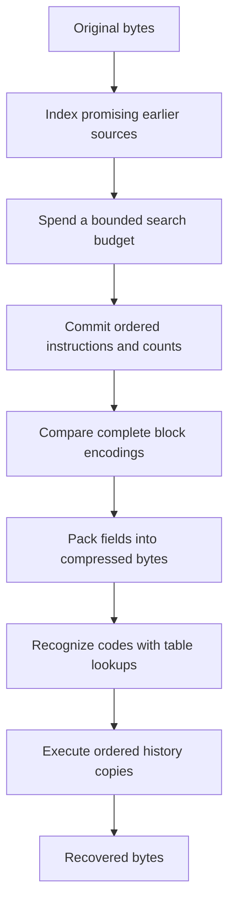

The complete codec from the first article already replaces repetition with backward references, codes the instructions, transmits a codebook, frames blocks, and decodes them independently. That makes a valid compressed stream. It does not explain why zlib has moving arrays, hash chains, several match engines, shared work buffers, or two decoding loops.

Those mechanisms answer a different question: how much work must the implementation do to obtain and execute the stream? We will derive them from a simple complete compressor and decoder. Assume the whole input is available and the destination has enough space. Buffer replacement, explicit flush requests, wrappers, dictionaries, and resource lifetime belong to the next article. Bounded internal work areas still matter: an arbitrarily long input cannot require an arbitrarily large temporary array.

The source is the repository's pinned zlib revision plus its registered patches. Excerpts select the ordinary C implementation and packed instruction layout. Build alternatives are identified where they change a mechanism. Worked instruction sequences isolate decisions; they do not predict every compressor run or claim unmeasured speedups.

## Start with the costs of a complete baseline {#costs}

Imagine a compressor that tries every earlier permitted source at every input position. It compares bytes until a mismatch or the maximum match length, chooses an instruction, saves the block's instructions, counts their symbols, constructs a prefix code, and writes its description and payload. A decoder reconstructs that codebook, follows the tree one bit at a time, and executes matches with a forward byte-copy loop. This is already a complete algorithm.

Its avoidable costs are visible. Most candidate sources fail immediately, but the compressor visits them anyway. Repetitive input creates many candidates that repeat similar comparisons. Searching every candidate spends time even when an adequate match is known. A custom codebook can cost more bytes to describe than its shorter payload saves. A tree decoder branches for every code bit. A byte-copy loop tests its condition for every output byte.

Representation adds other costs. Moving history after each input byte would be wasteful. Sending the internal tree graph wastes bits. Repeatedly sorting all remaining subtrees wastes construction work. Separate large arrays for every temporary representation waste memory. Producing a byte after every small field adds bookkeeping.

Some optimizations preserve the chosen instructions: moving an array or replicating a table entry does not select a different message. Others deliberately change encoder choices: a bounded search can miss a longer match, and fixed coding can beat a custom tree on a short block. The format determines which outputs are legal. Encoder policy determines which legal outputs are worth pursuing.



## Keep useful history without shifting every byte {#window}

A backward reference needs an earlier source and a length. DEFLATE permits distances 1–32768 and lengths 3–258. These are format limits. A compressor may decline to use some legal references; a decoder still needs to understand references another encoder emits.

For `ABCDABCDwxyz`, the second `ABCD` can copy four bytes from four positions back. After the final `wxyz`, the newest eight bytes are `ABCDwxyz`. A teaching history of capacity eight has discarded the earliest `ABCD`. Capacity limits the sources available to a new reference, without changing what a retained reference means.

The following scene asks which earlier bytes remain available. Step through the second `ABCD`, then `wxyz`. Its eight-byte history is a logical teaching model, not zlib's compressor allocation.

<div class="zl-demo-mount"><zlib-demo kind="window"><p>The second ABCD uses distance 4 and length 4. The newest eight bytes become ABCDABCD, then ABCDwxyz. Teaching capacity illustrates eligibility, not zlib's physical layout.</p></zlib-demo></div>

The real compressor wants ordinary advancing addresses for long comparisons. A circular byte array would split comparisons at its boundary. Instead it uses a continuous array twice the chosen history scale. Call that scale W. Default W is 32768, making 65536 byte positions. Earlier bytes, the current position, and unprocessed bytes ahead share this array. The C names are `window`, `strstart`, and `lookahead` for the array, current position, and real unprocessed byte count.

Physical capacity, legal reference range, and actual search range differ. zlib reserves a margin of `258 + 3 + 1 = 262` bytes to allow long comparisons and preparation of subsequent positions. This is `MIN_LOOKAHEAD`. Its ordinary matcher limits distance to `W−262`, called `MAX_DIST(s)` in [`deflate.h`](https://github.com/madler/zlib/blob/757f0527154291bcf6bfbd6396ecde6bedd2db95/deflate.h#L294-L305). Default search distance is therefore 32506. Giving up the furthest legal references simplifies storage; it does not change DEFLATE's 32768-byte limit.

## Refill by moving one large region occasionally {#refill}

As the current position approaches the upper end, the compressor needs room for more input. Moving after every processed byte would be expensive. zlib instead moves a surviving region down by W occasionally. Every retained position moves by the same amount, preserving distances.

Use a constructed snapshot with supported W=512 to expose the arithmetic. Capacity is 1024 and search distance 250. At current position 800 with 100 real bytes ahead, occupied data ends at 900 and 124 tail bytes are free. The movement threshold is `W+(W−262)=762`. Moving `[512,900)` to `[0,388)` makes the current position 288. Source 700 becomes 188, preserving `800−700 = 288−188 = 100`. Free tail space becomes 636 bytes.

Discarding the lower half is permitted because, at the threshold, the earliest admitted source is `762−250=512`. Anything below W is already too old. At position 800 the earliest admitted source is 550, so the movement retains some physically present but already ineligible bytes too.

Predict whether appending 300 bytes changes the current input byte. Move the region, then append. The numerical position changes but still identifies the same original input position; the new bytes extend its unprocessed suffix.

<div class="zl-demo-mount"><zlib-demo kind="refill"><p>With W=512, move [512,900) to [0,388). Start 800 becomes 288 and source 700 becomes 188. Append 300 bytes at [388,688). Byte addresses are not reduced modulo W.</p></zlib-demo></div>

The [actual movement](https://github.com/madler/zlib/blob/757f0527154291bcf6bfbd6396ecde6bedd2db95/deflate.c#L285-L294) adjusts the saved match source, the original-byte start of the block, and the search index. Here `s` points to private compressor state, `wsize` is W, and `more` is free tail space before movement:

```c
        if (s->strstart >= wsize + MAX_DIST(s)) {

            zmemcpy(s->window, s->window + wsize, (unsigned)wsize - more);
            s->match_start -= wsize;
            s->strstart    -= wsize; /* we now have strstart >= MAX_DIST */
            s->block_start -= (long) wsize;
            if (s->insert > s->strstart)
                s->insert = s->strstart;
            slide_hash(s);
            more += wsize;
        }
```

The copied length `W−more` is the occupied part of the upper half, including lookahead. `fill_window` then appends into free space. Its 262-byte target triggers preparation; it does not cap a read at 262. At the true input tail, fewer bytes suffice. Only positions with complete three-byte prefixes can be indexed.

The comparison loops also read ahead in batches. `fill_window` maintains an initialized margin beyond real input, up to 258 bytes where allocation permits. Those bytes are readable workspace, not additional input. The returned match is capped by real `lookahead`. This permits less frequent end checks without compressing padding.

## Index promising sources with a small key {#hash}

Storage movement does not solve exhaustive search. Every match has at least three equal bytes. Grouping positions by a compact function of those three bytes avoids visiting sources with obviously different prefixes. That function is a hash: equal prefixes yield equal hashes, but unequal prefixes may collide. A bucket contains candidates, never a certificate of equality.

Each bucket saves its newest position; each position links to its predecessor in the same bucket. The C arrays are `head` for bucket heads and `prev` for predecessor links. Search follows one chain from newer to older positions. Newer sources appear first and often have cheaper small-distance encodings.

Bitwise XOR sets a result bit when its two input bits differ; retaining the low fifteen bits discards higher positions. Default indexing has 32768 buckets. Its fifteen-bit running hash shifts left five bits, XORs the next byte, then retains the low fifteen bits. The [update macro](https://github.com/madler/zlib/blob/757f0527154291bcf6bfbd6396ecde6bedd2db95/deflate.c#L147-L177) names the shift and mask `hash_shift` and `hash_mask`:

```c
#define UPDATE_HASH(s,h,c) (h = (((h) << s->hash_shift) ^ (c)) & s->hash_mask)
```

Starting from zero, A, B and C produce 65, 2146 and 3075. Appending D gives 36, also obtained by hashing B, C and D from zero. Shifting and masking removed A's contribution. Advancing to the next three-byte key reuses the prior calculation instead of hashing the whole key again.

Keeping a predecessor for every input position forever would be unbounded. Instead, `prev` has W slots and position p uses `p & (W−1)`, or p modulo W. At W=512, positions 100 and 612 share a slot; their separation 512 exceeds the 250-byte search range. The old link is no longer useful when the slot is reused. This circular indexing belongs to the **predecessor array**. Compared bytes remain in the continuous `2W` array.

When bytes move down by W, `slide_hash` transforms saved positions m to `m−W` if m≥W, otherwise zero, the no-position marker. Subtraction leaves slot remainders unchanged. Source 700 at slot 188 becomes source 188; predecessor 650 becomes 138. Chains index moved bytes rather than copying their contents.

The memory setting, `memLevel`, controls hash space through `hash_bits = memLevel + 7`; default eight gives fifteen bits. More buckets can reduce unrelated collisions at the price of memory and initialization. They cannot eliminate candidates whose three-byte prefixes really are identical.

## Spend comparisons where they can improve the answer {#search}

Repetitive data can leave many candidates in one bucket. zlib limits chain traversal and rejects unpromising candidates cheaply. Suppose the best match has length b. A candidate differing at zero-based byte index b cannot improve it. The ordinary byte-comparison branch probes bytes b and b−1, then the first two bytes, before entering its longer loop. With equal hashes and equal first two bytes under the supported hash parameters, the third byte is implied. Hash equality alone would not justify skipping it.

The longer loop expands eight byte comparisons before checking its position bound, reducing control work on equal runs. The separate `UNALIGNED_OK` build branch compares pairs of bytes instead; its alignment and type assumptions are not part of the ordinary byte branch explained here.

Two controls bound search: a maximum candidate count and a satisfactory match length, called `max_chain_length` and `nice_match`. If the best length carried into search reaches a good-match threshold, `good_match`, zlib quarters the candidate budget. The [source](https://github.com/madler/zlib/blob/757f0527154291bcf6bfbd6396ecde6bedd2db95/deflate.c#L1418-L1559) also caps the satisfactory length at real remaining input:

```c
    if (s->prev_length >= s->good_match) {
        chain_length >>= 2;
    }
    /* Do not look for matches beyond the end of the input. This is necessary
     * to make deflate deterministic.
     */
    if ((uInt)nice_match > s->lookahead) nice_match = (int)s->lookahead;
```

Here `prev_length` is the best length supplied to this search. It motivates spending less work, not a claim that all candidates were examined. Chains also stop at the admitted distance bound. Position zero is the chain terminator, so that physical source position is not searched.

In the scene, the nearest source matches three bytes and a predecessor matches seven. First use a one-candidate budget, then permit the predecessor. Observe visited positions as well as the returned length.

<div class="zl-demo-mount"><zlib-demo kind="search"><p>The nearest source matches three bytes; one chain step finds seven. A one-candidate budget misses the longer source while its shorter selected reference remains valid.</p></zlib-demo></div>

A smaller budget still emits valid data but may give up compression. `longest_match` means the best match found by this bounded search, not the globally longest source. Level 1 permits four candidates and a satisfactory length of eight; level 3 permits 32 and 32. Level 6 permits 128 and 128, with an eight-byte good-match threshold reducing the budget to 32. Level 9 permits 4096 candidates and a satisfactory length of 258. These are work policies, not promises of minimum output size or measured running times.

## Delay a decision when the next position may be better {#lazy}

A good match need not yield the best instruction sequence. Suppose position i offers three matched bytes and i+1 offers seven. Taking three now skips the newer opportunity. One literal followed by the seven-byte match covers eight bytes with two instructions. Eventual code costs still matter, but this motivates looking one position ahead.

The fast engine, `deflate_fast`, commits a found match immediately. It also saves indexing work: for matches no longer than its insertion threshold it inserts interior positions; for longer matches it skips much of that work and prepares the hash at the new position. Future searches may have fewer indexed candidates. In levels 1–3, the configuration column named `max_lazy` controls that insertion threshold, not lazy parsing.

The lazy engine, `deflate_slow`, leaves the preceding position undecided while searching the current position. If the current match is no longer, it commits the preceding match. If it is longer, it emits the preceding byte as a literal and retains the newer match. Ties favor the earlier match. This is local one-position lookahead, not optimization over all future instruction sequences.

The earlier and current lengths are `prev_length` and `match_length`. An earlier match at least `max_lazy_match` long suppresses the next expensive search. Ordinary levels 4–9 use lazy thresholds 4, 16, 16, 32, 128 and 258. The [commit branch](https://github.com/madler/zlib/blob/757f0527154291bcf6bfbd6396ecde6bedd2db95/deflate.c#L2047-L2097) begins:

```c
        if (s->prev_length >= MIN_MATCH && s->match_length <= s->prev_length) {
```

Only a committed decision becomes a saved instruction. Covered positions also enter the index when their complete three-byte keys exist; the tail cannot invent absent bytes for a key.

Strategies change this mechanism directly. The filtered-data preference, `Z_FILTERED`, discards matches of length at most five in the lazy engine. Even without that preference, the lazy engine discards a length-three match farther than 4096 bytes, the default `TOO_FAR`, since distance coding can undermine such a small saving. Literal-only coding, `Z_HUFFMAN_ONLY`, skips match searching. Run-length coding, `Z_RLE`, makes only distance-one matches by comparing with the preceding byte, avoiding general chains. Level zero skips matching and Huffman construction and writes stored blocks. All still produce ordinary DEFLATE.

## Save ordered instructions and count their coding symbols {#records}

Choosing shorter codes requires frequencies, but counts cannot distinguish `AAB` from `ABA`. The encoder therefore saves committed instructions in order while counting their coding symbols. A compact record preserves a literal or match until block coding is chosen; it does not store the bytes a match will reconstruct.

In the ordinary packed layout, a record has three bytes. Two hold distance, low byte first. Zero distance marks a literal, with its value in the third byte. Otherwise the third byte holds length minus three: lengths 3–258 fit as 0–255. Our selected instructions become:

| Instruction | Record bytes, hexadecimal | Reconstructed bytes |
| --- | --- | --- |
| A | `00 00 41` | `A` |
| B | `00 00 42` | `B` |
| Length 6, distance 2 | `02 00 03` | `ABABAB` |

The [tally stores](https://github.com/madler/zlib/blob/757f0527154291bcf6bfbd6396ecde6bedd2db95/trees.c#L1094-L1119) call the record area `sym_buf` and its next free offset `sym_next`. Here `dist` is distance and `lc` is a literal or length offset:

```c
    s->sym_buf[s->sym_next++] = (uch)dist;
    s->sym_buf[s->sym_next++] = (uch)(dist >> 8);
    s->sym_buf[s->sym_next++] = (uch)lc;
```

A literal increments one literal/length frequency. A match increments a length-group frequency and a distance-group frequency, not the frequencies of all copied bytes. Length six uses literal/length symbol 260 and distance two uses distance symbol 1; neither needs extra numeric bits. Larger groups need extra bits, whose costs must also be counted. The end-of-block symbol 256 starts with frequency one even in an empty block.

There are 286 constructible literal/length symbols and 30 distance symbols. At default memory level, the record scale is 16384 and at most 16383 records enter one such block. This bounds temporary storage independently of total input length. Matches represent varying byte counts, so a record limit is not an original-byte limit. The compile-time `LIT_MEM` alternative changes record views; three-byte packed offsets describe the ordinary layout only.

## Build short codes without repeatedly sorting every symbol {#huffman}

The baseline already uses Huffman coding. Repeatedly sorting all remaining subtrees to find the two lightest would waste construction work. zlib uses an array minimum heap, a priority queue whose first slot names a lightest subtree. Every parent queue slot is no heavier than its children. After removing the minimum, a replacement moves downward with the lighter child until that order is restored. This follows one queue path instead of sorting the full alphabet again.

For counts A:8, B:4, C:2, D:2, first merge C and D into weight four, merge B with that subtree into weight eight, then merge the two weight-eight roots. Lengths are 1,2,3,3 and payload cost is `8×1+4×2+2×3+2×3=28` bits, against 32 with four two-bit words. This isolates four symbols; a real block includes the end marker and any length/distance symbols.

The heap stores **node numbers** into a separate tree array. For queue position k, slots `2k` and `2k+1` are children used to restore queue order; they need not be Huffman children of node `heap[k]`. Equal frequencies are compared using subtree height, called `depth`, preferring the shallower subtree. This height differs from final leaf code length measured from the completed root.

The [merge in `build_tree`](https://github.com/madler/zlib/blob/757f0527154291bcf6bfbd6396ecde6bedd2db95/trees.c#L631-L701) adds selected frequencies and records their parent. Here n and m are node numbers and `node` their new parent:

```c
        tree[node].Freq = tree[n].Freq + tree[m].Freq;
        s->depth[node] = (uch)((s->depth[n] >= s->depth[m] ?
                                s->depth[n] : s->depth[m]) + 1);
        tree[n].Dad = tree[m].Dad = (ush)node;
```

Unused symbols get zero length. If fewer than two leaves have positive frequency, preparation adds artificial frequency-one leaves and compensates cost counters. This avoids zero-bit words without pretending those symbols occurred in the input.

Removed nodes are retained at the queue array's high end, with the final root before them. A forward pass through that region visits parents before descendants, allowing lengths to be computed without recursive tree traversal. After frequencies and parents are no longer needed, their fields become codewords and lengths. Bounded arrays replace individually allocated tree nodes and their indirections.

## Enforce the format's code-length limit {#lengths}

Huffman merging can place rare symbols very deep. DEFLATE limits data-code lengths to fifteen bits and code-length-description codes to seven. These are format constraints, not search-quality controls. An overlong word cannot be emitted because its weighted cost looks attractive.

A first pass assigns parent length plus one, clamps at the limit, and counts leaf lengths in a histogram, `bl_count`. Clamping alone does not work. With teaching limit three, lengths `1,2,3,4,4` occupy exactly all prefix-code space: their shares `2^-length` sum to one. Clamping gives `1,2,3,3,3`, occupying `9/8`. Each length fits individually, but the set cannot be a prefix code.

The [repair loop](https://github.com/madler/zlib/blob/757f0527154291bcf6bfbd6396ecde6bedd2db95/trees.c#L534-L616) removes one entry from the longest occupied class below the limit, creates two one bit longer, and removes one at the maximum length:

```c
        s->bl_count[bits]--;        /* move one leaf down the tree */
        s->bl_count[bits + 1] += 2; /* move one overflow item as its brother */
        s->bl_count[max_length]--;
        /* The brother of the overflow item also moves one step up,
         * but this does not affect bl_count[max_length]
         */
        overflow -= 2;
```

Splitting preserves occupied space and adds a leaf; removing a maximum-length entry restores the leaf count while freeing one smallest unit of space. The teaching histogram becomes one length-one code and four length-three codes, occupying `1/2+4/8=1`. Source variable `overflow` counts overlong nodes encountered during traversal, including internal nodes; it is not simply an overlong-leaf count.

Repaired lengths are assigned back to leaves in frequency order, with long classes going to the low-frequency end. For counts `8,4,2,1,1`, lengths `1,3,3,3,3` cost 32 bits instead of the unconstrained 30. zlib corrects its dynamic cost counter for every reassigned leaf. Block comparison needs that repaired cost.

The next scene isolates code space, not a full DEFLATE alphabet. Start with 1,2,3,3, then shorten B to one. Observe that a shorter word occupies more shared prefix space. Zero marks an unused symbol.

<div class="zl-demo-mount"><zlib-demo kind="huffman"><p>Lengths 1,2,3,3 fill code space. Giving B length 1 oversubscribes it. Valid individual lengths do not by themselves make a valid codebook.</p></zlib-demo></div>

## Derive canonical words and compress the codebook itself {#canonical}

The decoder needs the assignment, but sending heap slots or parent pointers would expose an expensive private representation. Canonical coding makes lengths and symbol order sufficient. For A:1, B:2, C:3, D:3, words are `0`, `10`, `110`, `111`.

In [`gen_codes`](https://github.com/madler/zlib/blob/757f0527154291bcf6bfbd6396ecde6bedd2db95/trees.c#L200-L229), the first word of each width follows from the preceding width's start and count. Here `code` is the starting integer and `bits` the new width:

```c
        code = (code + bl_count[bits - 1]) << 1;
        next_code[bits] = (ush)code;
```

Starts are 0, 2 and 6. Symbols in numerical order take successive words of their width. Numeric fields are sent low bit first, whereas Huffman words arrive in canonical word order. Reversing a word within its own width lets one low-first writer handle both: canonical `110` becomes integer 3, binary `011`, whose three low bits send `1,1,0`. The width must accompany the integer.

A dynamic length list is itself repetitive: absent symbols give zeros and adjacent symbols often share lengths. Its nineteen-symbol description alphabet includes direct lengths 0–15 and three repeats:

| Description symbol | Expansion | Extra bits |
| --- | --- | --- |
| 16 | Repeat preceding length 3–6 times | 2, count minus 3 |
| 17 | Write 3–10 zeros | 3, count minus 3 |
| 18 | Write 11–138 zeros | 7, count minus 11 |

The encoder first scans data-code lengths to count the descriptions it will use, builds their small codebook, then scans again to emit them. [`scan_tree` and `send_tree`](https://github.com/madler/zlib/blob/757f0527154291bcf6bfbd6396ecde6bedd2db95/trees.c#L709-L785) repeat the run decisions, avoiding a separate array of description instructions. This is a space optimization beyond the format's basic ability to describe a codebook.

The small codebook needs a starting description too. Its lengths are raw three-bit fields in order `16,17,18,0,8,7,9,6,10,5,11,4,12,3,13,2,14,1,15`. An unused tail can be omitted, but at least four are announced. Count fields give the literal/length count minus 257 in five bits, distance count minus one in five, and small-code count minus four in four. Description cost therefore includes fourteen count bits, raw three-bit lengths, encoded repeat/direct symbols, and repeat extras. A custom payload must repay all of them.

## Choose a complete block, including its description {#blocks}

Stored, fixed and dynamic blocks are format options. Choosing between them is encoder policy. Stored copies original bytes; fixed uses prescribed codes; dynamic describes custom codes before the payload. Each is independently decodable under its own complete format rule.

The compressor counts the same records with fixed and constructed codes. The dynamic cost includes its description. Both include the end marker. [`_tr_flush_block`](https://github.com/madler/zlib/blob/757f0527154291bcf6bfbd6396ecde6bedd2db95/trees.c#L997-L1088) names these bit counts `static_len` and `opt_len`, adds the three-bit header, and rounds to bytes:

```c
        opt_lenb = (s->opt_len + 3 + 7) >> 3;
        static_lenb = (s->static_len + 3 + 7) >> 3;
```

Fixed wins a tie. The fixed preference, `Z_FIXED`, substitutes the fixed candidate for dynamic. Before emitting either, the source tests stored: original length plus four must be no greater than the chosen byte estimate, and original bytes must still be available. Four accounts for the sixteen-bit length and complement. The stored writer separately sends the header, aligns to a byte, and writes those fields and payload. A stored payload is at most 65535 bytes. Its length supplies the boundary, so it needs no end-marker code.

Original bytes can leave the moving window while records remain. Stored selection therefore needs a real original-byte range. And since that test comes first, `Z_FIXED` can still produce stored blocks. Level zero bypasses positive-level tree construction and uses its stored strategy, including direct payload copying when destination space and block conditions permit.

Our selected A, B, length-6/distance-2 instructions have a fixed payload/end cost of 35 bits: 38 with header, or five bytes after final padding. For this selected record fixture, the actual constructor assigns two bits each to A, B, end and length symbol 260, plus one bit to distance symbol 1: `4×2+1=9` payload/end bits. Its 116-bit description comprises fourteen count bits, eighteen raw small-code lengths (`18×3=54`), 24 description-code bits and 24 repeat extras. Thus its complete candidate costs `9+116+3=128` bits. These are the fixture’s constructed codes, not a prediction of default match choices. An initially byte-aligned stored block takes thirteen bytes for the eight original bytes. Cheapest payload is not cheapest block.

Keep instructions fixed in the comparison below. Compare the three representations, then repeat the skewed literal example to amortize its description. The Z_FIXED control excludes dynamic; the original-byte control removes stored as a candidate; the earlier-bit-offset control changes physical padding. These controls isolate emission rather than rerunning match search.

<div class="zl-demo-mount"><zlib-demo kind="blockcost"><p>Compare complete candidates for selected instructions. Dynamic pays for its description. Z_FIXED still permits stored selection. Stored also needs original bytes.</p></zlib-demo></div>

The source's byte-rounded comparison omits current partial-byte position. Actual stored padding follows its header; final coded padding follows its end marker. Changing alignment affects those physical bits without changing the comparison estimate. This inexpensive policy does not minimize exact added bits at every alignment or optimize all block partitions. Compile-time `FORCE_STORED` and `FORCE_STATIC` change selection and belong to separate build branches.

## Pack short fields with a shared bit writer {#bits}

Chosen fields have different widths. Splitting each directly into bytes would repeat bookkeeping. zlib accumulates them in a sixteen-bit register, moving complete words into an internal byte queue. `bi_buf` holds the integer and `bi_valid` counts meaningful low bits. A new field starts at the first unused bit with no intervening gap.

The [ordinary `send_bits` macro](https://github.com/madler/zlib/blob/757f0527154291bcf6bfbd6396ecde6bedd2db95/trees.c#L274-L286) checks whether old count plus width exceeds sixteen. Its overflow branch emits the low word and retains the rest:

```c
  if (s->bi_valid > (int)Buf_size - len) {\
    int val = (int)value;\
    s->bi_buf |= (ush)val << s->bi_valid;\
    put_short(s, s->bi_buf);\
    s->bi_buf = (ush)val >> (Buf_size - s->bi_valid);\
    s->bi_valid += len - Buf_size;\
```

`Buf_size` is sixteen. `put_short` appends low byte then high byte. The strict condition permits exactly sixteen held bits until a later overflowing append or explicit bit flush.

For our final fixed block, the header has integer 3 and width 3. A uses reversed integer `0x8e` in eight bits, B `0x4e` in eight, length symbol 260 `0x10` in seven, distance symbol 1 `0x10` in five, and end marker zero in seven. Appending B crosses the first boundary: eleven old bits plus eight emit `73 74` and leave three held bits. The end marker emits `82 40` and leaves six. Final padding emits `00`. The raw stream is `73 74 82 40 00`.

Step through those fields and watch B's split and the final partial byte. A register split adds no format field.

<div class="zl-demo-mount"><zlib-demo kind="writer"><p>Six fields become 73 74 82 40 00. B crosses the sixteen-bit boundary. Final alignment completes the last byte after the end marker.</p></zlib-demo></div>

`bi_flush` emits complete bytes and retains a partial byte; `bi_windup` finishes the partial byte and clears the register. Coded blocks can share a byte across a boundary. Padding after every record or block would change the stream. The complete-byte queue separates field construction from destination copying even in our enough-output baseline, avoiding destination bookkeeping for every code.

## Reuse records only after reading their contents {#storage}

Separate record and output arrays would be simple but each needs sizeable block storage. zlib overlays them. Record scale B is `1 << (memLevel+6)`, default 16384. One allocation has `4B` bytes; records start at B and occupy at most `3(B−1)` bytes. The first B bytes supply output headroom. The [packed assignments](https://github.com/madler/zlib/blob/757f0527154291bcf6bfbd6396ecde6bedd2db95/deflate.c#L514-L521) are:

```c
    s->sym_buf = s->pending_buf + s->lit_bufsize;
    s->sym_end = (s->lit_bufsize - 1) * 3;
```

`pending_buf` is the output view and `lit_bufsize` is B. Before emitting a record, [`compress_block`](https://github.com/madler/zlib/blob/757f0527154291bcf6bfbd6396ecde6bedd2db95/trees.c#L908-L945) reads its entire distance and literal/length into local values. The unread-record boundary advances three bytes. Output may reuse released space while staying before the next unread record.

A fixed match can require 31 bits: eight length-code bits, five length extras, five distance-code bits and thirteen distance extras. That exceeds a record's 24 storage bits. Headroom pays for the difference; reading one record alone does not release enough space for its worst-case output. Dynamic output also places its description before the first record's payload, tying placement to constructed lengths and frequencies as well as final size.

The next scene deliberately uses a tiny allocation below zlib's permitted size. It asks about ordering, not a reported library failure. Compare expensive output early with output spread over records. Space released by reading a record cannot justify a preceding write retroactively.

<div class="zl-demo-mount"><zlib-demo kind="overlay"><p>A front-loaded teaching plan can overwrite unread records even if final output fits. Follow both boundaries after every record. The teaching allocation is smaller than zlib permits.</p></zlib-demo></div>

Final size alone cannot establish safe reuse for arbitrary plans. The actual encoder has specific constructed codes, selection rules and read-before-write ordering; its debug build checks the unread boundary during emission. Sharing saves one allocation but couples coding to storage more tightly than disjoint arrays. `LIT_MEM` changes the layout and needs its own views.

## Decode from a reservoir instead of requesting individual bits {#decode-bits}

The stream is now fixed. Decoder optimizations cannot choose better matches; they execute the instructions already present. A baseline that requests one bit at a time repeatedly locates its source byte and updates a bit position. zlib instead keeps fetched bytes in an integer reservoir. Its lowest bit is next in input order, and a count says how many bits are valid.

The ordinary decoder calls these `hold` and `bits`. Three bits in reading order `0,1,1` give `hold=6`, `bits=3`. Appending byte `0xa5` above them gives `6+(165<<3)=1326` and eleven valid bits. Inspecting five yields `1326 & 31 = 14`; consuming five shifts the reservoir to 41 and leaves six valid bits. A zero bit still counts as input.

The [byte-pull macro](https://github.com/madler/zlib/blob/757f0527154291bcf6bfbd6396ecde6bedd2db95/inflate.c#L365-L374) appends above existing bits. Here `next` points to the next unread compressed byte:

```c
        hold += (unsigned long)(*next++) << bits; \
        bits += 8; \
```

Fetching transfers a whole byte into the reservoir; inspecting selects low bits; consuming removes precisely a recognized field. These actions differ. Read-ahead enables whole-code lookup but must not charge every inspected bit to a short code.

The same reservoir supplies numeric extras. A decoded length or distance entry gives a base and extra-bit count. Adding that many low bits to the base recovers the value, then those bits are dropped. Codeword and numeric field have separate widths even when one integer supplies both. Their bit orders are format requirements; batching the operations is the optimization.

## Turn canonical codes into bounded lookup tables {#tables}

A tree walk makes up to fifteen dependent branch decisions per data code. Inspecting several low bits at once instead permits an array lookup. A flat fifteen-bit table would have 32768 entries per alphabet, even if most codes were short. zlib uses a smaller first table, the root, and allocates subtables only for longer prefixes.

For teaching code A=`0`, B=`10`, C=`110`, D=`111`, choose a two-bit root. Since arrival order occupies low bits first, A occupies root indices `00` and `10`: the second inspected bit belongs to the next code and cannot change the answer. B occupies `01`, whose low-to-high reading is `1,0`. Index `11` links to a one-bit subtable for C and D. Six cells replace a pointer tree without allocating a full eight-cell three-bit table.

Replication matters because the root inspects two bits but A consumes one. Each cell must carry consumption and an action, not just a symbol. Entry structure `code` has `bits` for consumption at this level, `op` for action, and `val` for a literal, numeric base or subtable offset. Action zero is a literal; flag 16 marks a base with its low bits giving the extra count. A small nonzero action links to a subtable. Flags 32 and 64 distinguish block end and invalid codes. The cell combines recognition with what the decoder should do next.

The constructor, [`inflate_table`](https://github.com/madler/zlib/blob/757f0527154291bcf6bfbd6396ecde6bedd2db95/inftrees.c#L35-L310), counts lengths, finds their minimum and maximum, and clamps requested root width between them. Length counts place symbols in increasing length and then symbol order without repeatedly searching for the next canonical symbol. Each word fills all cells sharing its prefix. A longer prefix triggers a subtable sized by the remaining length counts, with a root entry pointing to its new cells.

Before filling, the constructor validates code space. Start with one available prefix; at each depth, double slots and subtract the count at that length. Negative means oversubscription. Space left at the end means an incomplete code: rejected for the description alphabet, and for data alphabets except the one-bit special case. An entirely empty alphabet installs invalid entries, deferring failure until attempted decoding. Thus an unused empty distance alphabet does not make an actual distance code valid.

The constructor assumes incoming lengths lie in 0–15; it does not validate that indexing precondition itself. The dynamic parser supplies bounded lengths from fields and repeats, and separately requires a nonzero end-marker length. Ordinary dynamic data tables request root widths nine for literal/length and six for distance. Reservations are 852 and 592 **cells**, not symbol counts. The constructor checks cell use while reserving roots and subtables. `PKZIP_BUG_WORKAROUND` changes capacities to 854 and 594 and changes parser count limits; ordinary figures are not universal build constants.

## Recognize a short code without consuming its neighbor {#lookup}

Decode teaching message `AD`: reading-order bits `0,1,1,1`, held as integer 14. Low-two-bit index `10` selects a replicated A entry and drops only one bit, leaving `111`. Root index `11` then consumes two bits and links to a subtable; its remaining bit chooses D. Four bits yield exactly two symbols.

Predict the error if A's lookup dropped its whole root width: D's first bit would disappear. Step through the scene, comparing inspected index width with consumed bits.

<div class="zl-demo-mount"><zlib-demo kind="lookup"><p>For AD, index 10 returns A and consumes one bit. Remaining 111 selects root 11 then subtable entry 1 for D. Inspection width differs from consumption.</p></zlib-demo></div>

The ordinary decoder can inspect a root entry using current low bits, fetching another byte only if the entry requires more bits than actually held. A replicated short entry may be decisive without a full root-width refill: missing high index bits cannot change its answer. Longer entries and subtables still require enough real bits before commitment. This avoids unnecessary pulls, especially near the end marker.

Dynamic decoding pays a table-building stage before payload lookup. It reads announced counts and raw small-code lengths, builds that table, then expands direct lengths and repeats into the two data alphabets. Default parsing admits at most 286 literal/length entries and 30 distance entries. Count fields can express more; the ordinary parser rejects excess descriptions.

The teaching fragment `3,16,17,2,18`, with repeat extras `1,2,2`, produces one 3, four more 3s, five zeros, one 2 and thirteen zeros: 24 lengths. It is a fragment, not a full dynamic header. Try the normal expansion, then a missing predecessor and a run exceeding remaining slots. Every requested repeat must be checked before its slots are filled.

<div class="zl-demo-mount"><zlib-demo kind="lengths"><p>The fragment expands to 24 code lengths. Symbol 16 needs a predecessor; every run must fit the announced total. These are lengths, not reconstructed output bytes.</p></zlib-demo></div>

The [actual parser](https://github.com/madler/zlib/blob/757f0527154291bcf6bfbd6396ecde6bedd2db95/inflate.c#L833-L891) checks symbol 16's predecessor and the combined announced length bound before its repeat stores. It then requires symbol 256, constructs both data tables and decodes payload. Construction is paid once per dynamic block and reused for many instructions. Fixed blocks reuse prescribed tables; stored blocks bypass symbol lookup entirely.

## Copy repeated bytes in the required forward order {#copy}

The decoder has a length and backward distance. The baseline's forward copy already gives their meaning; optimizing it must retain dependencies. After literals `AB`, length six/distance two appends A,B,A,B,A,B. The third copied byte reads the A just written by the first. A snapshot of the initial two-byte source cannot itself provide six bytes, and a general overlapping memory move does not implement this growing-output rule.

If the source lies in output already produced in the current destination, no separate history copy is needed. At destination p and distance d, start at p−d and advance both addresses. A large whole-output destination makes this direct case common: earlier bytes remain available rather than requiring every match to pass through another array.

For earlier output regions, the general decoder retains a circular history array with a next-write index and valid-byte count. Their C names are `wnext` and `whave`; capacity is `wsize`. This **decoder history ring** differs from the compressor's continuous `2W` array. It preserves output history rather than supporting contiguous match searches and hash indexing.

If distance exceeds output produced in the current region, the difference locates the starting source in retained history. With retained `WXYZ`, current `AB`, distance six and length eight, first copy `WXYZ` from history, then `ABWX` from growing current output. The ring boundary can split the first portion into two segments. After old history is exhausted, copying continues directly from output. No intermediate match-sized array is needed.

Default decoding rejects distances exceeding current output plus valid retained history. Capacity does not make unwritten history available. Build option `INFLATE_ALLOW_INVALID_DISTANCE_TOOFAR_ARRR` enables a separate missing-history zero-fill behavior; it is not the ordinary case here. `INFLATE_STRICT` adds a header-derived maximum-distance check. Valid overlapping copies still require the same order.

## Move capacity checks outside a whole-instruction loop {#fast}

The ordinary decoder works near arbitrary input and output boundaries, checking each refill and clipping copy batches. On large regions those checks repeat unnecessarily. The fast route first establishes room for any next instruction, then performs fewer capacity checks within that instruction.

Output needs 258 free positions, the maximum match length. Logical input fields need at most fifteen length-code bits plus five extras, and fifteen distance-code bits plus thirteen extras: 48 total. The loop refills in batches, so six-byte room also depends on the shared refill balance, not only that logical total.

At the next literal/length state, `LEN`, the [actual dispatch](https://github.com/madler/zlib/blob/757f0527154291bcf6bfbd6396ecde6bedd2db95/inflate.c#L923-L929) uses `have` for unread input and `left` for free output:

```c
    if (have >= 6 && left >= 258 && bits < 8) {
        RESTORE();
        inflate_fast(strm, out);
        LOAD();
```

`RESTORE` publishes local parsing values for the helper; `LOAD` retrieves its result. Fewer than eight held bits enables exact whole-byte backtracking at exit. It is a different prerequisite from capacity. These guards establish room, not validity: invalid codes and unavailable history are still checked inside.

Compare five with six unread bytes, then 257 with 258 output slots, then seven with eight held bits. Each scene control decides whether this route may run; none certifies a valid stream.

<div class="zl-demo-mount"><zlib-demo kind="fastpath"><p>Fast entry needs six unread bytes, 258 free output positions and fewer than eight held bits. Otherwise ordinary decoding continues with the same instruction meaning.</p></zlib-demo></div>

Inside [`inflate_fast`](https://github.com/madler/zlib/blob/757f0527154291bcf6bfbd6396ecde6bedd2db95/inffast.c#L71-L309), input and output boundaries are their region ends minus five and 257. Starting strictly before them means at least six bytes and 258 output positions remain. The caller establishes the first iteration's margins; later iterations test both boundaries.

Why do batched refills not require seven bytes? Separate maxima are two bytes before length decoding, one for length extras, two before distance decoding and two for distance extras. They cannot all occur together. If the first site pulls two, it leaves at least sixteen bits; a length code consumes at most fifteen, leaving one. Pulling one for at most five length-extra bits leaves at least four. The next two-byte refill leaves at least twenty; a distance code consumes at most fifteen, leaving at least five. One further byte supplies all thirteen possible distance-extra bits, so the final site's second byte is unnecessary. If an earlier site pulls less, the total is already at most six.

The loop also copies three bytes per iteration to reduce loop overhead. For a source wholly in current output, the [ordered stores](https://github.com/madler/zlib/blob/757f0527154291bcf6bfbd6396ecde6bedd2db95/inffast.c#L249-L263) are:

```c
                    from = out - dist;          /* copy direct from output */
                    do {                        /* minimum length is three */
                        *out++ = *from++;
                        *out++ = *from++;
                        *out++ = *from++;
                        len -= 3;
                    } while (len > 2);
```

`len` is remaining match length and `dist` its distance. A one- or two-byte tail follows. The first group is permitted because matches have length at least three. At distance one or two, later assignments read bytes from earlier assignments in the same group. Unrolling saves control work while retaining ordered dependencies; simultaneous wide loads and stores would need a different argument. History-ring segments have separate bounded cases before the direct-output remainder.

Read-ahead must finally return bytes belonging to later parsing. The helper gives back unused whole bytes and retains a partial byte:

```c
    len = bits >> 3;
    in -= len;
    bits -= len << 3;
    hold &= (1U << bits) - 1;
```

Nineteen remaining bits return two bytes and leave three held bits. Because entry had fewer than eight, returned whole bytes were fetched by this helper; its pointer cannot retreat into an earlier stage's bytes. Ordinary decoding resumes at the exact continuation. Our five-byte complete example cannot enter this six-byte fast route. Being a valid stream does not imply meeting a fast path's room requirements.

## Read configuration as a choice of work {#configuration}

The mechanisms explain what settings change. A larger window scale retains farther candidate sources and enlarges the continuous compressor array. More memory gives more hash buckets and more records per block. Level changes search/insertion effort and immediate versus delayed commitment. Strategy can bypass general search, prefer distance-one runs, filter short matches or remove dynamic from block choice. These settings do not introduce another format.

Controls interact. Removing matches changes frequencies and possibly the chosen codebook and block form. More records can amortize a description but postpone the decision. Greater search effort cannot eliminate an expensive description's overhead. On decoding, larger available regions can enable the fast loop without changing any instruction's meaning.

Each optimization saves identifiable work under stated prerequisites: fewer candidate comparisons, cheaper queue maintenance, smaller descriptions, shared storage, fewer per-bit branches and fewer per-byte capacity checks. Speed and compression ratio for a workload still require measurement. Format validity does not depend on winning a benchmark.
