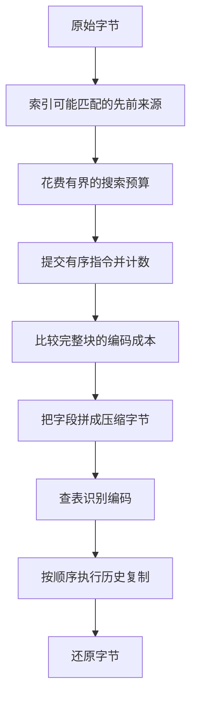

第一篇已经给出完整的编解码过程：用向后引用表示重复，给指令编码，传递码表，划分块，再由独立解码器还原。这样已经能产生合法压缩流。但它还不能解释，为什么 zlib 需要移动数组、哈希链、几种匹配引擎、共享工作区，以及两套解码循环。

这些机制回答另一个问题：为了得到并执行这样的压缩流，实现需要花多少工作？本文从一个简单而完整的压缩器和解码器出发推导它们。先假设完整输入已经可读，目标空间也足够。替换缓冲区、主动刷新、格式封装、字典和资源生命周期留到下一篇。内部工作区仍然必须有界；输入任意长，不能要求临时数组也任意大。

本文阅读的源码是仓库固定的 zlib 版本加上登记的补丁。代码摘录选择普通 C 实现和紧凑指令布局。遇到会改变机制的构建分支，会单独指出。选定的指令例子用于隔离某项决策，不表示每次压缩都会选择这些指令，也不宣称未经测量的加速效果。

## 从完整朴素算法的成本出发 {#costs}

设想一个压缩器：在每个输入位置，枚举所有允许的先前来源。对每个来源逐字节比较，直到失配或达到最大长度；选择一条指令，保存本块指令，统计符号，构造前缀码，写出码表描述和载荷。解码器重建码表，逐位沿树行走，再用向前的逐字节循环执行引用。这已经是完整算法。

可以避免的工作也很明显。绝大多数候选马上失配，压缩器却仍要逐个访问。重复数据产生大量候选，许多比较又在重复相似工作。已经找到够好的匹配，仍穷尽候选，也可能不划算。定制码表的描述可能比短码省下的空间更大。树形解码每读一码位就要分支。逐字节复制则每写一个字节都要检查循环条件。

表示方式也有成本。每处理一个字节就移动历史很浪费。直接传内部树图会浪费编码位。每次合并前都重新排序全部子树会浪费构造工作。给每种临时表示单独准备大数组会增加内存。每来一个小字段就处理字节边界，也会反复记账。

有些优化不改变选定指令：移动数组、复制查表项，都不改变消息。另一些则主动改变编码决策：限制搜索可能漏掉更长的匹配；短块可能用固定码表比定制码表更省。格式规定哪些结果合法；编码策略决定哪些合法结果值得花工作去寻找。



## 保留有用历史，而不逐字节搬动 {#window}

向后引用需要先前来源和长度。DEFLATE 允许距离 1–32768、长度 3–258。这是格式限制。压缩器可以不使用某些合法引用；解码器仍须理解其他编码器发出的合法引用。

对 `ABCDABCDwxyz`，第二个 `ABCD` 可以从四个位置之前复制四字节。处理完 `wxyz`，最新八字节是 `ABCDwxyz`。容量为八的教学历史已经丢掉最早的 `ABCD`。容量限制新引用可用的来源，却不改变仍然保留的引用的含义。

下面的场景问：哪些先前字节还可使用？先走过第二个 `ABCD`，再走过 `wxyz`。八字节历史是逻辑教学模型，不是 zlib 压缩器的实际分配。

<div class="zl-demo-mount"><zlib-demo kind="window"><p>第二个 ABCD 使用距离 4、长度 4。最新八字节先为 ABCDABCD，再为 ABCDwxyz。教学容量解释来源资格，不代表 zlib 的物理布局。</p></zlib-demo></div>

实际压缩器希望长串比较使用普通的递增地址。字节环会在边界把比较拆开。因此它使用长度为历史尺度两倍的连续数组。把历史尺度记作 W。默认 W 是 32768，数组便有 65536 个字节位置。较早字节、当前位置和前方未处理字节共同占用数组。C 中，数组叫 `window`，当前位置叫 `strstart`，真实未处理字节数叫 `lookahead`。

物理容量、格式允许的引用范围、实际搜索范围是三个不同量。zlib 留出 `258 + 3 + 1 = 262` 字节余量，供长比较以及后续位置的准备使用。这叫 `MIN_LOOKAHEAD`。普通匹配器把距离限制为 `W−262`，在 [`deflate.h`](https://github.com/madler/zlib/blob/757f0527154291bcf6bfbd6396ecde6bedd2db95/deflate.h#L294-L305) 中叫 `MAX_DIST(s)`。默认搜索距离因此是 32506。放弃最远的部分合法引用简化了布局，没有修改 DEFLATE 的 32768 字节限制。

## 偶尔搬动大段数据，再补充输入 {#refill}

当前位置靠近数组上端时，需要为新输入腾出空间。每处理一字节就移动历史很贵。zlib 改为偶尔把仍有用的区域整体下移 W。所有保留位置都减去相同的量，向后距离因此不变。

用支持的 W=512 构造一个快照来算。容量是 1024，搜索距离是 250。当前位置为 800，前方还有 100 个真实字节，已占区域结束于 900，尾部空闲 124 字节。移动门槛是 `W+(W−262)=762`。把 `[512,900)` 移到 `[0,388)`，当前位置成为 288。来源 700 成为 188，距离仍为 `800−700 = 288−188 = 100`。尾部可用空间变成 636 字节。

为什么能丢掉下半区？到门槛时，最早允许来源是 `762−250=512`；低于 W 的位置已经太远。当前位置为 800 时，最早允许来源更是 550。因此搬动后还会保留一些物理上存在、但已不能搜索的旧字节。

先预测：追加 300 字节，会改变当前待处理字节吗？先移动，再追加。数字位置变了，指向的仍是同一个原始输入位置；新字节只延长其未处理后缀。

<div class="zl-demo-mount"><zlib-demo kind="refill"><p>W=512 时，把 [512,900) 移到 [0,388)。当前位置 800 成为 288，来源 700 成为 188。再把 300 字节追加到 [388,688)。这里没有把字节地址对 W 取模。</p></zlib-demo></div>

[实际移动代码](https://github.com/madler/zlib/blob/757f0527154291bcf6bfbd6396ecde6bedd2db95/deflate.c#L285-L294) 还要调整已保存的匹配来源、本块原字节的开始位置，以及搜索索引。这里 `s` 指向压缩器私有状态，`wsize` 是 W，`more` 是移动前的尾部空闲量：

```c
        if (s->strstart >= wsize + MAX_DIST(s)) {

            zmemcpy(s->window, s->window + wsize, (unsigned)wsize - more);
            s->match_start -= wsize;
            s->strstart    -= wsize; /* we now have strstart >= MAX_DIST */
            s->block_start -= (long) wsize;
            if (s->insert > s->strstart)
                s->insert = s->strstart;
            slide_hash(s);
            more += wsize;
        }
```

复制长度 `W−more` 是上半区中已占用的部分，也包括前方待处理字节。`fill_window` 随后把输入追加到空闲处。262 字节是触发准备的目标，不是每次最多读取 262 字节。真实输入到尾部时，可以少于这个量；进入索引的起点仍须有完整三字节前缀。

比较循环还会成批向前读取。`fill_window` 在真实输入后维护已初始化的余量；只要分配范围允许，最多补足 258 字节。这些是可读工作区，不是输入。返回匹配长度仍受真实 `lookahead` 限制。这样可以少做末尾检查，又不会把填充压进结果。

## 用短键索引可能匹配的来源 {#hash}

少搬动数据没有解决穷举搜索。每条匹配至少有三个相等字节。用这三字节的紧凑函数值把位置分组，就能避开明显不同的前缀。这个函数叫哈希：相同前缀一定得到相同值，不同前缀也可能碰撞。因此桶里只是候选，并非字节相等的证据。

每个桶保存最新位置；每个位置链接到同桶的更早位置。C 数组 `head` 保存桶头，`prev` 保存前驱。搜索沿一条链由新到旧，而不扫描全部历史。较近来源先被看到，而且较小距离往往编码更便宜。

按位异或在两个输入位不同时产生 1；保留低十五位就是丢弃更高位置。默认索引有 32768 个桶，十五位滚动哈希每次左移五位，与新字节异或，再保留低十五位。[更新宏](https://github.com/madler/zlib/blob/757f0527154291bcf6bfbd6396ecde6bedd2db95/deflate.c#L147-L177) 把移位量和掩码称为 `hash_shift`、`hash_mask`：

```c
#define UPDATE_HASH(s,h,c) (h = (((h) << s->hash_shift) ^ (c)) & s->hash_mask)
```

从零开始输入 A、B、C，值依次为 65、2146、3075。再加入 D 得到 36，也正是从零对 B、C、D 计算的结果。移位与掩码已消除 A 的贡献。前进到下个三字节键，只需复用上次计算，而不重新处理整个键。

若为每个输入位置永久保存前驱，内存仍会无限增长。因此 `prev` 只有 W 个槽；位置 p 使用 `p & (W−1)`，即 p 对 W 的余数。W=512 时，位置 100、612 共用槽 100；两者相距 512，早已超过 250 的搜索范围。槽被复用时，旧链信息已经不再有用。循环复用属于**前驱数组**；被比较字节仍在连续的 `2W` 数组里。

字节下移 W 时，`slide_hash` 把保存的位置 m 改为：m≥W 则取 `m−W`，否则取表示无位置的零。减去 W 不改变槽余数。槽 188 处的来源 700 成为来源 188，保存的前驱 650 成为 138。链是移动字节的索引，不是其内容的另一份副本。

内存设置 `memLevel` 通过 `hash_bits = memLevel + 7` 控制哈希空间；默认八得到十五位。更多桶可以减少无关前缀的碰撞，但增加内存和初始化工作；真实相同前缀的候选并不会消失。

## 只为可能改善答案的候选花比较成本 {#search}

重复数据会让一个桶仍有很多候选。zlib 同时限制链遍历，并廉价排除无望候选。假设已有最佳匹配长度 b；在从零计数的下标 b 失配的候选不可能改善结果。普通字节比较分支先探测 b、b−1，再检查前两字节，幸存者才进入长循环。在支持的哈希参数下，哈希相同且前两字节相同可推出第三字节相同；仅有哈希相同不能省去它。

长循环展开八次字节比较后再检查位置边界，减少长相等串上的循环控制。另一个构建分支 `UNALIGNED_OK` 每次比较双字节；它涉及额外的对齐和类型条件，不是这里解释的普通逐字节分支。

搜索有两个控制量：最大候选次数，以及足够满意的长度，分别叫 `max_chain_length`、`nice_match`。传入搜索的已有长度达到阈值 `good_match` 时，候选预算缩成四分之一。[源码](https://github.com/madler/zlib/blob/757f0527154291bcf6bfbd6396ecde6bedd2db95/deflate.c#L1418-L1559) 还把满意长度限制到真实剩余输入：

```c
    if (s->prev_length >= s->good_match) {
        chain_length >>= 2;
    }
    /* Do not look for matches beyond the end of the input. This is necessary
     * to make deflate deterministic.
     */
    if ((uInt)nice_match > s->lookahead) nice_match = (int)s->lookahead;
```

这里 `prev_length` 是本次搜索带入的最佳长度。它是少做工作的理由，不表示已经遍历所有候选。链还会在超过允许距离时停止。零是链终止标记，因此物理位置零不被当作来源搜索。

下面最近候选匹配三字节，一个前驱可匹配七字节。先只给一个候选的预算，再允许走到前驱。同时观察访问过哪些位置和最终长度。

<div class="zl-demo-mount"><zlib-demo kind="search"><p>最近来源匹配三字节；沿链一步可找到七字节。一个候选的预算漏掉长来源，但选中的短引用仍合法。</p></zlib-demo></div>

小预算仍可产生合法数据，只是可能少压缩一些。`longest_match` 表示这次有界搜索发现的最佳匹配，不是所有合法来源中的全局最长。级别 1 最多看四个候选，满意长度八；级别 3 为 32 和 32。级别 6 为 128 和 128，已有长度达到八时预算降到 32。级别 9 允许 4096 个候选，满意长度 258。这些是工作策略，不是最小结果或实测运行时间的承诺。

## 下一位置可能更好时，延后提交 {#lazy}

好的匹配不必然给出好的指令序列。假设位置 i 可匹配三字节，i+1 可匹配七字节。立即取三字节会跳过后一个机会。先写一字面量，再取七字节，可用两条指令覆盖八字节。最终码长仍会影响位成本，但这说明为什么值得多看一个位置。

快速引擎 `deflate_fast` 找到匹配就立即提交。它还节约建索引工作：匹配不长于插入阈值时，插入内部位置；匹配更长时，跳过许多插入，直接准备新位置的哈希。后续搜索因此可能少一些候选。级别 1–3 的配置列虽然叫 `max_lazy`，在这里控制的是插入阈值，并没有开启延迟匹配。

延迟引擎 `deflate_slow` 在搜索当前位置时，仍不提交前一位置。当前匹配没有更长，就提交前一个；当前更长，就把前一字节输出为字面量，保留新匹配等待下次比较。相同长度选择较早匹配。这是向前一个位置的局部策略，不是优化所有未来指令序列。

前一长度与当前长度叫 `prev_length`、`match_length`。前一个达到 `max_lazy_match` 时，不再进行下一次昂贵搜索。普通级别 4–9 的延迟阈值为 4、16、16、32、128、258。[提交分支](https://github.com/madler/zlib/blob/757f0527154291bcf6bfbd6396ecde6bedd2db95/deflate.c#L2047-L2097) 从以下条件开始：

```c
        if (s->prev_length >= MIN_MATCH && s->match_length <= s->prev_length) {
```

只有已提交决定才成为保存的指令。覆盖的位置还会在拥有完整三字节键时插入索引；到输入尾部不能凭空补出缺少的键字节。

策略设置更直接地改变机制。面向过滤后数据的偏好 `Z_FILTERED` 在延迟引擎里丢弃长度不超过五的匹配。即使没有该偏好，延迟引擎也丢弃距离超过 4096 的三字节匹配；默认阈值叫 `TOO_FAR`，因为距离编码可能抵消这点节省。只编码字面量的 `Z_HUFFMAN_ONLY` 跳过匹配搜索。游程策略 `Z_RLE` 只比较前一字节，形成距离一的匹配，避免一般哈希链。级别零跳过匹配和 Huffman 构造，直接写原样块。它们产生的仍是普通 DEFLATE。

## 保存有序指令，同时统计编码符号 {#records}

选择短码需要频率，但计数不能区别 `AAB` 和 `ABA`。编码器因而按顺序保存已提交指令，同时统计它们的编码符号。紧凑记录保留一个字面量或匹配，直到决定块编码；它不存匹配将还原的全部字节。

普通紧凑布局每条记录占三字节。前两字节保存距离，低字节在前。距离零标记字面量，第三字节保存其值；否则第三字节保存长度减三，长度 3–258 恰好成为 0–255。选定指令表示如下：

| 指令 | 记录字节，十六进制 | 还原字节 |
| --- | --- | --- |
| A | `00 00 41` | `A` |
| B | `00 00 42` | `B` |
| 长度 6、距离 2 | `02 00 03` | `ABABAB` |

[记录存储代码](https://github.com/madler/zlib/blob/757f0527154291bcf6bfbd6396ecde6bedd2db95/trees.c#L1094-L1119) 把记录区叫 `sym_buf`，下一空闲偏移叫 `sym_next`。这里 `dist` 是距离，`lc` 是字面量或长度偏移：

```c
    s->sym_buf[s->sym_next++] = (uch)dist;
    s->sym_buf[s->sym_next++] = (uch)(dist >> 8);
    s->sym_buf[s->sym_next++] = (uch)lc;
```

字面量增加一次字面量/长度频率；匹配增加一次长度组频率和一次距离组频率，而不是计数每个被复制字节。长度六使用字面量/长度符号 260，距离二使用距离符号 1，都不需要额外数值位。较大的组有额外位，成本也必须计入。即使空块，块结束符号 256 的初始频率仍为一。

可构造的字面量/长度符号有 286 个，距离符号有 30 个。默认内存级别的记录尺度是 16384，一块最多接受 16383 条记录。临时空间因此不随总输入长度无限增加。匹配代表的字节数不同，所以记录数量上限不是原始字节数上限。编译选项 `LIT_MEM` 会改变记录视图；三字节偏移只描述普通布局。

## 不反复排序所有符号，也能构造短码 {#huffman}

朴素算法已经有 Huffman 编码。若每次挑两个最轻子树前，都把剩余子树重新排序，仍会浪费工作。zlib 使用数组最小堆：一种第一槽指向最轻子树的优先队列。每个父槽不重于其子槽。移除最小项后，让替代项沿较轻子槽向下移动，直到恢复顺序。这样只走一条队列路径，不必把整个字母表重排。

对频率 A:8、B:4、C:2、D:2，先合并 C、D 得权重四，再与 B 合并得八，最后合并两个权重八的根。码长是 1、2、3、3，载荷为 `8×1+4×2+2×3+2×3=28` 位，小于四个两位码的 32 位。这里隔离四个符号；真实块还包括结束符和可能的长度、距离符号。

堆中保存的是另一个树数组里的**节点编号**。对队列位置 k，槽 `2k`、`2k+1` 是恢复队列次序用的子槽，不必是节点 `heap[k]` 的 Huffman 子节点。频率相同时，用子树高度 `depth` 比较，优先较浅的子树。这个高度不同于完整树里从根到叶子的最终码长。

[`build_tree` 的合并](https://github.com/madler/zlib/blob/757f0527154291bcf6bfbd6396ecde6bedd2db95/trees.c#L631-L701) 相加频率并保存父节点。n、m 是选中的节点编号，`node` 是新父节点：

```c
        tree[node].Freq = tree[n].Freq + tree[m].Freq;
        s->depth[node] = (uch)((s->depth[n] >= s->depth[m] ?
                                s->depth[n] : s->depth[m]) + 1);
        tree[n].Dad = tree[m].Dad = (ush)node;
```

未使用符号码长为零。正频率叶子少于两个时，准备阶段增加频率为一的人工叶子，并补偿成本计数。这样避免零位编码，又不把人工符号假装成真实输入。

移出的节点还保存在队列数组高端，最终根放在它们之前。顺序遍历该区域时，父先于子，因此计算码长不需要递归走树。频率和父编号不再需要后，其字段被复用为码字和码长。有界数组替代了单独分配的树节点及指针间接访问。

## 满足格式的码长限制 {#lengths}

Huffman 合并可能让罕见符号很深。DEFLATE 规定数据码最长十五位，描述码长所用的小字母表最长七位。这是格式要求，不是搜索质量旋钮；加权成本再诱人，也不能发出过长码字。

第一次遍历取父长度加一，在上限处截断，并把叶子长度计入直方图 `bl_count`。单独截断并不够。设教学上限为三，原长度 `1,2,3,4,4` 占满前缀编码空间：各项份额 `2^-length` 之和为一。截断为 `1,2,3,3,3` 后总和成为 `9/8`。每项长度都合法，合起来却放不下。

[修复循环](https://github.com/madler/zlib/blob/757f0527154291bcf6bfbd6396ecde6bedd2db95/trees.c#L534-L616) 找到上限以下最长的非空长度类，移出一个，生成两个长一位的码，再从最大长度类移去一个：

```c
        s->bl_count[bits]--;        /* move one leaf down the tree */
        s->bl_count[bits + 1] += 2; /* move one overflow item as its brother */
        s->bl_count[max_length]--;
        /* The brother of the overflow item also moves one step up,
         * but this does not affect bl_count[max_length]
         */
        overflow -= 2;
```

拆分保持占用空间不变并增加一个叶子；移去最大长度项恢复叶子总数，同时空出最小单位的空间。教学直方图变成一个一位码和四个三位码，占用 `1/2+4/8=1`。源码的 `overflow` 统计遍历中遇到的过长节点，也包括内部节点，不能直接理解为过长叶子数。

修复后的长度按频率次序重新分配给叶子，较长类别分给低频一端。频率 `8,4,2,1,1` 配上 `1,3,3,3,3` 花 32 位，而不受限结果是 30 位。zlib 为每个重新赋长的叶子修正动态成本；后面的块比较必须使用修复后的值。

下面隔离码空间，不代表完整 DEFLATE 字母表。先观察 1、2、3、3，再把 B 缩到一位。码变短，会占用更多共享前缀空间。零表示未使用符号。

<div class="zl-demo-mount"><zlib-demo kind="huffman"><p>码长 1、2、3、3 恰好占满空间。把 B 改成一位会超额占用。每项长度合法，不等于整个码表合法。</p></zlib-demo></div>

## 推导规范码，再压缩码表本身 {#canonical}

解码器需要编码分配，但发送堆槽或父指针会暴露昂贵的私有表示。规范编码只需码长和符号顺序。A:1、B:2、C:3、D:3 对应 `0`、`10`、`110`、`111`。

在 [`gen_codes`](https://github.com/madler/zlib/blob/757f0527154291bcf6bfbd6396ecde6bedd2db95/trees.c#L200-L229) 中，每个长度的起始码由前一长度的起点与计数得到。`code` 是起始整数，`bits` 是新宽度：

```c
        code = (code + bl_count[bits - 1]) << 1;
        next_code[bits] = (ush)code;
```

起点依次为 0、2、6。按符号编号，每个符号取其宽度的下一个码。数值字段低位先传，Huffman 码按规范码字顺序到达。在各自宽度内反转码字，便能共用低位先行的写入器：规范 `110` 存为整数 3，即 `011`，读三个位的顺序是 `1,1,0`。整数必须伴随宽度使用。

动态码长列表自身也有重复：未出现符号产生很多零，相邻符号常有相同码长。它的十九符号描述字母表包括直接长度 0–15，以及三种重复：

| 描述符号 | 展开含义 | 额外位 |
| --- | --- | --- |
| 16 | 重复前一码长 3–6 次 | 2 位，保存次数减 3 |
| 17 | 写 3–10 个零 | 3 位，保存次数减 3 |
| 18 | 写 11–138 个零 | 7 位，保存次数减 11 |

编码器先扫描数据码长，统计将使用哪些描述，构造这些描述的小码表，再扫描一次来发出它们。[`scan_tree`、`send_tree`](https://github.com/madler/zlib/blob/757f0527154291bcf6bfbd6396ecde6bedd2db95/trees.c#L709-L785) 重做相同的游程决定，省掉单独保存描述指令数组。这是实现的空间优化，超出了格式本来就能描述码表的基本能力。

小码表也需要起始描述。它的码长以原始三位字段按 `16,17,18,0,8,7,9,6,10,5,11,4,12,3,13,2,14,1,15` 顺序给出。可以省掉未使用的尾部，但至少宣布四项。三个计数字段分别用五位保存字面量/长度数量减 257，用五位保存距离数量减一，用四位保存小码表数量减四。描述成本因此包括十四个计数位、原始三位码长、编码后的直接/重复符号，以及重复次数额外位。定制载荷必须收回所有这些成本。

## 比较完整块，包括它的描述 {#blocks}

原样、固定、动态是格式提供的三种选择，如何挑选则是编码器策略。原样复制输入字节；固定使用预定码；动态在载荷前描述定制码。每种形式都有完整且独立可解的格式规则。

压缩器用固定码与构造出的码，分别统计同一组记录的成本。动态成本包括描述，两者都包括结束符。[`_tr_flush_block`](https://github.com/madler/zlib/blob/757f0527154291bcf6bfbd6396ecde6bedd2db95/trees.c#L997-L1088) 把位数称为 `static_len`、`opt_len`，加三位块头并向上取整到字节：

```c
        opt_lenb = (s->opt_len + 3 + 7) >> 3;
        static_lenb = (s->static_len + 3 + 7) >> 3;
```

平局选固定。固定偏好 `Z_FIXED` 也用固定候选替换动态候选。在发出二者之一前，源码先测试原样：原字节长度加四不能大于选中的字节估计，而且原字节必须仍可用。四来自十六位长度及其补码。原样写入器另外发送块头、补齐到字节，再写长度字段与载荷。一块原样载荷最多 65535 字节；长度已经给出边界，不需要结束符编码。

原字节可能已滑出窗口，而记录仍在，因此原样选择必须有真实原字节区间。这个测试在前，故 `Z_FIXED` 仍可产生原样块。级别零跳过正级别的树构造，采用自己的原样策略；目标空间与块条件允许时，还能直接复制载荷。

选定的 A、B、长度六/距离二，固定载荷加结束符花 35 位，加块头为 38，最终填充后五字节。在这组记录的实际构造结果中，A、B、结束符、长度符号 260 各占两位，距离符号 1 占一位，因此动态载荷/结束符为 `4×2+1=9` 位。116 位描述由十四个计数位、十八个原始小码表长度（`18×3=54`）、24 个描述码位与 24 个重复额外位组成。完整候选于是为 `9+116+3=128` 位。这是该选定记录的构造结果，不预测默认匹配选择。初始按字节对齐的原样块则用十三字节保存八个原字节。最短载荷不等于最短块。

在下面比较中保持指令不变。先比较三种形式，再把偏斜频率的字面量例子重复更多次，以摊薄描述。Z_FIXED 控件排除动态；原字节控件决定是否还能选原样；此前位数控件改变实际填充。它们隔离块发出过程，不重跑匹配搜索。

<div class="zl-demo-mount"><zlib-demo kind="blockcost"><p>对选定指令比较完整候选。动态要支付描述成本。Z_FIXED 仍允许原样；原样还要求原字节可用。</p></zlib-demo></div>

源码的字节取整比较没有使用当前部分字节的位置。实际原样填充在块头之后，最终压缩块填充在结束符之后。改变对齐会改变物理位数，却不改变该估计。这种廉价策略没有最小化每个起始对齐下的精确新增位数，也没有优化全部分块方式。编译选项 `FORCE_STORED`、`FORCE_STATIC` 改变选择，属于另外的构建分支。

## 共用位写入器来拼接小字段 {#bits}

选中的字段宽度不同。若各自直接拆成字节，就会反复记账。zlib 用十六位寄存器积累字段，再把完整字送入内部字节队列。`bi_buf` 保存整数，`bi_valid` 记录有效低位数。新字段从第一个空闲位开始，中间不留空隙。

[普通 `send_bits` 宏](https://github.com/madler/zlib/blob/757f0527154291bcf6bfbd6396ecde6bedd2db95/trees.c#L274-L286) 检查旧位数加新宽度是否超过十六；溢出分支发出低字，保留剩余：

```c
  if (s->bi_valid > (int)Buf_size - len) {\
    int val = (int)value;\
    s->bi_buf |= (ush)val << s->bi_valid;\
    put_short(s, s->bi_buf);\
    s->bi_buf = (ush)val >> (Buf_size - s->bi_valid);\
    s->bi_valid += len - Buf_size;\
```

`Buf_size` 是十六，`put_short` 先追加低字节，再追加高字节。严格大于条件允许恰好十六位暂留，直到下次溢出追加或主动排出完整位。

例子的最终固定块，头部整数 3、宽度三；A 的反转整数为 `0x8e`、宽度八；B 为 `0x4e`、宽度八；长度符号 260 为 `0x10`、宽度七；距离符号 1 为 `0x10`、宽度五；结束符为零、宽度七。追加 B 时首次跨界：旧十一位加新八位，发出 `73 74`，保留三位。结束符随后发出 `82 40`，留下六位。最终补齐发出 `00`，得到原始流 `73 74 82 40 00`。

逐步追加这些字段，留意 B 的拆分与最后的不完整字节。寄存器拆分没有增加任何格式字段。

<div class="zl-demo-mount"><zlib-demo kind="writer"><p>六个字段成为 73 74 82 40 00。B 跨过十六位边界；最终对齐在结束符后完成最后一字节。</p></zlib-demo></div>

`bi_flush` 发出完整字节，保留部分字节；`bi_windup` 完成部分字节并清空寄存器。压缩块之间可以共用一个字节。在每条记录或每个块后都填充，会改变流。完整字节队列把字段构造和目标复制分开，即使目标足够，也不用让每次发码都处理目标记账。

## 读完记录后，再复用它的空间 {#storage}

记录与输出各用一个数组很直接，但两者都要容纳相当大的块。zlib 把它们叠放。记录尺度 B 为 `1 << (memLevel+6)`，默认 16384。一次分配提供 `4B` 字节，记录从 B 开始，最多占 `3(B−1)` 字节；前 B 字节作为输出起始余量。[紧凑布局赋值](https://github.com/madler/zlib/blob/757f0527154291bcf6bfbd6396ecde6bedd2db95/deflate.c#L514-L521) 如下：

```c
    s->sym_buf = s->pending_buf + s->lit_bufsize;
    s->sym_end = (s->lit_bufsize - 1) * 3;
```

`pending_buf` 是输出视图，`lit_bufsize` 是 B。发出记录编码前，[`compress_block`](https://github.com/madler/zlib/blob/757f0527154291bcf6bfbd6396ecde6bedd2db95/trees.c#L908-L945) 先把完整距离和字面量/长度读到局部值。未读记录边界因此前进三字节。只要没有追上下一条未读记录，输出就能复用已释放空间。

固定编码的一次匹配最多需 31 位：八位长度码、五位长度额外位、五位距离码、十三位距离额外位。这比记录占用的 24 位更多。起始余量支付差额；单读一条记录并没有释放其最坏输出需要的全部空间。动态输出还先于第一条记录载荷写出描述，其布局因此依赖实际构造码长和频率，而不只依赖最终大小。

下面故意使用小于 zlib 允许范围的微型分配。问题是写入顺序，不是在展示库故障。比较把昂贵输出放在前面和分散到各记录的计划。读记录释放的空间，不能反过来为更早的写入提供理由。

<div class="zl-demo-mount"><zlib-demo kind="overlay"><p>即使最终输出放得下，教学计划也可能过早写坏未读记录。逐条观察写边界与未读边界；教学分配小于 zlib 允许的最小值。</p></zlib-demo></div>

只知道最终大小，不足以保证任意计划都能安全复用。实际编码器有特定构造码、选择规则和先读后写顺序；调试构建还在发出过程中检查未读边界。共享节省一次分配，却让编码和存储的关系比独立数组更紧密。`LIT_MEM` 改变布局，需要按自身视图理解。

## 把输入位积存在整数里，而不逐位索取 {#decode-bits}

压缩流现在已经固定。解码优化不能选择更好的匹配，只能执行已有指令。逐位索取的朴素实现会不断定位来源字节、更新位位置。zlib 把已取字节积存在整数里。最低位是接下来要读的输入位，另一个计数表示多少位有效。

普通解码器称它们为 `hold`、`bits`。到达顺序为 `0,1,1` 的三位对应 `hold=6`、`bits=3`。把 `0xa5` 追加到其上，得到 `6+(165<<3)=1326`，共有十一有效位。查看五位得到 `1326 & 31 = 14`；消费五位才会右移为 41，剩六有效位。数值为零的位也是真实输入。

[取字节宏](https://github.com/madler/zlib/blob/757f0527154291bcf6bfbd6396ecde6bedd2db95/inflate.c#L365-L374) 在已有位之上追加。`next` 指向下一个尚未取入的压缩字节：

```c
        hold += (unsigned long)(*next++) << bits; \
        bits += 8; \
```

取入是把完整字节移到寄存器；查看是选择低位；消费是移除恰好已识别的字段。三者不同。预读让一次查表识别整个码成为可能，但不能把查过的全部位都算作短码的消费。

同一个整数也供应数值额外位。解出的长度或距离表项给出基数与额外位数；把这些低位加到基数上恢复值，再丢弃对应位。码字和数值字段宽度独立，即使来自同一整数。它们的位序是格式规则，批量处理才是实现优化。

## 把规范码展开为有界查找表 {#tables}

逐位走树，每个数据码最多有十五次相依的分支决定。一次查看多个低位，则能直接用整数作数组下标。但完整十五位表每个字母表要 32768 个表项，即使多数码很短也一样。zlib 使用较小的首层表，称为根表，只为较长前缀分配子表。

对教学码 A=`0`、B=`10`、C=`110`、D=`111`，选两位根表。到达位在整数里低位先放，因此 A 占根下标 `00`、`10`；查看的第二位已经属于下一个码，不能改变答案。B 占 `01`，低到高读是 `1,0`。下标 `11` 链接到一位子表，区分 C、D。总共六项替代指针树，不用分配完整三位表的八项。

复制短码表项是关键：根表看两位，A 却只消费一位。每个表项须保存消费量和动作，而不只是符号。结构 `code` 的 `bits` 表示本层消费量，`op` 表示动作，`val` 保存字面量、数值基数或子表偏移。动作零表示字面量；标志 16 表示基数，低位给出额外位数。较小的非零动作表示子表链接；标志 32、64 区分块结束和非法编码。一个表项同时完成识别与后续操作分派。

构造器 [`inflate_table`](https://github.com/madler/zlib/blob/757f0527154291bcf6bfbd6396ecde6bedd2db95/inftrees.c#L35-L310) 统计长度，找最小与最大值，把请求根宽限制在其间。长度计数把符号按码长、再按符号编号排列，不用反复搜索下一个规范符号。每个码填入全部共享其前缀的表项。出现长前缀时，剩余长度计数决定子表宽度，再让根表项指向新区域。

填表前先检查码空间。最初有一个可用前缀；每加深一层，可用槽翻倍，再减该长度的码数量。变负表示超额。最后仍有空位表示不完整：描述字母表拒绝它；数据字母表除一位特殊情形外也拒绝。完全空的字母表会安装非法表项，把错误推迟到真正尝试解码。这样可以有未使用的空距离字母表，但不能实际解出合法距离码。

构造器假设输入长度在 0–15，不会自行检查这一数组下标前提。动态解析器通过有界字段与重复提供长度，并另行要求结束符长度非零。普通动态数据表请求的根宽分别为字面量/长度九位、距离六位；预留 852、592 **个表项**，不是符号数。构造器在预留根表与子表时检查用量。`PKZIP_BUG_WORKAROUND` 把容量改为 854、594，也改变解析器允许数量；普通数字不是所有构建通用的常数。

## 识别短码，但不吞掉相邻编码 {#lookup}

解教学消息 `AD`：到达顺序 `0,1,1,1`，整数为 14。低两位下标 `10` 选中复制的 A 表项，只丢一位，留下 `111`。根下标 `11` 再消费两位，进入子表；剩下一位选 D。四个位恰好产生两个符号。

先预测：A 查表后若丢掉整个根宽，会出什么问题？D 的第一位会消失。逐步观察下标查看宽度与消费量的差别。

<div class="zl-demo-mount"><zlib-demo kind="lookup"><p>AD 的下标 10 返回 A，只消费一位。剩下 111 选择根表 11，再选择子表项 1 得到 D。查看宽度不等于消费量。</p></zlib-demo></div>

普通解码器还可以先用已有低位查看根项，只有该项需要的位多于实际已有位时才再取字节。复制的短码项不一定要补满根宽：未知高下标位不会改变答案。长项与子表仍须先拥有足够真实位，才能提交。这能避免多余取字节，尤其在结束符附近。

动态解码在载荷前要支付构表阶段。先读数量和原始小码表长度，构造小表，再把直接码长与重复展开到两个数据字母表。默认解析最多接受 286 个字面量/长度项、30 个距离项。计数字段能表达更多，普通解析器会拒绝超额描述。

教学片段 `3,16,17,2,18` 的重复额外值为 `1,2,2`，产生一个 3、再四个 3、五个零、一个 2、十三个零，共 24 个码长。它是片段，不是完整动态头。先试正常展开，再试缺少前项和超出剩余槽的重复。必须在填槽前验证整个请求。

<div class="zl-demo-mount"><zlib-demo kind="lengths"><p>片段展开成 24 个码长。符号 16 需要前项；每个游程必须装入宣布的总量。这里不是还原输出字节。</p></zlib-demo></div>

[实际解析器](https://github.com/madler/zlib/blob/757f0527154291bcf6bfbd6396ecde6bedd2db95/inflate.c#L833-L891) 在重复写入前检查 16 有前项，并检查合并宣布的长度数量上限。随后要求符号 256 存在，构造两张数据表，再解载荷。一个动态块只付一次构表成本，许多指令复用结果。固定块复用预定表，原样块完全绕过符号查表。

## 按要求的前进顺序复制重复字节 {#copy}

解码器已经得到长度和向后距离。朴素算法的向前复制本来就是其含义；优化必须保留依赖。字面量 `AB` 之后，长度六、距离二依次追加 A、B、A、B、A、B。第三个复制字节读取第一个复制刚写出的 A。初始两字节来源的快照不能自行提供六字节；一般的重叠内存搬移也不实现这种逐渐增长的输出。

如果来源就在当前目标已产生的输出里，不需另走历史副本。在目标 p、距离 d 时，从 p−d 开始，两个地址一起递增。完整大目标让这个直接情形很常见：较早字节仍在，无需让每条匹配都先经由另一个数组复制。

针对更早的输出区域，通用解码器还保存一个历史环，记录下一写入下标和有效字节数，C 中叫 `wnext`、`whave`，容量叫 `wsize`。这个**解码历史环**不同于压缩器连续的 `2W` 数组；它保留输出历史，不负责连续匹配搜索与哈希索引。

距离大于当前区域已产出量时，差值指出起始来源在保留历史里多远。若保留 `WXYZ`，当前输出 `AB`，距离六、长度八，就先从历史复制 `WXYZ`，再从逐渐增长的当前输出复制 `ABWX`。环边界可能把前一部分分成两段。旧历史耗尽后，直接从当前输出继续，不需要匹配长度大小的中间数组。

默认解码拒绝超过当前输出加有效保留历史的距离。已分配容量不使未写历史变为可用。构建选项 `INFLATE_ALLOW_INVALID_DISTANCE_TOOFAR_ARRR` 启用单独的缺失历史补零行为，不是这里的普通情况。`INFLATE_STRICT` 另加头部导出的最大距离检查。合法重叠复制仍须保持同样顺序。

## 把容量检查移到整条指令之外 {#fast}

普通解码器可在任意输入、输出边界附近工作：每次补位检查输入，复制时按空间裁短。区域很大时，这些检查重复得没有必要。快速路径先确认能容纳任何下一条指令，再减少指令内部的容量检查。

输出需要 258 个空闲位置，即最大匹配长度。逻辑输入字段最多为十五位长度码加五个额外位，以及十五位距离码加十三个额外位，共 48 位。但循环成批补位，六字节余量还依赖各次补位共享的位数余额，不只依赖这个逻辑总数。

在准备读取下一条字面量/长度的状态 `LEN`，[实际分派](https://github.com/madler/zlib/blob/757f0527154291bcf6bfbd6396ecde6bedd2db95/inflate.c#L923-L929) 用 `have` 表示未读输入量，`left` 表示空闲输出量：

```c
    if (have >= 6 && left >= 258 && bits < 8) {
        RESTORE();
        inflate_fast(strm, out);
        LOAD();
```

`RESTORE` 把局部解析值写回供辅助函数读取，`LOAD` 取回结果。持有位少于八，使退出时能精确退回完整字节；它与容量是不同前提。这些条件确认有空间，不确认数据合法。内部仍检查非法编码与不可用历史。

比较五与六个未读字节，再比较 257 与 258 个输出位置，最后比较七与八个持有位。每个控件都在决定能否走这条路径，没有一个在认证流合法。

<div class="zl-demo-mount"><zlib-demo kind="fastpath"><p>快速入口需要六个未读字节、258 个空闲输出位置、少于八个持有位。否则普通解码继续执行同样的指令含义。</p></zlib-demo></div>

[`inflate_fast`](https://github.com/madler/zlib/blob/757f0527154291bcf6bfbd6396ecde6bedd2db95/inffast.c#L71-L309) 内，输入与输出边界分别设为区域末尾减五、减 257。起点严格小于边界，就分别还剩至少六字节、258 位置。调用者保证首轮余量，后续轮次检查两条边界。

为什么成批补位不需要七字节？各补位点单看最多能取：解长度前两字节、长度额外位一字节、解距离前两字节、距离额外位两字节。但这些最大值不能同时发生。若首处取两字节，至少有十六位；长度码最多消费十五，至少剩一。再为最多五个长度额外位取一字节，至少剩四。下一次取两字节，至少有二十；距离码最多消费十五，至少剩五。再取一字节已经足够十三个距离额外位，最后一处不可能需要第二字节。如果更早某处少取，合计本来就不超过六。

循环还通过每轮复制三字节减少控制工作。来源完全位于当前输出时，[实际有序写入](https://github.com/madler/zlib/blob/757f0527154291bcf6bfbd6396ecde6bedd2db95/inffast.c#L249-L263) 是：

```c
                    from = out - dist;          /* copy direct from output */
                    do {                        /* minimum length is three */
                        *out++ = *from++;
                        *out++ = *from++;
                        *out++ = *from++;
                        len -= 3;
                    } while (len > 2);
```

`len` 是剩余匹配长度，`dist` 是距离。最后可能再复制一或两字节。首组三次可执行，因为匹配最短三字节。距离一或二时，同组后面的赋值会读取前面刚写的字节。展开节省控制工作，同时保留依赖顺序；同时进行宽读取与宽写入需要另外的理由。历史环分段在转入直接输出前，有各自有界的处理分支。

预读最后还须归还属于后续解析的字节。辅助函数退回未使用的完整字节，只保留部分字节：

```c
    len = bits >> 3;
    in -= len;
    bits -= len << 3;
    hold &= (1U << bits) - 1;
```

若剩十九位，就退两字节，留三位。入口持有位少于八，因此退回的整字节都是本辅助函数取入的，指针不会越退到更早阶段的字节。普通解码从精确接续位置继续。完整五字节例子无法进入需要六字节的快速路径；流合法不等于满足快速路径的空间条件。

## 把配置读成工作量选择 {#configuration}

现在各项设置的含义有了依据。更大的窗口尺度保留更远候选，增大压缩器连续数组；更多内存提供更多哈希桶和每块记录；级别改变搜索、插入工作量以及立即或延迟提交；策略可跳过一般搜索、偏向距离一游程、过滤短匹配，或从块选择中排除动态。它们没有引入新格式。

控制量会互相影响。去掉匹配会改变频率，可能改变码表与获胜块形式。增加记录数可摊薄描述，也会推迟决策。再多搜索也不能消除昂贵描述的开销。解码时，更大的可用区域能打开快速路径，却不改变指令含义。

每项优化都在具体前提下省去可指认的工作：少比较候选，更廉价地维护队列，缩小描述，共享存储，减少逐位分支与逐字节容量检查。某类负载的速度与压缩率仍须针对该负载测量。格式合法性不依赖基准测试获胜。
