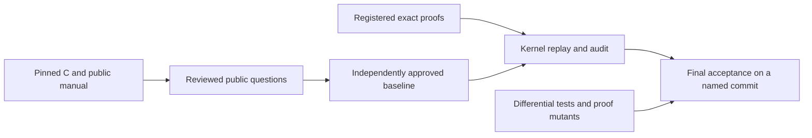

# Checking a verification claim

A green build says that the modules compile. It does not say that zlib is verified.
Acceptance requires proofs of fixed public questions, a faithful C translation and an
independently approved account of the runtime. The remaining work is in
[the overview](../overview.md).

Start with [the public goals](goals.md) to understand the claim. Read
[the anti-cheating policy](../anti-cheating.md) to understand how the question stays fixed
while proofs change. [The trusted base](../trusted-base.md) states the semantic limits.

## Four stages

Run these commands from the repository root. Each stage answers a different question.

| Stage | Command | What a pass establishes | What it does not establish |
| --- | --- | --- | --- |
| Coverage | `python3 scripts/verification.py coverage` | The pinned public header, entry inventory, translated names, manual sections and import closure agree. | That every contract exists or is correct. |
| Development | `python3 scripts/verification.py check` | The project builds, compiled declarations replay in a fresh kernel, the declaration audit passes and locks match. | Completion: open goals remain allowed. |
| Specification readiness | `python3 scripts/verification.py specs` | The development checks pass and all required public propositions exist and are closed. | Semantic completeness, independent approval or proofs of those propositions. |
| Final proof acceptance | `python3 scripts/verification.py final --baseline COMMIT` | Every fixed target has an exactly matching registered proof; the approved baseline is preserved; the strict checks pass on a clean named commit. | Correctness of an unreviewed baseline, the C compiler or the operating system. |

The inventory requires 95 default-build entry contracts, four lifecycle contracts and four
initialisation-domain contracts. Other build configurations remain part of the project goal.
A proposition's existence is not a proof. A proof about an abstract API or the byte format
does not discharge a contract about actual translated execution.

## What the checks establish

| Check | Evidence and limit |
| --- | --- |
| Kernel replay and axiom audit | Check the proof terms and dependencies. Only `propext`, `Classical.choice` and `Quot.sound` are allowed. A correct proof can still answer an incomplete question. |
| Exact goal matching | A registered theorem must have the fixed target as its type. Extra premises, a similar name or an abstract-model theorem do not count. |
| Source and semantic locks | Detect changes to protected source, definitions and registered theorem types. They preserve meaning; they do not judge whether that meaning is correct. |
| No-placeholder check | Rejects unfinished Lean proof sources. A development pass does not waive the final no-placeholder requirement. |
| Differential tests | Compare translated execution with real C, including errors and allocation failure. They are finite evidence of fidelity, not proof. Sanitizer runs extend that evidence. |
| Audit and differential self-tests | Deliberately break their inputs and require the checking mechanisms to detect the change. A passing positive baseline is required first. |
| Proof mutants | Change translated function behaviour and require the function's proof to reject it. Public entries also replay the original exact proof against the mutation. Sensitivity does not prove that every error is covered. |
| Independent review | Judges the runtime, translation, public domains, specifications and lock updates. Init must establish the invariant; no unproved callee contract may be assumed. |

Final acceptance runs a clean build, fresh replay, strict audit, no-placeholder check, audit
self-tests, normal and sanitizer differential runs, the differential self-test and strict proof
mutation lists. The four CI jobs are `build`, `no-sorry`, `audit` and `difftest`. Report a result
as proved only when the required CI is green on the named commit. Never report an unrun check
as passing.

## Who fixes the question

Candidate locks detect drift within a checkout. Authority comes from an independently approved
immutable baseline. Final acceptance compares against that baseline, including the audit code
and original registrations. The final workflow takes its auditor and baseline from `main`;
the development bootstrap path is not final acceptance.

Runtime, translation, domain or specification changes need a separate review with the old and
new meaning, source evidence and generated lock diff. Locks must be regenerated, never edited
by hand. A documentation move that changes protected paths also needs a reviewed policy update.
Required reviews and checks must be enforced by repository protections; a code-owner file alone
does not enforce them. The detailed rules are in [the anti-cheating policy](../anti-cheating.md).

## Guides and review records

| Page | Purpose |
| --- | --- |
| [Public goals](goals.md) | The caller domain, execution, result, frame, ownership and lifecycle obligations. |
| [Proof mutants](proof-mutants.md) | How to run and interpret mutation checks, including strict acceptance. |
| [Public contract review](contract-review.md) | Statement layers, source-review corrections, counterexamples and the advanced-operation boundary. |
| [Local registration review](registration-review.md) | What the recorded local registration checks establish and what remains outside their scope. |
| [Query registration review](query-registration-review.md) | Six exact public queries and their mutation evidence. |
| [PR integration review](pr-integration-review.md) | The reviewed integration snapshot, protected-source changes and audit timeout/orchestration evidence. |
| [Compiler helper review](compiler-helper-review.md) | Six generated recursive execution helpers and their logical counterparts. |
| [Runtime review](runtime-review.md) | Historical findings R1–R13 and translation questions U1–U5. |
| [Heap-table review](runtime-tables-review.md) | Historical findings F1–F6 about array-backed tables and in-place updates. |

Review records preserve evidence and scope. They are not independent baseline approvals and
must not be read as current defect lists. Use [the overview](../overview.md) for current work,
[the API manuals](../spec/api/README.md) for public behaviour, [the design](../design/README.md) for
the model and [the proof guide](../proof/README.md) for implementation arguments.

