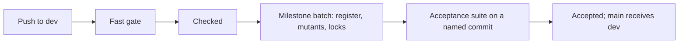

# Checking a verification claim

A green build says that the modules compile. It does not say that zlib is verified.
This page says what each check establishes and where its limit is. To run the checks,
read [contributing](contributing.md). The current status is on the
[results page](../progress.md#scope); the planned scope is in the same place.

## Two levels

- **Checked.** The theorem is on `dev`, and the fast gate is green on that commit. Lean's kernel
  has checked the proof. Day-to-day work is merged at this level.
- **Accepted.** The theorem is also listed in `tests/audit/theorems.txt`, and the acceptance suite
  is green on a commit you name. Only an accepted result may be reported as final.

## Two sets of checks

| Set | When | What it runs |
| --- | --- | --- |
| Fast gate (`build`, `no-sorry`) | Every push and pull request | All modules build, no forbidden construct, no `sorry`, the patches apply to the pinned `zlib/`. It is the only gate for merging. |
| Acceptance suite (`audit`, `difftest`) | Nightly on `main`, and on request with the manual trigger of the `lean` workflow | Axiom gate, exact goal match, locks, self tests, proof mutants, differential tests with and without sanitisers. |

A red nightly run is fixed before new acceptance work. It does not block proof work.
Acceptance work is done in batches at a milestone, not for each change.

## What the checks establish

| Check | Evidence and limit |
| --- | --- |
| Kernel replay and axiom audit | Check the proof terms and dependencies. Only `propext`, `Classical.choice` and `Quot.sound` are allowed. A correct proof can still answer an incomplete question. |
| Exact goal matching | A registered theorem must have the fixed target as its type. Extra premises, a similar name or an abstract-model theorem do not count. |
| Source and semantic locks | Detect changes to protected source, definitions and registered theorem types. They preserve meaning; they do not judge whether that meaning is correct. |
| No-placeholder check | Rejects `sorry` and the other forbidden constructs listed in `AGENTS.md`. |
| Differential tests | Compare translated execution with real C, including errors and allocation failure. They are finite evidence of fidelity, not proof. Sanitizer runs extend that evidence. |
| Audit and differential self-tests | Deliberately break their inputs and require the checking mechanisms to detect the change. |
| Proof mutants | Change translated function behaviour and require the function's proof to reject it. Sensitivity does not prove that every error is covered. |

## Who fixes the question

A statement that is wrong is corrected, not worked around: see `AGENTS.md`. Lock files detect
changes to protected statements. They are regenerated with the audit tool, never edited by hand,
with one line per lock on why it changed. [The anti-cheating page](../anti-cheating.md) lists the
ways a green build can still be worthless and what the acceptance suite defends against.

## Guides and records

| Page | Purpose |
| --- | --- |
| [Contributing](contributing.md) | Numbered steps and commands. |
| [Public goals](goals.md) | The caller domain, execution, result, frame, ownership and lifecycle obligations. |
| [Proof mutants](proof-mutants.md) | How to run and interpret mutation checks. |
| [Public contract review](contract-review.md) | Statement layers, source-review corrections and counterexamples. |

The remaining pages in this folder are records of past reviews. They preserve evidence and
scope. They are not the current process and not current defect lists.

| Record | Content |
| --- | --- |
| [Local registration review](registration-review.md) | What the recorded local registration checks establish. |
| [Query registration review](query-registration-review.md) | Six exact public queries and their mutation evidence. |
| [Compiler helper review](compiler-helper-review.md) | Six generated recursive execution helpers and their logical counterparts. |
| [Runtime review](runtime-review.md) | Historical findings R1–R13 and translation questions U1–U5. |
| [Heap-table review](runtime-tables-review.md) | Historical findings F1–F6 about array-backed tables and in-place updates. |
