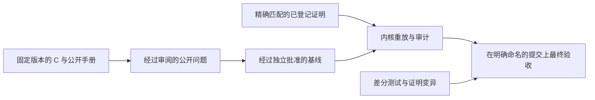

<!-- source-sha256: 6873ba3ce94f6a9984e3c071de9b99f58d9c302d29fe80f743bb58d0f37dd2c7 -->

# 检查一个验证结论

构建通过表示模块可以编译，并不表示 zlib 已完成验证。验收需要证明固定的公开问题、忠实的 C 翻译，以及经过独立批准的运行时说明。剩余工作见[进度](../progress.md)。

先读[公开目标](goals.md)，了解结论的范围；再读[防止取巧的规则](../anti-cheating.md)，了解证明变化时如何保持问题不变。[可信基础](../trusted-base.md)说明语义边界。

对不可变开发提交运行检查时，见[异步验证](async-verification.md)。
队列不改变验收要求。

要添加证明，请按[贡献指南](contributing.zh.md)操作：其中有带确切命令的编号步骤以及 CI 作业与本地命令对照表。术语见[术语表](../glossary.zh.md)。

## 四个阶段

先固定要证明的问题，再检查提交是否真的证明了它。“基线”是经过独立批准、作为比较依据的不可变版本；“内核重放”是让新的 Lean 内核重新检查已编译的证明项。下表中的 `COMMIT` 要替换为该基线的提交标识。

在仓库根目录执行以下命令。每个阶段回答不同的问题。

| 阶段 | 命令 | 通过说明什么 | 不说明什么 |
| --- | --- | --- | --- |
| 覆盖检查 | `python3 scripts/verification.py coverage` | 固定版本的公开头文件、入口清单、翻译后的名称、手册章节和导入闭包一致。 | 每个契约都已存在或正确。 |
| 开发检查 | `python3 scripts/verification.py check` | 项目可构建，编译后的声明在全新内核中重放，声明审计通过，锁文件匹配。 | 验证已经完成：仍允许目标未解决。 |
| 规范就绪检查 | `python3 scripts/verification.py specs` | 开发检查通过，所有要求的公开命题都已存在且为闭合命题。 | 语义完备、独立批准，或这些命题已经有证明。 |
| 最终证明验收 | `python3 scripts/verification.py final --baseline COMMIT` | 每个固定目标都有类型精确匹配的已登记证明；保留经批准的基线；在干净、明确命名的提交上通过严格检查。 | 未经审阅的基线、C 编译器或操作系统正确。 |

清单要求 95 个默认构建的入口契约、四个生命周期契约和四个初始化定义域契约。其他构建配置仍属于项目目标。命题存在不等于命题已被证明。抽象 API 或字节格式的证明不能代替关于实际翻译执行的契约证明。

## 各项检查能说明什么

| 检查 | 证据及其边界 |
| --- | --- |
| 内核重放与公理审计 | 检查证明项及其依赖。只允许 `propext`、`Classical.choice` 和 `Quot.sound`。正确的证明仍可能回答一个不完整的问题。 |
| 精确目标匹配 | 已登记定理的类型必须就是固定目标。额外前提、相似名称或抽象模型定理都不算。 |
| 源码锁与语义锁 | 检测受保护源码、定义和已登记定理类型的变化。它们保持含义不变，但不判断这个含义是否正确。 |
| 无占位证明检查 | 拒绝未完成的 Lean 证明源码。开发检查通过不会免除最终的无占位证明要求。 |
| 差分测试 | 比较翻译后的执行与真实 C，包括错误和分配失败。它们是忠实性的有限证据，不是证明。带运行时内存／未定义行为检测的 Sanitizer 运行扩展了这类证据。 |
| 审计和差分自测 | 故意破坏输入，并要求检查机制发现变化。必须先通过未修改的正向基线。 |
| 证明变异 | 改变翻译后函数的行为，要求该函数的证明拒绝它。公开入口还会将原来的精确证明针对变异重放。敏感性不等于覆盖所有错误。 |
| 独立审阅 | 判断运行时、翻译、公开定义域、规范和锁更新。Init 必须建立不变量；不能假设未经证明的被调函数契约。 |

最终验收会执行干净构建、全新重放、严格审计、无占位证明检查、审计自测、普通差分运行与带 Sanitizer 检测的差分运行、差分自测，以及严格证明变异列表。四个 CI 作业是 `build`、`no-sorry`、`audit` 和 `difftest`。只有明确命名的提交上所需 CI 全部通过，才能报告结果已证明。绝不能把未执行的检查报告为通过。

## 谁来固定问题

候选锁文件检测同一个检出目录内的偏移。权威依据来自经过独立批准的不可变基线。最终验收与该基线比较，包括审计代码和原始登记项。最终工作流从 `main` 获取审计器与基线；开发期间的引导流程不属于最终验收。

运行时、翻译、定义域或规范变化需要单独审阅，说明旧含义、新含义、源码证据，以及生成的锁文件差异。锁必须重新生成，不能手工编辑。文档移动若改变受保护路径，也需要经过审阅的策略更新。所需审阅与检查必须由仓库保护规则强制执行；仅有代码所有者文件不能强制执行它们。详细规则见[防止取巧的规则](../anti-cheating.md)。

## 指南与审阅记录

| 页面 | 用途 |
| --- | --- |
| [公开目标](goals.md) | 调用者定义域、执行、结果、帧性质、所有权和生命周期义务。 |
| [证明变异](proof-mutants.md) | 如何运行和解释变异检查，包括严格验收。 |
| [公开契约审阅](contract-review.md) | 命题分层、源码审阅修正、反例和高级操作边界。 |
| [本地登记审阅](registration-review.md) | 已记录的本地登记检查说明什么，以及其范围之外的内容。 |
| [查询登记审阅](query-registration-review.md) | 六个精确公开查询及其变异证据。 |
| [PR 集成审阅](pr-integration-review.md) | 审阅过的集成快照、受保护源码变化，以及审计超时和编排证据。 |
| [编译器辅助声明审阅](compiler-helper-review.md) | 六个生成的递归执行辅助声明及其逻辑对应定义。 |
| [运行时审阅](runtime-review.md) | 历史发现 R1–R13 和翻译问题 U1–U5。 |
| [堆表审阅](runtime-tables-review.md) | 关于数组支撑的表和原位更新的历史发现 F1–F6。 |

审阅记录保留证据及其范围。它们不是独立基线批准，也不能当成当前缺陷清单。当前工作见[进度](../progress.md)，公开行为见 [API 手册](../spec/api/README.md)，模型见[设计](../design/README.md)，实现论证见[证明指南](../proof/README.md)。
