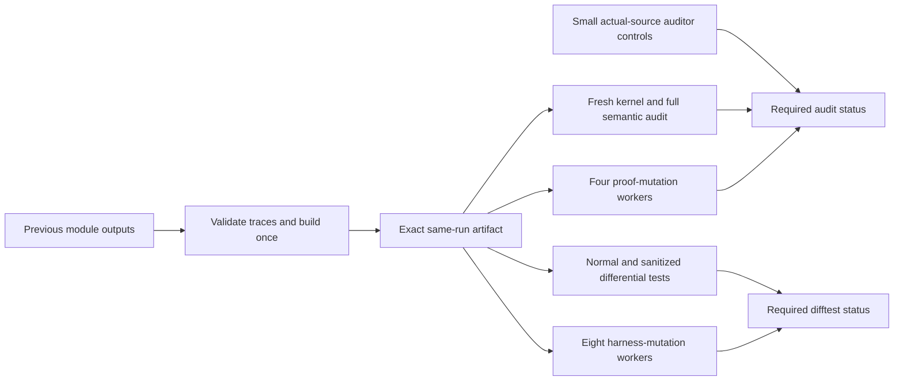

# CI audit performance

The largest measured delay was the negative audit test. Each sample imports
the full library. The old auditor collected axioms independently for every
declaration. Shared dependencies were visited many times. Invalid imports
also produced the complete semantic report before rejection.

The auditor now builds one dependency graph from all audited definitions
and theorems. It follows types and values, including private definitions,
axiom types and inductive constructors. Forbidden axioms propagate along
reverse edges until no new dependencies remain. Building the graph before
propagation handles cycles without treating a partially visited node as clean.
The allowed axioms and reviewed compiler exceptions are unchanged.

A rejected declaration still fails the run. It does not need a complete
semantic report. Every successful run still emits all semantic records,
registered theorem types and goal results. Fixture tests compare the new
collector with Lean's original collector for every audited root. They also
cover private dependencies, axiom types and mutually recursive inductives.

The same source compiles to the `zlibf-audit` executable. The verification
driver builds it in the invoking auditor checkout. It loads the candidate's
compiled declarations without executing their initializers. Negative tests
build the executable once in the invoking snapshot and use that
exact executable for every isolated mutation. Candidate changes cannot
select a replacement auditor.

One full-library measurement covered 36,106 declarations and 406 registered
theorems. Compiling the original auditor alone took 788 seconds to run.
The shared traversal took 62 seconds. Both produced the same 481,854,479-byte
report, byte for byte, as the earlier completed interpreter audit. This
measures the declaration audit, not fresh kernel replay, source compilation,
proof mutants or an entire remote CI run.

All negative samples remain present. Each retains its real unmodified
baseline, isolated build and required rejection. Per-sample elapsed times
make subsequent bottlenecks visible. Fresh kernel replay and full semantic
locks remain independent checks.

The source-span parser also compiles once in the invoking checkout. Every
call still parses the actual source and mutant, without elaborating their
imports. Each invocation runs in a clean temporary directory with only the
pinned standard-library search path. A parity test compares its output with
the interpreter while candidate search paths and an unresolvable source
import are present. No parsed-source result is cached.

## One build and independent checks

The producer restores earlier module outputs, then asks Lake to build every
library module and differential driver. Lake checks source and dependency
traces; a cache hit never means that verification passed. The key separates
toolchains, configurations, native compilers and operating-system versions.
A source change can restore the previous key and reuse unchanged modules.
GitHub can evict a cache. A missing cache requires compilation again.

The producer publishes one immutable archive for the current workflow run.
Each consumer checks the exact commit, every tracked Lean input, toolchains,
platform and compiler before extraction. Archives cannot overwrite source or
contain links. Consumers use `lake --no-build build ZlibF`: stale or missing
outputs fail instead of starting another full compile. Tests mutate private
copies and retain their positive controls. The independent approved auditor
builds its own tools; candidate native executables do not replace them.

All 13 original auditor controls use unchanged source closures. Declaration
controls import the actual runtime. Runtime and translation edits must compile
and then fail the unchanged semantic-lock comparator. The statement edit uses
the actual registered function theorem. Each fixture first compiles, passes
the auditor and records its own positive semantic baseline. A compiler error,
timeout, crashed auditor, unapplied edit or wrong lock failure fails the test.
The full-project positive audit and committed locks remain a separate required
check. No zlib claim is derived from these small control fixtures.

A local run of the 13 controls took 32.37 seconds. This is a local measurement,
not the complete Linux workflow. Historical full-library control shards took
110 and 156 minutes; the latter hit the old job deadline.

The proof mutation partition preserves every public goal bundle, its unchanged
exact-proof baseline and all rows of every referenced full proof list, including
rows outside the public registry. The initial inventory has 49 goals, 64 exact
public mutants and 146 full-list rows. Four independent runners partition it
without overlap. The differential harness uses its existing complete row
partition on eight runners. Required statuses reject skipped, cancelled and
failed workers. Matrix fail-fast is disabled so remaining checks still run.

The exact-proof replay program is unchanged Lean source compiled once as a
native executable. Every call still reconstructs the original proof dependency
closure and checks it in a fresh kernel. The regression suite compares native
and interpreter return codes and complete standard output for positive,
insensitive and actual-result-changing mutants.

## Complete workflow measurements

All three measured Linux workflows completed successfully. The first two
used four proof workers and four differential-harness workers, with sixteen
jobs each. The third used four proof workers and eight harness workers, with
twenty jobs. The second source snapshot includes thirteen additional proof
modules; the third includes subsequent proof additions.

| Measurement | First cold run | Following incremental run | Eight-worker incremental run |
| --- | --- | --- | --- |
| Source | `20f9f41b` | `940e95e4` | `a5d53005` |
| Workflow, including queue | 52 min 42 s | 33 min 4 s | 25 min 54 s |
| Initial queue and runner wait | 2 s | 2 min 59 s | 5 min 38 s |
| Execution from first job start | 52 min 40 s | 30 min 5 s | 20 min 16 s |
| Library build step | 21 min 50 s | 41 s | 14 s |
| Differential driver build step | 18 s | Below one second | 1 s |

The [cold run](https://github.com/cla7aye15I4nd/zlib-f/actions/runs/42543153993)
and [four-worker incremental run](https://github.com/cla7aye15I4nd/zlib-f/actions/runs/42547590505),
followed by the [eight-worker incremental run](https://github.com/cla7aye15I4nd/zlib-f/actions/runs/42554891749),
retain full kernel replay, semantic locks, all mutants, ordinary C comparison
and ASan/UBSan. These are complete workflow results, not summed parallel times.
The first build saved a reusable module cache on main. Successful transport and
source validation let the other jobs consume that build without recompiling it.

The incremental run's longest harness worker took 28 min 25 s. The longest
proof worker took 16 min 47 s and the core audit took 15 min. The next tuning
therefore used eight differential-harness workers and kept four proof workers.
All 445 original harness rows remain: 410 must differ and 35 must agree. Every
worker retains all positive baselines, full inputs and unchanged verdict rules.
An actual-shell regression checks eight nonempty shards without duplicate or
missing controls. The complete eight-worker run passed all twenty jobs. Its
longest harness worker took 17 min 36 s, its longest proof worker took 19 min
9 s and its core audit took 15 min 10 s. The producer restored the module
cache in 6 s; the entire build job, including publishing outputs, took 59 s.

Main pushes now queue behind the active run. Superseded PR runs still cancel.
This fixes a measured cancellation after 28 min 42 s of cold compilation,
before the artifact and cache were saved. No checks are skipped for site edits.
These runs establish a complete cold workflow below one hour and a cached
incremental workflow below thirty minutes, including queue. They do not
establish a cold workflow below thirty minutes. Queue delays and future
source changes can increase elapsed time.
