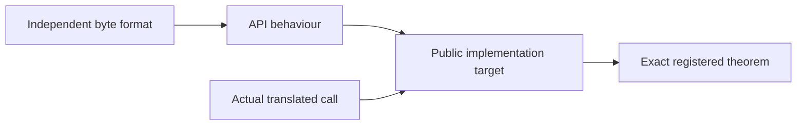

# Public contract review record

This record explains the source review and counterexamples behind the 95 default-build
entry contracts and eight family targets. It is not independent approval of a semantic
baseline. Statements about checked proofs below describe the recorded review evidence;
current acceptance still requires the registry and CI on a named commit. Current remaining
work is listed only in [the overview](../overview.md).

## Three specification layers

| Layer | Meaning |
| --- | --- |
| `ZlibF/Spec/Format` | Legal DEFLATE, zlib and gzip bytes, decoding and checksums. |
| `ZlibF/Spec/Api` | Heap-free API models. Some older models cover only documented call patterns. |
| `ZlibF/Spec/Public` | Fixed implementation targets: actual execution, caller domain, result, frame and ownership. |

`Calls.lean` fixes the actual translated entry. Public targets cannot replace it with an
empty execution relation or assume that a library callee satisfies its specification.
A format or abstract-model proof alone does not verify a public function.

## Scope of the statement review

| Group | Target modules | Obligations reviewed |
| --- | --- | --- |
| Checksums and queries | `Checksums`, `Queries` | Null-buffer conventions, all scalar values, signed combine lengths, immutable heap and constant tables. |
| Init and reset | `Initialisation`, `Lifecycle`, `Domains` | Version/error order, every signed parameter, allocation failure, exact cleanup and established nonempty domains. |
| Stream operations | `StreamQueries`, `Streams`, `Copy` | Clean refusals, counters, partial output, dictionary windows, bit insertion, bounds and independent copied ownership. |
| Buffer utilities | `Utilities` | Compatibility wrappers, scalar cells, trailing input, partial output on memory failure, exact lengths and temporary cleanup. |
| Callback inflate | `Back` | Actual finite returning callbacks, adaptive input, shared-allocation descriptors, raw output and caller-owned window. |
| Gz handles | `GzState`, `GzOpen`, `GzControl`, `GzRead`, `GzWrite`, `GzClose` | Lazy allocation, inactive dangling fields, recovery, positions, whole-item counts, borrowed messages, accepted bytes, seek zeros and descriptor cleanup. |
| Lifecycles | `Sequences`, `GzTrace` | Every admitted next call returns, init-established invariants, exact allocation changes, cleanup, ordinary format epochs and complete writer output. |

Source readings remain **to confirm** by implementation proofs outside the named checked
results. [The API manuals](../api/README.md) explain the operations. Historical execution
notes and proof-status prose never override the registry or required CI.

## Source-review corrections

The review identified these distinctions in the target statements:

- `Uncompress2` permits output before a late memory failure. It shares its data relation with
  the concrete utility targets. Buffer exhaustion does not imply that unused trailing bytes
  extend a valid stream. Init-failure length cells can remain unchanged; later failures store counts.
- Stream queries include null and clean invalid-state refusals. Priming follows the source's
  zero, negative and overflow order. Optional output cells are independently optional.
- The pinned `gz_look` first checks four header bytes. Wrong methods, flags or shorter files
  can select transparent input. Later members go directly to inflate. The default buffer is
  8192 bytes; `gzbuffer` clamps to eight and rejects doubling overflow. Formatting refusal
  returns a stream error separately from an empty or oversized result.
- The header does not promise refusal of every invalid scalar in `gzsetparams`. For valid
  parameters, success updates the inner compressor as well as the outer fields.
- Callback descriptors may share an allocation with the window. They preserve the window
  slice; their observation invariant ignores only that slice. The whole-function target is
  universal over those invariants, so choosing a loose invariant cannot discharge it.

These are readings of the selected C **to confirm** by complete implementation proofs.
Their presence in compiled propositions does not establish that those propositions are complete.

## Counterexamples to the old statements

The independent follow-up used immutable commit `a655458` as its old specification. It did
not change public caller domains, translated functions or runtime operations.

| Input or state | Old statement's error | Correction and recorded evidence |
| --- | --- | --- |
| Raw bytes `73 04 42 00`, one output byte | The actual first call returns `Z_OK` and `A` after pulling an impossible distance. Whole-lookahead validity rejects that result. | Require a supporting bit prefix with a valid completion, and require every compatible completion to extend the output. A kernel proof rejects the old clause and checks a model witness. The paired C/translation regression includes the following `Z_DATA_ERROR`. |
| Valid gz reader, allocated message, empty read-only table | `dropWindow` resized the read-only table by storing its default value. Actual `freeB` leaves that table unchanged. | Remove only the byte block. A generic theorem covers every `WindowAllocation`; the complete `gzclearerr` public proof checks the corrected target. |
| Model state with `2^63` decode-table slots | The query view omitted the fixed C array layout, allowing pointer subtraction beyond `ptrdiff_t`. | Require the actual 1444-entry `codes[ENOUGH]` layout. A kernel counterexample preserves the old question; an exact public `inflateCodesUsed` proof checks the correction. |

The causal-output correction also applies to shared `Uncompress2`. Universal determinacy
alone can be vacuous after malformed lookahead. Neither corrected clause assumes validity
of the remaining lookahead. The unchanged decoder-model question still needs refinement to
actual decoder execution. The separate legacy fixed detection-lag clause has a counterexample;
this record does not treat that model as an approved implementation refinement.

The cleanup helper is shared by `inflateReset`, `inflateReset2`, `gzrewind` and `gzclearerr`.
Their allocated blocks are writable and require the same byte removal. The generic effect
proof does not prove every caller. This was a specification representation error, not an
upstream defect.

The query layout comes from `inflate.h` and the 852+592 bound in `inftrees.h`. The existing
`Good` invariant entails it. Init and actual transitions must establish and preserve that
invariant; the sequence target requires this as a conclusion. No public scalar limit was added.

The deflate target also fixes both directions of stream-error classification under its live-state
premise: invalid flush, invalid null buffers, or a non-finish call after finishing began.
Merely listing permitted error codes would allow spurious refusal. The message-writing refusal
is distinct from the earlier invalid-flush return; only the latter promises an unchanged heap.

Recorded model mutants remove causal evidence, restore whole-lookahead validity or drop the
input-prefix requirement. Public `gzclearerr` mutants omit error clearing or retain EOF flags.
Their rejection checks proof sensitivity. Differential comparisons remain finite execution evidence.

## The advanced-operation boundary

Sequence safety and cleanup include all admitted operations, including reset, copy and recovery.
Ordinary data epochs connect actual accepted and produced bytes to the independent format and
include sufficient-room completion. Trace constructors compute eligibility markers; a proof
cannot freely choose or clear them.

One initial dictionary describes an ordinary RFC stream. Replacing a raw decoder dictionary
midstream changes that context. The marker records the change; its per-entry window effect
and sequence safety remain required. Priming, header capture and recovery also retain concrete
operation targets. The target set does not yet amount to full operational refinement of every
advanced combination. This boundary does not remove their safety obligations.

Gz writer histories record actual calls, accepted input and consumed seek zeros. Final close
must produce gzip members decoding to that data, or the same bytes in transparent mode.
Existing file prefixes and tails are accounted for. Position-only contracts are insufficient.

## Review and approval

A proposed statement correction needs immutable old and new statements, a C/manual comparison
and an explanation of the failed question. Separate a proof-technique problem, wrong
specification, translation mismatch and upstream defect. An internal-invariant counterexample
does not justify narrowing a public precondition. Init and earlier calls must establish any
replacement invariant. Callee contracts remain proved results.

A confirmed specification error belongs in its own reviewed change with regression evidence
and regenerated locks. Readiness checks presence, compilation, fresh replay and lock agreement;
it cannot decide semantic completeness. Independent review must approve the public domains,
representation limits and runtime before a commit becomes an authority baseline.
