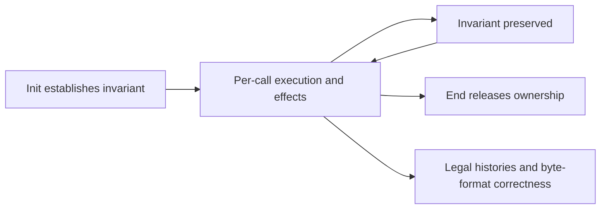

# Public verification goals

The claim is safety and documented behaviour for the public API. The first target is the
default x86_64 Linux static build with the default allocator. Allocation failure is in scope.
The project also targets every configuration built by upstream CI.

`tests/audit/public-api.json` fixes the public inventory against the pinned `zlib.h`. Each
entry names a translated function, a manual section and its required final target. There are
95 default-build entries and eight family obligations: four lifecycle contracts and four
initialisation-domain contracts. The Windows-only `gzopen_w` is identified separately.
An inventory entry is a requirement, not a proof.

## A contract covers the whole call

| Part | Required statement |
| --- | --- |
| Domain | Cover every call permitted by the public contract. Rejected scalar parameters have a specified error path. Establish internal helper bounds in the implementation; do not add them as caller requirements. |
| Execution | The actual translated entry returns without a runtime fault, including fuel exhaustion. Quantify over every permitted initial heap and allocation-failure oracle. An empty execution relation cannot satisfy the contract. |
| Result | Specify return codes, scalar outputs, output bytes and stream changes, including error ordering, partial output and counters. An error code alone does not imply an untouched buffer. |
| Frame | Preserve caller storage outside permitted write ranges and unrelated live objects. |
| Ownership | Init and copy establish ownership. Failed init and copy release partial allocations. End and close release owned resources exactly once. Ordinary errors preserve documented recovery or cleanup operations. |

The concrete targets are in `ZlibF/Spec/Public/`; `Domains.lean` and `Sequences.lean` add the
family obligations. `Calls.lean` fixes actual translated execution. [The contract review](contract-review.md)
explains the separation from heap-free API models and [the independent byte format](../format/README.md).
Neither kind of model theorem alone proves a concrete public contract.

[The API manuals](../api/README.md) explain signatures, parameters, effects, call order and
ownership. Some short manuals describe restricted uses. Their documentary preconditions do
not remove cases from registered targets. [The manual scope](../api/contracts.md) and
[deviations](../deviations.md) make those restrictions explicit. Formal target changes require
separate review.

## Lifecycles and non-vacuity

Four targets cover inflate, deflate, callback inflate and gz histories. Safety and cleanup
quantify over finite legal histories, including reset, dictionary changes, copy, recovery,
end and close where allowed. Copies own independent storage and preserve observable
continuation behaviour.

Ordinary data epochs connect accepted and produced bytes to the independent format. Completed
compression produces valid data. Decompression recovers its input under compatible wrapper,
window and dictionary settings. Checksums satisfy their mathematical definitions. Advanced
operations retain their per-entry effects and unconditional sequence safety; the exact
ordinary-epoch boundary is in [the contract review](contract-review.md#the-advanced-operation-boundary).
It must not be mistaken for full refinement of every advanced combination.

The four initialisation-domain targets require init to establish the representation invariant
for every documented parameter combination on success, and to clean up on failure. This makes
the domain nonempty through actual initialisation. One convenient witness does not replace
universal parameter coverage. Concrete witnesses supplement the top-level results.
No final theorem may assume an unproved library callee contract.

## Caller assumptions and semantic limits

The caller supplies live objects and the readable or writable ranges required by the API.
Calls on one stream are sequential. The caller does not modify library-owned state.
Buffer-overlap conditions and scalar-pointer representation limits require review against
the public contract. Every stronger restriction belongs in [deviations](../deviations.md).
Undefined behaviour in a permitted library call is a blocker, not a new caller restriction.

Callbacks and system calls are external. Their documented memory contracts are assumptions.
Termination also assumes that they return and that callback input is finite where an unlimited
stream could otherwise continue forever. This is not a theorem about arbitrary caller code
or the operating system.

The claim excludes compiler and operating-system correctness, performance, constant-time
behaviour and resource bounds against decompression bombs. Malformed compressed data remains
in scope. The trusted semantic limits are in [the trusted base](../trusted-base.md).

## Acceptance

[The checking guide](README.md) separates coverage, development checks, specification readiness
and final proof acceptance. Each final target needs an exactly matching registered theorem,
allowed axiom dependencies, init-established invariants, frame and ownership proofs, and
function proof mutants. Independent review must approve the questions and baseline. All four
CI jobs must pass on the named commit. Finite differential tests support fidelity; they are
not proof. Current proof progress and blockers appear only in [the overview](../overview.md).
