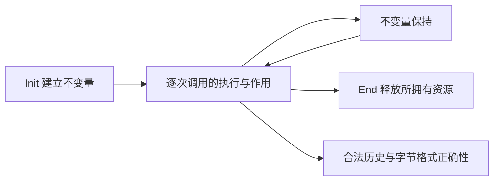

<!-- source-sha256: 235344fd23573fe6d4e185bf3e3f9f67acc65162425915407ffd511c39779631 -->

# 公开验证目标

结论要求公开 API 安全并满足文档规定的行为。首个目标是默认 x86_64 Linux 静态构建，使用默认分配器。分配失败属于范围之内。项目还以覆盖上游 CI 构建的每一种配置为目标。

`tests/audit/public-api.json` 根据固定版本的 `zlib.h` 固定公开入口清单。每个条目给出翻译后的函数、手册章节及其所需最终目标。共有 95 个默认构建入口和八个族级义务：四个生命周期契约和四个初始化定义域契约。其 `safety_goals` 组列出当前范围的十个安全目标：`inflate` 和 `deflate` 调用序列、`uncompress*` 和 `compress*`。仅 Windows 支持的 `gzopen_w` 单独标识。清单条目是一项要求，不是证明。

## 契约覆盖整个调用

先以一次有输出的解压调用为例：返回码正确还不够，写入字节、输入／输出指针、保留状态与内存访问范围都必须描述同一次执行。“帧性质”约束没有被授权修改的内存保持不变；“所有权”约束哪些分配归流保管、最终由谁释放。

| 部分 | 必须陈述的内容 |
| --- | --- |
| 定义域 | 覆盖公开契约允许的每个调用。拒绝的标量参数有明确错误路径。在实现内部建立辅助函数的界限，不把它们加成调用者要求。 |
| 执行 | 实际翻译后的入口返回时没有运行时故障，包括步数预算耗尽。对每个允许的初始内存状态（堆）以及每种允许的分配成功／失败安排量化；后者在模型中由分配失败预言机给出。空的执行关系不能满足契约。 |
| 结果 | 指定返回码、标量输出、输出字节和流状态变化，包括错误顺序、部分输出和计数器。仅凭错误码不能推断缓冲区未被修改。 |
| 帧性质 | 保留允许写入范围以外的调用者存储，以及无关的存活对象。 |
| 所有权 | Init 和 Copy 建立所有权。失败的 Init 和 Copy 释放部分分配。End 和 Close 恰好一次地释放所拥有资源。普通错误保留文档允许的恢复或清理操作。 |

具体目标位于 `ZlibF/Spec/Public/`；`Domains.lean` 和 `Sequences.lean` 添加族级义务。`Calls.lean` 固定实际翻译后的执行。[契约审阅](contract-review.md)解释它们与无堆 API 模型、[独立字节格式](../spec/format/README.md)的区别。任何一种模型定理都不能单独证明具体公开契约。

[API 手册](../spec/api/README.md)解释签名、参数、作用、调用顺序和所有权。有些简短手册描述受限用法。其文档前提不会从已登记目标中移除其他情形。[手册范围](../spec/api/contracts.md)和[偏离说明](../deviations.md)明确这些限制。形式目标变化需要单独审阅。

## 生命周期与非空性

四个目标覆盖 inflate、deflate、回调 inflate 和 gz 调用历史。安全和清理对有限的合法历史量化，包括允许的 Reset、字典变化、Copy、恢复、End 和 Close。副本拥有独立存储，并保留可观察的后续行为。

普通数据阶段把实际已接受和已产生的字节联系到独立格式。完成的压缩产生有效数据。在包装、窗口和字典设置兼容时，解压还原输入。校验和满足其数学定义。高级操作仍须满足各入口作用和无条件的序列安全；普通数据阶段的精确边界见[契约审阅](contract-review.md#the-advanced-operation-boundary)。不能把这个边界误认为已经完整细化所有高级组合。

“定义域非空”要求允许的状态确实能由初始化产生，不能只证明一个永远无法满足的前提。四个初始化定义域目标要求：Init 对每个文档规定的参数组合，在成功时建立表示不变量，失败时清理。实际初始化由此保证定义域非空。一个方便的见证不能替代所有参数的覆盖。具体见证补充顶层结果。最终定理不得假设未经证明的库内被调函数契约。

## 调用者假设与语义边界

调用者提供存活对象，以及 API 要求的可读或可写范围。同一个流上的调用按顺序执行。调用者不修改库所拥有的状态。缓冲区重叠条件和标量指针的表示限制需要对照公开契约审阅。任何更强限制都应写入[偏离说明](../deviations.md)。允许的库调用若出现未定义行为，这是阻塞问题，而不是新增调用者限制的理由。

回调和系统调用属于外部。其文档规定的内存契约是前提假设。终止性还假设它们会返回，并且在无限输入可能导致永久运行的场景中，回调输入有限。这不是关于任意调用者代码或操作系统的定理。

结论不包括编译器和操作系统正确性、性能、常数时间行为，也不包括抵御解压炸弹的资源界限。格式错误的压缩数据仍在范围内。可信语义边界见[可信基础](../trusted-base.md)。

## 验收

[检查指南](README.md)区分覆盖、开发检查、规范就绪和最终证明验收。每个最终目标都需要精确匹配的已登记定理、允许的公理依赖、由 Init 建立的不变量、帧性质与所有权证明，以及函数证明变异。验收套件必须在明确命名的提交上通过。有限差分测试支持忠实性判断，但不是证明。当前证明进度和阻塞项只在[进度](../progress.md)中记录。

`Goal.deflate` 的公开变异体（`tests/proof-mutants/public-deflate.tsv`，在 `tests/audit/public-mutants.json` 中登记）是对 `deflate` 函数体的单文件修改。每一个都首先在 `deflate_phases` 处被拒绝；它是把 `deflate` 拆成各阶段的 `rfl` 等式，函数体的任何修改都会在那里失败。因此这些行只说明已登记的证明与翻译绑定，并不说明证明依赖被修改的检查。它们只因语义上的杀死已由每个变异分片都运行的脚本行表覆盖，才可用于精确的公开重放：`tests/proof-mutants/deflate-header.tsv`（头部阶段和 `_tr_flush_block`）、`tests/proof-mutants/deflate-strategies.tsv`（`fill_window`、`longest_match` 和各压缩策略）以及 `tests/audit/proofmut/deflate.tsv`（流操作）。每个脚本行在翻译及其所有证明重述中做相同修改，并且必须在其语义引理处被杀死。如果其中任何一张表缺失或为空，分片即失败（`scripts/verification.py` 中的 `SAFETY_MUTANT_LISTS`）。
