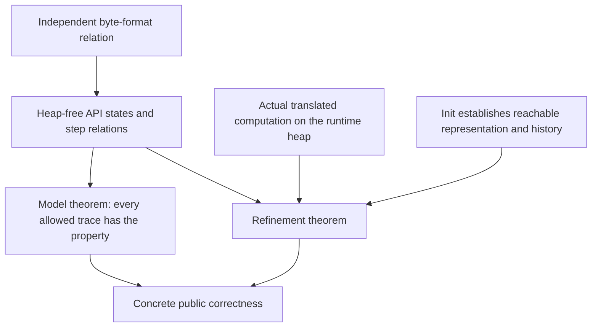

# API models and the concrete boundary

There are two different kinds of API statement in this repository. The heap-free relations in
`ZlibF/Spec/Api/` describe histories of bytes and allowed results. The concrete public targets in
`ZlibF/Spec/Public/` name translated calls and their runtime effects. A theorem about a heap-free
relation is not a theorem about a C entry point. Read the [public API manual](../spec/api/README.md)
for individual calls and the [target guide](../checking/goals.md) for acceptance requirements.

This page explains the models' structure and limits. It does not supply missing refinement
proofs or replace the public targets. [Progress](../progress.md) records their current status.

## Three connections a correctness claim needs

A model relation permits only the behaviours written in its clauses. Proving a consequence of
those clauses can be useful, even when the consequence closely follows a clause. The substantive
implementation obligation is to prove that actual executions satisfy every relevant clause.
Initialisation must establish the concrete representation/history relation. Callers must prove
helper preconditions using the translated init and helper theorems, without assuming callee
contracts.

The public targets also include safety, frame, ownership, lifecycle and exact scalar effects
that a byte-history model cannot express. Narrow uses described by a model or a focused manual
do not narrow those targets. See [representation limits](../deviations.md).

## Where the definitions live

Paths below are relative to `ZlibF/Spec/Api/`.

| Module | Role |
| --- | --- |
| `Basic.lean` | Return codes, flush values, parameter checks, wrapper selection and format viability |
| `Header.lean` | Gzip header requests, output records and header bytes |
| `Inflate.lean` | Inflate state, step relations, dictionaries, recovery and callback decoding |
| `Deflate.lean` | Deflate state, step relations, flush history, dictionaries and bounds |
| `Compress.lean` | One-call compression/decompression relations and numeric bounds |
| `Gz.lean` | File-handle state machines over abstract file contents |
| `Run.lean` | Operation datatypes, family dispatch and traces |
| `Iface.lean` | Abstract `HeapApi` interface used by legacy refinement goals |
| `Concrete.lean` | Direct runtime execution, successful-run correctness and selected compressor targets |
| `Goals.lean` | Named propositions about models and refinement |
| `Examples.lean` | Small model witnesses and computable checks |

## State, calls and histories

`InflState` remembers input consumed and output delivered since reset (`seen`, `out`).
`DeflState` remembers accepted input and produced output (`input`, `produced`). A step is a
relation, such as `InflStep st call result st'`, rather than an implementation function.
The public interface allows different amounts of progress per call and different compressor
block choices. The relation constrains those choices without selecting an algorithm.

A trace re-presents unconsumed input and varies the available output room and flush values.
`InflTrace` and `DeflTrace` therefore support claims across arbitrary chunk boundaries within
their represented operation families. The model's totals are natural numbers; the concrete
`uLong` totals on LP64 must be related modulo `2^64`.

The call record uses `badBuf` for a null output buffer, or a null input buffer with nonzero
input length. It has no actual null pointers or overlapping memory. Those shapes and aliases
belong to the concrete boundary.

Data claims depend on the state's precision flags. Priming, recovery and disabled checksum
validation can remove the ordinary byte-format interpretation. `InflState.Exact` requires both
precision and validation. Weaker data interpretation never removes the concrete safety,
termination or exact per-call effect requirements.

The core history model omits `msg` and `data_type`. It models `adler` as the applicable checksum
of delivered inflate output or accepted deflate input. Numeric queries such as `deflateUsed`,
`inflateCodesUsed`, `zlibCompileFlags` and checksum-combine entry points do not have complete
contracts here; their concrete targets are separate.

## Inflate: output needs causal evidence

`Layer.Decodes wrap wbits dict stream output` selects the independent raw, zlib, gzip or automatic
wrapper relation. For raw data it uses the effective suffix of the dictionary. For zlib it
also checks the header window against the configured window, with zero selecting the header's
window.

| Relation | Meaning |
| --- | --- |
| `Layer.Viable` | A byte prefix has a complete valid continuation, with a short header allowance |
| `Layer.Consistent` | Some completion of the consumed bytes has the proposed output prefix |
| `Layer.Determined` | Every complete stream compatible with the consumed byte history extends that output |
| `Layer.OutputEvidence` | Some supporting bit prefix has a valid completion, and every compatible completion under every permitted dictionary extends the output |
| `Layer.Detectable` | An earlier byte prefix is nonviable by the configured detection lag |

Existential consistency alone allows guessing output from a favourable unread continuation.
Universal determinacy rules that out. Supporting-bit evidence also prevents vacuity when pulled
lookahead already contains an unchecked error. `InflState.Consistent` uses
`Layer.OutputEvidence`; `InflState.Determined` separately quantifies over every permitted
dictionary. Both occur in the ordinary and late-memory-error relations.

An unknown preset dictionary is not the empty dictionary. Before a wrapped stream requests it,
a legal continuation may still supply it. For an exact, full-window stream, a data error must
be justified for every dictionary still permitted by the state. Once supplied, that dictionary
is fixed.

`FullWindow` marks the configurations for which every format-valid distance is supported.
The ordinary round-trip target uses a 15-bit inflate window. A smaller configured window can
reject an otherwise valid stream, depending on call chunking: a distance can reach bytes in
current-call output that are no longer available in a smaller saved window. The full-window
condition qualifies the abstract rejection/completion claims; it is not a public safety
restriction.

The legacy `detectLag = 8` does not describe actual inflate. A dynamic-table prefix can be
impossible at byte 230 while a call consumes 281 bytes and returns `Z_OK`. Thus a theorem about
`Goal.inflate_rejects_invalid` would establish a model property, not this implementation timing
claim. The discrepancy is recorded in [progress](../progress.md); it must not be hidden by
changing the public input domain.

`InflRunOk` describes cursor progress, totals, return codes, stopping, format clauses, checksums
and requested header fields. `InflRunMem` describes failure to allocate the history window at
call exit. That failure can follow input reads and nonempty output writes while `total_in`,
`total_out` and `adler` retain their old values. It enters the memory-error phase. The model's
liveness claims allow this outcome in place of normal completion. This behaviour is distinct
from an early allocation failure that has not written output.

Negative `inflatePrime` values contribute their low bits: the model takes the nonnegative
remainder modulo `2^bits`. `InflMark` describes only the fresh-state case. `InflSyncPoint` and
priming after input have partial abstract descriptions. `InflGetDict` describes a running stream
with a fixed window. `InflBack` represents its two callbacks as pure functions of call number;
that relation does not model arbitrary callback heap effects.

## Deflate: byte validity and call history

`DeflState.Valid` relates completed output to all accepted input and the selected wrapper.
`DeflState.FlushedAt` describes output at a completed sync/full flush. `DeflRun` also records
pending bytes, buffered bits, checksum updates and return-code conditions.

The historical `started` flag is monotone until reset, including refused calls. Erasing it on a
refusal would permit changing a dictionary after an already-written wrapper header. The model's
`done` flag becomes true exactly when it was already true or a call returns `Z_STREAM_END`.
A buffer error does not finish the stream. The model records a completed full flush when the
call returns `Z_OK` with room left, and retains the corresponding input/output split for the
raw resynchronisation property.

`DeflState.bound` gives the numeric `deflateBound` formula. Output adequacy is a separate clause,
guarded by the model's `clean` flag and its exact transition rules. Parameter changes, priming,
tuning, dictionary changes and flushes need their own effects accounted for; a numeric formula
alone proves no output bound. `compressBound` is the saturated default formula, whereas the
abstract `deflateBound` formula has no overflow clamp.

The dictionary models do not describe every operational use. Raw `InflSetDict` is restricted
to the pre-input case although C permits later window amendments. `DeflSetDict` describes the
documented pre-compression order and refuses some calls that C accepts after stream end. These
limits are recorded in [deviations](../deviations.md). A byte-format epoch with one initial
dictionary cannot represent arbitrary later dictionary replacement.

## One-call utilities: bytes and scalar cells differ

`Compress2` is a data-only relation. `CompressCall` and `CompressResult` add pointer shape,
capacity and the separately stored length; `Compress2Z` preserves the `_z` entry's check order:

1. Reject a null source with nonzero length, a null length cell, or a null destination with
   positive capacity. A present length cell keeps its value.
2. Clear the stored length before initialisation. An invalid level is refused before an
   allocator failure can occur.
3. A null destination with zero capacity passes those checks. Init may return a memory error;
   otherwise the inner compressor refuses the null destination.
4. For acceptable shapes, the data relation supplies written bytes and the stored length.

The compatibility wrapper reads the length cell before these checks. A null cell faults;
it is not a clean `_z` argument refusal. Scalar-cell aliasing with input/output is absent from
these adapters. Counted decompression adapters also keep their scalar cells separate. `Uncompress2` records
both written output and consumed input, and distinguishes truncated input from insufficient
output room. Early and late allocation failures must retain their different scalar effects.

`Concrete.execute` runs the actual translated computation on `C.Heap`, preserving each returned
heap and exposing faults. It is not a replaceable relation. `Concrete.Correct` requires an
actual successful run for every permitted initial heap, followed by the stated postcondition.
The precondition must still be reachable; a function-level invariant is established by init,
and a top-level claim needs a concrete permitted witness.

Two useful distinctions are explicit in `Concrete.lean`:

| Target | Scope |
| --- | --- |
| `Goal.compress_bound_value` | Numeric equality for both translated bound functions on every `UInt64` input; no output-adequacy claim |
| `Goal.compress2_z_first_alloc_failure` | First default allocation fails: memory error, stored zero length, unchanged byte blocks and no additional live block |

The latter treats the local stream as automatic storage, so it consumes no allocator-failure
index. It does not describe successful compression or later allocation failures.

## Gzip files: an abstract file is not the operating system

`GzHandle` stores file contents, decoded data, positions, pushed-back bytes, writer history and
error flags. `GzDecoded` describes decoded contents and terminal status. The model permits
external I/O failure; after `failed` is set, its data promises cease. Concrete targets must
still describe ownership, error effects and safe cleanup.

Source behaviours represented in the model include four-byte gzip detection, transparent reads,
concatenated members, trailing garbage, delayed error delivery and truncated-file buffer errors.
The `G` mode disables transparent reading. `gzprintf` takes formatted bytes; it does not verify
an arbitrary C variadic formatter.

The position relations retain an important distinction. After a compressed reader has hit EOF,
a forward seek can return a future position while `gztell` stays at the old end until the pending
skip is realised. Transparent-mode seeks reposition the descriptor, can drop pushed-back bytes,
and can move beyond the file end. `GzHandle.CopyMode` distinguishes that case. `GzOffset` only
constrains the result to nonnegative or -1; it is not an exact descriptor-position contract.
These examples show why abstract gz relations cannot replace the concrete per-function targets.
In addition, the erroneous-suffix clause of `GzDecoded` uses the older existential
`Layer.Consistent`, rather than the causal output-evidence relation used by `InflState`.
It must not be treated as a complete operational specification of gzip reading.

## What the abstract interface must mean

`HeapApi` in `Iface.lean` fixes the types for legacy refinement goals. Its fields are not an
implementation of the runtime heap. Choosing an empty run relation or an impossible matching
relation would not verify anything.

| Field family | Required interpretation in a concrete instantiation |
| --- | --- |
| `Heap`, `Strm`, `GzFile` | Actual runtime heap and represented stream/handle references |
| `inflMatches`, `deflMatches`, `gzMatches` | Live concrete representation plus the model history; unrelated fields remain free |
| `*Args` | Actual buffers, scalar values, sizes, writability and required separation for the operation |
| `*Run`, init/end/copy/back and utility operations | Every actual execution outcome, including faults and external/allocation failures |
| `*NoState`, `*Disjoint` | The concrete no-state condition and separation required for initialisation or copying |

For inflate, matching must connect mode, bit buffer, ring history, checksum and wrapping totals
to the model state. For deflate it must also connect pending output, buffered bits and the last
flush. Copy matching must describe equal logical histories in independent owned storage.
Callback decoding needs explicit callback effects and termination assumptions.

The abstract refinement goals require no fault and matching after each allowed operation.
Sequence composition follows only once actual init establishes matching and actual operations
preserve it. Leak freedom additionally needs concrete ownership and frame statements; the
abstract interface does not supply them. The generated [schema](../runtime-schema.md) describes
representation fields, not a proof that the matching relation holds.

## Reading model goal names

| Family in `Goals.lean` | Property |
| --- | --- |
| `format_deterministic`, `format_prefix_free` | A complete format stream has one decoding and no complete proper extension |
| `inflate_decodes`, `inflate_completes`, `inflate_rejects_invalid` | Output prefixes, completion and rejection under the model's exactness/window/detection clauses |
| `deflate_valid`, `deflate_completes`, `deflate_full_flush_resync` | Valid completed output, finishing within the assumed bound and raw resynchronisation |
| `roundtrip`, `roundtrip_completes`, `dict_roundtrip`, `header_roundtrip` | Composition through the independent format relation |
| `deflate_bound_adequate`, `compress_bound_adequate`, `compress_roundtrip` | Utility/bound consequences of the corresponding model clauses |
| `gz_roundtrip`, `gz_seek_read` | Abstract file round trip and the specified position cases |
| `*_refines` | Actual execution must be an allowed model step under a concrete `HeapApi` instantiation |

`Examples.lean` supplies small witnesses and arithmetic checks. Such a witness establishes that
a represented example is possible; it does not establish universal correctness or concrete
refinement. The [checking guide](../checking/README.md) separates definitions, witnesses,
registered theorems and accepted results.

[Design guide](README.md) · [Documentation home](../README.md)
