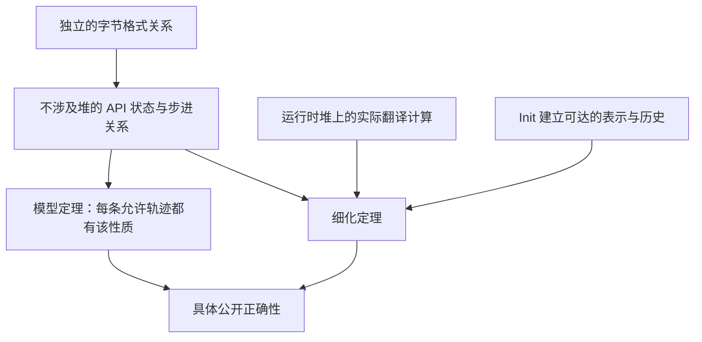

# API 模型与具体实现边界

仓库里有两类不同的 API 命题。`ZlibF/Spec/Api/` 中不涉及堆的关系描述字节历史和允许结果。`ZlibF/Spec/Public/` 中的具体公开目标命名翻译后的调用及其运行时效果。关于无堆关系的定理并不是关于 C 入口的定理。单个调用见[公开 API 手册](../spec/api/README.md)，验收要求见[目标指南](../checking/goals.md)。

本页解释模型结构和限制，不提供缺失的细化证明，也不替代公开目标。[进度](../progress.md)记录当前状态。

## 正确性结论需要的三个联系

模型关系只允许其条款写出的行为。证明这些条款的推论可能有用，即使结论直接来自某条款。实质性的实现义务是证明实际执行满足每个相关条款。初始化必须建立具体表示/历史关系。调用者必须使用翻译后 init 与辅助函数的定理证明辅助前提，不能假设被调用者契约。

公开目标还包括字节历史模型无法表达的安全性、帧性质、所有权、生命周期和精确标量效果。模型或聚焦手册描述的狭窄用法不会缩小这些目标。见[表示限制](../deviations.md)。

## 定义的位置

以下路径相对于 `ZlibF/Spec/Api/`。

| 模块 | 作用 |
| --- | --- |
| `Basic.lean` | 返回码、flush 值、参数检查、包装选择和格式可延续性 |
| `Header.lean` | Gzip 头请求、输出记录和头部字节 |
| `Inflate.lean` | Inflate 状态、步进关系、字典、恢复和回调解码 |
| `Deflate.lean` | Deflate 状态、步进关系、flush 历史、字典和界限 |
| `Compress.lean` | 单次调用压缩/解压关系与数值上界 |
| `Gz.lean` | 抽象文件内容上的文件句柄状态机 |
| `Run.lean` | 操作数据类型、类别分派和轨迹 |
| `Iface.lean` | 早期细化目标使用的抽象 `HeapApi` 接口 |
| `Concrete.lean` | 直接运行时执行、成功运行正确性与选定压缩器目标 |
| `Goals.lean` | 关于模型与细化的具名命题 |
| `Examples.lean` | 小型模型见证和可计算检查 |

## 状态、调用与历史

`InflState` 记录 reset 后已消费输入和已交付输出（`seen`、`out`）。`DeflState` 记录已接受输入和已产生输出（`input`、`produced`）。一步是 `InflStep st call result st'` 这样的关系，而非实现函数。公开接口允许每次调用有不同进展量，也允许压缩器选择不同数据块。关系约束这些选择，但不选定算法。

轨迹重新提供未消费输入，并改变可用输出空间和 flush 值。因此，`InflTrace` 和 `DeflTrace` 支持所表示操作类别内跨任意分块边界的结论。模型总数是自然数；LP64 具体 `uLong` 总数必须通过模 `2^64` 联系。

调用记录用 `badBuf` 表示空输出缓冲区，或非零输入长度下的空输入缓冲区。它没有实际空指针或重叠内存。这些形状与别名属于具体实现边界。

数据结论依赖状态的精确性标志。priming、恢复和禁用校验和验证可能移除普通字节格式解释。`InflState.Exact` 同时要求精确性和验证。较弱的数据解释绝不取消具体安全性、终止或精确逐次调用效果的要求。

核心历史模型省略 `msg` 和 `data_type`。它把 `adler` 建模为适用于已交付 inflate 输出或已接受 deflate 输入的校验和。`deflateUsed`、`inflateCodesUsed`、`zlibCompileFlags` 等数值查询和校验和组合入口在这里没有完整契约；它们的具体目标独立存在。

## Inflate：输出需要因果证据

`Layer.Decodes wrap wbits dict stream output` 选择独立的 raw、zlib、gzip 或自动包装关系。raw 数据使用字典的有效后缀。zlib 还检查头部窗口不超过配置窗口；零表示采用头部窗口。

| 关系 | 含义 |
| --- | --- |
| `Layer.Viable` | 字节前缀有完整有效的后续，另允许短头部情况 |
| `Layer.Consistent` | 已消费字节的某种完整补全具有所提议的输出前缀 |
| `Layer.Determined` | 与已消费字节历史兼容的每个完整流都扩展该输出 |
| `Layer.OutputEvidence` | 某个支持位前缀有有效补全，且在每个允许字典下，每个兼容补全都扩展该输出 |
| `Layer.Detectable` | 某个更早字节前缀已超过配置的检测滞后且不可有效延续 |

仅有存在性一致允许从有利但尚未读取的后续中猜测输出。全称确定性排除这种情况。支持位证据还避免在预读内容已经含有未检查错误时出现空真。`InflState.Consistent` 使用 `Layer.OutputEvidence`；`InflState.Determined` 另对每个允许字典量化。两者都出现在普通关系和后期内存错误关系中。

未知预置字典不是空字典。在带包装流请求字典之前，合法后续仍可提供字典。对于精确、完整窗口的流，数据错误必须对状态仍允许的每个字典都成立。字典一旦提供便固定。

`FullWindow` 标记支持每个格式有效距离的配置。普通往返目标使用 15 位 inflate 窗口。较小配置窗口可能拒绝本来有效的流，且取决于调用分块：某个距离可到达本次调用输出中的字节，但这些字节可能不再存在于较小保存窗口中。完整窗口条件限定抽象拒绝/完成结论，不是公开安全性限制。

早期 `detectLag = 8` 不描述实际 inflate。动态表前缀可能在第 230 字节已不可完成，但调用消费 281 字节后仍返回 `Z_OK`。因此，`Goal.inflate_rejects_invalid` 的定理建立的是模型性质，而不是这种实现时机结论。差异记录在[进度](../progress.md)，不能通过改变公开输入定义域隐藏。

`InflRunOk` 描述游标进展、总数、返回码、停止、格式条款、校验和及请求的头字段。`InflRunMem` 描述调用退出时历史窗口分配失败。这种失败可能发生在读取输入和非空输出写入之后，而 `total_in`、`total_out`、`adler` 保留旧值，随后进入内存错误阶段。模型的活性结论允许用这种结果替代普通完成。这与尚未写输出的早期分配失败不同。

负的 `inflatePrime` 值贡献其低位：模型取模 `2^bits` 的非负余数。`InflMark` 只描述初始状态情况。`InflSyncPoint` 和输入后的 priming 只有部分抽象描述。`InflGetDict` 描述固定窗口的运行中流。`InflBack` 把两个回调表示为调用次数的纯函数；该关系不表示任意回调堆效果。

## Deflate：字节有效性与调用历史

`DeflState.Valid` 将完成输出与全部已接受输入及选定包装联系起来。`DeflState.FlushedAt` 描述已完成 sync/full flush 的输出。`DeflRun` 还记录待输出字节、缓冲位、校验和更新和返回码条件。

历史标志 `started` 在 reset 前单调，包括被拒绝调用。若拒绝时擦除它，会允许在已写包装头之后修改字典。模型的 `done` 恰在此前已为真或调用返回 `Z_STREAM_END` 时为真。缓冲错误不表示流完成。调用以 `Z_OK` 返回且仍有输出空间时，模型记录完成的 full flush，并保留用于 raw 重新同步性质的输入/输出切分。

`DeflState.bound` 给出数值 `deflateBound` 公式。输出容量充足性是独立条款，由模型 `clean` 标志及其精确转换规则保护。参数变更、priming、tuning、字典变更和 flush 都需要计入各自效果；只有数值公式不能证明输出上界。`compressBound` 是饱和的默认公式，而抽象 `deflateBound` 公式没有溢出截断。

字典模型不描述每种操作用法。raw `InflSetDict` 限制在输入前，尽管 C 允许之后修改窗口。`DeflSetDict` 描述文档中的压缩前顺序，并拒绝一些 C 在流结束后接受的调用。这些限制记录在[偏离](../deviations.md)。使用一个初始字典的字节格式阶段无法表示任意后期字典替换。

## 单次调用工具：字节与标量单元不同

`Compress2` 是纯数据关系。`CompressCall` 和 `CompressResult` 增加指针形状、容量和独立存储长度；`Compress2Z` 保留 `_z` 入口的检查顺序：

1. 拒绝非零长度的空源、空长度单元，或正容量的空目标。存在的长度单元保留原值。
2. 初始化前清零存储长度。无效级别在可能发生分配失败之前被拒绝。
3. 零容量的空目标通过这些检查。Init 可返回内存错误；否则内部压缩器拒绝空目标。
4. 对可接受形状，数据关系给出已写字节和存储长度。

兼容包装在这些检查前读取长度单元。空单元会故障，不是 `_z` 那种正常参数拒绝。这些适配器不表示标量单元与输入/输出的别名。计数解压适配器也分离其标量单元。`Uncompress2` 同时记录已写输出和已消费输入，并区分截断输入与输出空间不足。早期、后期分配失败必须保留各自不同的标量效果。

`Concrete.execute` 在 `C.Heap` 上运行实际翻译计算，保留每个返回堆并暴露故障。它不是可替换关系。`Concrete.Correct` 要求对每个允许初始堆存在实际成功运行，随后满足指定后置条件。前置条件仍必须可达；函数级不变量由 init 建立，顶层结论需要具体允许见证。

`Concrete.lean` 明确区分两个有用目标：

| 目标 | 范围 |
| --- | --- |
| `Goal.compress_bound_value` | 对每个 `UInt64` 输入，两个翻译后的 bound 函数均具有数值相等性；不声称输出容量充足 |
| `Goal.compress2_z_first_alloc_failure` | 第一次默认分配失败：内存错误、长度存储为零、字节块不变、没有额外存活块 |

后者把局部流视为自动存储，因此不消耗分配失败索引。它不描述成功压缩或之后的分配失败。

## Gzip 文件：抽象文件不是操作系统

`GzHandle` 保存文件内容、解码数据、位置、退回字节、写入历史和错误标志。`GzDecoded` 描述解码内容和终止状态。模型允许外部 I/O 失败；设置 `failed` 后，数据保证停止成立。具体目标仍必须描述所有权、错误效果和安全清理。

模型表示的源码行为包括四字节 gzip 检测、透明读取、拼接成员、尾随垃圾、延迟错误交付和截断文件的缓冲错误。`G` 模式禁用透明读取。`gzprintf` 接受已格式化字节，不验证任意 C 可变参数格式化器。

位置关系保留一个重要区别：压缩读取器到达 EOF 后，向前 seek 可返回未来位置，而 `gztell` 在待跳过操作实现之前仍停在旧末尾。透明模式 seek 重新定位描述符，可丢弃退回字节，也可移到文件末尾之后。`GzHandle.CopyMode` 区分这种情况。`GzOffset` 仅约束结果非负或为 -1，不是精确描述符位置契约。这些例子说明抽象 gz 关系为何不能替代具体逐函数目标。此外，`GzDecoded` 的错误后缀条款使用较早的存在性 `Layer.Consistent`，而不是 `InflState` 的因果输出证据关系；不能把它当作 gzip 读取的完整操作规范。

## 抽象接口必须表达什么

`Iface.lean` 中的 `HeapApi` 固定早期细化目标的类型。它的字段不是运行时堆的实现。选择空运行关系或不可能成立的匹配关系并不能验证任何东西。

| 字段类别 | 具体实例中的必要解释 |
| --- | --- |
| `Heap`, `Strm`, `GzFile` | 实际运行时堆和表示出的流/句柄引用 |
| `inflMatches`, `deflMatches`, `gzMatches` | 存活的具体表示及模型历史；不相关字段不受额外约束 |
| `*Args` | 操作的实际缓冲区、标量值、大小、可写性及必要分离 |
| `*Run`, init/end/copy/back 和工具操作 | 每种实际执行结果，包括故障以及外部/分配失败 |
| `*NoState`, `*Disjoint` | 初始化或复制所需的具体无状态条件和分离条件 |

对 inflate，匹配必须把模式、位缓冲、环形历史、校验和及回绕总数连接到模型状态。对 deflate，还必须连接待输出内容、缓冲位和最近 flush。Copy 匹配必须描述独立拥有存储上的相同逻辑历史。回调解码需要显式回调效果与终止假设。

抽象细化目标要求每个允许操作后无故障且保持匹配。只有实际 init 建立匹配、实际操作保持匹配后，序列组合才成立。无泄漏还需要具体所有权与帧性质命题，抽象接口不提供它们。生成的[结构参考](../runtime-schema.md)描述表示字段，不是匹配关系成立的证明。

## 阅读模型目标名称

| `Goals.lean` 中的类别 | 性质 |
| --- | --- |
| `format_deterministic`, `format_prefix_free` | 完整格式流有唯一解码，且没有完整的真扩展 |
| `inflate_decodes`, `inflate_completes`, `inflate_rejects_invalid` | 在模型的精确性/窗口/检测条款下的输出前缀、完成和拒绝 |
| `deflate_valid`, `deflate_completes`, `deflate_full_flush_resync` | 有效完成输出、在假定上界内完成和 raw 重新同步 |
| `roundtrip`, `roundtrip_completes`, `dict_roundtrip`, `header_roundtrip` | 通过独立格式关系组合 |
| `deflate_bound_adequate`, `compress_bound_adequate`, `compress_roundtrip` | 对应模型条款关于工具/界限的推论 |
| `gz_roundtrip`, `gz_seek_read` | 抽象文件往返和指定位置情况 |
| `*_refines` | 在具体 `HeapApi` 实例下，实际执行必须是允许的模型步 |

`Examples.lean` 提供小型见证和算术检查。这类见证建立某个表示示例可能发生，并不建立全称正确性或具体细化。[检查指南](../checking/README.md)区分定义、见证、已登记定理和已验收结果。

[设计指南](README.md) · [文档首页](../README.md)
