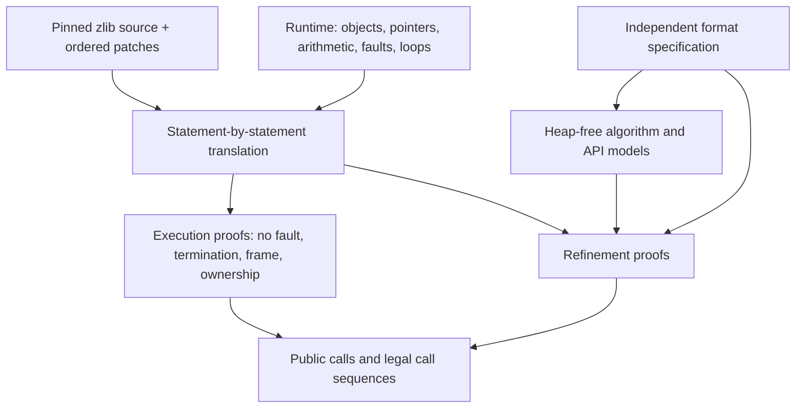
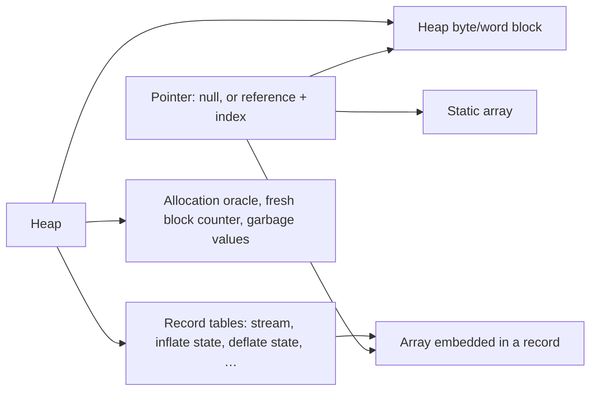

# From C to a checked theorem

A theorem is about a Lean computation. Applying it to zlib requires two reviewed connections:
the runtime must represent the relevant C operations, and the translation must match the
selected C source. The kernel checks the proof after those choices. It does not check either
connection to C. [Trusted base](../trusted-base.md) records that boundary.

## The layers

| Layer | Its job | What justifies it |
| --- | --- | --- |
| Selected C | Fix the program being verified | The pinned `zlib/` submodule plus `patches/*.patch`, applied in name order |
| Runtime | Give translated operations executable semantics | Independent review and semantic regression tests |
| Translation | Preserve the C statements and their order | Source review and differential tests; tests are evidence, not proof |
| Models and specifications | State what the program must do without committing to its implementation | Review of definitions, domains and their relation to the public manual and data formats |
| Proofs | Connect the computation to those statements | Lean kernel checking and the [acceptance checks](../checking/README.md) |

Safety and functional correctness use the same concrete states. Heap-free mathematics belongs
in `ZlibF/Math/`; it should not acquire heap dependencies merely because a memory proof uses it.
An intermediate algorithm model is useful when it separates mathematics from memory reasoning.
It still needs a refinement proof connecting it to the translated function.

## Selected source and module layout

The first target is the default x86_64 Linux static build with LP64 widths and the default
allocator. Allocation failure is in scope. Other build configurations and custom allocator
implementations are separate scope, recorded in [representation limits](../deviations.md).
The source submodule is never edited. A patch is permitted only for a confirmed upstream bug,
under the rules in the repository's `AGENTS.md` and `patches/README.md`.

| Location | Responsibility |
| --- | --- |
| `ZlibF/Runtime/` | Heap, pointers, faults, loops and modelled library operations |
| `ZlibF/Zlib/X.c.lean` | Translation of `zlib/X.c`, with the specification and proofs for that file |
| `ZlibF/Zlib/X.h.lean` | Translation of `zlib/X.h` |
| `ZlibF/Spec/` | Heap-free format/API relations and concrete public targets |
| `ZlibF/Math/` | Heap-free facts shared by the proofs |
| `tests/` | Differential evidence, regressions and acceptance checks |

Large C-file modules may have supporting submodules. Function names remain the C names. A
function's docstring begins with its C signature. The [translation rules](translation.md)
describe the correspondence in detail.

## Why an object heap

A C struct is represented by a Lean record. A heap has separate tables for records, byte arrays,
word arrays and other element kinds. A pointer names an object or an embedded/static array,
plus an element index. It does not contain a machine address.

This makes field updates and framing direct. A record field is a projection; changing it is a
record update. Updating bytes cannot change a record in another table. Copying a whole record
also copies its embedded arrays. The generated [runtime schema](../runtime-schema.md) gives the
complete fields, pointer constructors and type choices.

The representation deliberately avoids ABI byte offsets. It therefore cannot give a byte view
of an arbitrary struct, or represent every possible alias between a scalar cell and a buffer.
Array field lengths are not enforced by the record type. `WellFormed`,
`Heap.RecordsWellFormed` and `Statics.WellFormed` supply those facts where needed. A proof must
carry them or derive them from its representation invariant.

## Execution and faults

The runtime exposes a return value and final heap, or a fault. `Fault.ub` represents the
undefined operations covered by the model. `Fault.outOfFuel` represents an exhausted loop bound;
a termination proof excludes it. The [safety definition](../safety.md) gives the full obligation.

| Operation | Represented behaviour |
| --- | --- |
| Pointer arithmetic | Stays in one live array, including its one-past position; dereferencing one past faults |
| Loads and stores | Check liveness and bounds; stores also check read-only status |
| Pointer difference/order | Require the same live array and valid offsets; difference must fit `ptrdiff_t` |
| Pointer equality | Structural equality; different reference constructors compare unequal |
| Unsigned arithmetic | Wraps at the C width |
| Signed arithmetic and shifts | The translation checks overflow and invalid shift counts |
| Copy/fill | Check ranges and writability; `memcpy` also checks non-overlap |
| Allocation | Uses the failure oracle; success uses a fresh block identity |
| Free | Accepts NULL; otherwise requires the start of a live writable block |
| Loops | Use a finite bound; exhaustion is a fault, never an ordinary exit |

The language operations live in `Space.lean`, `Monad.lean` and `Ptr.lean`. Modelled C library
operations live in `Libc.lean` and generated `LibcTables.lean`. The generated schema and record
access operations are in `Schema.lean` and `Tables.lean`.

## Semantic differences that proofs must respect

These are design limits, not extra claims about C. The authoritative details are in
[trusted base](../trusted-base.md) and [representation limits](../deviations.md).

| Difference | Consequence for a proof |
| --- | --- |
| Fresh integer cells have arbitrary values | Quantify over every garbage-value function; do not assume zero |
| Each fresh cell keeps one value throughout a run | Do not rely on repeated uninitialised C reads agreeing |
| Fresh pointer fields are NULL | Establish that a pointer field was written before it is read; a NULL comparison alone does not establish this |
| `NULL + 0` succeeds; generic `NULL - NULL` faults | Review any translation-specific exception separately |
| Equality has no adjacent-object address cases | Do not justify a C branch using equality of pointers from different objects |
| No general addresses, alignment or type tags | Review casts and address-sensitive paths explicitly; structs have no general byte view |
| CRC addresses use offsets of heap byte blocks | Static/embedded byte references are not all covered; the CRC word path assembles little-endian bytes and does not model strict aliasing |
| Read-only status covers byte blocks and static objects | Do not assume arbitrary records or word blocks can be marked read-only |
| Block identities are never reused | Carry `Fresh` for allocating code; the initial heap must also have distinct object identities |
| Library copies count elements | Convert C byte counts correctly; whole-record `memcpy` uses the overlap-checking record copy |

Automatic storage must retain its C lifetime and must not consume a default-allocator failure
index. Locals whose addresses escape into a call still need represented storage and cleanup.
No proof may repair a representation gap by silently restricting the public domain.

## Design decisions

These identifiers keep earlier design discussions traceable. They describe the chosen
approach; their soundness obligations remain in the trusted-base and proof guides.

| ID | Decision | Obligation |
| --- | --- | --- |
| D1 | Use an object heap with typed record tables | Justify the represented operations and cover the relevant C aliasing. |
| D2 | Use local proof automation | Generated proof terms must check in the kernel; no assumed verification-condition generator replaces the proof. |
| D3 | Translate the C by hand, statement by statement | Review the correspondence and retain differential tests as evidence. |
| D4 | Model the compressor's overlapping pending/symbol storage | Prove the lifetime and non-overwrite conditions for every admitted memory level. |
| D5 | Give fresh integer cells arbitrary values and fresh pointers NULL | Quantify over integer garbage and prove pointer write-before-read history. |
| D6 | Avoid an ABI byte layout for records | Record-byte views and scalar/buffer aliases need separate representation work. |

## Composing calls without assuming their answers

A helper theorem proves a property of the actual translated helper. Its caller establishes the
helper's precondition and then uses that theorem. A helper contract is never an assumption that
replaces execution. [Internal obligations](internal-contracts.md) names the conditions that
callers must establish.

One representation invariant per state record carries bounds, ownership and the history needed
for correctness. Initialisation establishes it; later calls preserve it; end functions release
the owned storage. This establishes that the invariant is reachable. Whole-sequence proofs then
compose those function theorems, including refusals and failed allocations. See the
[proof guide](../proof/README.md) for the method and [checking guide](../checking/README.md) for
what counts as an accepted result.

[Design guide](README.md) · [Documentation home](../README.md)
