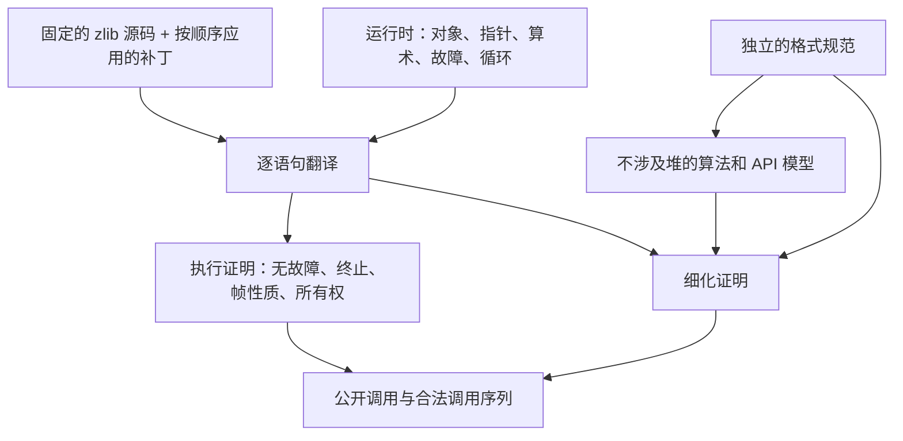
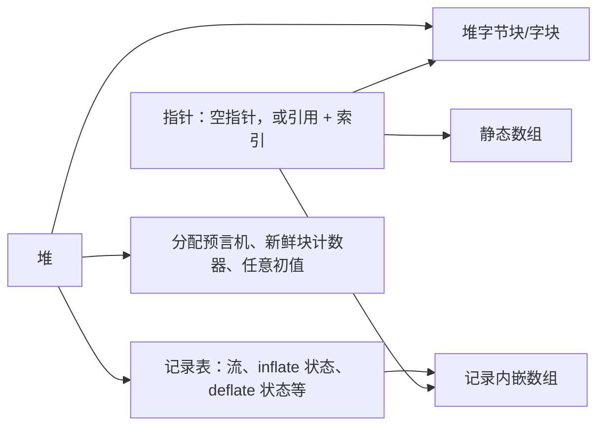

<!-- source-sha256: f590bcbcf13b5db936ae4baf6d19cc075b8b8addd77ee0e4db805ba77391fccb -->
# 从 C 到经过检查的定理

定理针对的是一个 Lean 计算。将它用于 zlib，需要审阅两个联系：运行时必须表示相关 C 操作，翻译必须对应选定的 C 源码。内核在这些选择确定后检查证明，并不检查它们与 C 的这两个联系。[可信基础](../trusted-base.md)记录了这条边界。

## 各层的关系

| 层 | 职责 | 依据 |
| --- | --- | --- |
| 选定的 C | 固定被验证的程序 | 固定版本的 `zlib/` 子模块，加上按文件名顺序应用的 `patches/*.patch` |
| 运行时 | 为翻译后的操作提供可执行语义 | 独立审阅与语义回归测试 |
| 翻译 | 保留 C 语句及其顺序 | 源码审阅与差分测试；测试是证据，不是证明 |
| 模型与规范 | 描述程序必须做什么，而不预先选定实现方式 | 审阅定义、定义域及其与公开手册和数据格式的关系 |
| 证明 | 将计算连接到这些命题 | Lean 内核检查与[验收检查](../checking/README.md) |

安全性与功能正确性使用同一组具体状态。不涉及堆的数学内容放在 `ZlibF/Math/`；不能仅因为内存证明使用它，就让它依赖堆。中间算法模型可用于分离数学推理与内存推理，但仍需要细化证明，将模型连接到翻译后的函数。

## 选定源码与模块布局

首个目标是默认 x86_64 Linux 静态构建，使用 LP64 位宽和默认分配器。分配失败在范围内。其他构建配置和自定义分配器实现是独立范围，记录在[表示限制](../deviations.md)中。绝不修改源码子模块。只有确认的上游缺陷才允许补丁，并须遵守仓库 `AGENTS.md` 与 `patches/README.md` 的规则。

| 位置 | 职责 |
| --- | --- |
| `ZlibF/Runtime/` | 堆、指针、故障、循环和建模的库操作 |
| `ZlibF/Zlib/X.c.lean` | `zlib/X.c` 的翻译，以及该文件的规范与证明 |
| `ZlibF/Zlib/X.h.lean` | `zlib/X.h` 的翻译 |
| `ZlibF/Spec/` | 不涉及堆的格式/API 关系与具体公开目标 |
| `ZlibF/Math/` | 各证明共享的不涉及堆的事实 |
| `tests/` | 差分证据、回归与验收检查 |

较大的 C 文件模块可以有支持子模块。函数名保留 C 名称，函数文档字符串以 C 签名开头。[翻译规则](translation.md)详细描述对应关系。

## 对象堆与字段更新

例如，C 中的 `s->strstart = 8` 更新压缩状态的一项字段。对象堆把它表示为“在状态对象 s 中把 strstart 改成 8”，而不先计算该字段在机器地址中的字节偏移。这样，证明可以明确指出改了哪个对象、哪项字段，同时说明其他对象没有变化。

C 结构体表示为 Lean 记录。堆分别为记录、字节数组、字数组和其他元素类型设置表。指针命名一个对象、嵌入数组或静态数组，并附带元素索引；它不包含机器地址。

这样可以直接表达字段更新和帧性质。记录字段是投影，修改字段就是记录更新。更新字节不能改变另一张表中的记录。复制整个记录时，也复制其内嵌数组。生成的[运行时结构参考](../runtime-schema.md)列出全部字段、指针构造器和类型选择。

这种表示刻意避免 ABI 字节偏移，因此不能提供任意结构体的字节视图，也不能表示标量单元与缓冲区之间所有可能的别名。记录类型不保证数组字段的长度。需要时，由 `WellFormed`、`Heap.RecordsWellFormed` 和 `Statics.WellFormed` 提供这些事实。证明必须携带它们，或从表示不变量推出它们。

## 执行与故障

运行时返回结果值和最终堆，或者返回故障。`Fault.ub` 表示模型覆盖的未定义操作；`Fault.outOfFuel` 表示循环额度耗尽，终止证明必须排除它。[安全性定义](../spec/safety.md)给出完整义务。

| 操作 | 模型行为 |
| --- | --- |
| 指针算术 | 保持在同一个存活数组内，允许尾后位置；解引用尾后位置会故障 |
| 读写 | 检查存活性与边界；写入还检查只读状态 |
| 指针差值/顺序比较 | 要求同一个存活数组和有效偏移；差值必须能由 `ptrdiff_t` 表示 |
| 指针相等 | 结构相等；不同引用构造器比较为不等 |
| 无符号算术 | 按 C 位宽回绕 |
| 有符号算术与移位 | 翻译检查溢出和无效移位计数 |
| 复制/填充 | 检查范围和可写性；`memcpy` 还检查不重叠 |
| 分配 | 使用失败预言机；成功时使用新鲜块标识 |
| 释放 | 接受 NULL；否则要求指向存活可写块的起点 |
| 循环 | 使用有限额度；耗尽是故障，绝不是普通退出 |

语言操作定义在 `Space.lean`、`Monad.lean` 和 `Ptr.lean`。建模的 C 库操作定义在 `Libc.lean` 和生成的 `LibcTables.lean`。生成的结构定义与记录访问操作位于 `Schema.lean` 和 `Tables.lean`。

## 证明必须尊重的语义差异

这些是设计限制，不是关于 C 的额外结论。准确细节以[可信基础](../trusted-base.md)和[表示限制](../deviations.md)为准。

| 差异 | 对证明的影响 |
| --- | --- |
| 新鲜整数单元有任意值 | 对每个任意初值函数量化；不能假设为零 |
| 每个新鲜单元在一次运行中保持同一个值 | 不能依赖 C 对未初始化单元的重复读取恰好一致 |
| 新鲜指针字段为 NULL | 建立字段先写后读的事实；单独与 NULL 比较不能证明它 |
| `NULL + 0` 成功；通用 `NULL - NULL` 故障 | 单独审阅翻译专用的任何例外 |
| 相等比较没有相邻对象地址的情况 | 不能利用不同对象的指针相等来证明 C 分支 |
| 没有通用地址、对齐或类型标签 | 显式审阅强制转换和地址敏感路径；结构体没有通用字节视图 |
| CRC 观察地址低位 | 堆字节块使用对齐起点；静态和内嵌字节数组具有任意但稳定的起点余数。通用 ABI 布局和字转换的严格别名规则在模型之外 |
| 只读状态覆盖字节块和静态对象 | 不能假设任意记录或字块都能标记为只读 |
| 块标识永不复用 | 分配代码必须携带 `Fresh`；初始堆也必须具有互异对象标识 |
| 库复制按元素计数 | 正确转换 C 字节计数；整记录 `memcpy` 使用会检查重叠的记录复制 |

自动存储必须保留 C 生命周期，且不能消耗默认分配器的失败索引。地址传入调用的局部对象仍需要表示出的存储和清理。证明不能通过悄悄限制公开定义域来弥补表示缺口。

## 设计决定

这些标识用于追溯较早的设计讨论。它们描述所选方案；其可靠性义务仍见可信基础与证明指南。

| ID | 决定 | 义务 |
| --- | --- | --- |
| D1 | 使用具有类型化记录表的对象堆 | 论证所表示操作，并覆盖相关 C 别名。 |
| D2 | 使用局部证明自动化 | 生成的证明项必须通过内核检查；不能用假定正确的验证条件生成器替代证明。 |
| D3 | 手工逐语句翻译 C | 审阅对应关系，并保留差分测试作为证据。 |
| D4 | 建模压缩器中重叠的待输出/符号存储 | 对每个允许的内存级别证明生命周期和不覆盖条件。 |
| D5 | 新鲜整数为任意值，新鲜指针为 NULL | 对整数任意初值量化，并证明指针先写后读的历史。 |
| D6 | 不为记录采用 ABI 字节布局 | 记录字节视图和标量/缓冲区别名需要另行表示。 |

## 组合调用时不预设答案

辅助函数定理证明实际翻译后辅助函数的性质。调用者建立其前置条件，再使用定理。辅助函数契约绝不能作为替代执行的假设。[内部义务](../spec/internal-contracts.md)命名了调用者必须建立的条件。

每个状态记录的表示不变量携带边界、所有权和正确性所需的历史。初始化建立它，后续调用保持它，结束函数释放拥有的存储。这也建立了不变量可达的事实。整个序列的证明随后组合这些函数定理，包括拒绝和分配失败。方法见[证明指南](../proof/README.md)，验收标准见[检查指南](../checking/README.md)。

[设计指南](README.md) · [文档首页](../README.md)
