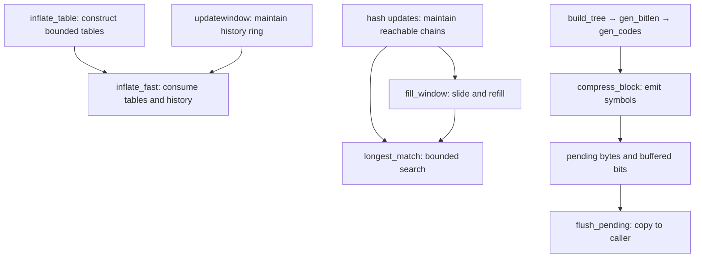

# Obligations at internal calls

These are documentary contracts for default-build helpers. They explain what a caller must
establish and what the helper's execution proof must deliver. All readings of C below are
**to confirm**; the table itself is not a proof or an assumed callee contract. See the
[proof guide](../proof/README.md) for the execution proofs and [overview](../overview.md) for status.

An internal precondition can be stronger than a public entry's precondition. The actual caller
must derive it from init-established invariants and current execution state. It cannot become
a hidden restriction on a public call. In particular, small memory levels, arbitrary fresh
integer contents and documented error cases remain obligations of their public callers.

## How to read the entries

Each stable `I-*` identifier names one obligation. `Pre` describes the helper's domain. `Post`
describes its result. `Effects` limits the permitted reads or writes. An intermediate fact is
required at the named stage, before the C reuses the same fields for another purpose.

Every entry also requires the common memory facts: referenced storage is live, correctly
represented and in bounds; writes target writable storage; `memcpy` ranges are disjoint;
pointer fields were written before use. Each helper proof must establish termination, no fault
and the frame for storage outside its effects. These are obligations about its translated body,
including calls to helpers proved below it.

The arrows show proof dependencies and maintained data, not an exhaustive C call graph.

## Construct decode tables: `inflate_table`

Purpose: build a canonical decoding table.
`inflate_table(type, lens, codes, &table, &bits, work)`; `base` is the entry `*table`.

| Part / ID | Contract |
| --- | --- |
| Pre `I-it-pre-lens` | `lens[0..codes)` is readable, with lengths in `0..15`. For `CODES`, lengths are at most 7 and the requested `*bits` is at least 7. |
| Pre `I-it-pre-codes` | `type` is `CODES`, `LENS` or `DISTS`; `codes` is at most 19, 288 or 32, respectively. |
| Pre `I-it-pre-work` | `work[0..codes)` is writable scratch, disjoint from other arguments. |
| Pre `I-it-pre-table` | `table`/`bits` are writable cells; `base` holds 128/852/592 entries for `CODES`/`LENS`/`DISTS`, disjoint from other arguments. |
| Post `I-it-ret` | Returns 0 on success, -1 for invalid lengths, or 1 for a `LENS`/`DISTS` capacity refusal. Empty codes succeed with invalid entries. |
| Effects `I-it-writes` | Changes only scratch, pointer/width cells and in-capacity table entries. Success constructs `[base, base + used)`; errors may leave partial writes. |
| Post `I-it-advance` | On success, `*table = base + used` and `*bits` is the actual root width. |
| Post `I-it-complete` | Success writes every constructed entry, including an invalid entry for a permitted one-symbol code, or two invalid entries for an empty code. |
| Post `I-it-links` | Every successful root link and its entire sub-table lie in `[base, base + used)`. |
| Post `I-it-canonical` | Success decodes the [canonical assignment](../format/README.md), with invalid markers for reserved symbols. |
| Post `I-it-term` | The call ends under the stated domain. |

## Decode with margins: `inflate_fast`

Purpose: decode until room is low, a block ends or data is invalid.

| Part / ID | Contract |
| --- | --- |
| Pre `I-if-pre-room` | Mode is `LEN`; `avail_in ≥ 6`, `avail_out ≥ 258`, `start ≥ avail_out`. `next_out - (start - avail_out)` begins readable earlier output of the outer `inflate` call, in the same object. Input/output are disjoint. |
| Pre `I-if-pre-bits` | `bits < 8`; `hold` contains exactly those buffered low bits and no other set bits. |
| Pre `I-if-pre-tables` | `lencode`/`distcode` and root widths satisfy successful-table entry/link rules, including fixed tables. |
| Pre `I-if-pre-window` | `whave ≤ wsize`; `wsize = 0` implies `whave = wnext = 0`; otherwise `wnext < wsize` and `window` holds `wsize` bytes. Its valid history has `whave` bytes; `sane` is set. |
| Effects `I-if-reads` | Byte reads use entry input, prior outer-call output or valid window history; table reads stay in the decoding tables. |
| Effects `I-if-writes` | Writes only entry output, stream cursors/counts/`msg` and state `hold`/`bits`/`mode`; no allocation. |
| Post `I-if-post` | Cursors/counts record consumed input/output. Whole unused input bytes are returned; `bits < 8`. Mode is `LEN`, `TYPE` or `BAD`; `BAD` may consume a partial invalid symbol. |
| Post `I-if-dist` | A distance beyond the bytes produced by the outer `inflate` call plus `whave` sets `BAD` before copying that match. |

## Preserve decoder history: `updatewindow`

Purpose: append `[end - copy, end)` to history, including dictionary data.

| Part / ID | Contract |
| --- | --- |
| Pre `I-uw-pre` | `[end - copy, end)` is readable and disjoint from the destination window. `wbits` is in the configured inflate range. An existing window has `2^wbits` writable bytes. The ring is unused (`wsize = 0`) or has `wsize = 2^wbits`, `whave ≤ wsize`, `wnext < wsize`, and `whave < wsize → wnext = whave`. |
| Effects `I-uw-alloc` | Allocates only an absent window. Returns 1 on allocation failure, else 0. Writes only window storage/fields and allocator state; failure preserves existing history. |
| Post `I-uw-inv` | On return 0, `wsize = 2^wbits`, `whave ≤ wsize`, `wnext < wsize`, and `whave < wsize → wnext = whave`. |
| Post `I-uw-content` | Success keeps the suffix, at most `wsize` bytes, of old history concatenated with input; `whave` counts it and ring order ends at `wnext`. |

## Refill and slide: `fill_window`, `slide_hash`, `read_buf`

Purpose: refill lookahead and maintain window/hash positions.

| Part / ID | Contract |
| --- | --- |
| Pre `I-fw-pre` | `fill_window` has `lookahead < MIN_LOOKAHEAD`, `window_size = 2*w_size`, `strstart + lookahead ≤ window_size`, and `insert ≤ strstart`. Window, hash sizes/masks, high-water mark, search settings and position ranges satisfy the configured deflate state, including `I-hc-inv`. Input has a readable `avail_in` view. |
| Post `I-fw-post-room` | `fill_window` leaves `strstart ≤ window_size - MIN_LOOKAHEAD`. |
| Post `I-fw-post-lookahead` | It leaves `lookahead ≥ MIN_LOOKAHEAD` or `avail_in = 0`. Newly read bytes extend the current lookahead in order. |
| Effects `I-fw-slide` | Sliding moves live upper-window bytes down by `w_size`, adjusts positions/`insert` with C arithmetic and calls `slide_hash`. Other writes are input/checksum accounting, hashes and high-water padding. |
| Pre / Post `I-sh-total` | `slide_hash` requires positive `hash_size` and `w_size`, and writable `head[0..hash_size)`/`prev[0..w_size)`. Each entry becomes `m - w_size` if `m ≥ w_size`, else `NIL`; it sets `slid = 1`. Unreachable `prev` values need not be initialised. |
| Pre / Post `I-rb-copy` | `read_buf` needs a writable destination for `n = min(avail_in, size)` bytes, disjoint from input. It returns `n`, copies that prefix, advances `next_in`, reduces `avail_in`, adds to `total_in`, and updates Adler-32/CRC-32 for the active wrapper. For `n = 0`, it changes nothing. |

## Search valid hash chains: `longest_match`

Purpose: search earlier hash-chain positions within a budget.

| Part / ID | Contract |
| --- | --- |
| Pre / Post `I-hc-inv` | `INSERT_STRING`, `slide_hash`, `CLEAR_HASH`, `fill_window` and `deflateSetDictionary` maintain heads naming inserted positions and reachable `prev[p mod w_size]` slots written with `NIL` or smaller same-hash positions. Positions agree with current window/lookahead. |
| Pre `I-lm-pre` | `cur_match` is a nonzero head for the current string's hash, `cur_match < strstart`, and distance is at most `MAX_DIST`. `I-hc-inv` holds; `strstart ≤ window_size - MIN_LOOKAHEAD`, `1 ≤ prev_length ≤ MAX_MATCH`, and configured search settings give a positive chain budget after any reduction. |
| Effects `I-lm-reads` | Reads window through `strstart + MAX_MATCH` inclusive, possibly past lookahead, and written reachable `prev` slots. Only `match_start` changes; padding must not justify an invalid match. |
| Post `I-lm-ret` | Returns at most `min(MAX_MATCH, lookahead)`. Improvement sets a valid `match_start`; otherwise it may retain `prev_length`, capped by lookahead, without a new `match_start` guarantee. |
| Post `I-lm-term` | Ends within the chain budget; traversed nonzero positions strictly decrease. No global maximum is promised. |

## Construct and emit Huffman trees: `trees.c`

Purpose: construct bounded Huffman codes and emit a block.

| Part / ID | Contract |
| --- | --- |
| Pre `I-bt-pre` | `build_tree` receives a descriptor for 286/30/19 literal-length/distance/bit-length leaves, set frequencies and room for internal nodes/heap/depth. Frequency sums after forced-leaf repair fit their fields. |
| Effects `I-bt-heap` | Heap indices stay below 573; nodes stay in their tree. Writes: descriptor maximum, nodes, heap/depth, bit counts and costs. |
| Intermediate `I-bt-forest` | Before lengths/codes overwrite parent/frequency fields, nodes form a full binary tree over positive-frequency symbols, with forced leaves to reach two. Parent frequencies sum child frequencies. |
| Pre / Post `I-gb-len` | Given that tree, ordered heap and descriptor, `gen_bitlen` writes active leaf lengths in `1..max_length` (15 or 7), Kraft sum 1, counts and costs. |
| Post `I-gb-count` | `bl_count[l]` counts active leaves of length `l`; `bl_count[0] = 0`. |
| Pre / Post `I-gc-code` | `gen_codes` needs lengths in `0..15` through `max_code` and matching complete-code counts. It writes only positive-length code fields: bit-reversed canonical words in symbol order. |
| Pre / Effects `I-cb-reads` | `compress_block` requires complete three-byte symbols in `sym_buf[0..sym_next)`, valid literal/match ranges, matching trees with usable codes, and pending/bit-buffer room. It reads symbols in order and emits their codes/extra bits followed by `END_BLOCK`. |
| Post `I-cb-pending` | After symbol `k` (from 0), `pending < lit_bufsize + 3*(k+1)`. Emission must also preserve unread symbols throughout. This bound must be proved, not assumed from callers. |
| Pre / Post `I-tf-choice` | `_tr_flush_block` requires valid block symbols/frequencies, `last` in `0..1`, pending capacity, and, for a chosen stored block, `stored_len ≤ 65535` and readable `buf[0..stored_len)`. It chooses stored if `buf != NULL` and `stored_len + 4 ≤ opt_lenb`; otherwise fixed if `static_lenb = opt_lenb`, else dynamic. `opt_lenb` is the smaller rounded compressed size, except `Z_FIXED` selects fixed first. It resets block accounting and aligns bits if `last`. |

The default [overlay bound](../proof/trees.md) must cover every public memory level; it cannot
become a hidden caller restriction.

## Drain pending output: `flush_pending` and bit writers

Purpose: collect buffered bits and copy pending bytes to output.

| Part / ID | Contract |
| --- | --- |
| Pre / Post `I-fp-inv` | `pending_out` lies in the pending allocation and `pending_out + pending ≤ pending_buf + pending_buf_size`. Writers additionally need room at their actual write offsets; this interval condition alone is insufficient. |
| Pre / Post `I-fp-copy` | `flush_pending` requires writable `avail_out` output disjoint from pending storage and valid bit-buffer state with room for `_tr_flush_bits`. It first flushes whole buffered bytes, then copies `n = min(pending, avail_out)`, advances both cursors, adds to `total_out`, and subtracts from both counts. After a nonzero copy empties pending, `pending_out = pending_buf`. Only pending/bit fields, stream output fields and the copied output bytes change. |
| Pre / Post `I-pb-room` | `put_byte` and `put_short` require one/two writable bytes at their pending offsets. `send_bits` requires `1 ≤ length ≤ 16`, a value fitting that length, valid `bi_valid`/`bi_buf`, and room for a possible short write. They append bytes/bits without checking capacity. Callers must establish room; `I-cb-pending` must protect unread symbols in the overlay. |

The [translation rules](translation.md) explain the operations these obligations refer to.
The [API model](api-model.md) explains how byte histories differ from concrete heap effects.

[Design guide](README.md) · [Documentation home](../README.md)
