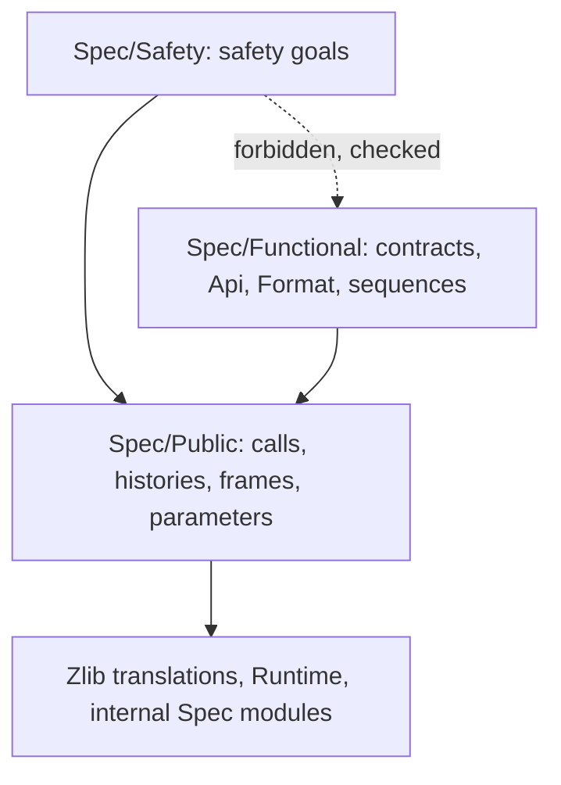

# Safety and functional specifications

Status: design approved on 2026-11-13. It is applied in the steps listed under "Order of work". It
says how `ZlibF/Spec/` is split so that the current target, the safety of every public function,
can be read from one directory. Nothing here changes what a proved theorem means.

## What changes and what does not

- `ZlibF/Spec/Safety/` holds the safety goals: no `Fault.ub`, no memory error, no leak and
  termination, on the documented domain. The acceptance audit requires these.
- `ZlibF/Spec/Functional/` holds the result contracts, the format and API models (`Api/`,
  `Format/`), and the round-trip statements (`Goal.*_sequence`). They are still built, and a proved
  one is still fully audited. An unproved one is reported as open and fails nothing.
- `ZlibF/Spec/Public/` stays and becomes the common part: the definitions both kinds of goal use.
  Only goal definitions and purely functional material leave it. A later rename of `Public/` to
  `Common/` is open (see below).
- Goal names do not change. Every goal stays `ZlibF.Spec.Public.Goal.<name>`. The directory shows
  the split; the Lean namespace stays as it is. So `tests/audit/theorems.txt`, `goals.txt`, the
  mutant tables and every proof that names a goal stay valid.
- **Every currently registered theorem stays registered and fully audited.** The split drops or
  weakens no accepted or registered result.
- No statement text changes in a move. A full contract `Goal.X` is not weakened or deleted: it
  becomes the functional goal of `X`, and the safety goal is stated beside it.
- The fast gate gains one import check. The change in what is required is in the acceptance
  `audit` job.

## Layout and import direction



A module under `Spec/Safety/` or `Spec/Public/` must not import, even transitively, a module under
`Spec/Functional/`. The script `scripts/check-spec-layers.py` walks the import closure and fails on
such an edge. The fast gate runs it. Then reading `Spec/Safety/` and what it imports tells a reader
the whole current target. Until the gzip modules are split (step 4), the script carries an
allowlist of the edges still to remove. The allowlist may only shrink.

The old module paths `ZlibF/Spec/Api/*` and `ZlibF/Spec/Format/*` stay as one-line re-export
modules for one release, so that branches that import them still build. They count as
functional for the check.

The internal specifications at the top of `ZlibF/Spec/` (`Inflate*.lean`, `PlatformMemory.lean`,
`ByteAddress.lean`, `Crc32ByteViews.lean`) are callee contracts for proofs, not public goals. They
stay where they are. Two of them import `Spec/Format` (`InflateDecodeTableSemantics`,
`InflateFastBodyToken`). No safety goal imports them today, and the check would report it if one
did.

## Mapping of today's modules

The rule for each definition: a `Goal.X` full contract goes to `Functional/`. A safety goal
(`Goal.X_safety`, the existing `_safe` names, the sequence safety goals and the non-vacuity goals)
goes to `Safety/`. Any other definition stays in `Public/` if a safety goal uses it, else goes to
`Functional/`.

| Today | After the split |
| --- | --- |
| `Spec/Format/*`, `Spec/Format.lean` | `Functional/Format/*` |
| `Spec/Api/*` except the parameter decoders | `Functional/Api/*` |
| Parameter decoders in `Api/Basic`: return codes `Api.Z`, `Flush`, `Wrap`, `inflWbits`, `DWrap`, `DeflParams`, `deflInit?` | `Public/Parameters.lean`, without the `Format` import, namespace unchanged |
| `Public/Calls`, `Public/Memory`, `Public/History` (`StreamOwned`, `CallerRange`, `ActiveHeader`, `StreamOperation`, `StreamArguments`, `StreamReachable`, `Region`, frames) | stay in `Public/` |
| `Public/Initialisation`, `Public/Lifecycle`, `Public/StreamQueries`, `Public/Domains` (`InitDomain`, witness heaps) | definitions stay; `Goal.*` to `Functional/`, non-vacuity goals to `Safety/` |
| `Public/Sequences`: `StreamInvariant`, `StreamWriteRegions`, `StreamHeaderRecord`, `StreamSequenceSafety`, `BackReachable`, `BackSafeReachable`, `BackPlatform` | stay in `Public/Sequences.lean` |
| `Public/Sequences`: `DataLog`, the traces, `DecodesFor`, `FlushedFor`, `InflateCompletes`, `DeflateCompletes`, `Goal.inflate_sequence`, `Goal.deflate_sequence` | `Functional/Sequences.lean` |
| `Public/Sequences`: `Goal.inflate_sequence_safety`, `Goal.deflate_sequence_safety` | `Safety/Sequences.lean` |
| `Public/Checksums`, `Public/Queries`, `Public/Streams`, `Public/Copy`, `Public/Utilities` | definitions stay; `Goal.*` to `Functional/` or `Safety/` by the rule |
| `Public/GzState`, `Public/GzTrace`, `Public/Gz*`, `Public/Back`, `Goal.gz_sequence`, `Goal.inflate_back_sequence*` | step 4, after the gzip statement changes have landed |

`Public/GzState` imports `Api/Gz` for `GzLooksGzip` and `Proof.«gzlib.c.base»`. The first is an
allowlisted edge until step 4. The second is allowed by the check (only `Functional/` is
forbidden) and is listed as a later clean-up.

## Two goals per public function

Every function in `tests/audit/public-api.json` gets a safety goal and a functional goal. A safety
goal states that the executed call returns `.ok`, writes only its frame and changes the live
blocks as the ledger says. It can fail: no safety goal is true by definition. The safety goals take
three shapes.

- **Stateless calls** (checksums, `compressBound*`, `zlibVersion`, `zlibCompileFlags`, the
  `compress*` and `uncompress*` utilities): on the documented domain the call returns without a
  fault, writes only the declared caller regions, and the live blocks are unchanged. Where a full
  contract exists and is proved, the safety theorem is a short corollary of it.
- **Stream operations** (the inflate and deflate families): one goal per function, a real
  statement about one call of that function on every reachable history. It is the second clause
  of `StreamSequenceSafety` specialised to that `Call` constructor, plus the invariant. Init
  functions are stated from `InitDomain`, which needs no history. `inflateEnd` and `deflateEnd`
  take the third clause. Goals that already exist are used, not restated: `Goal.deflateCopy_safety`
  (dev `fb1b8a02`) and batch 3's refusal goals `Goal.inflate_refusal` and `Goal.deflate_refusal`
  (NULL or inconsistent stream refused with `Z_STREAM_ERROR`).
- **The gzip file interface and `inflateBack`**: the same, from `Goal.gz_sequence_safety` and
  `Goal.inflate_back_sequence_safety`. The write frame of a gz call is agreed with batch C in the
  notes before it is stated.

The manifest agrees row by row with the table "No-fault coverage of zlib.h functions" in
`docs/progress.md`. That table names, per function, the theorem and the route (own goal, sequence
goal, End clause, or open).

Non-vacuity: a stream goal of the second shape is only as strong as its reachable set. The four
non-vacuity goals (`Goal.*_initialisation_domain`) give a reachable witness for each family. They
are part of the required set. Each per-function goal's docstring names the witness it relies on.

Names: new goals are `Goal.<function>_safety`. The four existing `uncompress*_safe` names stay,
because renaming a registered goal is a statement change with no gain. The manifest names the goal
explicitly, so the audit no longer guesses a suffix.

## Manifest and audit

Each entry of `apis` replaces `goal` by two fields:

```json
{"function": "deflateCopy", "safety_goal": "ZlibF.Spec.Public.Goal.deflateCopy_safety",
 "functional_goal": "ZlibF.Spec.Public.Goal.deflateCopy", ...}
```

A top-level `open_safety` list names each required safety goal that has no registered theorem
yet, with its owner. Moving a function in or out of the required set is a one-line change. The
`undocumented` group stays as in 981aee5b. The gzip file interface and `inflateBack` are planned:
their safety goals are required and listed as open until proved.

`scripts/verification.py`:

- **Required**: the safety goal of every `lp64-linux` function that is not undocumented, plus the
  entries of `safety_goals` and `nonvacuity_goals`. Until every one is proved, the audit checks
  that each goal not in `open_safety` has a registered theorem of exactly that type with allowed
  axioms only, and that `open_safety` only shrinks. dev does not turn red. From the commit where
  `open_safety` is empty, a missing theorem fails the audit.
- **Functional**: every `functional_goal` and `sequence_goals`. A registered proof is audited in
  full (axioms, exact type, replay, mutants if keyed). An unproved one is reported and fails
  nothing.
- **Mutants**: keyed by the functional goal when it is proved, else by the safety goal. This
  replaces the `_safe`/`_safety` suffix guess in `mutation_apis`.

## Progress view

The function table gets two status columns, Safety and Functional. The top of
`docs/progress.md` shows two summary tables: "Safety (required)" with proved and open counts by
family, and "Functional (not required)" with the same counts. Both come from the generator, which
also writes the Chinese twin. This waits for batch 3's change to the generator's staleness check.

## `docs/spec/`

`docs/spec/` gets `safety/` and `functional/` sections that mirror the two directories, each with a
short page per family and its Chinese twin. `docs/spec/safety.md` becomes the entry page of the
safety section. The API manual under `docs/spec/api/` stays; each function's entry links its two
goals.

## Order of work

Every Lean slice lands on `dev` from `worker/safety-split` after a full `lake build ZlibF` and the
verification self tests. Each commit that touches protected paths says so.

1. **Directories and the stateless and stream families.** `Spec/Safety/`, `Spec/Functional/`, the
   layer check in the fast gate, `Api/` and `Format/` moved with re-export modules,
   `Public/Parameters.lean`, and the goal definitions of the checksum, utility, inflate and deflate
   families moved out of `Public/`. Importers that name a moved goal import its new module. No
   statement text changes. Announced in the shared notes.
2. **New safety goals and corollaries** for the inflate, deflate and stateless families.
3. **Manifest, audit, progress view.** Coordinated with batch 3. Batch 3 owns
   `scripts/proof-progress.py` until its staleness change lands; the two-column view comes after.
4. **gzip and `inflateBack`.** `GzState`, `GzTrace` and the gz goals are not moved or edited until
   the read-side owner and batch C say their statement changes have landed. The gz write frame is
   agreed with batch C first.
5. **Documents.** `docs/spec/` sections, `AGENTS.md` ("What counts as proved", "Checking"),
   `docs/overview.md`, `docs/checking/goals.md`, with Chinese twins.

## Open points

- A rename of `Spec/Public/` to `Spec/Common/`. It would be one mechanical commit; 104 modules
  import `Spec/Public` today. It is done only if the owner wants it.
- The write frame of `Goal.gz_sequence_safety`: which caller regions a gz call may write. To be
  agreed with batch C.
- `Public/GzState`'s import of a proof module (`Proof.«gzlib.c.base»`).

[Design index](README.md)
