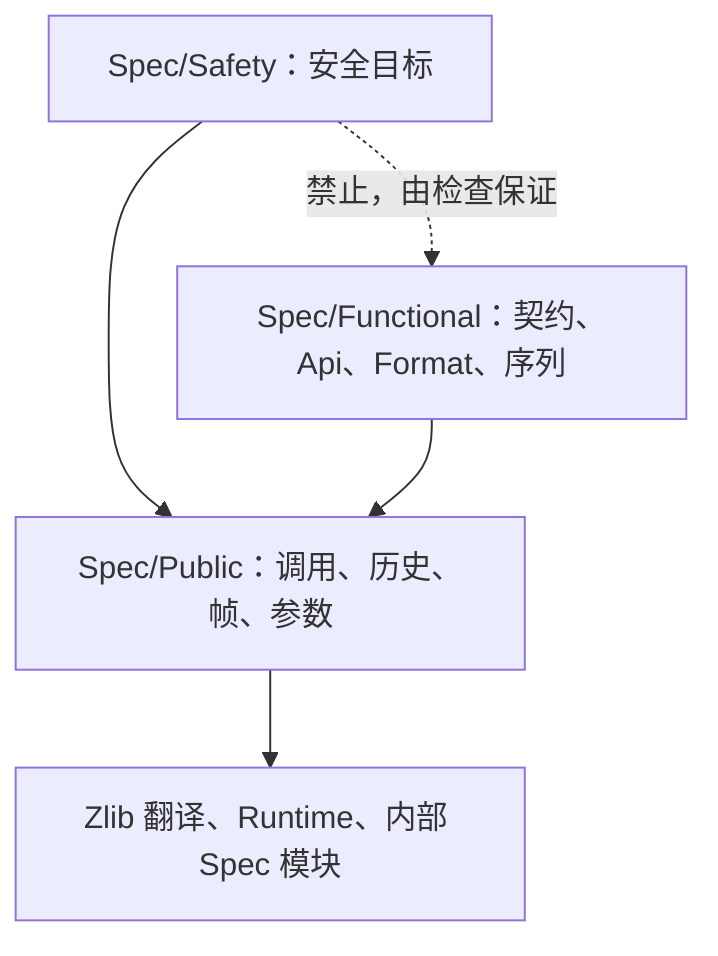

<!-- source-sha256: 9fd4415a1353a17053ed8b86d45a0502b51cf364221c1fd01af4f7150c644ce6 -->
# 安全规范与功能规范

状态：设计已于 2026-11-13 批准，按“工作顺序”中的步骤实施。本页说明怎样拆分 `ZlibF/Spec/`，使当前目标（每个公开函数的安全性）能从一个目录读出。这里的任何内容都不改变已证定理的含义。

## 改变什么，不改变什么

- `ZlibF/Spec/Safety/` 存放安全目标：在文档规定的定义域上没有 `Fault.ub`、没有内存错误、没有泄漏，并且终止。验收审计要求这些目标。
- `ZlibF/Spec/Functional/` 存放结果契约、格式与 API 模型（`Api/`、`Format/`）以及往返命题（`Goal.*_sequence`）。它们照常构建；已证明的仍完整审计。未证明的报告为待完成，不使任何检查失败。
- `ZlibF/Spec/Public/` 保留，成为公共部分：两类目标共用的定义。只有目标定义和纯功能性的内容移出。以后是否把 `Public/` 改名为 `Common/` 是待决问题（见下文）。
- 目标名称不变。每个目标仍是 `ZlibF.Spec.Public.Goal.<name>`。拆分体现在目录上，Lean 命名空间保持原样。因此 `tests/audit/theorems.txt`、`goals.txt`、变异表以及所有引用目标名的证明都继续有效。
- **目前已登记的每个定理都保持登记并接受完整审计。** 拆分不删除、不削弱任何已验收或已登记的结果。
- 移动时不改动任何命题文本。完整契约 `Goal.X` 不会被削弱或删除：它成为 `X` 的功能目标，安全目标写在它旁边。
- 快速门禁增加一个导入检查。所要求内容的变化发生在验收 `audit` 作业中。

## 布局与导入方向



`Spec/Safety/` 或 `Spec/Public/` 下的模块不得导入（包括间接导入）`Spec/Functional/` 下的模块。脚本 `scripts/check-spec-layers.py` 遍历导入闭包，遇到这样的边就失败。快速门禁运行它。这样，读者只读 `Spec/Safety/` 及其导入的内容，就能知道完整的当前目标。在 gzip 模块拆分（第 4 步）之前，脚本带有一个待移除边的允许列表。这个列表只能缩短。

旧模块路径 `ZlibF/Spec/Api/*` 和 `ZlibF/Spec/Format/*` 保留为一行的再导出模块，保留一个版本，使导入它们的分支仍能构建。检查把它们算作功能部分。

`ZlibF/Spec/` 顶层的内部规范（`Inflate*.lean`、`PlatformMemory.lean`、`ByteAddress.lean`、`Crc32ByteViews.lean`）是供证明使用的被调用者契约，不是公开目标，保持原位。其中两个导入了 `Spec/Format`（`InflateDecodeTableSemantics`、`InflateFastBodyToken`）。目前没有安全目标导入它们，若将来有，检查会报告。

## 现有模块的去向

每个定义按以下规则处理：完整契约 `Goal.X` 进入 `Functional/`。安全目标（`Goal.X_safety`、现有的 `_safe` 名称、序列安全目标和非空性目标）进入 `Safety/`。其他定义若被某个安全目标使用则留在 `Public/`，否则进入 `Functional/`。

| 现在 | 拆分之后 |
| --- | --- |
| `Spec/Format/*`、`Spec/Format.lean` | `Functional/Format/*` |
| 除参数解码器外的 `Spec/Api/*` | `Functional/Api/*` |
| `Api/Basic` 中的参数解码器：返回码 `Api.Z`、`Flush`、`Wrap`、`inflWbits`、`DWrap`、`DeflParams`、`deflInit?` | `Public/Parameters.lean`，不再导入 `Format`，命名空间不变 |
| `Public/Calls`、`Public/Memory`、`Public/History`（`StreamOwned`、`CallerRange`、`ActiveHeader`、`StreamOperation`、`StreamArguments`、`StreamReachable`、`Region`、各种帧） | 留在 `Public/` |
| `Public/Initialisation`、`Public/Lifecycle`、`Public/StreamQueries`、`Public/Domains`（`InitDomain`、见证堆） | 定义留下；`Goal.*` 进入 `Functional/`，非空性目标进入 `Safety/` |
| `Public/Sequences` 中的 `StreamInvariant`、`StreamWriteRegions`、`StreamHeaderRecord`、`StreamSequenceSafety`、`BackReachable`、`BackSafeReachable`、`BackPlatform` | 留在 `Public/Sequences.lean` |
| `Public/Sequences` 中的 `DataLog`、各种轨迹、`DecodesFor`、`FlushedFor`、`InflateCompletes`、`DeflateCompletes`、`Goal.inflate_sequence`、`Goal.deflate_sequence` | `Functional/Sequences.lean` |
| `Public/Sequences` 中的 `Goal.inflate_sequence_safety`、`Goal.deflate_sequence_safety` | `Safety/Sequences.lean` |
| `Public/Checksums`、`Public/Queries`、`Public/Streams`、`Public/Copy`、`Public/Utilities` | 定义留下；`Goal.*` 按规则进入 `Functional/` 或 `Safety/` |
| `Public/GzState`、`Public/GzTrace`、`Public/Gz*`、`Public/Back`、`Goal.gz_sequence`、`Goal.inflate_back_sequence*` | 第 4 步，等 gzip 的命题改动落地之后 |

`Public/GzState` 为了 `GzLooksGzip` 导入 `Api/Gz`，还导入了 `Proof.«gzlib.c.base»`。前者在第 4 步之前是允许列表中的边。后者为检查所允许（只禁止 `Functional/`），列为以后的清理项。

## 每个公开函数两个目标

`tests/audit/public-api.json` 中的每个函数都有一个安全目标和一个功能目标。安全目标陈述：执行的调用返回 `.ok`，只写自己的帧，并按账本改变存活块。它是可以不成立的：没有哪个安全目标按定义就为真。安全目标有三种形式。

- **无状态调用**（校验和、`compressBound*`、`zlibVersion`、`zlibCompileFlags`、`compress*` 与 `uncompress*` 工具函数）：在文档规定的定义域上，调用不出故障地返回，只写声明的调用者区域，存活块不变。若完整契约已存在且已证明，安全定理是它的简短推论。
- **流操作**（inflate 与 deflate 两族）：每个函数一个目标，是关于该函数在任意可达历史上的一次调用的真实命题。它是 `StreamSequenceSafety` 的第二个子句对该 `Call` 构造子的特化，再加上不变式。初始化函数从不需要历史的 `InitDomain` 出发陈述。`inflateEnd` 与 `deflateEnd` 取第三个子句。已有的目标直接使用，不重新陈述：`Goal.deflateCopy_safety`（dev `fb1b8a02`），以及 batch 3 的拒绝目标 `Goal.inflate_refusal` 与 `Goal.deflate_refusal`（空流或不一致的流以 `Z_STREAM_ERROR` 拒绝）。
- **gzip 文件接口与 `inflateBack`**：形式相同，分别来自 `Goal.gz_sequence_safety` 和 `Goal.inflate_back_sequence_safety`。gz 调用的写帧在陈述之前与 batch C 在笔记中商定。

清单与 `docs/progress.md` 中“No-fault coverage of zlib.h functions”一表逐行一致。该表按函数列出定理和路径（自身目标、序列目标、结束子句或待完成）。

非空性：第二种形式的流目标只和它的可达集合一样强。四个非空性目标（`Goal.*_initialisation_domain`）为每一族给出可达的见证。它们属于必需集合。每个逐函数目标的文档注释写明它依赖的见证。

命名：新目标叫 `Goal.<function>_safety`。现有的四个 `uncompress*_safe` 名称保留，因为重命名已登记的目标是一次命题改动，没有收益。清单显式写出目标名，审计不再猜后缀。

## 清单与审计

`apis` 的每一项用两个字段代替 `goal`：

```json
{"function": "deflateCopy", "safety_goal": "ZlibF.Spec.Public.Goal.deflateCopy_safety",
 "functional_goal": "ZlibF.Spec.Public.Goal.deflateCopy", ...}
```

顶层的 `open_safety` 列表写出每个尚无已登记定理的必需安全目标及其负责人。把一个函数移入或移出必需集合只需改一行。`undocumented` 组保持 981aee5b 的样子。gzip 文件接口与 `inflateBack` 已在计划内：它们的安全目标属于必需集合，证明之前列为待完成。

`scripts/verification.py`：

- **必需**：每个不属于未文档化函数的 `lp64-linux` 函数的安全目标，以及 `safety_goals` 和 `nonvacuity_goals` 中的条目。在全部证明之前，审计检查：不在 `open_safety` 中的每个目标都有一个类型恰好相同、只用允许公理的已登记定理，并且 `open_safety` 只缩短。dev 不会因此变红。从 `open_safety` 为空的那个提交起，缺少定理就使审计失败。
- **功能**：每个 `functional_goal` 和 `sequence_goals`。已登记的证明完整审计（公理、确切类型、重放、有键时的变异）。未证明的只报告，不使检查失败。
- **变异**：功能目标已证明时以它为键，否则以安全目标为键。这取代 `mutation_apis` 中对 `_safe`／`_safety` 后缀的猜测。

## 进度视图

函数表增加两个状态列：安全与功能。`docs/progress.md` 顶部显示两张汇总表：“安全（必需）”按族列出已证明和待完成的数目；“功能（不要求）”列出同样的数目。两者都由生成器产生，生成器同时写出中文页。这要等 batch 3 对生成器过期检查的改动落地之后。

## `docs/spec/`

`docs/spec/` 增加 `safety/` 和 `functional/` 两节，对应两个目录，每族一页短文档，并配中文页。`docs/spec/safety.md` 成为安全一节的入口页。`docs/spec/api/` 下的 API 手册保留；每个函数的条目链接它的两个目标。

## 工作顺序

每个 Lean 切片都从 `worker/safety-split` 在完整 `lake build ZlibF` 和验证自检通过后落到 `dev`。每个触及受保护路径的提交都写明这一点。

1. **目录，以及无状态族和流族。** 建立 `Spec/Safety/`、`Spec/Functional/`，在快速门禁中加入层次检查，移动 `Api/` 和 `Format/` 并保留再导出模块，建立 `Public/Parameters.lean`，把校验和、工具函数、inflate 和 deflate 各族的目标定义移出 `Public/`。引用被移动目标的模块改为导入它的新模块。不改命题文本。在共享笔记中通知。
2. **新安全目标及其推论**，覆盖 inflate、deflate 和无状态各族。
3. **清单、审计、进度视图。** 与 batch 3 协调。在 batch 3 的过期检查改动落地之前，`scripts/proof-progress.py` 由它负责；双列视图在此之后。
4. **gzip 与 `inflateBack`。** 在读侧负责人和 batch C 表示他们的命题改动已落地之前，不移动也不编辑 `GzState`、`GzTrace` 和 gz 目标。gz 写帧先与 batch C 商定。
5. **文档。** `docs/spec/` 各节、`AGENTS.md`（“What counts as proved”“Checking”）、`docs/overview.md`、`docs/checking/goals.md`，并配中文页。

## 待决问题

- 把 `Spec/Public/` 改名为 `Spec/Common/`。这会是一个机械提交；目前有 104 个模块导入 `Spec/Public`。只有所有者需要时才做。
- `Goal.gz_sequence_safety` 的写帧：一次 gz 调用可以写哪些调用者区域。与 batch C 商定。
- `Public/GzState` 导入了一个证明模块（`Proof.«gzlib.c.base»`）。

[设计索引](README.md)
