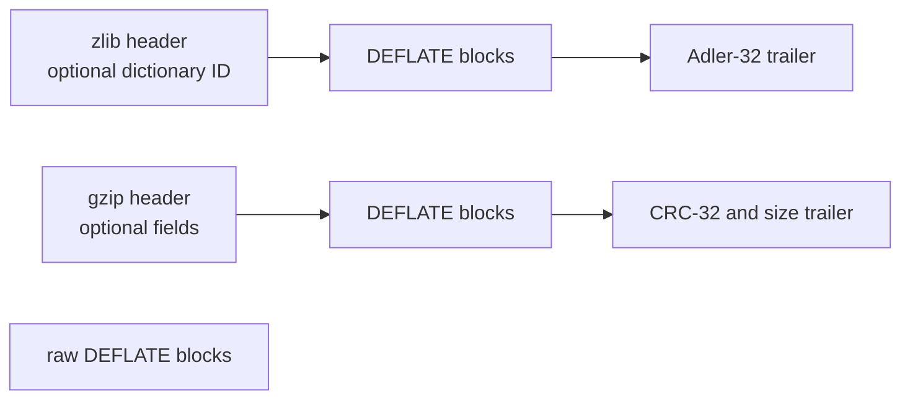

# Data format

[Documentation home](../README.md) · [API guide](../api/README.md) · [Lean model](model.md)

DEFLATE describes compressed bytes. The zlib and gzip formats put a header and a checksum
around those bytes. This guide explains the data that `inflate` must interpret and `deflate`
must produce. It states obligations, rather than claiming that the implementation meets them.
Accepted results and remaining work are recorded in [the overview](../overview.md).

Read the layers and bit order first, then the block and symbol rules. The wrapper sections
explain dictionaries and checksums. [The model reference](model.md) maps these rules to Lean.
Buffer management, return codes and legal call sequences belong to [the stream API](../api/streams.md).

The format sources are [RFC 1951](https://www.rfc-editor.org/rfc/rfc1951.html) for DEFLATE,
[RFC 1950](https://www.rfc-editor.org/rfc/rfc1950.html) for zlib and
[RFC 1952](https://www.rfc-editor.org/rfc/rfc1952.html) for gzip. The rules below retain zlib's
accepted variants and restrictions explicitly. The `F-*` names identify the obligations used
by the specifications and proof documentation.

## Layers and stream boundaries



Raw DEFLATE has no wrapper checksum or dictionary identifier. A zlib stream has one DEFLATE
payload. A gzip member has one DEFLATE payload; a gzip file may concatenate members.
`windowBits` selects which layer the API reads or writes.

A complete stream ends after the final block and its wrapper trailer, if any. The unused bits
of the final DEFLATE byte may have any value. Extra bytes are a separate tail. An exact-stream
relation requires that tail to be empty; a prefix relation records it. An `inflate` call may
reach `Z_STREAM_END` while bytes remain in the caller's buffer. That behavior does not make
those bytes part of the completed stream.

## Bits and blocks

Bits occupy each byte from the least significant position upward. Ordinary numeric fields,
including extra-bit values, put their least significant bit first. Huffman codes put their
most significant code bit first in that same sequence of byte positions.

`F-bit-order`: a decoder appends bytes at the high end of its bit buffer and consumes bits
from the low end. To recover the numeric canonical value of an `l`-bit Huffman code, reverse
the next `l` low buffer bits. This reversal applies to Huffman codes, not ordinary fields.

Each block starts with one `BFINAL` bit and a two-bit `BTYPE` number. `BFINAL = 1` marks the
last block. Otherwise another block follows immediately; block boundaries need not be byte
boundaries.

| `BTYPE` | Body |
| --- | --- |
| 0 | Stored bytes |
| 1 | Symbols encoded with fixed Huffman codes |
| 2 | Code descriptions followed by symbols encoded with those dynamic Huffman codes |
| 3 | Invalid |

`F-block-type-3`: block type 3 is rejected (`invalid block type`).

### Stored blocks

A stored block first skips to the next byte boundary. Those skipped bits may have any value.
It then contains the little-endian 16-bit fields `LEN` and `NLEN`, followed by exactly `LEN`
uncompressed bytes.

`F-stored-complement`: `NLEN = 65535 - LEN`. A mismatch is rejected
(`invalid stored block lengths`). A zero-length stored block is allowed.

## Canonical Huffman codes

A code description gives one length per symbol. Length zero means unused. For the
literal/length and distance alphabets, nonzero lengths are at most 15. A canonical code is
determined by these lengths and symbol order; its bit patterns need not be transmitted.

Let `count[l]` count symbols of length `l`. The first code at each length is:

```text
code_start[1] = 0
code_start[l] = (code_start[l - 1] + count[l - 1]) * 2    for l >= 2
```

At a fixed length `l`, assign consecutive values beginning at `code_start[l]` in increasing
symbol order. Write each value in exactly `l` bits.

`F-code-fits`: `code_start[l] + count[l] ≤ 2^l` for every `l` from 1 to 15. Equivalently,
the sum of `2^(-length)` over used symbols is at most 1. Exceeding it is over-subscription.

`F-code-complete`: a code is complete when that sum equals 1, and incomplete when it is less.
zlib's table builder applies the following acceptance rules:

| Length set | Acceptance |
| --- | --- |
| Over-subscribed | Rejected |
| Complete | Accepted |
| Incomplete with exactly one used symbol, of length 1 | Accepted for literal/length and distance codes; rejected for the code-length code |
| All lengths zero | Accepted as an empty table; every attempt to decode a symbol fails |
| Any other incomplete set | Rejected |

Accepting an empty table does not accept an undecodable block. A dynamic literal/length
table must also contain end-of-block. An empty distance table can serve a block with no
matches. An empty code-length table cannot decode the required subsequent lengths. The
single-symbol exception for distances is described by the RFC; zlib also permits it for
literal/length codes.

### Fixed codes

`F-fixed-lengths`: a fixed block uses these literal/length lengths:

| Symbols | Length |
| --- | --- |
| 0–143 | 8 |
| 144–255 | 9 |
| 256–279 | 7 |
| 280–287 | 8 |

All 32 distance symbols have length 5. The tables include reserved symbols: decoding
literal/length 286 or 287, or distance 30 or 31, is an error (`invalid literal/length code`
or `invalid distance code`). Their presence in a fixed table does not permit their use.

### Dynamic codes

A dynamic block describes three codes: a code-length code, a literal/length code and a
distance code. Immediately after the block header, read:

1. `HLIT` in 5 bits: the literal/length alphabet has `HLIT + 257` entries.
2. `HDIST` in 5 bits: the distance alphabet has `HDIST + 1` entries.
3. `HCLEN` in 4 bits: `HCLEN + 4` code-length entries follow.
4. Those entries in 3 bits each, in this symbol order:
   `16 17 18 0 8 7 9 6 10 5 11 4 12 3 13 2 14 1 15`.
   Unsent code-length entries are zero, so this code has lengths at most 7.
5. The combined literal/length and distance lengths, decoded using that code-length code.

The combined list contains all literal/length entries first, then all distance entries.
Code-length symbols expand as follows:

| Symbol | Expansion |
| --- | --- |
| 0–15 | One entry with that length |
| 16 | Repeat the previous length `3 + x` times; read 2 extra bits for `x` |
| 17 | Append `3 + x` zeros; read 3 extra bits |
| 18 | Append `11 + x` zeros; read 7 extra bits |

`F-dynamic-limits`: zlib requires `HLIT + 257 ≤ 286` and `HDIST + 1 ≤ 30`. The fields can
represent larger counts; zlib rejects them (`too many length or distance symbols`).

`F-dynamic-repeat`: symbol 16 needs a preceding entry. No repeat may exceed the combined
entry count (`invalid bit length repeat`). Repeats may cross the boundary between the two
alphabets.

`F-dynamic-eob`: literal/length symbol 256 must have nonzero length
(`invalid code -- missing end-of-block`).

`F-dynamic-valid`: each of the three codes must satisfy its acceptance rule above. Failures
are reported as `invalid code lengths set`, `invalid literal/lengths set` or
`invalid distances set`.

## Literals, matches and history

Inside a Huffman block, a literal/length symbol has one of three meanings:

| Symbol | Meaning |
| --- | --- |
| 0–255 | Append that byte to the output |
| 256 | End this block |
| 257–285 | Read length extra bits, a distance symbol and distance extra bits; then copy a match |

For each table entry, add the numeric extra-bit value to its base. Extra bits use the ordinary
least-significant-bit-first order.

`F-length-table`:

| Symbols | Extra bits | Length ranges, in symbol order |
| --- | --- | --- |
| 257–264 | 0 | 3, 4, 5, 6, 7, 8, 9, 10 |
| 265–268 | 1 | 11–12, 13–14, 15–16, 17–18 |
| 269–272 | 2 | 19–22, 23–26, 27–30, 31–34 |
| 273–276 | 3 | 35–42, 43–50, 51–58, 59–66 |
| 277–280 | 4 | 67–82, 83–98, 99–114, 115–130 |
| 281–284 | 5 | 131–162, 163–194, 195–226, 227–257; see the exception below |
| 285 | 0 | 258 |

`F-length-284`: zlib also accepts symbol 284 with extra value 31 as length 258. The RFC table
assigns length 258 to symbol 285 and leaves this combination unused. The format model retains
zlib's accepted combination. A recorded real-library check used a literal `a`, then symbol
284 with extra value 31 and distance 1, and obtained 259 bytes. This is evidence of fidelity,
not a proof of the translated decoder.

`F-distance-table`:

| Symbols | Extra bits | Distance ranges, in symbol order |
| --- | --- | --- |
| 0–3 | 0 | 1, 2, 3, 4 |
| 4, 5 | 1 | 5–6, 7–8 |
| 6, 7 | 2 | 9–12, 13–16 |
| 8, 9 | 3 | 17–24, 25–32 |
| 10, 11 | 4 | 33–48, 49–64 |
| 12, 13 | 5 | 65–96, 97–128 |
| 14, 15 | 6 | 129–192, 193–256 |
| 16, 17 | 7 | 257–384, 385–512 |
| 18, 19 | 8 | 513–768, 769–1024 |
| 20, 21 | 9 | 1025–1536, 1537–2048 |
| 22, 23 | 10 | 2049–3072, 3073–4096 |
| 24, 25 | 11 | 4097–6144, 6145–8192 |
| 26, 27 | 12 | 8193–12288, 12289–16384 |
| 28, 29 | 13 | 16385–24576, 24577–32768 |

`F-match-copy`: a match of length `L` and distance `D` copies one byte at a time from `D`
bytes back. Each byte joins the history before the next copy. Thus `L` may exceed `D`:
distance 1 repeats the most recent byte `L` times. A preset dictionary precedes the output
in that history and is not itself output.

`F-distance-bound`: a match must have enough preceding history. The declarative model uses
`D ≤ length(dictionary ++ output_so_far)`; the distance table also enforces `D ≤ 32768`.
An executing decoder needs the referenced bytes to be available in its saved window or in
the output of its current call. An unavailable distance is `invalid distance too far back`.

For a small configured window, those are different conditions. The default C path can copy
farther back within the current output buffer than the saved window can retain between calls.
`INFLATE_STRICT` adds a check against the zlib header's declared limit. The complete refinement
of these conditions across output-buffer boundaries is **to confirm**; the format relation
must not be presented as a guarantee that every buffer split accepts the same stream.
See [model choices](model.md#model-choices-and-boundaries) and [the inflate API](../api/inflate-stream.md).

## The zlib wrapper

The fields occur in the following order:

| Field | Encoding and rule |
| --- | --- |
| `CMF` | One byte: low four bits `CM = 8`; high four bits `CINFO ≤ 7` announce window size `2^(CINFO + 8)` |
| `FLG` | One byte: `(CMF * 256 + FLG) mod 31 = 0`; bit 5 is `FDICT`; bits 6–7 are the advisory `FLEVEL` |
| `DICTID` | Only with `FDICT`: four-byte big-endian Adler-32 of the whole preset dictionary |
| Payload | DEFLATE blocks, ending at a byte boundary after ignored padding |
| `ADLER32` | Four-byte big-endian Adler-32 of the uncompressed output |

`F-zlib-header`: the header check, method and window fields must be valid. The corresponding
errors are `incorrect header check`, `unknown compression method` and `invalid window size`.
The API also checks the declared window against its configured limit.

With `FDICT`, the caller supplies a dictionary whose Adler-32 matches `DICTID`. Only its last
`2^(CINFO + 8)` bytes are available as initial history. The checksum is still over the entire
supplied dictionary. With `FDICT` clear, a dictionary parameter to the format relation is
ignored. An empty dictionary has identifier 1.

`F-zlib-check`: the trailer must equal the Adler-32 of output bytes alone. A mismatch is
`incorrect data check`. The dictionary does not contribute to this checksum. The return of
`Z_NEED_DICT` and the subsequent dictionary call are [API behavior](../api/inflate-stream.md).

## The gzip wrapper

These fields describe one member:

| Field | Encoding and rule |
| --- | --- |
| `ID1`, `ID2`, `CM` | Bytes 31, 139, 8 |
| `FLG` | One byte: bit 0 `FTEXT`, bit 1 `FHCRC`, bit 2 `FEXTRA`, bit 3 `FNAME`, bit 4 `FCOMMENT`; bits 5–7 must be zero |
| `MTIME`, `XFL`, `OS` | Four-byte little-endian time, then one byte each for extra flags and operating system |
| Extra field | With `FEXTRA`: two-byte little-endian length, then that many bytes |
| Name | With `FNAME`: bytes terminated by zero |
| Comment | With `FCOMMENT`: bytes terminated by zero |
| Header CRC | With `FHCRC`: low 16 bits of CRC-32 of all preceding header bytes, little endian |
| Payload | DEFLATE blocks, ending at a byte boundary after ignored padding |
| `CRC32` | Four-byte little-endian CRC-32 of the uncompressed output |
| `ISIZE` | Four-byte little-endian output length modulo `2^32` |

Optional fields occur in the order shown. `FTEXT`, `MTIME`, `XFL` and `OS` do not alter
decoding. Reserved flags are rejected (`unknown header flags set`). Gzip supplies no preset
dictionary identifier.

`F-gzip-check`: the trailer CRC and size must match. A wrong CRC is `incorrect data check`;
a wrong size is `incorrect length check`. The optional header CRC is checked separately.
Reading several members, transparent input and file errors belong to [the gzip file API](../api/gz-file.md).

## Checksum mathematics

Adler-32 starts with `s1 = 1` and `s2 = 0`. For each byte `b`, update in this order:

```text
s1 = (s1 + b) mod 65521
s2 = (s2 + s1) mod 65521
adler = s2 * 65536 + s1
```

The empty sequence has Adler-32 1. `F-adler-incremental`: continuing from the checksum of
one piece over the next piece equals computing the checksum of their concatenation.

CRC-32 uses the reflected polynomial `0xEDB88320`. Its internal register starts at
`0xFFFFFFFF`. Process each byte least significant bit first, then xor the final register
with `0xFFFFFFFF`. The empty sequence has CRC-32 0. `F-crc-incremental`: continuing the
published checksum over another piece also equals computing the concatenation at once.
The [checksum API](../api/checksums.md) specifies initialization, update and combination calls.

## What the compressor must establish

`F-deflate-valid`: collect the output of a completed compression sequence through
`Z_FINISH`. It must be a valid stream of the selected layer, and decoding it with the matching
dictionary must return exactly the input. This is a round-trip requirement over the complete
stream, including the wrapper and checksum.

`F-deflate-matches`: emitted matches have lengths 3–258 and distances 1 through
`w_size - 262`, where `w_size` is the compressor window size. The distance bound is a zlib
algorithm choice, stronger than the format's maximum of 32768.

`F-deflate-flush`: completing `Z_SYNC_FLUSH` or `Z_FULL_FLUSH` emits a sequence of complete
blocks ending in an empty stored block. A decoder can then produce all input supplied up to
that flush. A caller with too little output space must continue until the flush completes;
one call alone need not emit the boundary. The [deflate API](../api/deflate-stream.md) describes
that protocol and the additional history reset of a full flush.

These obligations leave the choice of compressed bytes open. Different valid encoders may
choose different blocks, codes and matches for the same input. They must preserve the input
and satisfy the format, safety and API requirements.
