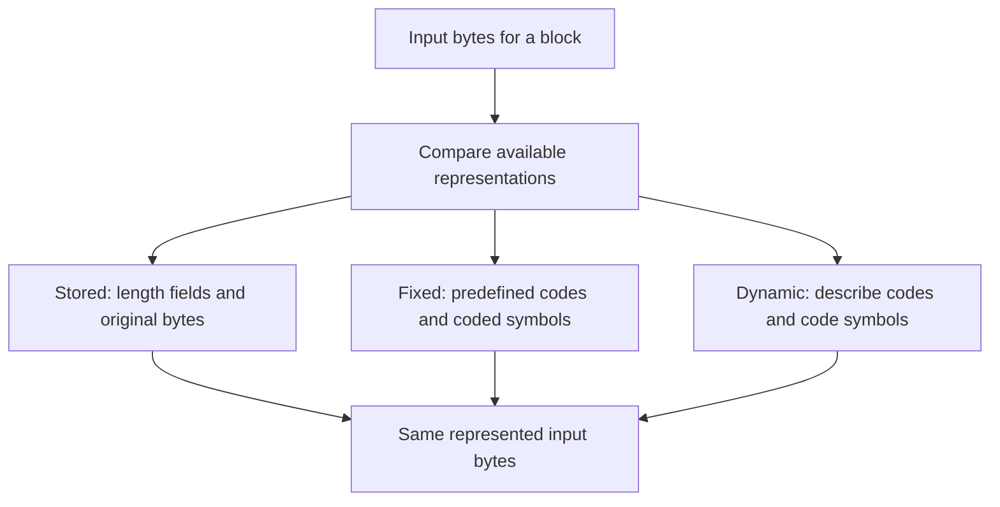
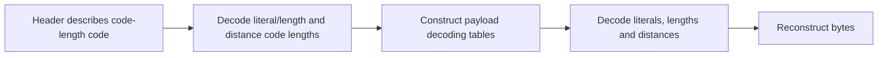
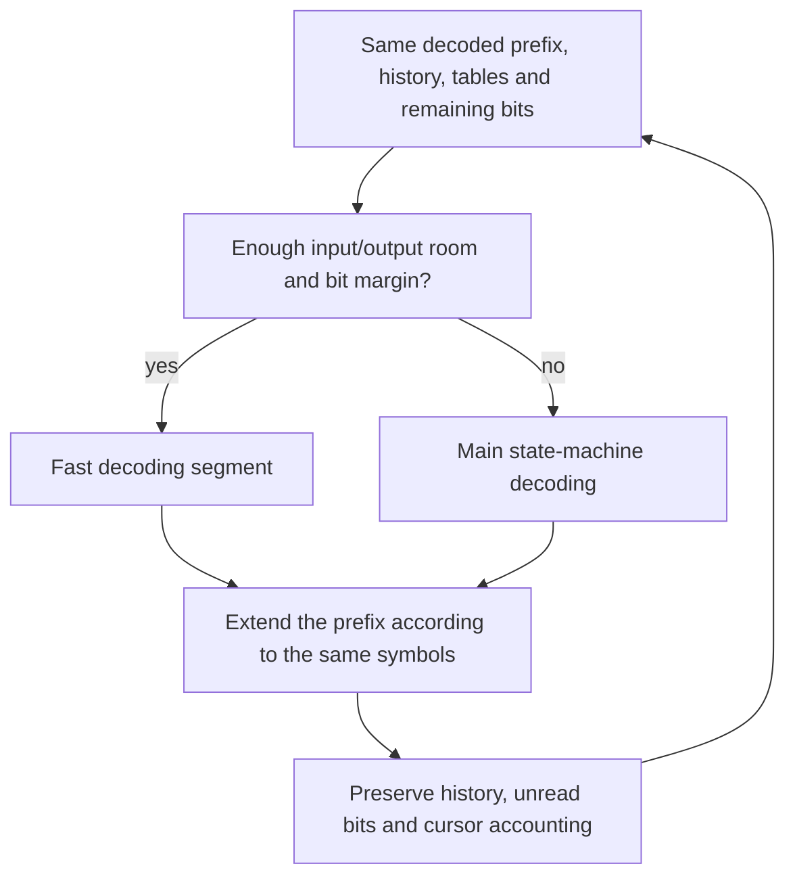

# 2. Repetition, symbols and bits

`ABABABAB` suggests an instruction: write `AB`, then repeat bytes two positions
back. Follow that instruction into a compressed block, preserving its meaning
at each step. Source correspondences below are **to confirm** under the
[shared proof method](../overview.md#7-how-the-arguments-become-checked-claims).

[Previous: a complete task](round-trip.md) · [Overview](../overview.md) ·
[Next: pausing and continuing](streaming.md)

## Contents

- [2.1 Turn repeated bytes into a match](#21-turn-repeated-bytes-into-a-match)
  - [2.1.1 A copy can read bytes it just produced](#211-a-copy-can-read-bytes-it-just-produced)
  - [2.1.2 The compressor must justify its choice](#212-the-compressor-must-justify-its-choice)
- [2.2 Keep enough recent history](#22-keep-enough-recent-history)
- [2.3 Give frequent symbols shorter codes](#23-give-frequent-symbols-shorter-codes)
  - [2.3.1 Read a small code tree](#231-read-a-small-code-tree)
  - [2.3.2 Connect the tree to real decoding tables](#232-connect-the-tree-to-real-decoding-tables)
- [2.4 Choose a block representation](#24-choose-a-block-representation)
- [2.5 Share meaning between slow and fast decoding](#25-share-meaning-between-slow-and-fast-decoding)

## 2.1 Turn repeated bytes into a match

One valid description is:

```text
literal A, literal B, match(length = 6, distance = 2)
```

A **literal** appends one byte. A **match** repeatedly reads a specified distance
behind the current output. These tokens are not yet their Huffman encoding or
complete wire format, nor a prediction of a particular compressor's choices.

### 2.1.1 A copy can read bytes it just produced


*Blue cells were written by this match. Orange outlines mark sources; blue
outlines mark destinations. Zero-based indices and arrows show sequential
byte-copy order, not a bulk memory copy.*

Source 0 supplies destination 2. On the third step, source 2 supplies destination
4, using a byte written by the first step. A disjoint copy from a snapshot of
only the original `AB` cannot express this operation.

After `k` steps, the first `2 + k` bytes are the corresponding output prefix,
the next source is `2 + k - 2`, and six minus `k` bytes remain. The source
precedes the destination even when ranges overlap. This invariant justifies
both values and initialized reads; actual writable capacity must also hold.

`inflate`'s `MATCH` mode and `inflate_fast` perform sequential copies. Their
pointer updates must implement `F-match-copy` in the
[format specification](../spec/format/README.md#literals-matches-and-history).
The [fast-decoder argument](../proof/inffast.md#match-copies-f3-and-f4) treats
overlapping copies in memory.

### 2.1.2 The compressor must justify its choice

At input position 2, `ABABAB` matches a distance-2 reference. A compressor can
emit that match or another valid description. Its hash chains help
`longest_match` locate candidates; strategy loops choose tokens.

A matching hash is only a hint. The proof must relate the chosen distance and
length to input bytes, bound candidate reads and chain traversal, and justify
emitted tokens. [Match-search reasoning](../proof/deflate.md) need not prove
that zlib always finds the longest possible match.

## 2.2 Keep enough recent history

DEFLATE distances reach 32,768 bytes. A 32 KiB window retains a recent suffix
instead of the entire output.


*Top: saved history after earlier output was delivered, before any current-call
output. Bottom: a separate malformed-input example without a preset dictionary.*

After 40,000 bytes, `40000 - 32768 = 7232` is the oldest retained index.
Distance 32,768 reaches it; distance 1 reaches the newest byte. Physical ring
slots must continue to denote that logical suffix through wrapping or sliding.

With only `AB` available, distance 3 asks for a nonexistent earlier byte.
Ordinary sane-distance decoding must reject it without an invalid read.
Malformed input is thus covered, rather than excluded by a valid-data premise.

A real match can read saved history, current-call output, or both. Window size
alone does not justify those reads. Smaller windows and optional strict-distance
checking complicate acceptance; buffer splits can matter. Exact conditions
remain in the [history specification](../spec/format/README.md#literals-matches-and-history)
and [decoder invariant](../proof/inflate.md).

## 2.3 Give frequent symbols shorter codes

Huffman coding represents symbols with bit strings called **codewords**.
Shorter codewords for frequent symbols can reduce the total bit count.
Encoder and decoder must use the same code.

### 2.3.1 Read a small code tree

Use a **toy four-symbol alphabet** with frequencies `A:4, B:2, C:1, D:1`.
Repeatedly combine the two least frequent nodes. This illustrates Huffman
coding, not DEFLATE's fixed table, complete alphabet or a complete block.


*Symbol labels give frequencies. Follow 0 left and 1 right; a leaf ends a codeword.*

`ABAD` becomes `0 | 10 | 0 | 111`, or `0100111`. Decoding repeatedly starts
at the root: `0` reaches A, `10` B, then `0` A and `111` D. No leaf is another's
ancestor, so no complete codeword begins another. This **prefix-free** property
makes symbol boundaries unambiguous.

For all eight symbols, the payload cost is
`4×1 + 2×2 + 1×3 + 1×3 = 14` bits, versus 16 for two bits per symbol.
This excludes code-description cost: saving two payload bits alone does not
make a dynamic block smaller.

### 2.3.2 Connect the tree to real decoding tables

DEFLATE has literal/length and distance alphabets. Literal/length symbols denote
bytes, end-of-block or lengths; some lengths and distances need extra bits.
A length-12 match uses symbol 265, base 11 plus extra value 1. Distance 2 uses
symbol 1 without extra bits. Their codewords depend on the selected block code.

Dynamic blocks transmit code lengths; canonical assignment derives codewords
from lengths and symbol order. `inflate_table` builds lookup tables instead
of requiring a tree walk for each symbol.

The proof must show both that lengths describe an admitted code, including
invalid-input handling, and that each initialized entry returns the prescribed
symbol, extra-bit count or error. Bounded access alone does not establish
meaning; see [table construction](../proof/inftrees.md).

Toy bit strings show codeword order only. Real packing gives numeric fields
and Huffman codewords different bit-order rules, defined by the
[bit-order specification](../spec/format/README.md#bits-and-blocks).

## 2.4 Choose a block representation

A stored block carries bytes directly; fixed blocks use predefined codes;
dynamic blocks describe their codes first. One DEFLATE stream can mix all three.



*Representation choices, not statement-by-statement C control flow. Costs
include headers, extra bits and alignment.*

A short block may not repay a dynamic description's cost; poorly compressible
data may favor stored form. Every choice must preserve input meaning, and
capacity bounds must include overhead. `_tr_flush_block` selects forms in
`trees.c`; see [tree construction and emission](../proof/trees.md).

Dynamic headers require a second level of codes:



*The code-length code describes payload codes, not original bytes directly.*

If two length-array slots remain, repeating zero three times is invalid.
Rejecting before the third write connects format validity to a memory bound.
The [dynamic-block specification](../spec/format/README.md#dynamic-codes)
defines exact counts and repeat rules.

## 2.5 Share meaning between slow and fast decoding

`inflate` decodes in its state machine or calls `inflate_fast` when input,
output and buffered-bit margins suffice. Both paths occur under default
parameters; small buffers do not select a different format.



*An intended shared invariant. Actual paths can suspend, reach block boundaries,
finish or fail.*

The main proof derives helper premises from execution and uses a proved result
covering actual returned pointers, bits and output. The
[main-decoder](../proof/inflate.md) and [fast-decoder](../proof/inffast.md)
arguments develop this connection. [Streaming](streaming.md) next follows what
must survive a pause.
