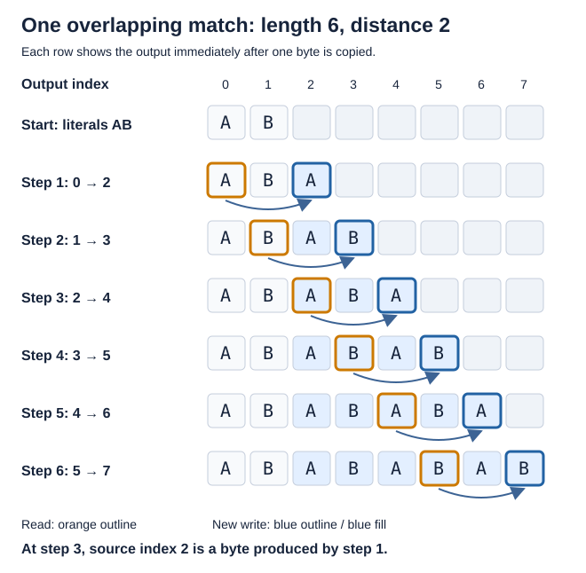
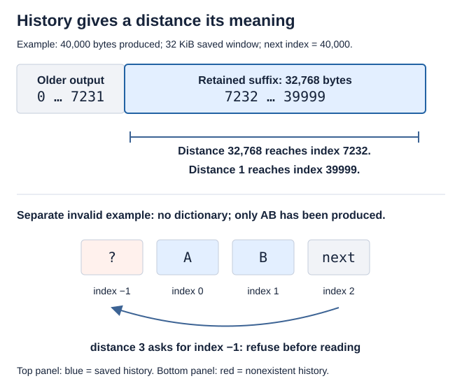
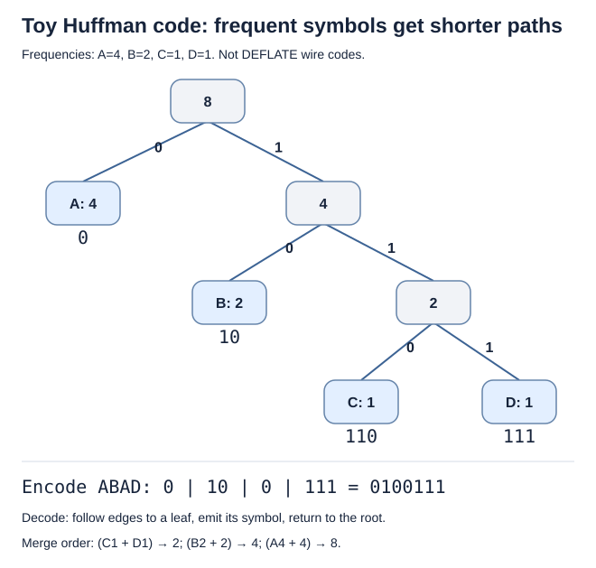
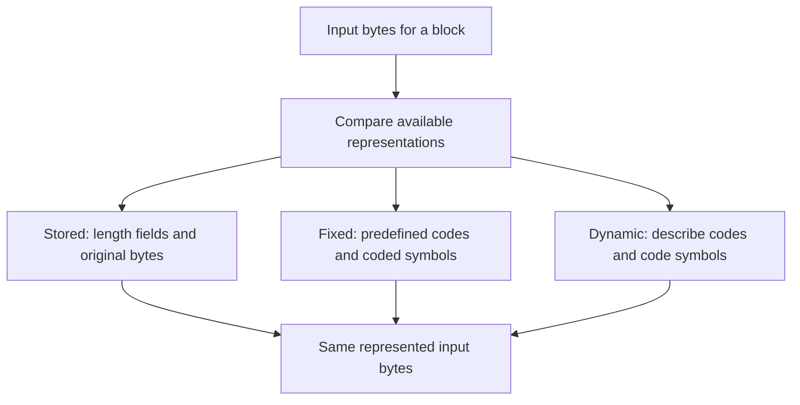
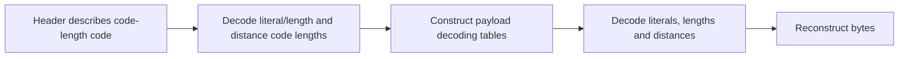
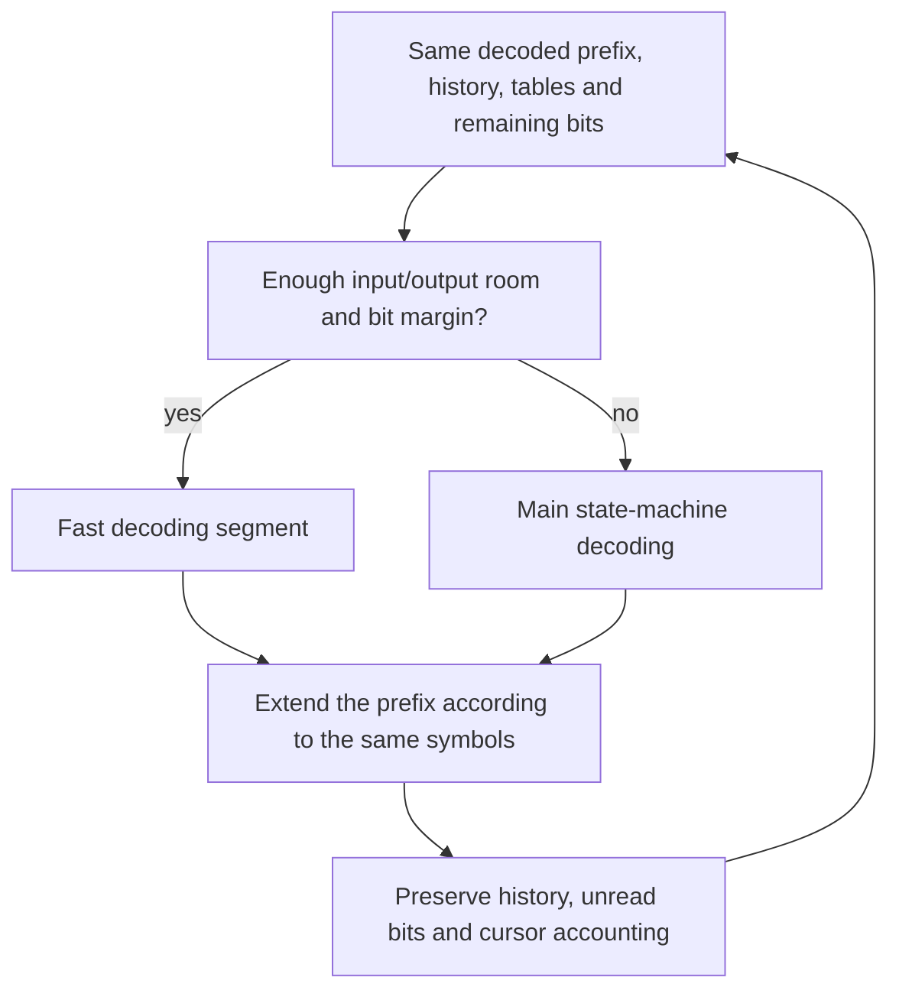

# 2. Repetition, symbols and bits

The eight bytes `ABABABAB` contain a useful instruction: write `AB`, then
repeat the bytes two positions back. This chapter follows that idea until it
becomes a compressed block. Each change of representation also introduces a
specific fact that the implementation proof must preserve.

[Previous: a complete task](round-trip.md) · [Overview](../overview.md) ·
[Next: pausing and continuing](streaming.md)

## Contents

- [2.1 Turn repeated bytes into a match](#21-turn-repeated-bytes-into-a-match)
  - [2.1.1 A copy can read bytes it just produced](#211-a-copy-can-read-bytes-it-just-produced)
  - [2.1.2 The compressor must justify its choice](#212-the-compressor-must-justify-its-choice)
- [2.2 Keep enough recent history](#22-keep-enough-recent-history)
- [2.3 Give frequent symbols shorter codes](#23-give-frequent-symbols-shorter-codes)
  - [2.3.1 Read a small code tree](#231-read-a-small-code-tree)
  - [2.3.2 Connect the tree to real decoding tables](#232-connect-the-tree-to-real-decoding-tables)
- [2.4 Choose a block representation](#24-choose-a-block-representation)
- [2.5 Share meaning between slow and fast decoding](#25-share-meaning-between-slow-and-fast-decoding)

## 2.1 Turn repeated bytes into a match

One valid description of `ABABABAB` is:

```text
literal A, literal B, match(length = 6, distance = 2)
```

A **literal** appends one byte. A **match** appends several bytes by repeatedly
reading a specified distance behind the current output position. These are
tokens describing bytes, not yet their Huffman encoding or complete wire format.
The example is a permitted representation, not a prediction of the tokens that
a particular zlib call will choose.

### 2.1.1 A copy can read bytes it just produced



*Blue cells are bytes written by this match. The orange outline marks the
source read on that row; the blue outline marks its destination. Cell indices
are zero-based. The arrows show byte-copy order, not bulk memory copying.*

At the first step, source index 0 supplies destination index 2. At the third
step, source index 2 supplies destination index 4: that source was written by
the first step. Taking a snapshot of only the original `AB` and attempting one
ordinary disjoint copy would not express this operation.

The useful invariant after `k` steps is concrete: the first `2 + k` bytes are
`ABABABAB`'s corresponding prefix, the next source is `2 + k - 2`, and six minus
`k` bytes remain. The source precedes the destination, even when the ranges
overlap. This both explains the output and supplies initialized reads. The
destination also needs actual writable capacity; knowing the match length does
not supply memory.

The selected C performs sequential copies in `inflate`'s `MATCH` mode and in
`inflate_fast`. Connecting their pointer updates to this recurrence is
**to confirm** by the execution proofs. The exact rule is `F-match-copy` in
the [format specification](../spec/format/README.md#literals-matches-and-history);
the [fast-decoder argument](../proof/inffast.md#match-copies-f3-and-f4) explains
the overlapping-copy case in memory.

### 2.1.2 The compressor must justify its choice

The compressor works in the other direction. At input position 2, the bytes to
be represented are `ABABAB`, matching a distance-2 reference. It can emit that
match, or choose a different valid description if its search and coding costs
favor one.

In the selected source, hash chains help `longest_match` find candidate earlier
positions; strategy loops decide which candidate or literal to record. This
implementation reading is **to confirm**. A matching hash is only a search hint:
the argument must connect the chosen distance and length to the actual input
bytes. It must also bound chain traversal, candidate reads and emitted tokens.
These are the [window and match-search arguments](../proof/deflate.md), rather
than a requirement that zlib always find the longest possible match.

## 2.2 Keep enough recent history

History is what makes a backward reference meaningful. DEFLATE distances range
up to 32,768 bytes. A decoder with a 32 KiB window can retain the recent suffix
instead of keeping the whole output file in private memory.



*The top panel describes saved history after earlier output has been delivered,
with no additional output yet in the current call. The bottom panel is a
separate malformed-input example with no preset dictionary.*

For the top panel, `40000 - 32768 = 7232`. A distance of 32,768 reaches the
oldest retained byte; distance 1 reaches the most recent. Physical storage may
wrap in a ring buffer, so the proof must relate its slots to this logical suffix.
Sliding or wrapping the buffer must not silently change which byte a distance
denotes.

For the bottom panel, only `AB` exists. A distance-3 match asks for a byte before
the beginning of that history. In the ordinary sane-distance mode, the decoder
must report the invalid distance without reading outside available storage.
This refusal is part of safety for malformed data, not a caller requirement
that compressed input always be valid.

The actual decoder can source a match from saved history, output already made
in the current call, or a combination of both. Therefore, a window-size bound
alone does not justify every source read. Smaller-window configurations add
subtleties about current output versus retained history and optional strict
distance checking. The exact conditions remain in
[the history specification](../spec/format/README.md#literals-matches-and-history)
and the [decoder invariant](../proof/inflate.md); the figure does not assert
identical acceptance for every window configuration and buffer split.

## 2.3 Give frequent symbols shorter codes

Matches remove repeated byte sequences. Huffman coding then gives symbols
bit strings called **codewords**. Assigning shorter codewords to frequent
symbols can reduce the total bit count. The decoder must know the same code.

### 2.3.1 Read a small code tree

Consider this **toy four-symbol alphabet**, with frequencies `A:4, B:2, C:1,
D:1`. Combining the two least frequent nodes repeatedly gives the tree below.
This is an explanation of Huffman coding, **not** DEFLATE's fixed code table,
complete alphabet, or a complete compressed block.



*The labels beside symbols are their frequencies. Follow a 0 edge to the left
and a 1 edge to the right. A leaf ends one codeword.*

For `ABAD`, the toy encoder writes `0 | 10 | 0 | 111`, or `0100111`.
The decoder follows `0` to A, starts again at the root, follows `10` to B,
then `0` to A and `111` to D. No leaf is an ancestor of another, so no complete
codeword is the beginning of another codeword. This **prefix-free** property
makes those boundaries unambiguous.

For all eight symbols with the stated frequencies, the payload cost is
`4×1 + 2×2 + 1×3 + 1×3 = 14` bits. Giving each of four symbols two bits would
cost 16 bits. Those numbers exclude the cost of communicating the code: a
two-bit payload saving alone does not establish that a dynamic block is smaller.

### 2.3.2 Connect the tree to real decoding tables

DEFLATE uses separate literal/length and distance alphabets. A literal/length
symbol can mean a literal, an end-of-block marker, or a match length. Some
lengths and distances need extra numeric bits. For example, a length-12 match
uses length symbol 265, whose base is 11, plus extra value 1; distance 2 uses
distance symbol 1 with no extra bits. Their Huffman codewords depend on the
block's selected code.

Dynamic blocks communicate code lengths. Canonical assignment determines the
codewords from those lengths and symbol order. `inflate_table` constructs lookup
tables so the decoder need not walk a drawing of a tree one edge at a time.
This correspondence with the selected C is **to confirm** by proof.

Two facts must hold together. The supplied lengths must describe an admitted
code, including the required invalid-input cases. Each actual initialized table
entry must then return the symbol, extra-bit count or error prescribed by that
code. A bounded table access alone cannot establish the decoded symbol's meaning.
Read the [table-construction argument](../proof/inftrees.md) for this connection.

Our toy bit strings show codeword order only. Real bytes also have packing rules:
ordinary numeric fields and Huffman codewords have different bit-order rules.
The [bit-order specification](../spec/format/README.md#bits-and-blocks) states
those rules; interpreting all fields as the same integer bit order would be wrong.

## 2.4 Choose a block representation

Blocks let a compressor choose a representation appropriate to part of the data.
A stored block carries bytes directly. A fixed block uses predefined Huffman
codes. A dynamic block first describes its codes, then uses them for symbols.
These are three forms within one DEFLATE stream; they can occur successively.



*This is a representation choice, not a statement-by-statement control-flow
diagram of zlib. Costs include headers, extra bits and alignment.*

For a short block, the dynamic code description can cost more than the payload
bits it saves. For poorly compressible data, a stored block can be preferable.
The emitted representation must still describe the same input whichever choice
is made. An output bound must include overhead; compression can increase size.
The source's `_tr_flush_block` makes block decisions in `trees.c`, a reading
**to confirm** through the [tree and emission argument](../proof/trees.md).

Dynamic headers introduce one further decoding step:



*The code-length code describes the payload codes; it does not encode the
original bytes directly.*

A repeated code-length instruction must fit the remaining length-array slots.
For example, if two slots remain, an instruction to repeat zero three times is
invalid. Rejecting that instruction before the third write connects a format
rule directly to an array bound. The
[dynamic-block specification](../spec/format/README.md#dynamic-codes) owns the
exact counts and repeat rules.

## 2.5 Share meaning between slow and fast decoding

The selected `inflate` state machine can decode symbols itself or dispatch to
`inflate_fast` when its actual input, output and bit-buffer margins suffice.
Both routes can occur with default input parameters. A small caller buffer does
not select a different compressed format.



*The diagram describes the intended shared invariant. Actual paths can also
stop at a block boundary, suspend, finish or report an error.*

The main proof must derive the fast helper's entry conditions from the current
execution, then use its proved result. It cannot assume an unproved fast-decoder
contract. The result must describe the actual returned pointers and bits as
well as the output bytes. This bridge is **to confirm** in the
[main-decoder argument](../proof/inflate.md) and
[fast-decoder argument](../proof/inffast.md).
The next chapter follows what must survive when
[an application pauses and resumes](streaming.md).
