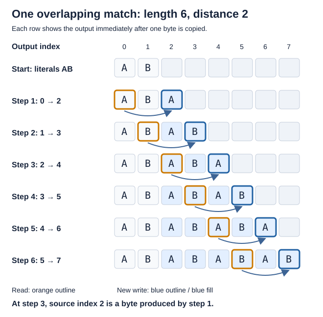
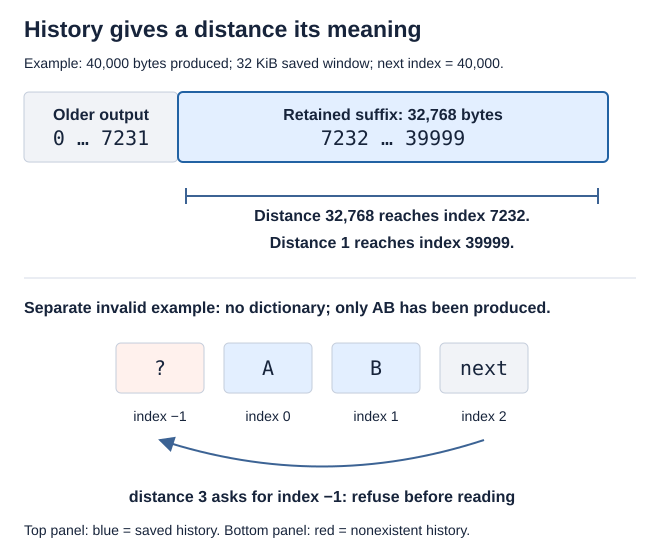
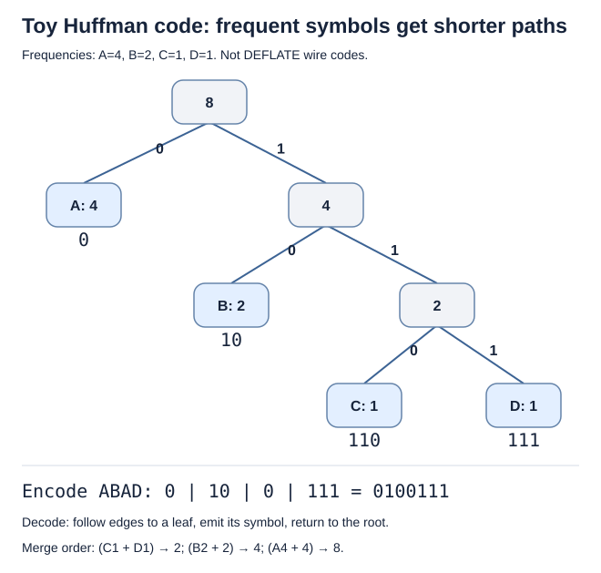
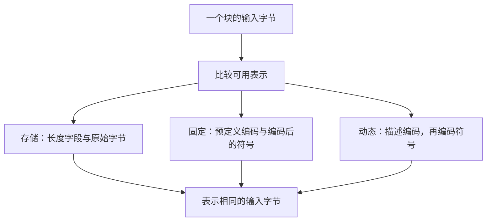
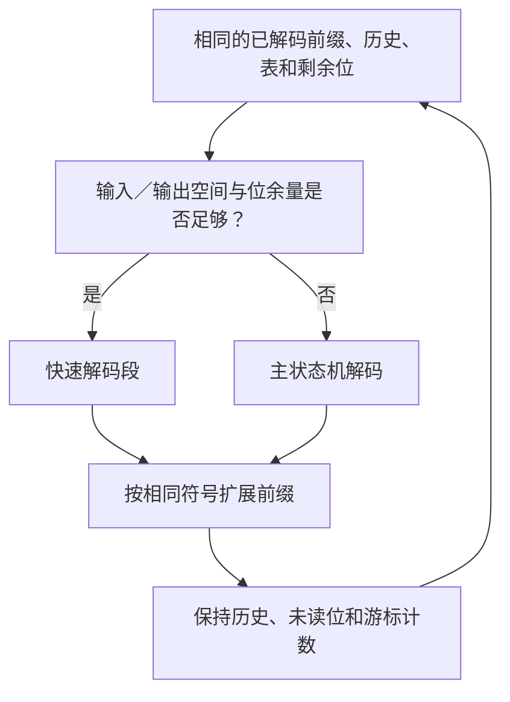

# 2. 重复、符号与位

`ABABABAB` 提示了一条指令：先写出 `AB`，再重复当前位置前两个字节。
沿着这条指令进入压缩块，可以看到每一步都必须保持原有含义。
下文的源码对应关系须按[共同的证明方法](../overview.md#7-how-the-arguments-become-checked-claims)
确认，现标为**待确认**。

[上一章：完整任务](round-trip.md) · [总览](../overview.md) ·
[下一章：暂停与继续](streaming.md)

## 目录

- [2.1 将重复字节表示为匹配](#21-turn-repeated-bytes-into-a-match)
  - [2.1.1 复制可以读取刚刚产生的字节](#211-a-copy-can-read-bytes-it-just-produced)
  - [2.1.2 压缩器必须证明所选匹配有效](#212-the-compressor-must-justify-its-choice)
- [2.2 保留足够的近期历史](#22-keep-enough-recent-history)
- [2.3 为高频符号分配较短编码](#23-give-frequent-symbols-shorter-codes)
  - [2.3.1 阅读一棵小编码树](#231-read-a-small-code-tree)
  - [2.3.2 将树连接到实际解码表](#232-connect-the-tree-to-real-decoding-tables)
- [2.4 选择块的表示方式](#24-choose-a-block-representation)
- [2.5 让慢速与快速解码共享含义](#25-share-meaning-between-slow-and-fast-decoding)

## 2.1 将重复字节表示为匹配

一种有效的描述是：

```text
literal A, literal B, match(length = 6, distance = 2)
```

**字面量**追加一个字节。**匹配**反复读取当前位置之前指定距离的字节。
这些指令符号还不是 Huffman 编码或完整的实际字节格式，也不预测某个压缩器会如何选择。

### 2.1.1 复制可以读取刚刚产生的字节



*蓝色单元格表示本次匹配写入的字节。橙框标出读取源，蓝框标出写入目的。
下标从零开始，箭头表示逐字节复制顺序，而非一次批量内存复制。*

源下标 0 提供目的下标 2 的字节。第三步中，源下标 2 提供目的下标 4 的字节，
使用的是第一步刚写入的内容。只对最初的 `AB` 拍快照再作不重叠复制，无法表达这个操作。

执行 `k` 步后，前 `2 + k` 个字节是相应输出前缀，下一个读取源为
`2 + k - 2`，还剩六减 `k` 个字节。
即使区间重叠，源位置也先于目的位置。
这个不变量同时解释字节值与读取已初始化的性质；实际可写容量也必须成立。

`inflate` 的 `MATCH` 模式与 `inflate_fast` 都逐字节复制。
它们的指针更新必须实现[格式规范](../spec/format/README.md#literals-matches-and-history)
中的 `F-match-copy`。
[快速解码器论证](../proof/inffast.md#match-copies-f3-and-f4)解释内存中的重叠复制。

### 2.1.2 压缩器必须证明所选匹配有效

在输入位置 2，`ABABAB` 可以表示为距离为 2 的引用。
压缩器可以输出这个匹配，也可以选择其他有效描述。
哈希链帮助 `longest_match` 定位候选位置，策略循环再选择符号。

哈希相同只是线索。证明必须将所选距离和长度连接到输入字节，
约束候选读取与链遍历，并说明输出符号正确。
[匹配搜索论证](../proof/deflate.md)无需证明 zlib 总能找到最长的匹配。

## 2.2 保留足够的近期历史

DEFLATE 的距离最多为 32,768 字节。
32 KiB 窗口只需保留近期后缀，无须保留全部输出。



*上图：此前输出已经交付，当前调用尚未产生新输出时的历史。
下图：另一个不使用预置字典的格式错误输入例子。*

输出 40,000 字节后，最早保留的下标为 `40000 - 32768 = 7232`。
距离 32,768 指向该字节，距离 1 指向最新字节。
物理环形槽位在回绕或滑动后，仍必须表示这个逻辑后缀。

如果历史只有 `AB`，距离 3 会请求不存在的更早字节。
通常启用合理距离检查的解码必须拒绝它，不能执行无效读取。
因此，格式错误输入也被覆盖，而不是通过“数据有效”的前提排除。

实际匹配可以读取保存的历史、当前调用产生的输出，或两者结合。
仅知道窗口大小不能证明这些读取有效。
较小窗口和可选的严格距离检查会让接受条件更复杂，缓冲区切分也可能影响行为。
精确条件仍见[历史规范](../spec/format/README.md#literals-matches-and-history)与
[解码器不变量](../proof/inflate.md)。

## 2.3 为高频符号分配较短编码

Huffman 编码用称为**码字**的位串表示符号。
为高频符号分配较短码字，可以减少总位数。
编码器与解码器必须使用同一套编码。

### 2.3.1 阅读一棵小编码树

取一个**四符号教学字母表**，频率为 `A:4, B:2, C:1, D:1`。
反复合并频率最低的两个节点。
这用于解释 Huffman 编码，并非 DEFLATE 的固定编码表、完整字母表或完整数据块。



*符号旁的数字为频率。沿 0 向左、1 向右走，到叶节点就完成一个码字。*

`ABAD` 变为 `0 | 10 | 0 | 111`，即 `0100111`。
解码每个符号都从树根开始：`0` 到达 A，`10` 到达 B，随后 `0` 到达 A，`111` 到达 D。
没有叶节点是另一个叶节点的祖先，因此任何完整码字都不是另一码字的开头。
这个**前缀无关**性质确定了符号边界。

全部八个符号的有效载荷成本为
`4×1 + 2×2 + 1×3 + 1×3 = 14` 位；每个符号使用两位则需要 16 位。
这里没有计算编码描述的成本：仅节省两个有效载荷位，不能说明动态块整体更小。

### 2.3.2 将树连接到实际解码表

DEFLATE 使用字面量／长度字母表和距离字母表。
字面量／长度符号表示字节、块结束或长度；某些长度和距离还需要额外位。
长度为 12 的匹配使用符号 265，其基值为 11，再加额外值 1。
距离 2 使用符号 1，无须额外位。
它们的码字取决于该块选定的编码。

动态块传递编码长度，规范编码分配规则根据长度和符号顺序推出码字。
`inflate_table` 构造查找表，无须每解一个符号都沿树逐边查找。

证明既要说明长度描述的是可接受编码，并涵盖无效输入处理，
也要说明每个已初始化表项会返回规定的符号、额外位数或错误。
访问有界不等于含义正确；详见[表构造](../proof/inftrees.md)。

教学位串只展示码字顺序。
实际打包时，数值字段与 Huffman 码字有不同的位序规则，见
[位序规范](../spec/format/README.md#bits-and-blocks)。

## 2.4 选择块的表示方式

存储块直接携带字节，固定块使用预定义编码，动态块先描述所用编码。
同一条 DEFLATE 流可以混合这三种块。



*图中表示编码选择，不是逐语句的 C 控制流。
成本包括头部、额外位和对齐。*

较短的数据块可能无法弥补动态描述的成本，不易压缩的数据可能更适合存储形式。
每一种选择都必须保持输入含义，容量上界也必须包含开销。
`trees.c` 中的 `_tr_flush_block` 选择形式；详见
[树构造与输出](../proof/trees.md)。

动态头部需要再增加一层编码：


*码长编码描述有效载荷所用编码，并不直接编码原始字节。*

如果长度数组只剩两个位置，重复零三次的指令就无效。
在第三次写入前拒绝该指令，将格式有效性与内存边界连接起来。
[动态块规范](../spec/format/README.md#dynamic-codes)定义精确的计数和重复规则。

## 2.5 让慢速与快速解码共享含义

`inflate` 可以在状态机中解码，也可以在输入、输出和位缓冲余量足够时调用 `inflate_fast`。
默认参数下也可能走任一条路径；较小的缓冲区不会选出另一种压缩格式。



*图中表示预期共享的不变量。实际路径也可能暂停、到达块边界、完成或失败。*

主证明从执行中推出辅助函数的前提，并使用已经证明、涵盖实际返回指针、位和输出的结论。
[主解码器](../proof/inflate.md)与[快速解码器](../proof/inffast.md)论证展开这条联系。
下一章[流式处理](streaming.md)跟踪暂停时必须保留的内容。
