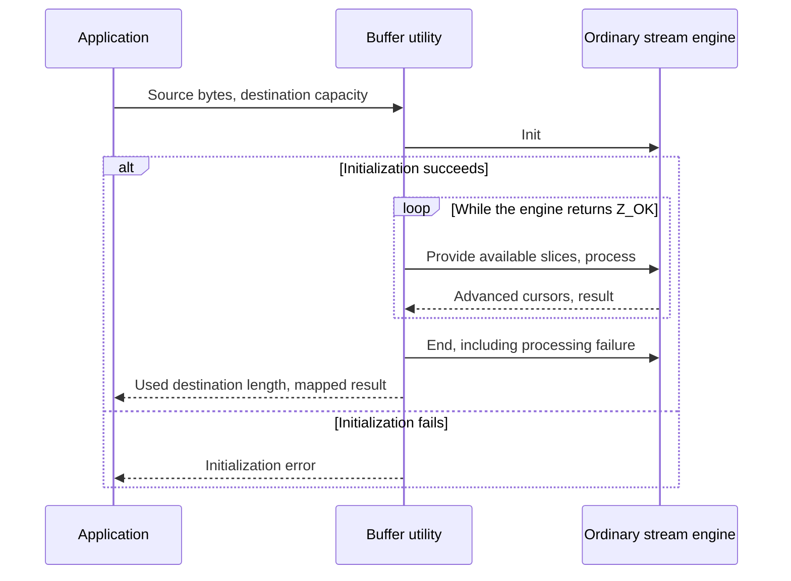
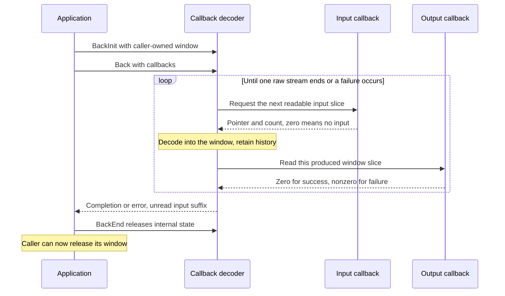
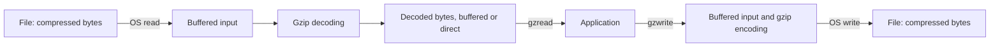
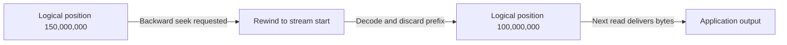

# 6. Choosing an application interface

Decoding eight bytes, copying a large archive to a destination and reading a
line near a gzip file's end share byte meaning but use different transfer and
resource protocols. Their source behavior is **to confirm** by execution proofs;
[shared composition rules](../overview.md#73-establish-preserve-and-compose)
apply to every interface.

## Contents

- [6.1 One buffer operation contains a stream lifetime](#61-one-buffer-operation-contains-a-stream-lifetime)
- [6.2 Callbacks let the decoder request input](#62-callbacks-let-the-decoder-request-input)
- [6.3 A gzip handle connects the codec to a file](#63-a-gzip-handle-connects-the-codec-to-a-file)
- [6.4 Seeking names a position in the original data](#64-seeking-names-a-position-in-the-original-data)
- [6.5 Independent checksum operations](#65-independent-checksum-operations)

## 6.1 One buffer operation contains a stream lifetime

`compress` accepts a complete source and destination capacity, managing an
ordinary compressor internally. `uncompress` manages an ordinary decoder.
Both use zlib format, without gzip/raw selection.

Wider lengths are sliced to fit engine availability fields. The
[streaming discipline](streaming.md) is hidden, but its cursor and cleanup
obligations remain in the utility proof.

**Eight-byte example.** For `ABABABAB`, let compression produce `m` bytes.
Headers/trailers and block descriptions can make `m` exceed eight. The default
formula gives `compressBound(8) = 21`; adequacy requires connecting that number
to actual output size. Compressed bytes and `m` can vary across configurations.

Decompression instead needs a separate bound on original size; compressed
length alone does not give destination capacity. A valid stream representing
eight bytes with a four-byte destination must stay within those four bytes,
including on buffer failure. Output may already have changed.

Utilities map engine completion `Z_STREAM_END` to `Z_OK`. `uncompress2` reports
consumed input and output length, and maps dictionary requests and certain
incomplete-input cases to `Z_DATA_ERROR`. The [contracts](../spec/api/utility.md)
state exact results and scalar-storage requirements; the
[proof guide](../proof/buffers.md) covers local state, conversions and bounds.

## 6.2 Callbacks let the decoder request input

With `inflateBack`, the decoder invokes input/output functions during one call.
It has a separate raw DEFLATE implementation in `infback.c`, not a wrapper
around ordinary `inflate`.

This assumes successful init and shows a possible cycle, not one input call per
output call. Initial input may delay the first callback. Output chunks are at
most one window, including a final nonempty partial chunk. Because the window
also retains history, callbacks must not overwrite/free it. Read or copy each
slice before returning; the decoder may then reuse it.

**Copying to a destination.** Input callbacks supply archive chunks; output
callbacks copy decoded slices to application storage. Safety requires readable
input until permitted replacement, bounded window writes and adequate callback
destinations. Callbacks must return, and supplied input history must be bounded:
a function-pointer type guarantees neither condition.

Input exhaustion/output refusal can return `Z_BUF_ERROR`. Malformed bytes can
return `Z_DATA_ERROR` after output; a final output refusal does not replace an
already selected format error. End uses `inflateBackEnd`. Each new `inflateBack`
call starts an independent raw stream, rather than resuming after an input pause.

The [callback contracts](../spec/api/inflate-back.md) state this focused domain;
the [proof guide](../proof/callbacks.md) connects calls to window ownership.
The application handles any enclosing [zlib/gzip wrapper](wrappers.md).

## 6.3 A gzip handle connects the codec to a file

`gzopen` creates a handle, `gzread`/`gzwrite` transfer application bytes and
`gzclose` releases it. Buffers and codec initialization are lazy: open success
does not guarantee later allocation or I/O success. These calls rely on explicit
[external-world semantics](../design/external-io.md).

Read/write are separate modes; buffering decouples the arrows. `gzwrite` can
accept bytes before any file write, followed by failure during flush/close.
The proof must distinguish accepted bytes, encoded bytes and successful I/O.

`gzread` handles concatenated gzip members internally; ordinary `inflate`
completes one member and requires caller action. Ordinary file reading can also
return recognized non-gzip input unchanged. Its proof therefore includes
transparent copying as well as decoding.

**Members containing `AB` and `CD`.** Repeated reads can deliver `ABCD` across
arbitrary buffer boundaries, preserving each member's checks and allocations.
Returned data may precede a later error. EOF, truncation, corruption and OS
failure have distinct [API results](../spec/api/gz-file.md). Cleanup covers lazy
init failure, partial I/O and close after failure; freeing resources cannot
require a successful final write. See the [gzip argument](../proof/gzip.md).

## 6.4 Seeking names a position in the original data

`gzseek(file, 100000000, SEEK_SET)` names byte 100,000,000 in **uncompressed**
data. `gztell` gives the logical next-transfer position; `gzoffset` gives the
compressed-file offset, subtracting unread buffered input in read mode.
There is no fixed conversion between them.

**Reading.** Seeking backward from logical byte 150,000,000 to 100,000,000 may
rewind, decode and discard that prefix. Some work is deferred until a read,
which can make positioning much slower than a plain file seek.

Forward seeks can consume decoded buffers or schedule a skip; transparent input
has a direct-file path. Relate processed position plus pending skip to the
observed position, with representable offset arithmetic. `SEEK_END` is unsupported.

**Writing.** Write `ABC`, seek to logical offset 6, then write `D`: the three
intervening bytes are zeros compressed as data.

Colors distinguish existing bytes, zeros and new input, not proof coverage.
Writing cannot seek backward to patch `A`. Zero-fill can wait until write/close;
carry its pending distance across calls and later I/O failure. See
[seek](../spec/api/gz-file.md#gzseek64), [position queries](../spec/api/gz-file.md#gztell64)
and the [position argument](../proof/gzip.md#positions-seeking-and-error-ownership).
[Decoder checkpoints](state-operations.md) are a separate mechanism.

## 6.5 Independent checksum operations

`adler32`/`crc32` can update a small state over byte slices without any codec or
file handle. To combine independently processed `X` and `Y`, use both checksums
and the length of `Y` to obtain the checksum of `X || Y`. The length matters;
combining checksums is not ordinary addition.

Prove this composition alongside the implementation's bounds and integer
behavior. See [contracts](../spec/api/checksums.md), [Adler-32](../proof/adler32.md)
and [CRC-32](../proof/crc32.md). Wrapper integration stays in
[chapter 4](wrappers.md); accepted evidence stays in [progress](../progress.md).
