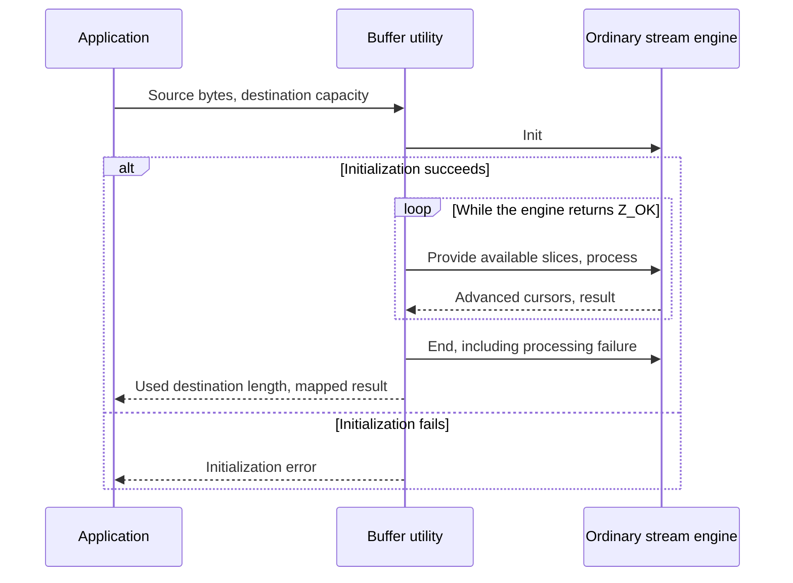
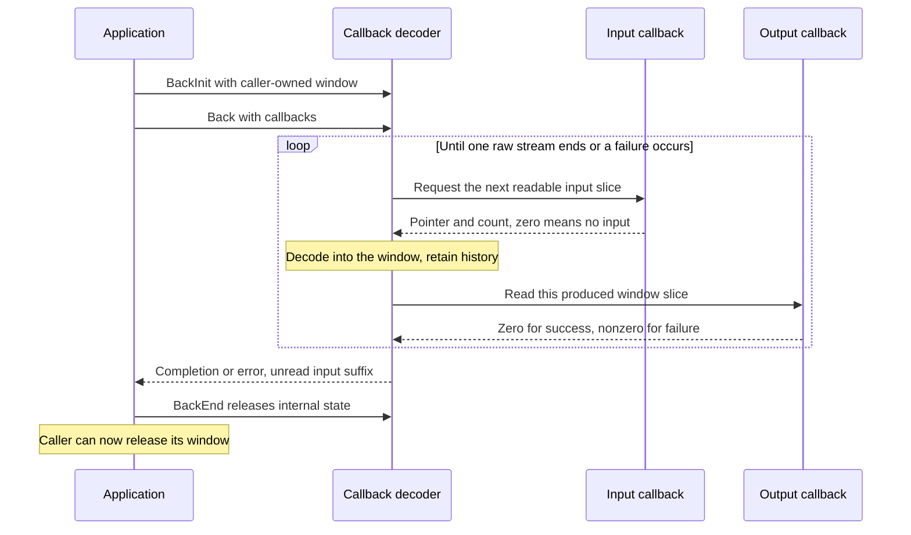
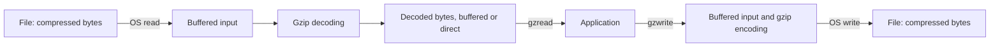
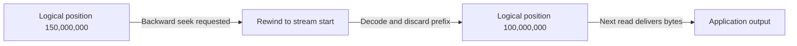
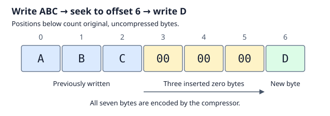

# 6. Choosing an application interface

Suppose an application needs to decode eight bytes, copy a large compressed
archive to a destination, or read a line near the end of a gzip file. These
tasks need the same byte meaning, but different ways to supply input, receive
output and manage resources. Each interface adds obligations at that boundary.

## Contents

- [6.1 One buffer operation contains a stream lifetime](#61-one-buffer-operation-contains-a-stream-lifetime)
- [6.2 Callbacks let the decoder request input](#62-callbacks-let-the-decoder-request-input)
- [6.3 A gzip handle connects the codec to a file](#63-a-gzip-handle-connects-the-codec-to-a-file)
- [6.4 Seeking names a position in the original data](#64-seeking-names-a-position-in-the-original-data)
- [6.5 Independent checksum operations](#65-independent-checksum-operations)

## 6.1 One buffer operation contains a stream lifetime

For a small in-memory message, the application can give `compress` the complete
source and a destination buffer. The call manages its own ordinary compressor.
`uncompress` similarly manages an ordinary decoder. Both use the zlib format;
they do not select gzip or raw DEFLATE. The source flow described here is
**to confirm** by execution proofs.

The outer call looks like one operation. Internally, wider lengths are divided
into slices that fit the engine's availability fields. This is the same
[pause-and-continue discipline](streaming.md), hidden from the application.
The utility proof must establish each real engine precondition, account for
every cursor advance and prove cleanup on each exit after successful init.
A hypothetical callee contract cannot replace that engine theorem.

**Example: eight original bytes.** For `ABABABAB`, let the compressed result be
`m` bytes. A destination of eight bytes is not justified merely by the word
“compression”: headers, trailers and block descriptions cost space.
Under the default bound formula, `compressBound(8)` returns 21. The bound's
adequacy requires showing that the actual compressor output fits it under the
stated conditions; proving the arithmetic formula alone does not establish that.
The chosen output bytes and `m` need not be unique across configurations.

For decompression, the caller must separately know or bound the original size.
The compressed input length does not supply that capacity. If a valid zlib
stream represents eight bytes but the destination holds four, a buffer failure
must preserve the four-byte bound. A failure can follow output; it does not
promise an untouched destination.

There is also a result boundary to prove. The utility reports a completed engine
run as `Z_OK`, whereas the stream engine reports `Z_STREAM_END`. `uncompress2`
reports consumed input as well as output length; its implementation also maps
dictionary requests and some incomplete-input cases to `Z_DATA_ERROR`.
The [buffer contracts](../spec/api/utility.md) give the exact cases and scalar
storage requirements. The [buffer proof guide](../proof/buffers.md) follows the
automatic local stream, length conversions, bounds and result mapping.

## 6.2 Callbacks let the decoder request input

For an input source and output sink already managed by an application,
`inflateBack` reverses who drives the transfers. The application calls once;
the decoder invokes an input function when it needs bytes and an output
function when decoded bytes are available. `inflateBack` has a separate raw
DEFLATE implementation in `infback.c`; it does not wrap a call to `inflate`.
This source reading is **to confirm** by its own execution proof.

The diagram assumes successful initialization and shows a possible cycle,
not one input call per output call.
Initially supplied input can delay the first input callback. One output chunk
is at most the window size, and a final nonempty partial chunk can also be
delivered. The window is both output storage and future decoding history.
Callbacks therefore must not overwrite or free it, even after accepting an
output slice. They must finish reading or copy a slice before returning;
the decoder can reuse the storage afterward.

**Example: copying to a destination.** An input callback supplies chunks from an
archive. An output callback copies decoded slices into an application-owned
destination. The proof needs readable input until its permitted replacement,
writable window bounds and a destination capacity argument inside the callback.
The library cannot guarantee safety for arbitrary callback code.

Input exhaustion or an output callback refusal can produce `Z_BUF_ERROR`.
Malformed bytes can instead produce `Z_DATA_ERROR`, possibly after output;
a final output refusal does not replace an already selected format error.
Cleanup still uses `inflateBackEnd`.
A new `inflateBack` call starts a new independent raw stream; it is not an
ordinary `inflate` continuation after a temporary input pause.

Termination also crosses the application boundary: callbacks must themselves
return, and the admitted input-supply history must be bounded. A theorem cannot
infer those facts merely from a C function-pointer type. The
[callback contracts](../spec/api/inflate-back.md) state this focused domain.
The [callback proof guide](../proof/callbacks.md) connects it to actual decoder
steps and window ownership. Any enclosing zlib/gzip wrapper belongs to the
application here; [chapter 4](wrappers.md) explains those extra checks.

## 6.3 A gzip handle connects the codec to a file

For a file, `gzopen` creates a handle, `gzread` or `gzwrite` transfers application
bytes, and `gzclose` releases the handle. Buffers and codec state are initialized
when needed. A successful open therefore does not guarantee that the first read
or write can allocate its buffers or complete its I/O.
These implementation relationships are **to confirm** by execution and history
proofs, with the [external-world assumptions](../design/external-io.md).

Reading and writing are separate handle modes. Input/output buffering means
these arrows need not all advance during one API call. For example, `gzwrite`
can accept bytes into a buffer before any file write occurs. A later flush or
close can fail while publishing them. The proof must distinguish accepted
application bytes, encoded bytes and successfully written file bytes.

On reading, `gzread` handles concatenated gzip members, moving to the next
member internally. Ordinary `inflate` reports the end of one member and needs
caller action to continue, as [chapter 4](wrappers.md) explains. In ordinary read
mode, the file interface can also recognize non-gzip input and return it
unchanged. Thus a proof of `gzread` must account for both decoding and transparent
copying; a theorem about the DEFLATE engine alone is insufficient.

**Example: two compressed members containing `AB` and `CD`.** Repeated reads can
deliver `ABCD`. Buffer boundaries need not coincide with the member boundary.
The composition argument must join the byte results while preserving each
member's checks and all allocations. Data can be returned before a later error
is reported. EOF, truncation, corruption and operating-system failure need their
distinct [file API results](../spec/api/gz-file.md).

The lifetime argument includes failed lazy initialization, partial I/O and
close after failure. Releasing buffers and the codec must not depend on a final
write succeeding. The [gzip proof guide](../proof/gzip.md) follows these paths
and identifies the actual state and ownership invariants.

## 6.4 Seeking names a position in the original data

`gzseek(file, 100000000, SEEK_SET)` asks for the next transfer to begin at byte
100,000,000 of the **uncompressed** data. It does not name byte 100,000,000 in
the compressed file. `gztell` reports the logical next-transfer position;
`gzoffset` reports a compressed-file offset, adjusting for unread buffered input
when reading. Buffering and compression prevent a simple fixed conversion.

**Reading example.** A gzip reader is at logical byte 150,000,000 and seeks
back to byte 100,000,000. Without a saved decoder checkpoint, it may rewind and
decode/discard the first 100,000,000 bytes. The work can be deferred until a later
read. This is why positioning can be much slower than a plain file seek.
The implementation's paths are **to confirm** by proof.

This depicts one replay path. A forward seek can consume buffered decoded bytes
or arrange a later skip; transparent input has a direct-file path. The proof
must relate both the position already processed and any pending skip to the
position the caller observes. Seek arithmetic also needs representable offsets.
`SEEK_END` is not supported.

**Writing example.** Write `ABC`, seek forward to logical offset 6, then write
`D`. The intervening three bytes are zero bytes; they are compressed as data.

The colours identify existing bytes, inserted zero bytes and new input. They
do not represent proof coverage. A writer cannot seek backward to patch `A`.
The zero-fill can be deferred until a write or close, so its proof must carry
the pending distance across calls and account for later I/O failure.
See [seek](../spec/api/gz-file.md#gzseek64),
[position queries](../spec/api/gz-file.md#gztell64) and the
[position argument](../proof/gzip.md#positions-seeking-and-error-ownership).
Decoder checkpoints are a different mechanism, explained in
[chapter 5](state-operations.md).

## 6.5 Independent checksum operations

An application can also call `adler32` or `crc32` directly, without a codec or
file handle. An update carries a small checksum state through successive byte
slices. For independently processed pieces `X` and `Y`, a combine operation
uses their checksums and the length of `Y` to obtain the checksum of `X || Y`.
The length is essential: joining check values is not ordinary addition.

This creates a separate mathematical composition obligation, alongside bounds
and integer behavior in the actual checksum implementation. The
[checksum contracts](../spec/api/checksums.md) and the
[Adler-32](../proof/adler32.md) and [CRC-32](../proof/crc32.md) arguments give the
exact domains. How the codec selects and updates a wrapper's checksum remains
in [chapter 4](wrappers.md). Accepted proof evidence is recorded in
[progress](../progress.md).
