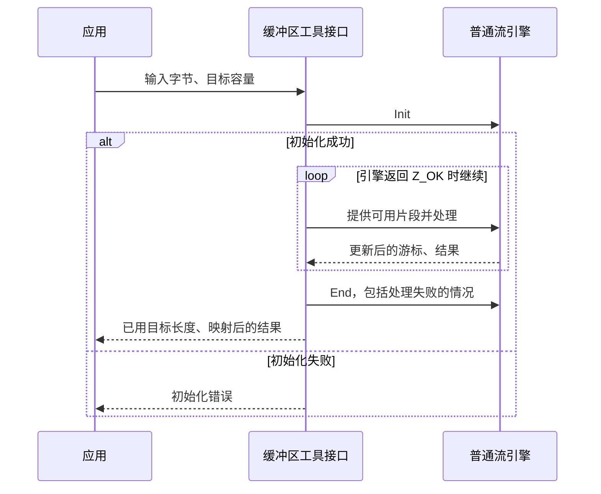
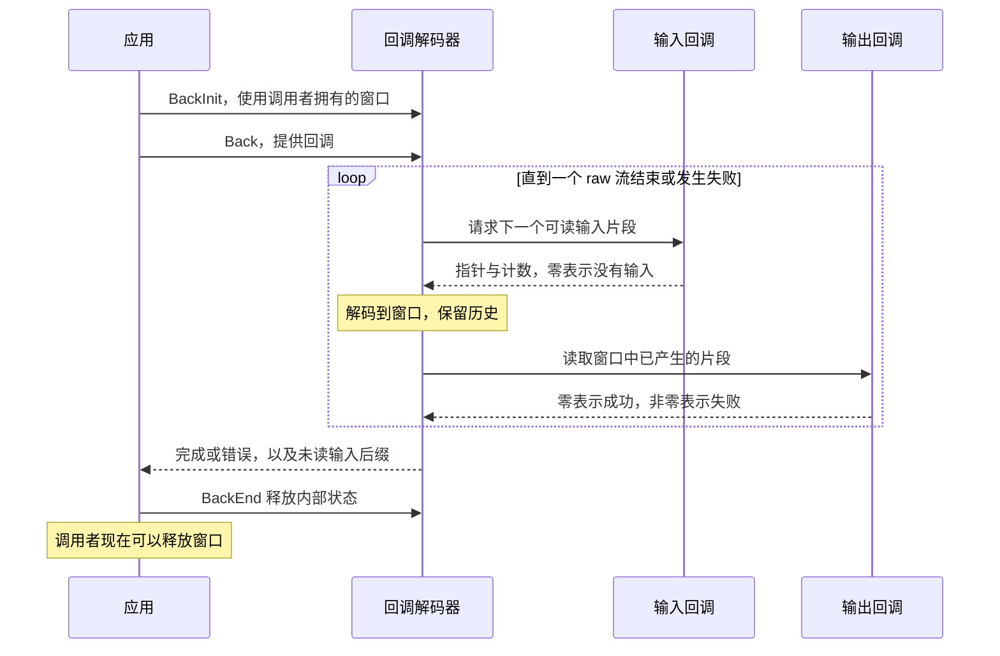
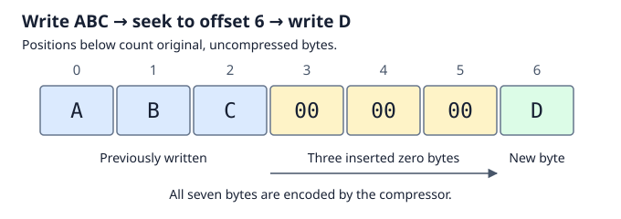

# 6. 选择应用接口

解码八个字节、把大型归档的解压内容复制到目标区、读取 gzip 文件末尾附近的一行，
它们共享字节含义，但使用不同的数据传递与资源协议。
这些源码行为仍**待确认**，须由执行证明验证；
[共用组合规则](../overview.md#73-establish-preserve-and-compose)适用于每种接口。

## 目录

- [6.1 一次缓冲区操作包含一段流生命周期](#61-one-buffer-operation-contains-a-stream-lifetime)
- [6.2 回调让解码器主动请求输入](#62-callbacks-let-the-decoder-request-input)
- [6.3 gzip 句柄把编解码器连接到文件](#63-a-gzip-handle-connects-the-codec-to-a-file)
- [6.4 定位使用原始数据中的位置](#64-seeking-names-a-position-in-the-original-data)
- [6.5 独立的校验和操作](#65-independent-checksum-operations)

## 6.1 一次缓冲区操作包含一段流生命周期

`compress` 接受完整输入及目标容量，在内部管理普通压缩器。
`uncompress` 则管理普通解码器。两者均使用 zlib 格式，不能选择 gzip/raw。

较宽的长度会切成适合引擎可用量字段的片段。
接口隐藏了[流式使用规则](streaming.md)，但其证明仍须核算游标并保证清理。

**八字节示例。** 对 `ABABABAB`，设压缩产生 `m` 个字节。
头尾和块描述可能使 `m` 大于八。默认公式给出 `compressBound(8) = 21`；
要证明容量足够，还必须把这个数与实际输出长度联系起来。
不同配置可能产生不同的压缩字节和 `m`。

解压则需要另行界定原始长度；仅凭压缩长度无法得到目标容量。
若有效流表示八个字节，而目标只有四字节，即使因缓冲区不足而失败，也必须限制在这四字节内。
此时输出区可能已经改变。

工具接口把引擎完成结果 `Z_STREAM_END` 映射为 `Z_OK`。
`uncompress2` 报告已消费输入和输出长度，并把字典请求及部分输入不完整的情况映射为 `Z_DATA_ERROR`。
[契约](../spec/api/utility.md)给出精确结果及标量存储要求；
[证明指南](../proof/buffers.md)涵盖局部状态、类型转换和界限。

## 6.2 回调让解码器主动请求输入

`inflateBack` 在一次调用中主动调用输入与输出函数。
它在 `infback.c` 中有独立的 raw DEFLATE 实现，不是普通 `inflate` 的封装。

图中假定初始化成功，展示一种可能的循环，不表示每次输入调用都对应一次输出调用。
初始输入可能推迟首次回调。每个输出块至多为一个窗口，结束时还可能交付非空的部分块。
窗口还用于保留历史，因此回调不得覆盖或释放它。
回调返回前必须读完或复制该片段，之后解码器可以复用这块存储。

**复制到目标区。** 输入回调提供归档片段，输出回调把解码后的片段复制到应用存储。
安全性要求：输入在允许替换前保持可读，窗口写入不越界，回调目标容量足够。
回调必须返回，累计提供的输入也必须有界；函数指针类型本身不保证这些条件。

输入耗尽或输出拒绝可能返回 `Z_BUF_ERROR`。
格式错误可能在已有输出后返回 `Z_DATA_ERROR`；最终输出拒绝不会覆盖已经选定的格式错误。
清理使用 `inflateBackEnd`。每次新的 `inflateBack` 调用都会开始独立的 raw 流，
不能把它当作输入暂时不足后继续原任务的调用。

[回调契约](../spec/api/inflate-back.md)说明其受限定义域；
[证明指南](../proof/callbacks.md)把调用与窗口所有权联系起来。
外层若有 [zlib/gzip 包装](wrappers.md)，由应用处理。

## 6.3 gzip 句柄把编解码器连接到文件

`gzopen` 创建句柄，`gzread`/`gzwrite` 传递应用字节，`gzclose` 释放句柄。
缓冲区与编解码器按需初始化：打开成功不保证后续分配或 I/O 成功。
这些调用依赖明确的[外部世界语义](../design/external-io.md)。

读写是不同模式，缓冲使各箭头可以分别推进。
`gzwrite` 可能先接受字节，尚未写入文件，之后在 flush/close 时失败。
证明必须区分已接受字节、已编码字节和成功的 I/O。

`gzread` 在内部处理串接的 gzip 成员；普通 `inflate` 完成一个成员后需要调用者采取下一步操作。
普通文件读取还可能识别非 gzip 输入并原样返回。
因此其证明既包括解码，也包括透明复制。

**成员分别包含 `AB` 和 `CD`。** 多次读取可跨任意缓冲边界交付 `ABCD`，
同时保持各成员的检查与分配核算。已经返回数据后，仍可能报告后续错误。
EOF、截断、损坏和 OS 失败有不同的[API 结果](../spec/api/gz-file.md)。
清理须覆盖按需初始化失败、部分 I/O 以及失败后的关闭；释放资源不能以最后一次写入成功为前提。
见 [gzip 论证](../proof/gzip.md)。

## 6.4 定位使用原始数据中的位置

`gzseek(file, 100000000, SEEK_SET)` 指定的是**未压缩**数据的第 100,000,000 字节。
`gztell` 给出下一次传递的逻辑位置；`gzoffset` 给出压缩文件偏移，
读取模式下会减去尚未使用的缓冲输入。两者不存在固定换算关系。

**读取。** 从逻辑位置 150,000,000 后退到 100,000,000，可能需要回到起点，
重新解码并丢弃前缀。部分工作会推迟到读取时执行，因此定位可能远慢于普通文件的跳转。

向前定位可以消耗已解码缓冲，也可以安排稍后跳过；透明输入有直接文件定位路径。
证明须把已处理位置及待跳过量与可观察位置联系起来，并保证偏移计算可表示。
不支持 `SEEK_END`。

**写入。** 写入 `ABC`，定位到逻辑偏移 6，再写入 `D`：中间三个字节为零，按普通数据压缩。

颜色区分已有字节、零字节和新输入，不表示证明覆盖率。
写入时不能向后定位来修改 `A`。
补零可以推迟到 write/close，因此须跨调用保存待补距离，并处理后续 I/O 失败。
见[定位](../spec/api/gz-file.md#gzseek64)、[位置查询](../spec/api/gz-file.md#gztell64)
和[位置论证](../proof/gzip.md#positions-seeking-and-error-ownership)。
[解码器检查点](state-operations.md)是另一种机制。

## 6.5 独立的校验和操作

`adler32`/`crc32` 可以在没有编解码器或文件句柄的情况下，随字节片段更新少量状态。
若 `X` 和 `Y` 独立处理，可用两者校验和与 `Y` 的长度，得到 `X || Y` 的校验和。
长度不可省略，合并校验和不是普通加法。

须在证明实现的界限与整数行为之外，证明这种组合关系。
见[契约](../spec/api/checksums.md)、[Adler-32](../proof/adler32.md)
和 [CRC-32](../proof/crc32.md)。包装层的连接见
[第 4 章](wrappers.md)；验收证据统一记录于[进度页](../progress.md)。
