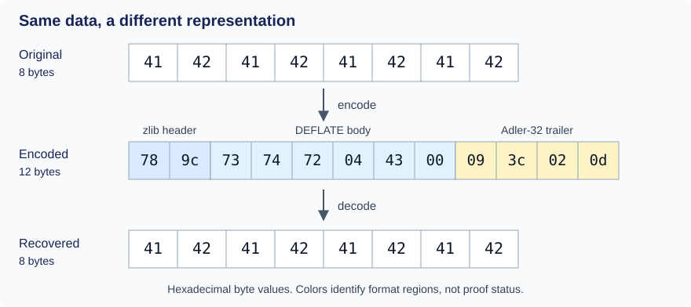
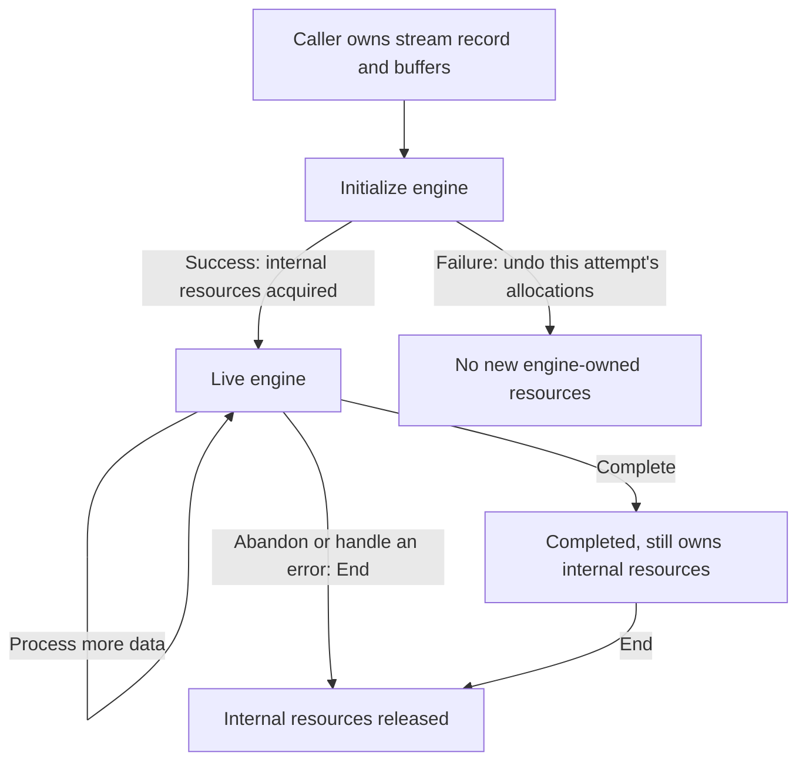
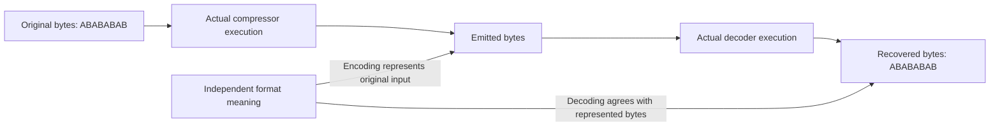

# 1. A complete compression and decompression task

[Overview](../overview.md) · Next: [How bytes become codes](encoding.md)

An application stores the eight bytes `ABABABAB` and recovers them later.
Following this task connects the caller's bytes, the library's output and the
resources used. Implementation behavior below is **to confirm** by execution
proofs under the [shared scope and method](../overview.md#7-how-the-arguments-become-checked-claims).

## Contents

- [1.1 Follow eight bytes](#11-follow-eight-bytes)
- [1.2 Start, process and release](#12-start-process-and-release)
  - [The successful route](#the-successful-route)
  - [Failure and abandonment](#failure-and-abandonment)
- [1.3 Accepted input and published output](#13-accepted-input-and-published-output)
- [1.4 Too little room or damaged data](#14-too-little-room-or-damaged-data)
- [1.5 Connect both engines to byte meaning](#15-connect-both-engines-to-byte-meaning)

## 1.1 Follow eight bytes

Our hexadecimal bytes are `41 42 41 42 41 42 41 42`. zlib treats them as bytes,
just as it would image data, serialized records or embedded zeros.

The middle row is **one valid zlib-format encoding**, not a promise of identical
output across versions, configurations or call schedules. [Encoding](encoding.md)
and [wrappers](wrappers.md) explain its body, header and trailer.

Twelve bytes represent eight: coding and wrapper overhead can outweigh savings.
Capacity therefore needs a proved bound. Several representations can encode the
same input; correctness uses independent [format relations](../spec/format/model.md),
not equality to one preferred compressed string.

This example selects the default zlib wrapper, no preset dictionary and ordinary
validation. Wider domains remain in the [configuration specification](../spec/input-configurations.md).

## 1.2 Start, process and release

### The successful route

Create a compressor with `deflateInit` and `Z_DEFAULT_COMPRESSION`. Provide
buffers, call `deflate`, and request `Z_FINISH` once all input has been supplied.
`Z_STREAM_END` reports completion; `deflateEnd` releases internal resources.

Separately, create a decoder with `inflateInit`, feed it the encoded bytes,
call `inflate` until completion, and release it with `inflateEnd`.
Initialization prepares state without compressing or decompressing.
Exact call conditions are in the [compression](../spec/api/deflate-stream.md)
and [decompression](../spec/api/inflate-stream.md) contracts.

The engines need not share a program: a producer can write today and an
unrelated consumer decode later. The format is their agreement.

### Failure and abandonment

Failed initialization must undo every allocation made by that attempt.
Successful initialization transfers ownership of internal resources to the
stream until End.

*Ownership through a task, rather than an exhaustive API transition graph.
The caller retains its record and buffers.*

An application can abandon decoding after an error or because it no longer
needs the data. End releases resources without processing the remainder.
For compression, End also discards pending output. It can report premature
abandonment even after freeing internal storage; see the
[end contract](../spec/api/deflate-stream.md#deflateend).

Recovering eight bytes alone therefore does not establish the lifetime claim.
Initialization establishes ownership, calls preserve it, and End frees each
owned allocation once. The [shared proof method](../overview.md#73-establish-preserve-and-compose)
explains this composition.

## 1.3 Accepted input and published output

A call may accept only `ABA` from the supplied `ABABABAB`. The remaining `BABAB`
must be presented again. Updated input pointers and counts identify accepted
bytes; updated output pointers and counts identify written bytes.

The compressor can retain work internally, so accepted and published byte
counts need not correspond in the same call. [Streaming](streaming.md) follows
the buffer boundaries and saved state.

The argument records accumulated accepted input and the published encoding
prefix. Before completion, that prefix need not be a complete decodable stream;
it must be related to retained state. After finishing, the full encoding must
describe exactly `ABABABAB`.

## 1.4 Too little room or damaged data

Give the decoder only seven output slots. The eighth decoded byte must wait
for more room, never be written outside the range. [Streaming](streaming.md)
explains continuation.

| Change to the example | What the argument must account for |
| --- | --- |
| Seven output bytes of capacity | Writes stay within the range; completion cannot omit the eighth byte. |
| Only the encoding's beginning is available | More input may be needed; a missing suffix alone does not establish malformed data. |
| The last byte changes from `0d` to `0c` | The body can still yield `ABABABAB`, but enabled trailer validation must reject the changed check value. |
| An internal allocation fails | The error, retained state and cleanup must match that failure path. |

Output can precede a bad-trailer error. [Wrappers](wrappers.md) explains why
published bytes do not certify whole-stream validation.

Malformed data remains in the safety domain. Invalid pointers have separate
caller obligations; expecting an error cannot make them safe. See
[defined refusals and memory obligations](../spec/safety.md#terms-and-reading-guide).

Whole-task completion needs sufficient input/output opportunities and the
required finish requests. Repeating an unproductive request cannot ensure it.
Per-call termination must separately exclude exhausted loop fuel.

## 1.5 Connect both engines to byte meaning

A round trip is insufficient as the sole correctness statement: two engines
could agree with each other while violating the interoperable format.

The upper route executes the task. The lower connections independently relate
actual translated buffers and executions to byte meaning. A model that assumes
the desired behavior does not establish either connection.

The compressor argument follows accepted input through symbols, bits and
published bytes; the decoder argument follows supplied bits through tables and
history copies into output. Technical details belong to the
[compressor](../proof/deflate.md) and [decoder](../proof/inflate.md) guides.
Helper premises must follow from initialization and preceding execution.

The [shared acceptance rules](../overview.md#74-locate-the-exact-evidence) cover
safety, resources and evidence. Finite example tests can expose disagreement;
they do not prove universal claims.

Continue with [how bytes become codes](encoding.md): the mechanisms inside the
encoding, and the invariants each mechanism needs.
