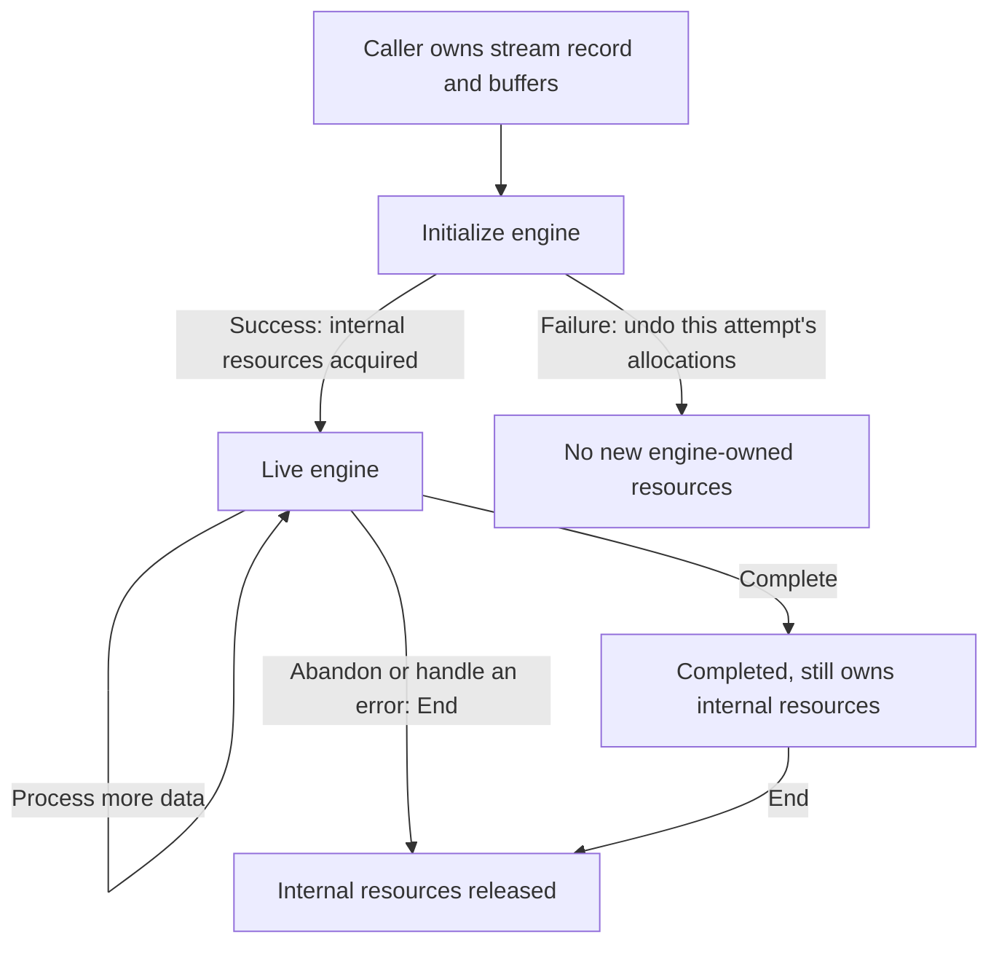
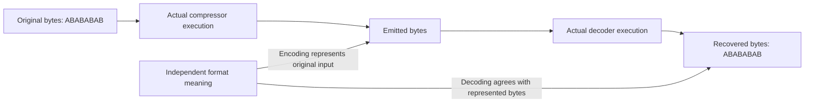

# 1. A complete compression and decompression task

[Overview](../overview.md) · Next: [How bytes become codes](encoding.md)

Suppose an application wants to store the eight bytes `ABABABAB` and recover
them later. zlib can encode those bytes, and decode the resulting representation.
Following that small task also explains what a correctness proof must connect:
the caller's actual bytes, the bytes written by the library, and the resources
used along the way.

## Contents

- [1.1 Follow eight bytes](#11-follow-eight-bytes)
- [1.2 Start, process and release](#12-start-process-and-release)
  - [The successful route](#the-successful-route)
  - [Failure and abandonment](#failure-and-abandonment)
- [1.3 Accepted input and published output](#13-accepted-input-and-published-output)
- [1.4 Too little room or damaged data](#14-too-little-room-or-damaged-data)
- [1.5 Connect both engines to byte meaning](#15-connect-both-engines-to-byte-meaning)

## 1.1 Follow eight bytes

The bytes are hexadecimal `41 42 41 42 41 42 41 42`. They happen to be ASCII
letters, but the library treats them as bytes. The same operation can handle
image data, a serialized record or zero bytes inside a buffer.

The middle row is **one valid zlib-format encoding** of this input. It is not a
promise that every version, configuration or call schedule will emit those
exact bytes. Its header, DEFLATE body and trailer will be explained in
[encoding](encoding.md) and [wrappers](wrappers.md).

This example is larger after compression: twelve bytes represent eight.
Repetition can save space in the body, while headers and other coding overhead
still cost space. An output-capacity proof must therefore establish a bound;
it cannot assume that the destination need only be as large as the input.

There can also be several valid representations of the same eight bytes.
The compressor's required result is a representation of its accepted input,
rather than one distinguished compressed string. The decoder's required result
is the bytes described by the supplied representation. Those requirements use
the independent [format relations](../spec/format/model.md).

The example uses the default zlib wrapper, no preset dictionary and the ordinary
validation behavior. The initial platform and wider input ranges remain those
of the [configuration specification](../spec/input-configurations.md).
An example selects a readable case; it does not narrow a public theorem.

## 1.2 Start, process and release

### The successful route

The application first creates a compressor using `deflateInit` with
`Z_DEFAULT_COMPRESSION`. It provides input and output buffers, calls `deflate`
as needed, and requests `Z_FINISH` when all input has been supplied. Completion
is reported by `Z_STREAM_END`. `deflateEnd` then releases the internal resources.

To recover the bytes, the application separately creates a decoder using
`inflateInit`, feeds it the encoded bytes, calls `inflate` until completion,
and releases it with `inflateEnd`. Initialization prepares state; it does not
itself perform the compression or decompression.

These are readings of the selected API and implementation, **to confirm** by
their execution proofs. The exact initialization, call and end conditions are
in the [compression](../spec/api/deflate-stream.md) and
[decompression](../spec/api/inflate-stream.md) contracts.

The two engines need not run in the same program. A producer can write the
encoded bytes today, and an unrelated consumer can decode them later. The
format is the agreement between them.

### Failure and abandonment

Creating internal state may require several allocations. If initialization
fails, every allocation made by that attempt must be released. A successful
initialization instead leaves resources owned by the stream until End.

The arrows describe ownership through a task, not every possible API transition.
The caller retains its own stream record and buffers throughout.

For example, an application may stop decoding after an error or because it no
longer needs the data. End releases the decoder without decoding the rest.
For compression, End also does not finish pending output; an abandoned result
may be incomplete. An end error can report premature abandonment even when
the internal resources have been released. Its exact result belongs to the
[end contract](../spec/api/deflate-stream.md#deflateend).

This is why “the eight bytes were recovered” is only part of the proof.
Initialization must establish the representation and ownership facts used by
later calls. Each call must preserve them, and End must release each owned
allocation exactly once. The [one-function method](../proof/method.md) explains
how those facts are obtained from actual executions, including failed allocation.

## 1.3 Accepted input and published output

Supplying eight input bytes does not mean that a particular call consumes all
eight. It also does not mean that it immediately publishes a complete encoding.
The updated input pointer and available count identify what was accepted.
The updated output pointer and available count identify what was written.

Consider a call supplied with `ABABABAB` that accepts only the first three bytes.
At that point its accepted input is `ABA`. The remaining `BABAB` still belongs
to the caller's pending input and must be presented again. A correctness
statement cannot silently treat those five bytes as already accepted.

The compressor can also retain work internally after accepting bytes. There is
no one-to-one correspondence between bytes accepted and bytes published by the
same call. The [streaming chapter](streaming.md) follows these boundaries with
buffer snapshots and explains what must survive a pause.

For this eight-byte task, a useful argument records the accumulated accepted
input and published encoding prefix. Once finishing completes, the full
published encoding must describe exactly `ABABABAB`. Before completion, an
incomplete published prefix need not be independently decodable as a whole
stream. The proof must relate it to the retained internal state as well.

## 1.4 Too little room or damaged data

Now give the decoder room for only seven output bytes. It must respect that
capacity even though the complete answer has eight bytes. Running out of room
does not justify writing the eighth byte outside the caller's range.
The application can provide more room and continue as described in
[streaming](streaming.md).

| Change to the example | What the argument must account for |
| --- | --- |
| Seven output bytes of capacity | Every write stays inside the supplied range; completion cannot omit the eighth decoded byte. |
| Only the beginning of the encoding is available | The engine may need more input. A missing suffix alone is not evidence of malformed data. |
| The last byte of this encoding changes from `0d` to `0c` | The original body can still yield `ABABABAB`, but the enabled trailer check must reject the changed check value. |
| An internal allocation fails | The documented error, preserved state and cleanup must match that failure path. |

In particular, a decoder may publish the eight bytes before it discovers a bad
trailer. Delivered output is not evidence that the complete wrapped stream has
passed validation. [Wrappers](wrappers.md) follows that exact boundary.

A data error also differs from a memory error. Malformed compressed bytes are
part of the safety domain: they must not cause an out-of-bounds access. An
arbitrary invalid pointer does not become safe merely because the application
expects an error return. The [safety specification](../spec/safety.md) and each
entry's contract distinguish memory obligations from defined refusals.

For a valid complete input, completion additionally needs the stated resources
and caller schedule: sufficient input and output opportunities, and the required
finish requests for compression. The termination obligation for each admitted
call must also exclude exhausted loop fuel. A caller that repeatedly offers no
useful input or room does not establish completion of a whole task.

## 1.5 Connect both engines to byte meaning

A successful round trip should recover the original eight bytes. That is a
useful consequence, but it is insufficient as the only correctness statement.
Two implementations could agree with one another while both use a format that
other zlib implementations cannot read.

The upper route is the concrete task. The lower connections are separate
implementation-to-specification obligations. They must hold for the actual
translated execution and buffers, rather than only for an abstract model that
already assumes the desired behavior.

For the compressor, the argument follows accepted input through its retained
symbols, emitted bits and published bytes. For the decoder, it follows supplied
bits through table interpretation and history copies to the actual output.
The [compressor](../proof/deflate.md) and [decoder](../proof/inflate.md) guides
give the corresponding technical arguments. Their callee premises must be
derived from initialization and preceding execution, not assumed as contracts.

Memory safety, resource accounting and termination accompany both connections.
Tests of concrete examples can expose disagreement, but do not prove the
universally quantified claims. [Checking](../checking/README.md) explains the
evidence required for acceptance; [progress](../progress.md) records its status.

Continue with [how bytes become codes](encoding.md). It opens the middle box:
why repetition, history and coding tables arise, and what each requires of the
implementation proof.
