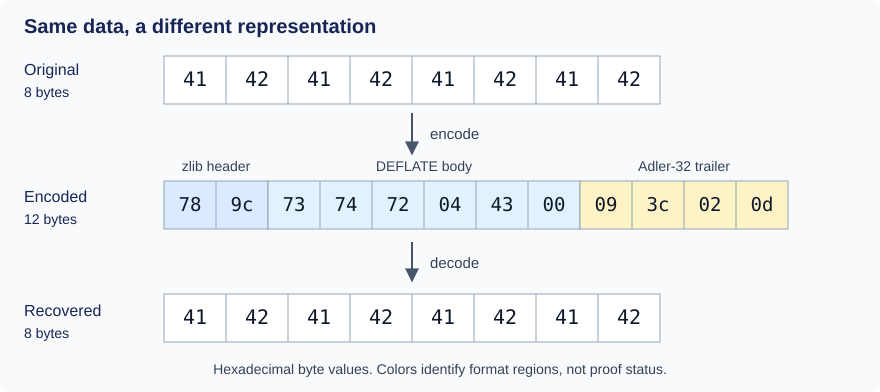
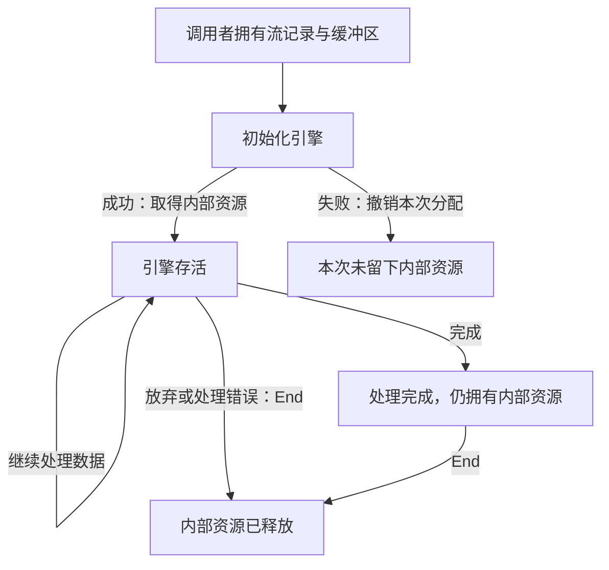

# 1. 一次完整的压缩与解压任务

[总览](../overview.md) · 下一章：[字节如何变成编码](encoding.md)

应用保存八个字节 `ABABABAB`，稍后再还原它们。
沿着这项任务，可以把调用者的字节、库的输出和所用资源联系起来。
下文的实现行为都须按[共同的范围与证明方法](../overview.md#7-how-the-arguments-become-checked-claims)
通过执行证明确认，现标为**待确认**。

## 目录

- [1.1 跟随八个字节](#11-follow-eight-bytes)
- [1.2 建立、处理与释放](#12-start-process-and-release)
  - [成功路径](#the-successful-route)
  - [失败与放弃任务](#failure-and-abandonment)
- [1.3 已消费输入与已交付输出](#13-accepted-input-and-published-output)
- [1.4 空间不足或数据损坏](#14-too-little-room-or-damaged-data)
- [1.5 将两个引擎分别连接到字节含义](#15-connect-both-engines-to-byte-meaning)

## 1.1 跟随八个字节

这些字节的十六进制值是 `41 42 41 42 41 42 41 42`。
zlib 将它们当作字节处理，图像数据、序列化记录或内嵌的零也一样。

中间一行是**一种有效的 zlib 格式编码**，并不承诺不同版本、配置或调用安排都会输出相同字节。
[编码](encoding.md)与[格式包装](wrappers.md)两章会解释主体、头部和尾部。

十二个字节表示八个字节：编码和包装的开销可能超过节省的空间。
因此，输出容量需要经过证明的上界。同一份输入可以有多种表示；正确性依照独立的
[格式关系](../spec/format/model.md)判断，而不是要求输出等于某个指定的压缩字节串。

这个例子选用默认 zlib 包装，不使用预置字典，并采用通常的校验行为。
更广的定义域仍由[输入配置规范](../spec/input-configurations.md)规定。

## 1.2 建立、处理与释放

### 成功路径

用 `deflateInit` 和 `Z_DEFAULT_COMPRESSION` 创建压缩器。
提供缓冲区并调用 `deflate`；全部输入已经提供后，请求 `Z_FINISH`。
`Z_STREAM_END` 表示完成，`deflateEnd` 释放内部资源。

解压是一项独立任务：用 `inflateInit` 创建解压器，提供编码后的字节，
调用 `inflate` 直至完成，再用 `inflateEnd` 释放资源。
初始化只准备状态，不执行压缩或解压。
精确的调用条件见[压缩](../spec/api/deflate-stream.md)与
[解压](../spec/api/inflate-stream.md)契约。

两个引擎不必属于同一个程序：生产者可以今天写出数据，另一位使用者日后再解码。
格式是双方共同遵守的约定。

### 失败与放弃任务

初始化失败时，必须撤销本次尝试中完成的每次分配。
初始化成功后，流拥有内部资源，直到调用 End。

*图中表示任务期间的所有权变化，并未列举全部 API 转移。
调用者始终保有自己的记录与缓冲区。*

应用可以在出错后，或不再需要数据时放弃解压。
End 释放资源，不再处理剩余数据。
对压缩而言，End 还会丢弃待输出内容。
即使内部存储已经释放，它仍可能报告任务被提前放弃；详见
[结束契约](../spec/api/deflate-stream.md#deflateend)。

所以，仅仅还原八个字节还不能建立整个生命周期的性质。
初始化建立所有权，各次调用保持所有权，End 将每个拥有的分配恰好释放一次。
[共同的证明方法](../overview.md#73-establish-preserve-and-compose)解释如何组合这些步骤。

## 1.3 已消费输入与已交付输出

一次调用可能只消费所提供的 `ABABABAB` 中的 `ABA`。
剩余 `BABAB` 必须再次提供。
更新后的输入指针和计数确定已消费的字节，输出指针和计数确定已写入的字节。

压缩器可以在内部保留未完成的工作，因此同一次调用的输入消费量和输出交付量不必对应。
[流式处理](streaming.md)一章会跟踪缓冲区边界与保存的状态。

证明记录累计已消费输入和已交付的编码前缀。
完成之前，这个前缀不必已经构成完整、可解码的数据流，但必须与保留的状态对应。
结束处理完成后，整个编码必须恰好表示 `ABABABAB`。

## 1.4 空间不足或数据损坏

如果解压器只有七个输出位置，第八个解码字节就必须等待更多空间，不能写出所给范围。
[流式处理](streaming.md)解释怎样继续。

| 对例子的改变 | 证明必须涵盖的情况 |
| --- | --- |
| 输出容量只有七个字节 | 写入保持在范围内，完成时不能遗漏第八个字节。 |
| 只有编码开头可用 | 可能需要更多输入；仅仅缺少后缀不能说明数据格式有误。 |
| 最后一个字节由 `0d` 改为 `0c` | 主体仍可能产生 `ABABABAB`，但启用的尾部校验必须拒绝这个变化后的校验值。 |
| 内部分配失败 | 错误、保留状态和清理都必须符合这条失败路径。 |

输出可能早于尾部错误被交付。[格式包装](wrappers.md)解释为什么已有输出不能证明整个流已通过校验。

格式错误的数据仍在安全性定义域内。无效指针则受另一组调用者义务约束；
期待错误返回并不能使无效指针安全。详见
[有定义的拒绝与内存义务](../spec/safety.md#terms-and-reading-guide)。

整个任务要完成，必须持续有足够的输入、输出机会，并发出所需的结束请求。
重复无进展的请求不能保证完成。
每次调用的终止证明还须单独排除循环步数预算耗尽。

## 1.5 将两个引擎分别连接到字节含义

只把往返还原作为正确性标准并不充分：两个引擎可能彼此一致，却都违背可互操作的格式。

上方路径执行实际任务，下方两条联系分别把翻译后的实际缓冲区和执行连接到字节含义。
一个已经假定期望行为的模型不能建立其中任何一条联系。

压缩器论证跟踪已消费输入如何经过符号、位和已交付字节；
解压器论证跟踪输入位如何经过表解释和历史复制进入输出。
技术细节见[压缩器](../proof/deflate.md)与[解压器](../proof/inflate.md)证明指南。
辅助函数的前提必须由初始化和之前的执行推出。

[共同的验收规则](../overview.md#74-locate-the-exact-evidence)涵盖安全性、资源和证据。
有限例子测试可以发现不一致，但不能证明全称命题。

继续阅读[字节如何变成编码](encoding.md)，查看编码内部的机制及各自需要的不变量。
