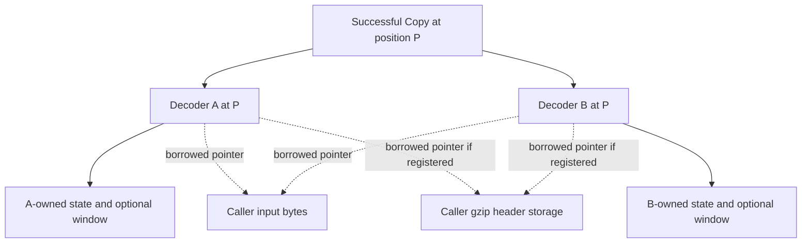
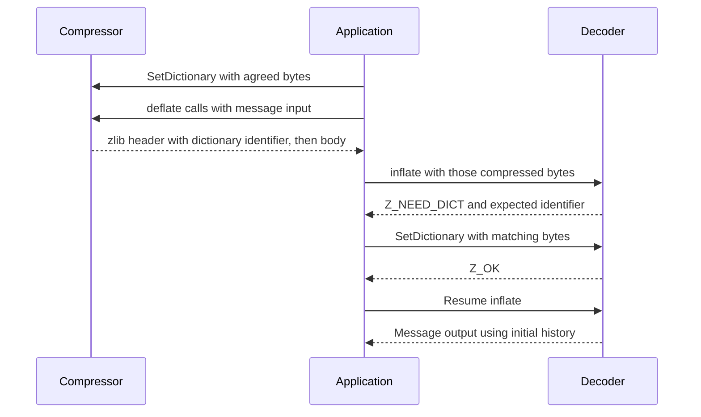
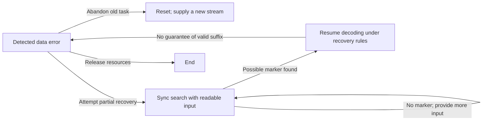

# 5. Reuse, checkpoints and controlled changes

A server reuses storage for independent messages; a viewer saves progress to
revisit a document. Reset and Copy serve these different needs. Both change
what future calls can do with the [stream state](streaming.md).
Source effects below are **to confirm** by execution proofs. The
[shared method](../overview.md#73-establish-preserve-and-compose) explains how
operation-specific invariants compose.

## Contents

- [5.1 Reuse storage for another message](#51-reuse-storage-for-another-message)
- [5.2 Save a checkpoint with Copy](#52-save-a-checkpoint-with-copy)
  - [5.2.1 Equal progress, independent ownership](#521-equal-progress-independent-ownership)
- [5.3 Start with an agreed dictionary](#53-start-with-an-agreed-dictionary)
- [5.4 Choose when a compressor exposes a boundary](#54-choose-when-a-compressor-exposes-a-boundary)
  - [5.4.1 Finish, reset and parameter changes](#541-finish-reset-and-parameter-changes)
- [5.5 Inspect or recover a special state](#55-inspect-or-recover-a-special-state)

## 5.1 Reuse storage for another message

After delivering `ABAB` from message A, a decoder can process independent B.
`inflateReset` discards A's progress and history, retaining reusable resources
and the requested format/window configuration. The caller supplies B's buffers.

Blue cells denote valid history; the white application box denotes delivered
data. Reset neither erases delivered bytes nor moves a file's read position.
The proof must make old window contents logically unavailable to future matches,
even if storage remains allocated, and account for a window freed when restoring
the requested size.

`inflateReset2` also selects a wrapper/window request, with a documented refusal
for invalid values. `deflateReset` similarly discards compression progress and
clears match history. Reset may abandon unfinished work; it does not certify
completion. Undocumented `*ResetKeep` entries retain history: a compressor using
old matches need not produce a stream decodable from empty history. Their
[contracts](../spec/api/deflate-stream.md#deflateresetkeep) define that protocol.
Exact ordinary reset effects are in the
[inflate](../spec/api/inflate-stream.md#inflatereset) and
[deflate](../spec/api/deflate-stream.md#deflatereset) contracts.

## 5.2 Save a checkpoint with Copy

Imagine decoder A paused after `AB`, before a match producing `ABABAB`.
This conceptual position need not be a particular `inflate` return point.
`inflateCopy(B, A)` lets B resume from the same position/history while A continues.
A useful checkpoint also preserves or recovers the unread compressed input and
its position. A byte offset alone omits buffered bits, tables, history and any
partially decoded operation.

### 5.2.1 Equal progress, independent ownership

Solid edges show independent internal ownership; dotted edges show borrowed
caller storage. Output pointers are copied too: provide suitable destinations
before either continuation writes. Shared header storage must remain valid for
both histories. The proof must preserve the decoding position while separating
mutable internal storage: progressing or ending A cannot modify/free B's state.
Each needs its own End. Static read-only tables may be shared; pointers into
copied internal tables must point into the copy.

If allocation fails partway, free the attempt's allocations, preserve the source
and account for the unusable destination. The
[Copy contract](../spec/api/inflate-stream.md#inflatecopy) requires a distinct,
writable, non-live destination. `deflateCopy` likewise branches compression,
for example to try alternative continuations; already published bytes remain
the application's responsibility. Its [contract](../spec/api/deflate-stream.md#deflatecopy)
and [ownership argument](../proof/deflate.md) cover the different internal storage.

## 5.3 Start with an agreed dictionary

Short messages may share vocabulary. With preset history `AB`, a conceptual
body could begin “copy 6 bytes from distance 2”, producing `ABABAB` without
delivering the dictionary itself. This illustrates the format, not a prescribed
compressor token choice.

The proof connects installed history to the compressor's actual dictionary.
Equal Adler-32 identifiers do not imply equal bytes. Retain the correct bounded
suffix and justify matches reaching before the message's output; the
[copy example](encoding.md) explains how new bytes extend a match.

Zlib requests the dictionary through `Z_NEED_DICT`. Raw mode permits installation
at call boundaries without an identifier check; gzip has no preset-dictionary
path. Wrong dictionaries and allocation failures have distinct continuation
rules in the [dictionary contract](../spec/api/inflate-stream.md#inflatesetdictionary).

## 5.4 Choose when a compressor exposes a boundary

A receiver may need to decode bytes sent so far without ending the message.
`Z_SYNC_FLUSH` exposes such a boundary while allowing later matches into earlier
history. Completed `Z_FULL_FLUSH` also clears match history, permitting restart
there with suitable decoder state.

Arrows are possible future references, not flush-time memory copies. Full flush
neither starts a new zlib/gzip wrapper nor ends the stream; frequent full flushes
can reduce compression savings. Its proof must link accepted input, pending bits
and published bytes, and exclude future matches into discarded history. A marker
does not make an arbitrary suffix independently wrapped and valid.

If output fills before a flush completes, retry the same request with more room
and the updated input pointers/counts. Exact completion and marker-space rules
are in the [flush contract](../spec/api/streams.md#compression-and-flushes).

### 5.4.1 Finish, reset and parameter changes

For `Z_FINISH`, keep supplying output room until `Z_STREAM_END`, adding no new
input to the finish operation while accounting for its unconsumed input. End
frees resources; Reset prepares another task.

`deflateParams` may flush a block under old level/strategy settings before
installing new ones. On `Z_BUF_ERROR`, settings stay unchanged but consumed input
and produced output remain progress. Preserve that accounting across retries.
See the [parameter contract](../spec/api/deflate-stream.md#deflateparams) and
[block-publication argument](../proof/trees.md).

## 5.5 Inspect or recover a special state

`inflateSync` searches damaged input for a possible full-flush marker. The same
pattern can occur elsewhere; finding it guarantees neither a valid suffix nor
whole-stream integrity.

These are selected workflows, not all representable states. During Sync search,
ordinary `inflate` cannot replace the search call. Recovery can disable trailer
validation; the [contract](../spec/api/inflate-stream.md#inflatesync) states that scope.

| Need | Entries and proof consequence |
| --- | --- |
| Supply a bit fragment | `inflatePrime` supplies bits for raw-start or reported-boundary workflows. `deflatePrime` prefixes raw output before the first compression call after init/reset. Include the bits in the format relation. |
| Inspect progress/buffering | `inflateMark`, `inflateCodesUsed`, `deflatePending`, `deflateUsed`: justify the reported quantity and permitted writes. |
| Read history | `*GetDictionary`: bound the destination and distinguish current history from the preset dictionary. |
| Control validation | `inflateValidate`: identify integrity checks enabled at completion. |

The C does not enforce every raw/timing premise in focused Prime contracts.
Outside such a premise is not automatically C UB or a clean refusal; use the
[contract conventions](../spec/api/contracts.md). Broader
[public goals](../checking/goals.md) retain their domains. The
[call-history method](../proof/method.md) supplies the common composition argument;
[progress](../progress.md) holds its evidence. Next:
[application interfaces](interfaces.md).
