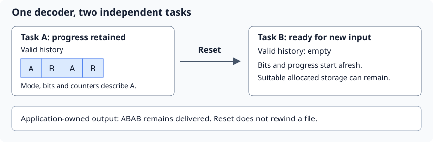
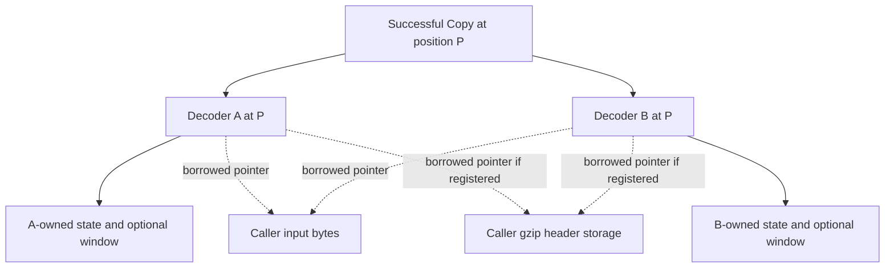
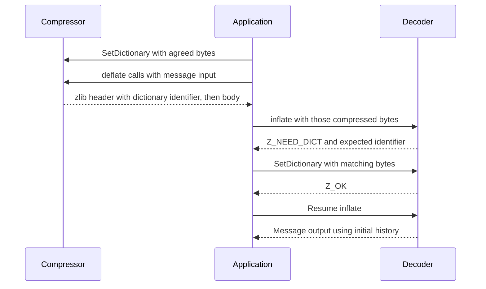
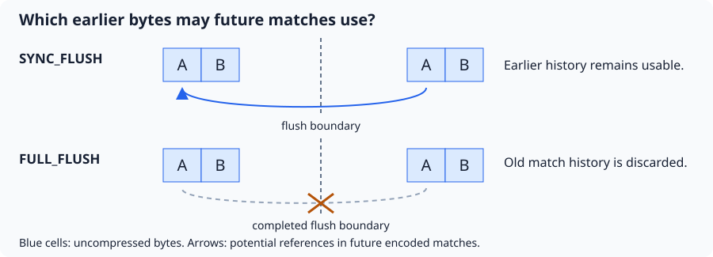
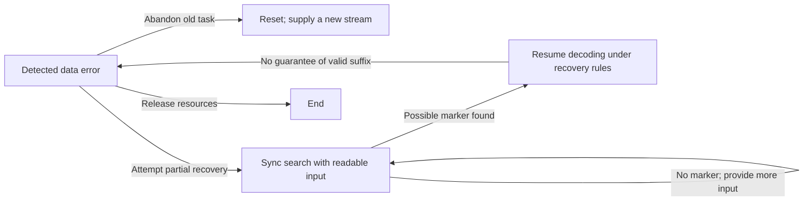

# 5. Reuse, checkpoints and controlled changes

A server may decompress thousands of independent messages. A viewer may revisit
an earlier part of a large compressed document. The first needs a fresh task in
reusable storage; the second needs the old task's saved progress. Reset and Copy
serve these different needs. They operate on the state introduced in
[streaming](streaming.md), so their correctness includes what future calls can do.

## Contents

- [5.1 Reuse storage for another message](#51-reuse-storage-for-another-message)
- [5.2 Save a checkpoint with Copy](#52-save-a-checkpoint-with-copy)
  - [5.2.1 Equal progress, independent ownership](#521-equal-progress-independent-ownership)
- [5.3 Start with an agreed dictionary](#53-start-with-an-agreed-dictionary)
- [5.4 Choose when a compressor exposes a boundary](#54-choose-when-a-compressor-exposes-a-boundary)
  - [5.4.1 Finish, reset and parameter changes](#541-finish-reset-and-parameter-changes)
- [5.5 Inspect or recover a special state](#55-inspect-or-recover-a-special-state)

## 5.1 Reuse storage for another message

Suppose the decoder has delivered `ABAB` from message A. The caller now wants to
decode independent message B. `inflateReset` discards A's decoding progress and
history while retaining reusable resources and the requested format/window
configuration. The caller supplies B's input and appropriate output space.

Blue cells denote valid decoder history; the white application box denotes
delivered data. Reset empties the logical history. It neither erases those
delivered bytes nor moves a file's read position.

The required argument starts from an actual live decoder, follows the reset
writes, and establishes the new-stream invariant. No later match may silently
use A's discarded history. Reusable window storage may remain allocated, but its
old contents must no longer count as valid history. The ownership argument must
also cover a window freed when the requested size is restored.

`inflateReset2` additionally selects a wrapper/window request. Its invalid
scalar requests require the documented refusal; accepted requests establish the
new configuration. `deflateReset` provides analogous reuse for compression,
discarding unfinished progress and logically clearing match history. Reset can
abandon an unfinished task, so success does not certify that task's completion.

The undocumented `*ResetKeep` entries deliberately retain history. That changes
the next task's assumptions: a compressor retaining old matches does not thereby
produce a stream decodable from empty history. Use their
[explicit contracts](../spec/api/deflate-stream.md#deflateresetkeep) for such a
protocol, rather than substituting them for ordinary Reset.

These effects are readings of the selected source, **to confirm** by execution
proofs. Exact reset premises and effects are in the
[inflate](../spec/api/inflate-stream.md#inflatereset) and
[deflate](../spec/api/deflate-stream.md#deflatereset) contracts.

## 5.2 Save a checkpoint with Copy

Suppose decoder A is paused after producing `AB`, just before a match that will
produce another `ABABAB`. This is a conceptual decoding position, not a promise
that a particular `inflate` call stops there. `inflateCopy(B, A)` makes B able to
continue from the same position and history. A can proceed now; B can be kept
for a later reread.

Saving only a compressed-file byte offset is generally insufficient. The state
also includes buffered bits, tables, history and a partially decoded operation.
A usable checkpoint pairs the copied decoder with the corresponding unread
compressed input and its position. The caller must retain or recover that input.

### 5.2.1 Equal progress, independent ownership

Solid edges mean independent internal ownership. Dotted edges mean borrowed
caller storage, which is not deep-copied. Output-buffer pointers are also copied;
assign suitable destinations before the two continuations write. A shared
registered header needs valid storage and suitable use throughout both histories.

The required result has two parts. The copies initially represent the same
decoding position. Their mutable internal storage is independent, so progressing
or ending A cannot modify or free B's state. Each successful copy needs its own
End. Static decoding tables can remain shared read-only data; pointers into a
copied state's own tables must instead refer into that copied state.

Allocation can fail halfway through copying. The failure argument must free the
attempt's new allocations, leave the source unchanged and account for the
destination's unusable state. It cannot assume a successful allocation. The
[Copy contract](../spec/api/inflate-stream.md#inflatecopy) also requires a
distinct writable non-live destination; copying onto a live stream is not the
checkpoint workflow. These source effects remain **to confirm** by proof.

`deflateCopy` similarly supports branching a compressor's current progress, for
example when trying alternative continuations. Already published compressed
bytes stay the application's responsibility. See its
[separate contract](../spec/api/deflate-stream.md#deflatecopy) and the
[ownership argument](../proof/deflate.md).

## 5.3 Start with an agreed dictionary

Independent short messages may repeatedly contain the same vocabulary. A preset
dictionary lets both sides start with agreed history. With dictionary `AB`, a
conceptual DEFLATE body could start with “copy 6 bytes from distance 2”, producing
`ABABAB`. The dictionary itself is not delivered as part of that message.
This illustrates the format; it does not prescribe the compressor's token choice.

The dictionary argument connects installed history to the bytes used by the
compressor. Matching Adler-32 identifiers alone cannot establish byte equality.
The decoder must retain the correct bounded suffix and use it safely when a
match reaches before this message's output. See the
[history-copy example](encoding.md) for why newly written bytes can then extend
that match.

For zlib, the ordinary decoder supplies the dictionary after `Z_NEED_DICT`.
Raw mode permits dictionary installation at call boundaries without a wrapper
identifier check. Gzip has no preset-dictionary path. A wrong dictionary or a
failed allocation has its own result and continuation conditions; this is not
an arbitrary setter usable in every mode. The
[dictionary contract](../spec/api/inflate-stream.md#inflatesetdictionary) gives
those cases, **to confirm** by implementation proof.

## 5.4 Choose when a compressor exposes a boundary

A network application may want the receiver to decode the bytes sent so far
without ending the message. `Z_SYNC_FLUSH` asks the compressor to expose such a
boundary. Future compressed matches may still refer to earlier history.
`Z_FULL_FLUSH` also clears the compressor's match history when the flush
completes, permitting decoding to restart after that point with suitable state.

Arrows denote permitted references in later compressed data, not memory copies
performed by the flush itself. A full flush does not emit a new zlib/gzip header
or end the enclosing stream. Repeated full flushes can reduce compression savings.

The required proof links accepted input, pending bits and published bytes across
the boundary. For full flush, it must also establish that future emitted matches
do not rely on the discarded history. A flush marker alone does not establish
that an arbitrary suffix is a correct independently wrapped stream.

A flush may require several calls. If output space fills, continue with the same
flush request and more room, retaining the updated input pointers/counts. Follow
the exact completion and marker-space conditions in the
[shared flush rules](../spec/api/streams.md#compression-and-flushes).

### 5.4.1 Finish, reset and parameter changes

`Z_FINISH` completes the compressed data stream: keep requesting it with more output room until
`Z_STREAM_END`, without adding new input to that finish operation. The caller
still accounts for any input left from its first finish request. End then frees
resources; Reset instead prepares another compression task.

`deflateParams` changes level/strategy during a task. A required block flush uses
the old settings before the new ones take effect. On `Z_BUF_ERROR`, settings
remain unchanged, but input consumption and output already produced remain real
progress. The proof must retain that accounting across a retry; “parameter
change failed” does not mean “nothing happened”. These source readings are
**to confirm**. See the [parameter contract](../spec/api/deflate-stream.md#deflateparams)
and [block-publication argument](../proof/trees.md).

## 5.5 Inspect or recover a special state

After corrupted input, an application might prefer recovering later content to
abandoning the entire file. `inflateSync` searches for a possible full-flush
marker. A marker can also occur elsewhere, so finding it does not guarantee that
the remaining bytes form a valid suffix or restore whole-stream integrity.

This diagram selects supported workflows, not every representable state.
During a continuing Sync search, ordinary `inflate` cannot simply replace the
search call. Recovery can disable trailer validation; its argument must state
that changed scope. These recovery effects are **to confirm** by execution proof.
See the [recovery contract](../spec/api/inflate-stream.md#inflatesync).

Other entries support specialized control or inspection:

| Need | Entries and proof consequence |
| --- | --- |
| Supply a bit fragment | `inflatePrime` supplies bits for raw-start or reported-boundary workflows. `deflatePrime` prefixes output in raw mode before the first compression call after init/reset. Account for those bits in the format relation. |
| Inspect progress or buffering | `inflateMark`, `inflateCodesUsed`, `deflatePending`, `deflateUsed`: establish the exact reported quantity and permitted writes. |
| Read retained history | `*GetDictionary`: provide enough destination space and distinguish current history from the original preset dictionary. |
| Control wrapper validation | `inflateValidate`: state which integrity checks remain enabled when interpreting completion. |

The focused Prime contracts describe raw-stream/timing workflows. The C does not
enforce all those restrictions. Being outside a focused premise is neither an
automatic C-UB classification nor a guarantee of a clean refusal. The
[contract conventions](../spec/api/contracts.md) distinguish these cases; the
broader [public goals](../checking/goals.md) retain their stated domains.

The [call-history proof method](../proof/method.md) connects each permitted
operation to the next actual state. It must derive a proved callee's premises,
rather than assume its specification. Current evidence belongs in
[progress](../progress.md). Next, [application interfaces](interfaces.md) show
how buffers, callbacks and files expose these engines.
