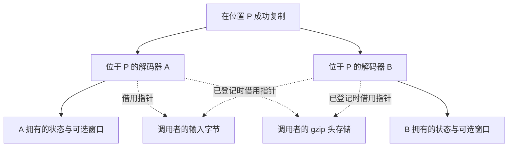
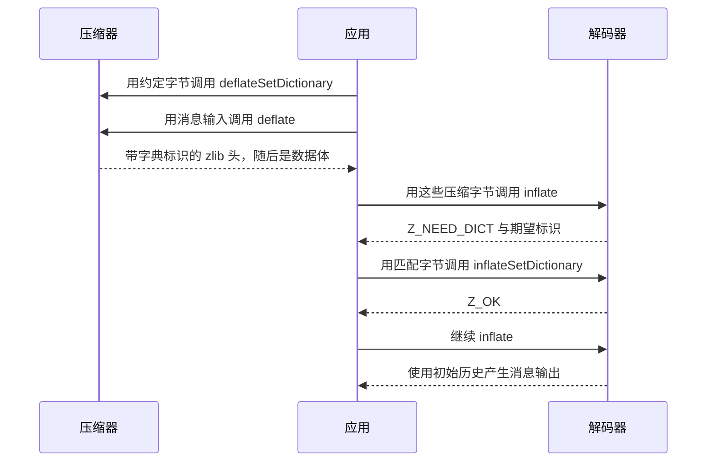
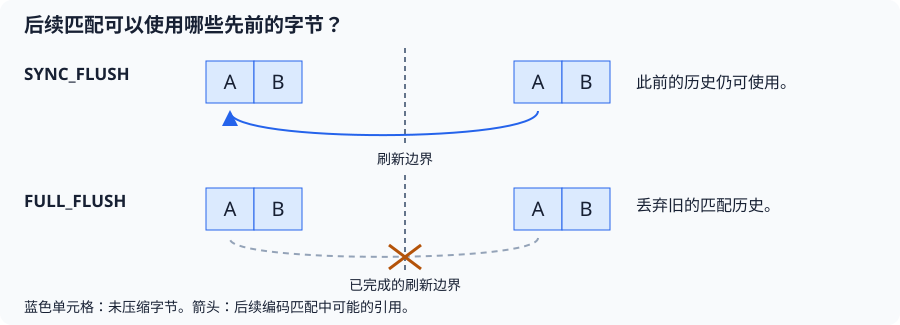
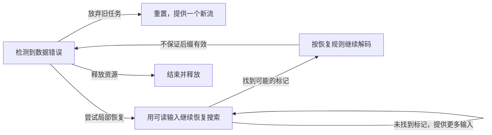

<!-- source-sha256: 682afeafd349c983063698580768431bc90148b3267f03fe917cbc394a8cfd34 -->

# 5. 复用、检查点与受控变更

服务器会复用存储来处理独立消息；阅读器会保存进度，以便重读文档。
重置（Reset）复用存储并开始新任务，复制（Copy）保留当前进度以便分叉继续。两者分别满足这两种需求。它们都会改变后续调用能够怎样使用
[流状态](streaming.md)。这些操作的完整组合证明未完成，仍需把各操作的状态变化、内存效果和合法后续调用连接起来。
[共用证明方法](../overview.md#73-establish-preserve-and-compose)说明如何组合各操作的状态不变量。

## 目录

- [5.1 复用存储来处理下一条消息](#51-reuse-storage-for-another-message)
- [5.2 用复制保存检查点](#52-save-a-checkpoint-with-copy)
  - [5.2.1 进度相同，所有权独立](#521-equal-progress-independent-ownership)
- [5.3 从约定的字典开始](#53-start-with-an-agreed-dictionary)
- [5.4 决定压缩器何时输出一个边界](#54-choose-when-a-compressor-exposes-a-boundary)
  - [5.4.1 完成、重置与参数变更](#541-finish-reset-and-parameter-changes)
- [5.5 查询或恢复特殊状态](#55-inspect-or-recover-a-special-state)

## 5.1 复用存储来处理下一条消息

解码器交付了消息 A 中的 `ABAB` 后，可以继续处理独立消息 B。
`inflateReset` 丢弃 A 的进度和历史，保留可复用资源，以及请求的格式与窗口配置。
调用者负责提供 B 的缓冲区。

蓝色单元格表示有效历史，白色应用框表示已交付数据。
Reset 不会擦除已交付字节，也不会移动文件读取位置。
证明必须说明：即使存储仍已分配，旧窗口内容也不能再供后续匹配引用；
恢复请求的窗口大小时若释放窗口，还须核算其所有权。

`inflateReset2` 还可选择包装格式与窗口请求，对无效值按文档拒绝。
`deflateReset` 同样丢弃压缩进度并清空匹配历史。
Reset 可以放弃未完成的任务，因此成功不代表旧任务已经完成。
未公开的 `*ResetKeep` 入口会保留历史：压缩器若使用旧匹配，
产生的流不一定能从空历史开始解码。其
[契约](../spec/api/deflate-stream.md#deflateresetkeep)定义了这种协议。
普通重置的精确行为见
[inflate](../spec/api/inflate-stream.md#inflatereset) 和
[deflate](../spec/api/deflate-stream.md#deflatereset) 契约。

## 5.2 用复制保存检查点

设解码器 A 在产生 `AB` 后暂停，下一个匹配将产生 `ABABAB`。
这是概念上的位置，不保证某次 `inflate` 恰好在这里返回。
`inflateCopy(B, A)` 让 B 能从同样的位置与历史继续，而 A 可以先行。
有用的检查点还要保留或重新取得未消费的压缩输入及其位置。
仅保存字节偏移不够，因为它不包含已缓存的位、编码表、历史和解码到一半的操作。

### 5.2.1 进度相同，所有权独立

图中的 P 表示保存检查点时的同一个处理位置。两份解码器可以从这里分别前进；图中实线和虚线区分各自拥有的内部存储与借用的调用者存储。

实线表示独立的内部所有权；虚线表示借用调用者的存储。
输出指针也会被复制：任何一方继续写入前，都要提供合适的目标区。
共享的头存储须在两条调用历史中保持有效。
证明既要保持解码位置，又要分离内部可变存储：推进或结束 A 不得修改或释放 B 的状态。
两者分别需要自己的 End。静态只读表可以共享；
指向已复制内部表的指针则必须指向副本。

若分配中途失败，须释放本次尝试取得的内存、保持源状态不变，并核算不可用的目标状态。
[Copy 契约](../spec/api/inflate-stream.md#inflatecopy)要求目标可写、与源不同，且尚未成为活动流。
`deflateCopy` 同样可以分叉压缩进度，例如尝试不同后续处理；
已经发布的字节仍由应用负责。其[契约](../spec/api/deflate-stream.md#deflatecopy)
和[所有权论证](../proof/deflate.md)涵盖压缩器不同的内部存储。

## 5.3 从约定的字典开始

短消息常有共同词汇。若预置历史为 `AB`，概念上的数据体可以从
“从距离 2 处复制 6 个字节”开始，产生 `ABABAB`，而不把字典本身交付为消息内容。
这说明格式的表达能力，不规定压缩器必须选择这些符号。

证明须把安装的历史与压缩器实际使用的字典联系起来。
Adler-32 标识相同不代表字节相同。
须保留正确且长度受限的后缀，并证明引用早于本条消息输出的匹配是合法的；
[复制示例](encoding.md)说明了新产生的字节怎样继续扩展匹配。

Zlib 通过 `Z_NEED_DICT` 请求字典。Raw 模式允许在调用边界安装字典，
但不检查标识；gzip 没有预置字典路径。
错误字典和分配失败各有不同的后续调用规则，见
[字典契约](../spec/api/inflate-stream.md#inflatesetdictionary)。

## 5.4 决定压缩器何时输出一个边界

接收方可能需要在消息结束前解码已经发送的字节。
`Z_SYNC_FLUSH` 提供这样的边界，同时允许后续匹配引用之前的历史。
完成 `Z_FULL_FLUSH` 还会清空匹配历史，从而允许在具备合适解码器状态时从该处重新开始。

箭头表示未来可能的引用，不表示 flush 当时执行内存复制。
完整刷新（`Z_FULL_FLUSH`）不会开始新的 zlib/gzip 包装，也不会结束当前流；频繁使用可能降低压缩收益。
其证明须连接已接受输入、待输出位和已发布字节，并排除后续匹配引用已丢弃的历史。
一个标记不能保证任意后缀都具有独立且有效的格式包装。

Flush 完成前若输出区满，应保留更新后的输入指针与计数，提供更多输出空间并重试同一请求。
精确的完成条件与标记空间要求见
[flush 契约](../spec/api/streams.md#compression-and-flushes)。

### 5.4.1 完成、重置与参数变更

对于 `Z_FINISH`，持续提供输出空间，直到 `Z_STREAM_END`；
不再向这次完成操作添加新输入，但仍须核算其中尚未消费的输入。
End 释放资源，Reset 则准备下一项任务。

压缩级别 `level` 控制搜索投入，策略 `strategy` 控制使用哪些编码选择。`deflateParams` 可能先按这两个参数的旧设置输出一个块，之后才安装新设置。
返回 `Z_BUF_ERROR` 时，设置保持不变，但已消费输入和已产生输出仍是实际进度。
重试时必须保留这些核算。见
[参数契约](../spec/api/deflate-stream.md#deflateparams)和
[块发布论证](../proof/trees.md)。

## 5.5 查询或恢复特殊状态

`inflateSync` 在损坏的输入中搜索可能的 full-flush 标记。
相同模式也可能出现在其他位置，因此找到它既不保证后缀有效，也不保证整份流的完整性。

图中只选取了部分使用流程，并非所有可表示状态。
Sync 搜索期间，不能用普通 `inflate` 替换搜索调用。
恢复可能关闭尾部验证；[契约](../spec/api/inflate-stream.md#inflatesync)说明了相应范围。

| 需求 | 入口及其证明要求 |
| --- | --- |
| 提供一段位 | `inflatePrime` 用于 raw 起始或已报告边界的流程。`deflatePrime` 在 init/reset 后第一次压缩调用之前给 raw 输出加上前缀。格式关系必须包含这些位。 |
| 查询进度或缓冲 | `inflateMark`、`inflateCodesUsed`、`deflatePending`、`deflateUsed`：证明返回的量及允许的写入。 |
| 读取历史 | `*GetDictionary`：约束目标容量，区分当前历史与预置字典。 |
| 控制验证 | `inflateValidate`：明确完成时启用哪些完整性检查。 |

位预置操作（Prime）将一小段位放到正式数据之前。C 不会检查其受限契约中的每一项裸 DEFLATE 格式／调用时序前提。
不满足这类前提，既不自动构成 C 未定义行为（UB），也不保证正常返回错误；见
[契约约定](../spec/api/contracts.md)。更广的
[公开目标](../checking/goals.md)保留原有定义域。
[调用历史方法](../proof/method.md)提供共用组合论证；
[进度页](../progress.md)记录证据。接下来阅读
[应用接口](interfaces.md)。
