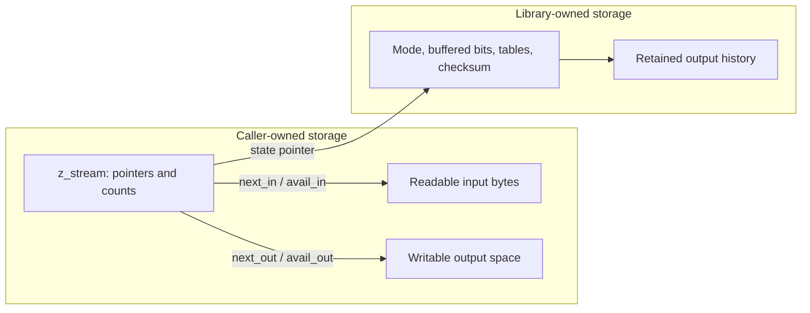
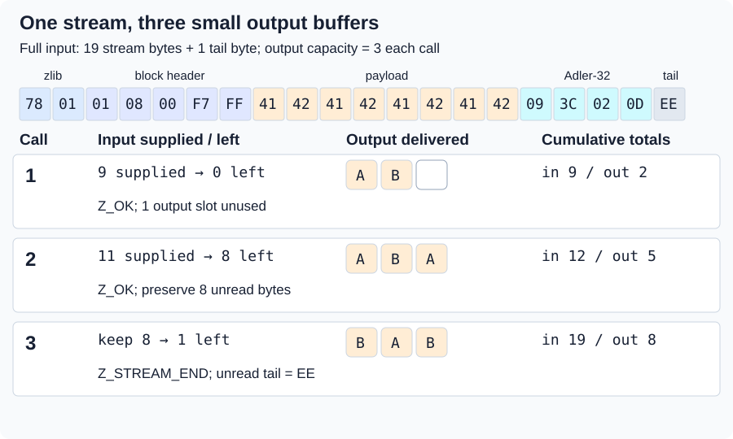
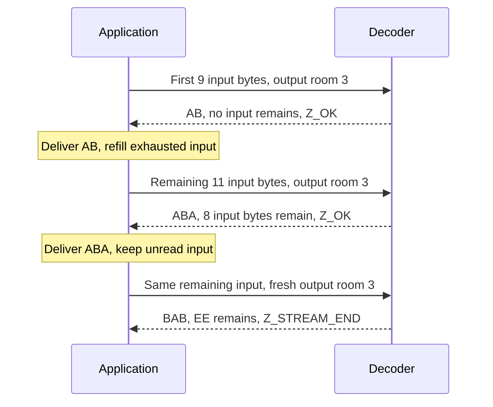
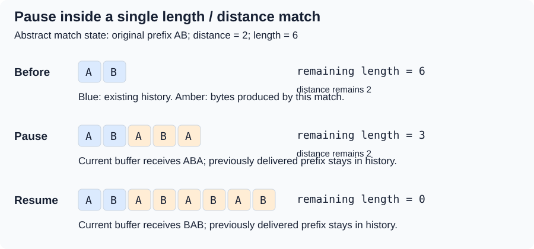
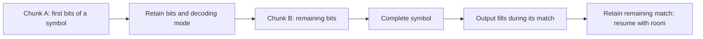
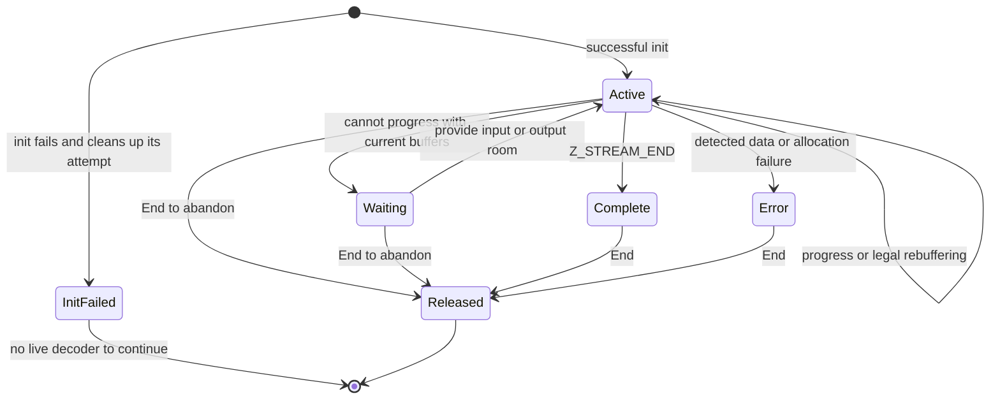

# 3. Pausing and continuing a stream

To deliver `ABABABAB` through three-byte output buffers, a decoder must pause
and continue. Streaming keeps the task's state across calls. Following that
state explains what the continuation proof must preserve.

## Contents

- [3.1 Where the bytes and the memory live](#31-where-the-bytes-and-the-memory-live)
- [3.2 Three calls, one decoded result](#32-three-calls-one-decoded-result)
  - [3.2.1 Preserve the input that remains](#321-preserve-the-input-that-remains)
  - [3.2.2 Account for the same execution](#322-account-for-the-same-execution)
- [3.3 A pause can occur inside a match](#33-a-pause-can-occur-inside-a-match)
- [3.4 A buffer boundary is not a format boundary](#34-a-buffer-boundary-is-not-a-format-boundary)
- [3.5 Progress, completion and errors](#35-progress-completion-and-errors)

## 3.1 Where the bytes and the memory live

The application owns `z_stream` and its buffers. `next_in` points at `avail_in`
unread compressed bytes; `next_out` points at `avail_out` writable bytes.
Calls advance these pointers and reduce their counts by the amounts used.



*The arrows denote references. They do not transfer ownership of caller buffers.*

Replacing an output buffer retains the decoder's tables and history. Its
**stream invariant** connects that history to decoded bytes and records the
bounds and ownership needed to continue. Initialization must establish it;
permitted calls must preserve it. The shared
[proof method](../overview.md#73-establish-preserve-and-compose) explains framing
and why helper contracts cannot be assumed.

This source reading is **to confirm** by proof. The
[shared contracts](../spec/api/streams.md#stream-storage-and-ownership) give exact
buffer, alias and lifetime conditions. Init allocates state; later calls may
allocate a history window. Both allocation-failure paths need cleanup arguments.

## 3.2 Three calls, one decoded result

This hand-constructed zlib stream stores the eight ASCII bytes `ABABABAB`.
The extra `EE` exposes the stopping position.

```text
78 01 | 01 08 00 F7 FF | 41 42 41 42 41 42 41 42 | 09 3C 02 0D | EE
header  stored-block     A  B  A  B  A  B  A  B    Adler-32      tail
        header
```

This encoding need not be the default compressor's choice. See
[encoding](encoding.md) for block choices and [wrappers](wrappers.md) for the
header and check value.

After `inflateInit` succeeds, use `Z_NO_FLUSH` and three-byte output buffers.
Supply nine input bytes, then the remaining eleven once those are exhausted.
Call 3 keeps unread input. Deliver each output before reusing its buffer.



*Blue: supplied input; amber: produced bytes; gray: unread input. Colors denote
data roles, not proof status.*

| Call | Input available before | Consumed | Produced | Input left | Output room left | Return |
| --- | ---: | ---: | --- | ---: | ---: | --- |
| 1 | 9 | 9 | `AB` (2) | 0 | 1 | `Z_OK` |
| 2 | 11 | 3 | `ABA` (3) | 8 | 0 | `Z_OK` |
| 3 | 8 | 7 | `BAB` (3) | 1 | 0 | `Z_STREAM_END` |

Cumulative `(total_in, total_out)` is `(9, 2)`, `(12, 5)`, then `(19, 8)`.
Call 3 consumes three payload and four trailer bytes. Output joins to
`ABABABAB`; `EE` remains unread. A finite run of the pinned C confirmed these
values: [example evidence, not a general proof](../overview.md#74-locate-the-exact-evidence).

### 3.2.1 Preserve the input that remains

Call 2 leaves eight bytes needed to finish. Replacing them loses input. Refill
only when `avail_in == 0`, or move/append data while preserving unread bytes and
their correct pointer and count.



*The application drives `inflate` and manages buffer lifetimes between calls.*

### 3.2.2 Account for the same execution

For one actual returned heap, consumed input `c` and produced output `p` obey:

```text
c = avail_in_before  - avail_in_after
p = avail_out_before - avail_out_after
next_in_after  = next_in_before  + c
next_out_after = next_out_before + p
```

For valid input in an ordinary run, newly written bytes extend the decoded
prefix. Counter and output theorems must describe that same execution. The
[decoder argument](../proof/inflate.md) connects mode proofs to the common
return path.

Normal totals wrap at C unsigned widths; this example does not wrap. After a
late window-allocation failure, pointers can reflect progress while final
total/checksum updates are skipped. See the exact
[accounting contract](../spec/api/inflate-stream.md#inflate).

## 3.3 A pause can occur inside a match

After output `AB`, a length-six, distance-two match needs six output slots.
With three slots per call, it spans two calls.



*An abstract match-state example, not a compressed-byte or actual return trace.*

After writing `ABA`, retain distance `2`, remaining length `3` and history for
`BAB`. Once the application reuses its old output buffer, continuation must
read valid retained history rather than overwritten caller storage.

The proof therefore connects window contents, current output, valid distance
and remaining match. A numeric remaining length alone cannot justify source
reads. C's `MATCH` state and return-time window update implement this mechanism,
**to confirm** by the [continuation arguments](../proof/inflate.md).

## 3.4 A buffer boundary is not a format boundary

A symbol can span input chunks. A decoder can also consume a byte but retain
unused bits. Thus `avail_in == 0` leaves no unread caller bytes, yet buffered
bits or pending output may remain.



*Input may split a symbol; output may split its expansion. Meaning is unchanged.*

The proof must lose or duplicate neither bits nor output across these cuts.
Fast and ordinary paths share the same relations; both can occur under default
configuration as buffers change. The [fast decoder argument](../proof/inffast.md)
gives entry margins and the returned bit-buffer relation.

## 3.5 Progress, completion and errors



*Waiting is an application condition, not a C mode. This End-only cleanup view
omits the [reset and recovery protocols](state-operations.md).*

`Z_BUF_ERROR` can mean no progress: provide input or room before retrying a
blocked request. EOF before `Z_STREAM_END` is not completion. Output can precede
a [failed trailer check](wrappers.md#44-output-can-precede-a-failed-check).

Compression uses `Z_NO_FLUSH`, then `Z_FINISH` until `Z_STREAM_END`, adding no
new input after the first finish request. See [flushes](state-operations.md).

The [shared lifetime obligation](../spec/safety.md#2-calls-and-sequences) composes
actual init, calls, rebuffering and End. It includes failed-init cleanup and safe
End after data or window-allocation errors; the diagram does not prove it.
