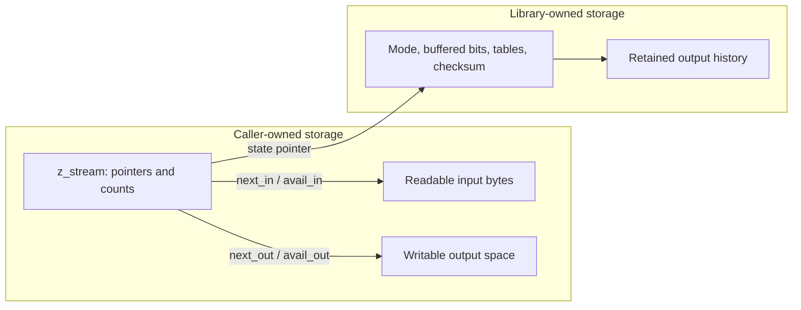
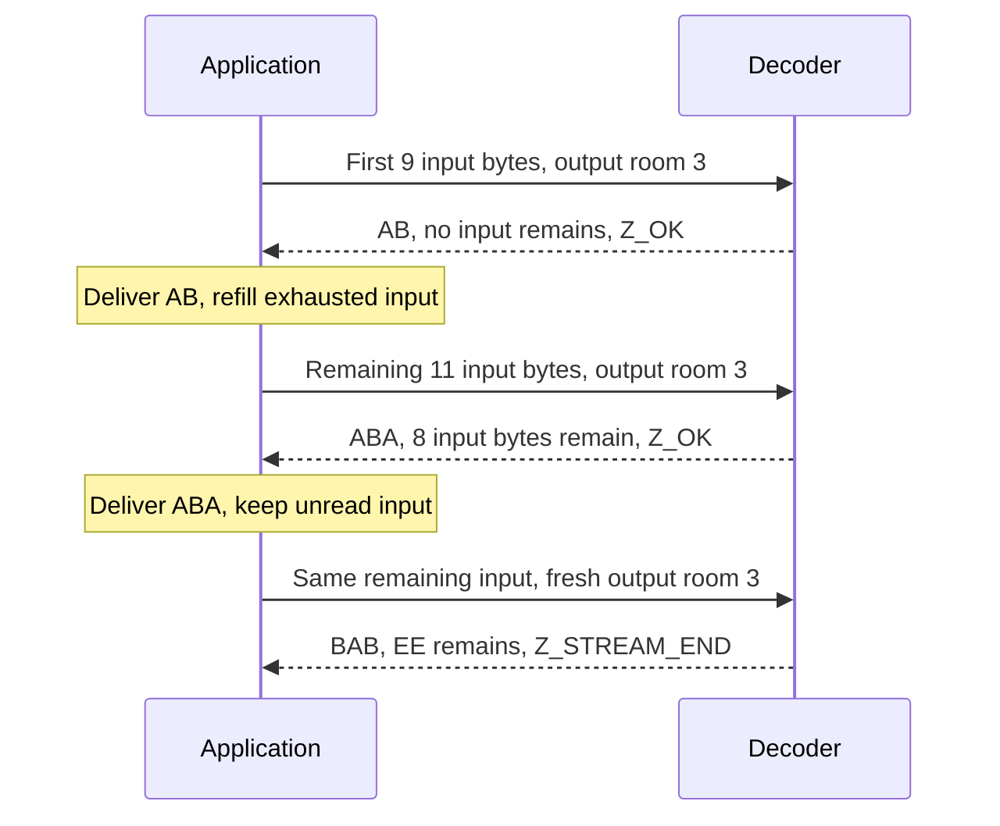
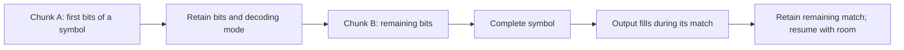
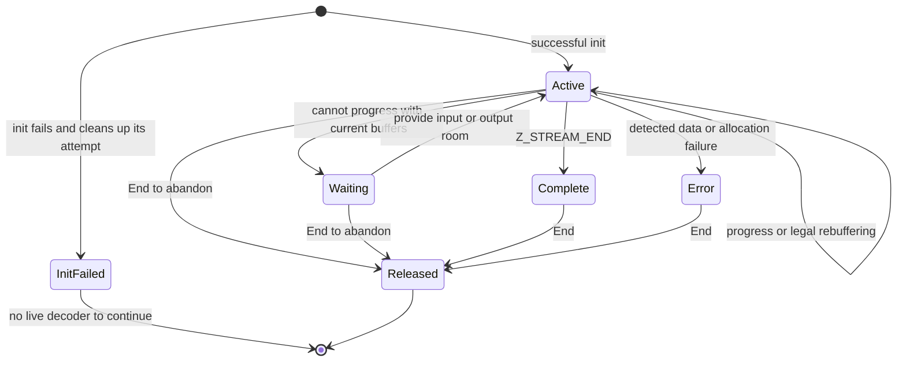

# 3. Pausing and continuing a stream

Suppose the result is `ABABABAB`, but the application has room for only three
output bytes at a time. The decoder must return, let the application use those
bytes, and continue without starting over. Streaming makes that possible by
keeping a processing task alive across calls. This chapter follows the bytes
and the saved state together, so the reason for each proof obligation is visible.

## Contents

- [3.1 Where the bytes and the memory live](#31-where-the-bytes-and-the-memory-live)
- [3.2 Three calls, one decoded result](#32-three-calls-one-decoded-result)
  - [3.2.1 Preserve the input that remains](#321-preserve-the-input-that-remains)
  - [3.2.2 Account for the same execution](#322-account-for-the-same-execution)
- [3.3 A pause can occur inside a match](#33-a-pause-can-occur-inside-a-match)
- [3.4 A buffer boundary is not a format boundary](#34-a-buffer-boundary-is-not-a-format-boundary)
- [3.5 Progress, completion and errors](#35-progress-completion-and-errors)

## 3.1 Where the bytes and the memory live

The application owns a `z_stream` record and the input/output buffers it supplies.
The record's public pointers and counts describe the current buffers:
`next_in` points at `avail_in` unread compressed bytes; `next_out` points at
`avail_out` bytes of writable room. A call advances those pointers and reduces
those counts by the amounts actually used.



*The arrows denote references. They do not transfer ownership of caller buffers.*

For example, replacing a full output buffer does not replace the decoder's
tables or history. Its internal state connects the old output to the next call.
An implementation proof must show that each read and write stays inside its
admitted range, that unrelated storage is unchanged, and that the retained
history still means the bytes already decoded. These facts form a **stream
invariant**: a description preserved whenever the application can legally
continue. Actual initialization must establish it; a helper's contract cannot
be assumed as a substitute for that initialization proof.

The ownership diagram is a reading of the selected implementation, **to confirm**
by proof. Exact buffer, alias and lifetime conditions are in the
[shared stream contracts](../spec/api/streams.md#stream-storage-and-ownership).
Successful init allocates the decoder state. The window can be allocated later,
when a call needs to retain output history. Allocation failure must therefore
be handled both at initialization and during decoding.

## 3.2 Three calls, one decoded result

Here is a complete, hand-constructed zlib stream containing one stored block.
The original bytes are the eight ASCII bytes `ABABABAB`. The final `EE` is extra
input after that stream, deliberately included to expose the stopping position.

```text
78 01 | 01 08 00 F7 FF | 41 42 41 42 41 42 41 42 | 09 3C 02 0D | EE
header  stored-block     A  B  A  B  A  B  A  B    Adler-32      tail
        header
```

This is a valid representation, not a claim that the default compressor chooses
these bytes. [Encoding](encoding.md) explains other block choices;
[wrappers](wrappers.md) explains the header and check value.

After successful `inflateInit`, use `Z_NO_FLUSH` and a three-byte output buffer.
Supply the first nine input bytes for call 1. After they are exhausted, supply
the remaining eleven bytes for call 2. Call 3 keeps call 2's unread input.
Deliver the produced output before reusing the output buffer on each call.


*Blue marks the supplied input range, amber marks produced bytes, and gray marks
input still unread. These colors identify data roles, not proof status.*

| Call | Input available before | Consumed | Produced | Input left | Output room left | Return |
| --- | ---: | ---: | --- | ---: | ---: | --- |
| 1 | 9 | 9 | `AB` (2) | 0 | 1 | `Z_OK` |
| 2 | 11 | 3 | `ABA` (3) | 8 | 0 | `Z_OK` |
| 3 | 8 | 7 | `BAB` (3) | 1 | 0 | `Z_STREAM_END` |

The cumulative `(total_in, total_out)` values are `(9, 2)`, `(12, 5)` and
`(19, 8)`. The last call consumes three payload bytes and four trailer bytes.
The delivered pieces join to `ABABABAB`; the caller still owns the unread `EE`.
These exact values were checked in a finite run of the pinned C decoder.
That run validates the example; it is evidence, not a general correctness proof.

### 3.2.1 Preserve the input that remains

After call 2, eight input bytes remain. Resetting `next_in` to a new chunk would
discard the bytes needed to finish the current stream. The simplest feeding
loop supplies a new input chunk only when `avail_in == 0`. A more elaborate
buffer manager can move or append data, provided it preserves the unread bytes
and supplies the correct pointer and count for the next call.



*The application drives ordinary `inflate`; each return gives it control over
buffer lifetimes before the next call.*

### 3.2.2 Account for the same execution

For each call, let `c` be input consumed and `p` be output produced. Pointer and
available-count conclusions must describe the actual returned heap:

```text
c = avail_in_before  - avail_in_after
p = avail_out_before - avail_out_after
next_in_after  = next_in_before  + c
next_out_after = next_out_before + p
```

For valid input in an ordinary run, the proof also relates the newly written
range to the next decoded prefix.
A correct counter theorem about one execution and a correct output theorem
about a different execution would not establish this connection. The
[main decoder argument](../proof/inflate.md) explains how mode proofs and the
common return path must agree about buffers, state and output.

Normal returns update cumulative totals, with unsigned wrapping at the C
widths. The small example does not wrap. A late window-allocation failure is
an important exception: input and output pointers can already reflect progress,
while normal final total/checksum accounting is skipped. Its exact treatment
belongs to the [inflate accounting contract](../spec/api/inflate-stream.md#inflate).

## 3.3 A pause can occur inside a match

The stored block above copies payload bytes directly. A compressed block can
instead ask to copy six bytes from distance two after the output prefix `AB`.
With only three output slots, that one match must span two calls.


*This is an abstract match-state example, not a trace of compressed-byte
consumption or a claimed particular `inflate` return schedule.*

The first output piece is `ABA`. At the pause, the decoder must remember
distance `2` and remaining length `3`, together with enough history to produce
the next `BAB`. The application may now deliver and reuse the old output buffer.
The next call must not read overwritten caller storage as though it were still
the retained history.

This is why the memory invariant and the decoded-prefix relation belong
together. Preserving a numeric remaining length alone does not establish that
the next source bytes exist or have the right values. The proof must connect
window contents, current output, valid history distance and the unfinished
match. The selected C's `MATCH` state and return-time window update implement
that mechanism, **to confirm** by the
[match and continuation arguments](../proof/inflate.md).

## 3.4 A buffer boundary is not a format boundary

A compressed byte can contain the beginning of a symbol whose remaining bits
arrive in the next chunk. Conversely, a decoder can read a whole byte, use only
some bits, and retain the others internally. `avail_in == 0` therefore means
that no caller-supplied bytes remain unread; it does not mean that the decoder
has no buffered bits or pending output.



*Input chunk boundaries can cut across a symbol; output chunk boundaries can
cut across its expansion. Neither changes the symbol's meaning.*

The corresponding proof connects consumed bytes, retained bits and decoded
symbols without losing or using a bit twice. It also connects written output
to the remaining match. The optimized and ordinary decoding paths must obey
the same relations when dispatch switches between them. Both paths can occur
under the default configuration as buffer sizes change. Read the
[fast decoder argument](../proof/inffast.md) for its entry margins and returned
bit-buffer relation.

## 3.5 Progress, completion and errors



*Waiting is an application-level condition, not an additional C decoder mode.
The diagram shows the ordinary End-only cleanup path; reset and recovery have
their own conditions in [state operations](state-operations.md).*

`Z_BUF_ERROR` can report no progress. More input or room may allow continuation;
calling again with the same blocked request provides no reason to progress.
An input source reaching EOF before `Z_STREAM_END` is not successful completion.
The decoder can emit bytes and only later detect a bad trailer, so delivered
output does not by itself certify the whole input. The
[wrapper chapter](wrappers.md) explains that final validation step.

For compression, the caller must additionally tell the engine when input is
finished. The ordinary schedule uses `Z_NO_FLUSH`, then `Z_FINISH` until
`Z_STREAM_END`, with no new input after the first finish request. The
[flush discussion](state-operations.md) explains the other boundaries.

The lifetime proof starts with actual successful initialization, composes each
permitted call and rebuffering step, and ends with exact cleanup. Failed init
must free what that attempt allocated. A live stream's End must remain safe
after a data error or a window-allocation failure. These are obligations of the
[safety specification](../spec/safety.md), not consequences of this diagram.
Current proof evidence is recorded separately in [progress](../progress.md).
