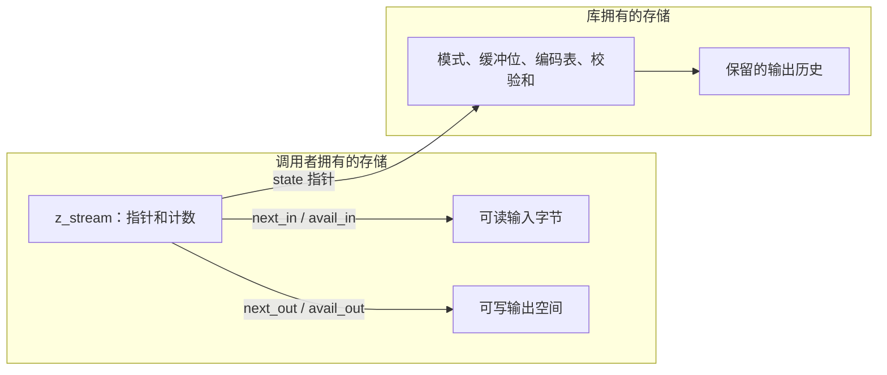
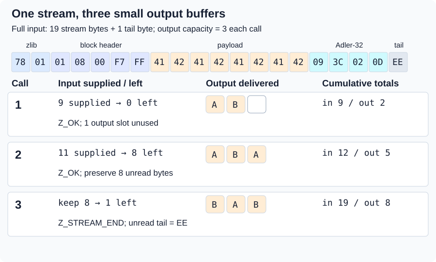
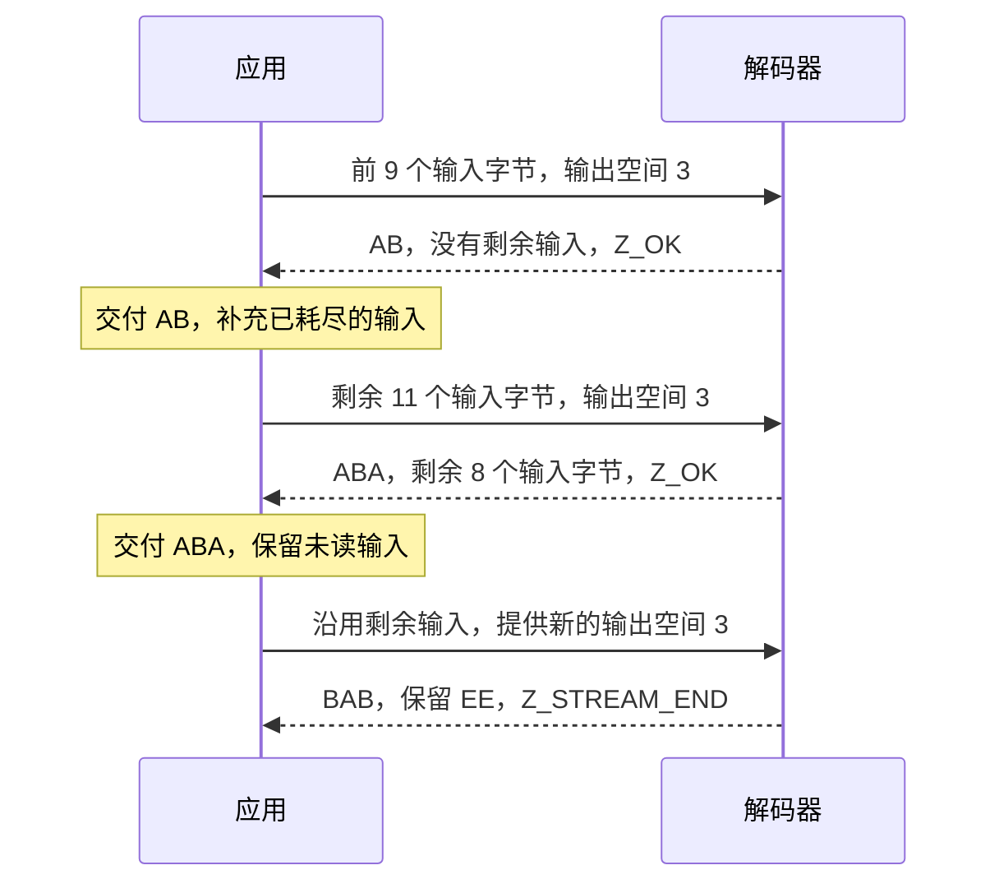
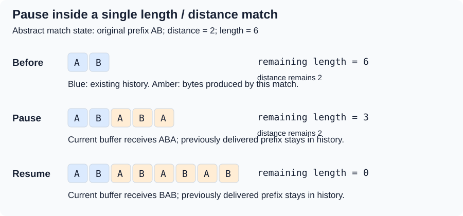
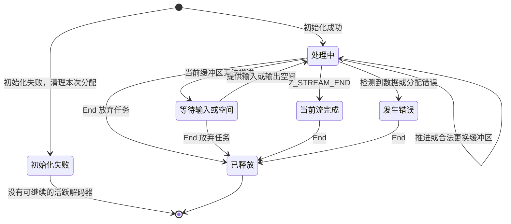

# 3. 流的暂停与继续

要用每次只有三个字节的输出缓冲区交付 `ABABABAB`，解码器就必须能暂停、再继续。
流式处理把任务状态保存在调用之间。沿着这些状态往下看，就能理解继续执行时必须证明保留了什么。

## 目录

- [3.1 字节和内存分别在哪里](#31-where-the-bytes-and-the-memory-live)
- [3.2 三次调用，一个解码结果](#32-three-calls-one-decoded-result)
  - [3.2.1 保留剩余输入](#321-preserve-the-input-that-remains)
  - [3.2.2 对同一次执行进行记账](#322-account-for-the-same-execution)
- [3.3 匹配内部也可以暂停](#33-a-pause-can-occur-inside-a-match)
- [3.4 缓冲区边界不等于格式边界](#34-a-buffer-boundary-is-not-a-format-boundary)
- [3.5 推进、完成和错误](#35-progress-completion-and-errors)

## 3.1 字节和内存分别在哪里

应用拥有 `z_stream` 和调用时提供的缓冲区。`next_in` 指向 `avail_in` 个未读压缩字节；
`next_out` 指向 `avail_out` 个可写字节。调用按照实际使用量推进指针，并减少相应的可用计数。



*箭头表示引用关系，不转移调用者缓冲区的所有权。*

更换输出缓冲区时，解码器的编码表和历史仍然保留。它的**流不变量**把历史与已解码字节联系起来，
并记录继续执行所需的边界和所有权。初始化必须建立它，允许的调用必须保持它。
共享的[证明方法](../overview.md#73-establish-preserve-and-compose)解释了帧性质，
以及为什么不能把辅助函数的契约直接当作假设。

这些源码解读仍**待确认**，需要由证明建立。
[共享契约](../spec/api/streams.md#stream-storage-and-ownership)给出精确的缓冲区、别名和生命期条件。
Init 分配内部状态；后续调用还可能分配历史窗口。这两个阶段的分配失败路径都需要清理证明。

## 3.2 三次调用，一个解码结果

下面这份手工构造的 zlib 流用存储块保存八个 ASCII 字节 `ABABABAB`。
额外的 `EE` 用来显露处理停止的位置。

```text
78 01 | 01 08 00 F7 FF | 41 42 41 42 41 42 41 42 | 09 3C 02 0D | EE
header  stored-block     A  B  A  B  A  B  A  B    Adler-32      tail
        header
```

这份编码不一定是默认压缩器会选择的结果。[编码](encoding.md)一章解释块的选择，
[包装格式](wrappers.md)一章解释头部和校验值。

`inflateInit` 成功后，使用 `Z_NO_FLUSH` 和三个字节的输出缓冲区。
先提供九个输入字节，耗尽后再提供剩余十一个。第三次调用保留未读输入。
每次复用输出缓冲区前，先交付其中已经产生的输出。



*蓝色表示已提供的输入；琥珀色表示已产生的字节；灰色表示未读输入。颜色表示数据角色，不表示证明进度。*

| 调用 | 调用前可用输入 | 已消费 | 已产生 | 剩余输入 | 剩余输出空间 | 返回值 |
| --- | ---: | ---: | --- | ---: | ---: | --- |
| 1 | 9 | 9 | `AB` (2) | 0 | 1 | `Z_OK` |
| 2 | 11 | 3 | `ABA` (3) | 8 | 0 | `Z_OK` |
| 3 | 8 | 7 | `BAB` (3) | 1 | 0 | `Z_STREAM_END` |

累计 `(total_in, total_out)` 依次为 `(9, 2)`、`(12, 5)`、`(19, 8)`。
第三次调用消费三个载荷字节和四个尾部字节。输出拼接后为 `ABABABAB`，`EE` 仍未读取。
对固定版本 C 解码器的一次有限运行确认了这些数值：它是
[示例证据，不是一般证明](../overview.md#74-locate-the-exact-evidence)。

### 3.2.1 保留剩余输入

第二次调用留下的八个字节仍是完成当前流所需的输入。替换掉它们就会丢失输入。
最简单的做法是只在 `avail_in == 0` 时补充新输入；也可以移动或追加数据，
但必须保留未读字节，并给出正确的指针和计数。



*应用驱动 `inflate`，并在调用之间管理缓冲区的生命期。*

### 3.2.2 对同一次执行进行记账

对于实际返回的同一个堆，已消费输入 `c` 和已产生输出 `p` 满足：

```text
c = avail_in_before  - avail_in_after
p = avail_out_before - avail_out_after
next_in_after  = next_in_before  + c
next_out_after = next_out_before + p
```

对于普通流程中的有效输入，新写入的字节延长了已解码前缀。
计数器定理和输出定理必须描述同一次执行。[解码器论证](../proof/inflate.md)把模式证明与公共返回路径连接起来。

普通返回按 C 无符号整数的位宽对累计值进行回绕；这个小例子没有发生回绕。
若在较晚阶段分配窗口失败，指针可能已经反映实际进度，而最终的累计值和校验和更新被跳过。
精确行为见[记账契约](../spec/api/inflate-stream.md#inflate)。

## 3.3 匹配内部也可以暂停

输出 `AB` 后，一个长度为六、距离为二的匹配需要六个输出位置。
若每次调用只有三个位置，这个匹配就会跨越两次调用。



*这是抽象匹配状态的例子，不是压缩字节消费轨迹，也不是实际返回轨迹。*

写出 `ABA` 后，需要保留距离 `2`、剩余长度 `3`，以及产生 `BAB` 所需的历史。
应用复用旧输出缓冲区后，继续执行必须读取有效的保留历史，不能读取已被覆盖的调用者存储。

因此，证明要把窗口内容、当前输出、有效距离和剩余匹配联系起来。
仅有一个剩余长度数值，不能证明源字节读取有效。
C 的 `MATCH` 状态和返回时的窗口更新实现了这一机制；这个解读仍**待确认**，
需要由[继续执行的论证](../proof/inflate.md)建立。

## 3.4 缓冲区边界不等于格式边界

一个符号可以跨越多个输入块。解码器也可以消费一个字节，却保留其中尚未使用的位。
因此，`avail_in == 0` 表示调用者没有未读字节，但内部仍可能有缓冲位或待产生的输出。


*输入边界可以切开符号；输出边界可以切开符号的展开过程。符号含义保持不变。*

证明必须排除跨越这些边界时丢位、重复用位、丢失输出或重复输出的情况。
快速路径和普通路径满足同样的关系；在默认配置下，缓冲区变化也可能触发两者切换。
[快速解码器论证](../proof/inffast.md)给出入口余量和返回时的位缓冲区关系。

## 3.5 推进、完成和错误



*“等待”是应用层条件，不是 C 的额外模式。这张只展示 End 清理路径的图省略了
[重置和恢复协议](state-operations.md)。*

`Z_BUF_ERROR` 可能表示没有进度：重试受阻请求前，先提供输入或输出空间。
在 `Z_STREAM_END` 前遇到 EOF 不算完成。
输出也可能先于[尾部检查失败](wrappers.md#44-output-can-precede-a-failed-check)发生。

压缩先使用 `Z_NO_FLUSH`，再持续使用 `Z_FINISH` 直到 `Z_STREAM_END`，
且第一次结束请求后不能再添加新输入。其他边界见[刷新操作](state-operations.md)。

[共享生命期要求](../spec/safety.md#2-calls-and-sequences)组合实际的 Init、调用、更换缓冲区和 End。
它包括初始化失败时的清理，以及数据错误或窗口分配错误后 End 的安全性；这张图本身不构成证明。
