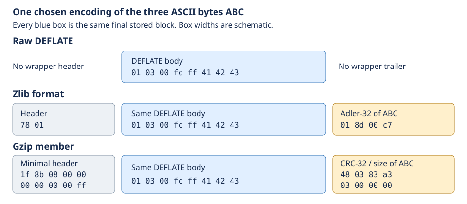
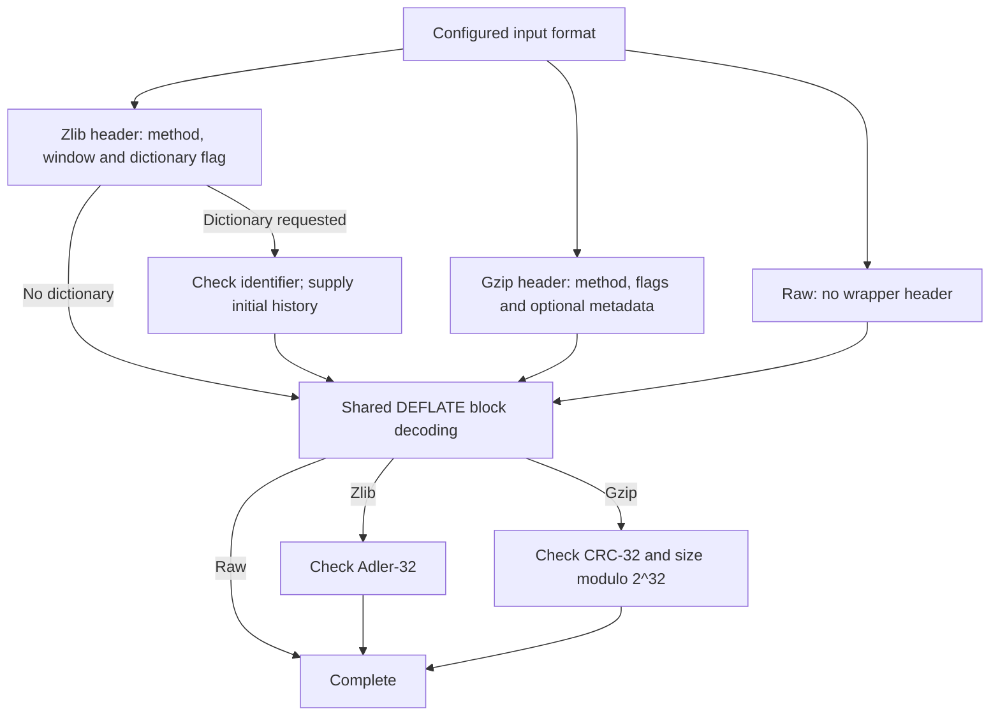
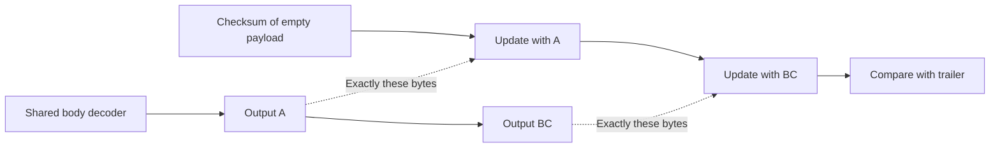
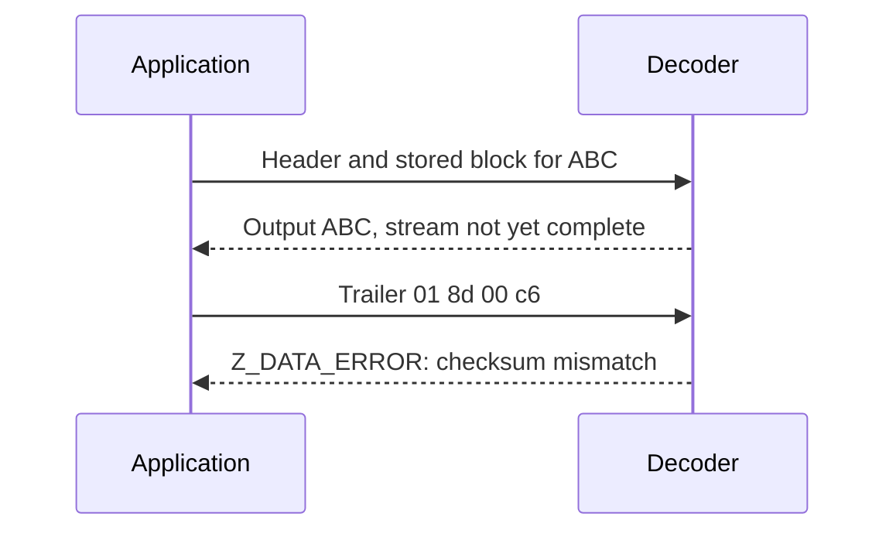

# 4. One DEFLATE body, three format paths

Suppose the original bytes are `ABC`. A raw DEFLATE stream, a zlib stream and a
gzip member can all carry the same compressed body for those bytes. Their
headers and endings differ. Following that one body shows which reasoning can
be shared, and what each wrapper must add before reporting success.

## Contents

- [4.1 Put the same body in three envelopes](#41-put-the-same-body-in-three-envelopes)
- [4.2 Headers establish the decoder's starting conditions](#42-headers-establish-the-decoders-starting-conditions)
  - [4.2.1 A window and an optional initial history](#421-a-window-and-an-optional-initial-history)
  - [4.2.2 Gzip metadata has a different destination](#422-gzip-metadata-has-a-different-destination)
- [4.3 Follow the bytes into the checksum](#43-follow-the-bytes-into-the-checksum)
- [4.4 Output can precede a failed check](#44-output-can-precede-a-failed-check)
- [4.5 Finishing one member and starting another](#45-finishing-one-member-and-starting-another)

## 4.1 Put the same body in three envelopes

Choose a final **stored block**, which carries the three bytes without Huffman
coding. Its complete raw representation is:

```text
01 | 03 00 | fc ff | 41 42 43
     LEN=3  NLEN     A  B  C
```

`01` contains the final-block flag, stored-block type and alignment padding.
`03 00` is the length; `fc ff` is its 16-bit complement. This is one deliberately
chosen valid encoding. A compressor may choose different blocks for `ABC`.
The [encoding chapter](encoding.md) explains those choices and the conditions
under which they reconstruct the same bytes.



*Figure 4.1. Blue is the shared DEFLATE body, grey is header metadata, and amber
is a trailer. Widths are schematic. All hex values are actual bytes for this
chosen example; colours describe data roles, not proof status.*

All three body decoders must interpret the stored block identically. A wrapper
proof additionally establishes where its body starts and ends. In particular,
trailer bytes must not become extra output or the next block. The exact boundary
rules live in the [format specification](../spec/format/README.md#layers-and-stream-boundaries).
This separates a byte-meaning argument from the separate memory argument that
every consumed byte is actually available in the caller's input range.

## 4.2 Headers establish the decoder's starting conditions

The paths join at the same block-decoding modes. They need not arrive with the
same history or window parameters.



*Figure 4.2. A conceptual decomposition of the normal paths. Each header or
trailer can itself span calls; malformed fields branch to errors. This picture
does not claim that the implementation contains a separate function per box.*

The selected C implements most of these boxes inside the `inflate()` mode
switch. `HEAD` and the gzip-specific modes parse headers; `TYPE`, table and
symbol modes decode the body; `CHECK` and `LENGTH` handle trailers. That source
reading is **to confirm** by execution proofs. `inflate_table()` builds tables,
`inflate_fast()` handles a fast decoding segment, and `updatewindow()` retains
history. There is no separate helper containing the entire shared decoder.
The [mode argument](../proof/inflate.md#the-mode-proof) explains how proof clauses
can follow these boundaries without rewriting the C translation.

### 4.2.1 A window and an optional initial history

Suppose a zlib header announces a 32 KiB window, while the decoder was configured
to accept at most 16 KiB. The header must be refused before ordinary body
decoding proceeds. If the decoder requests the size from the header, the header
instead supplies that size. With `INFLATE_STRICT` enabled, the header's maximum
distance also participates in body distance checks. That option is distinct from
the project's initial default build.

A preset dictionary creates a second connection. Imagine a compressor and
decoder both start with dictionary bytes ending in `AB`. A body's distance-two
reference can use that history before this stream has produced two bytes.
With no initial history, that same reference has no such justification.

Thus the shared-core statement must be parameterized by its valid initial
history and window conditions. The header and dictionary operations must
establish them from real preceding execution; the core cannot silently assume
that some earlier layer did so. A dictionary identifier is an Adler-32 value,
not the dictionary bytes themselves, and collisions are possible. Recovery of
the intended data needs the matching dictionary, not merely an equal identifier.
The exact [window requests](../spec/api/inflate-stream.md#inflateinit2_) and
[dictionary contract](../spec/api/inflate-stream.md#inflatesetdictionary) own
the API conditions. Raw dictionary workflows are explained with
[state operations](state-operations.md).

### 4.2.2 Gzip metadata has a different destination

A gzip header can carry a name, comment or extra field. These are metadata;
they do not change the body's literal, match or Huffman rules. Gzip has no
zlib-style preset-dictionary request.

`inflateGetHeader()` registers caller-owned destinations. Later `inflate()`
calls parse the header and fill those destinations; GetHeader does not parse it
by itself. If a long name crosses an input-buffer boundary, the parser must
retain its progress and obey the registered destination capacity on every call.
This is why wrapper correctness includes memory effects and borrowed-buffer
lifetimes as well as the mathematical body relation. See the
[header contract](../spec/api/inflate-stream.md#inflategetheader).

An optional gzip header check is separate from the payload check: it stores the
low 16 bits of a CRC-32 over the preceding header bytes. The payload CRC starts
anew for the uncompressed data. Mixing those histories would reject valid input
even if the CRC routine itself were correct.

## 4.3 Follow the bytes into the checksum

For `ABC`, whose byte values are 65, 66 and 67, Adler-32 starts with `s1 = 1` and
`s2 = 0`. Each byte adds to `s1`, then the new `s1` adds to `s2`, modulo 65521:

| Prefix processed | `s1` | `s2` |
| --- | --- | --- |
| Empty | 1 | 0 |
| `A` | 66 | 66 |
| `AB` | 132 | 198 |
| `ABC` | 199 | 397 |

The combined value is `397 * 65536 + 199 = 0x018d00c7`. Zlib stores those four
trailer bytes most significant first. For the same payload, CRC-32 is
`0xa3830348`; gzip stores its CRC and size least significant byte first, as in
Figure 4.1. The [checksum mathematics](../spec/format/README.md#checksum-mathematics)
defines these values independently of C. These small calculations illustrate
the definitions; agreement with a finite calculation is not an implementation proof.



*Figure 4.3. The checksum follows the uncompressed output prefix, even when
output arrives in several calls. Compression follows the corresponding accepted
input bytes. Neither path checksums the compressed body as its payload.*

Splitting the update as `A`, then `BC`, must produce the same checksum as `ABC`.
The useful invariant is stronger than “the accumulator fits in 32 bits”: it says
that the accumulator equals the checksum of exactly the bytes processed so far.
It excludes skipped bytes, duplicate updates and accidental header bytes.
The [Adler-32](../proof/adler32.md) and [CRC-32](../proof/crc32.md) arguments
establish the arithmetic and reads. The caller argument must connect their
actual input ranges to the same output prefix carried by the body proof.

## 4.4 Output can precede a failed check

Take the zlib example in Figure 4.1. Supply its header and body first, withholding
the four trailer bytes. The body can already yield `ABC`. Now supply
`01 8d 00 c6` instead of the correct `01 8d 00 c7`.



*Figure 4.4. Previously emitted bytes cannot be retracted. Delivering output and
accepting a complete wrapped stream are different events.*

With ordinary validation enabled, a mismatch requires a defined data-error
result, safe memory effects and a state that can be cleaned up. A matching
checksum alone cannot establish byte equality or authenticity. Successful
functional reasoning also needs the body's decoding relation. Incomplete
trailer input is different again: it needs continuation, rather than proving
that the available bytes are malformed. These distinctions are part of the
[inflate result contract](../spec/api/inflate-stream.md#inflate) and
[trailer proof boundaries](../proof/inflate.md#table-and-trailer-statement-boundaries).

## 4.5 Finishing one member and starting another

A gzip file can contain `member("ABC") || member("DEF")`, where `||` means
concatenation. Each member owns a separate header, DEFLATE body, checksum and
size. Ordinary `inflate()` stops at the first `Z_STREAM_END`. To read the second
member, its caller resets the live decoder and preserves any unconsumed input.

```text
first member:  header → body ABC → CRC/size → Z_STREAM_END
                                               │ Reset
next member:  header → body DEF → CRC/size → Z_STREAM_END
```

The composition argument must partition input at the actual first member end,
restart history and checksum correctly, and concatenate the resulting output
as `ABCDEF`. Treating a stream end as end of the whole file would lose `DEF`.
[Reset](state-operations.md) explains that transition. The higher-level
[gzip file interface](interfaces.md) manages concatenated members for its reader.
Accepted evidence and configuration coverage remain on the single
[progress page](../progress.md).
