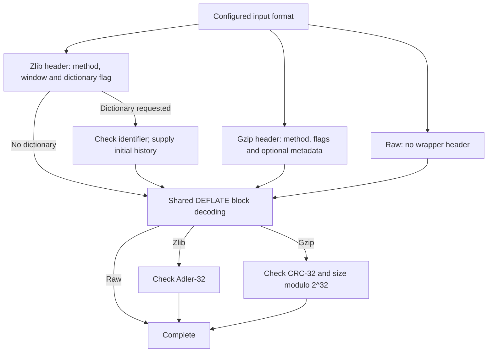
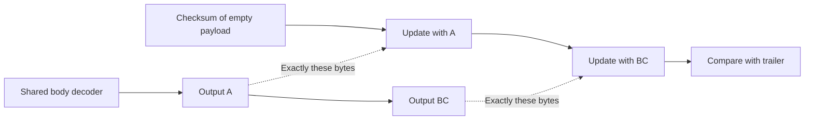
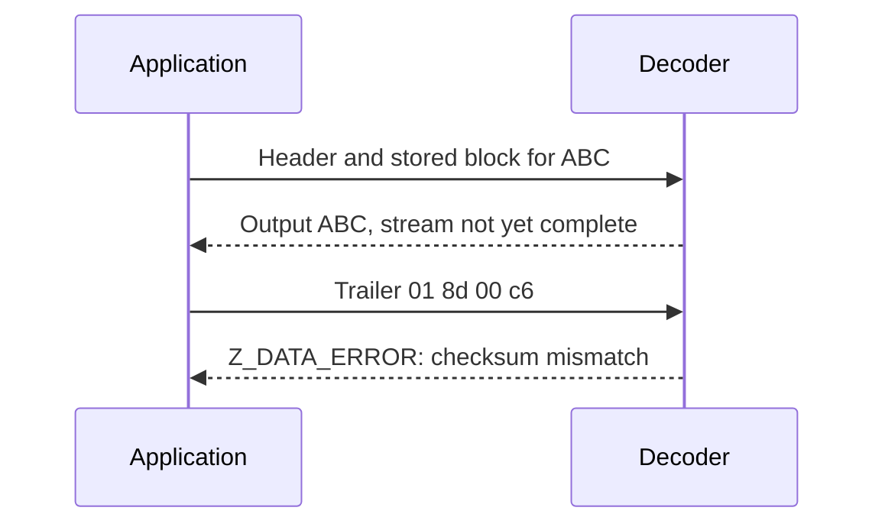

# 4. One DEFLATE body, three format paths

Raw DEFLATE, zlib and gzip can carry the same body for `ABC`. Different headers
and trailers establish its starting conditions and validate its result. This
separates shared decoding reasoning from wrapper obligations.

## Contents

- [4.1 Put the same body in three envelopes](#41-put-the-same-body-in-three-envelopes)
- [4.2 Headers establish the decoder's starting conditions](#42-headers-establish-the-decoders-starting-conditions)
  - [4.2.1 A window and an optional initial history](#421-a-window-and-an-optional-initial-history)
  - [4.2.2 Gzip metadata has a different destination](#422-gzip-metadata-has-a-different-destination)
- [4.3 Follow the bytes into the checksum](#43-follow-the-bytes-into-the-checksum)
- [4.4 Output can precede a failed check](#44-output-can-precede-a-failed-check)
- [4.5 Finishing one member and starting another](#45-finishing-one-member-and-starting-another)

## 4.1 Put the same body in three envelopes

A final **stored block** carries these three bytes without Huffman coding:

```text
01 | 03 00 | fc ff | 41 42 43
     LEN=3  NLEN     A  B  C
```

`01` contains the final flag, stored type and padding; `03 00` is the length;
`fc ff` is its 16-bit complement. This chosen encoding need not be the
compressor's choice. [Encoding](encoding.md) explains the alternatives.


*Figure 4.1. Blue: shared body; grey: header; amber: trailer. Widths are schematic,
hex values are actual bytes, and colors denote data roles rather than status.*

All paths must interpret this block identically. Wrapper proofs locate its
boundaries so trailers become neither output nor another block. The
[format rules](../spec/format/README.md#layers-and-stream-boundaries) define byte
meaning; memory bounds separately justify each input read.

## 4.2 Headers establish the decoder's starting conditions

The paths share block-decoding modes, with potentially different history and
window parameters.



*Figure 4.2. Normal conceptual paths, not separate C functions. Headers/trailers
can span calls; malformed fields branch to errors.*

Inside `inflate()`, `HEAD` and gzip modes parse headers; `TYPE`, table and
symbol modes decode; `CHECK` and `LENGTH` handle trailers. This source reading is
**to confirm** by execution proofs. Helpers cover tables (`inflate_table()`), a
fast segment (`inflate_fast()`) and history (`updatewindow()`), not the whole
core. The [mode proof](../proof/inflate.md#the-mode-proof) follows these boundaries
without rewriting the translation.

### 4.2.1 A window and an optional initial history

A zlib header announcing 32 KiB must be refused by a decoder limited to 16 KiB.
A header-selected window request instead takes its size from the header.
`INFLATE_STRICT` also uses the header's maximum distance in body checks; this
option is outside the initial default build.

If both engines start with dictionary bytes ending in `AB`, a distance-two
reference can use that history before producing two bytes. Without initial
history, that reference is unjustified.

The core's statement therefore takes valid initial history and window
conditions, established by actual header/dictionary execution. An Adler-32
dictionary identifier can collide: intended recovery requires matching bytes,
not just an equal identifier. See exact
[window requests](../spec/api/inflate-stream.md#inflateinit2_) and
[dictionary conditions](../spec/api/inflate-stream.md#inflatesetdictionary);
[state operations](state-operations.md) covers raw dictionaries.

### 4.2.2 Gzip metadata has a different destination

Gzip names, comments and extra fields do not change literal, match or Huffman
rules. Gzip has no zlib-style preset-dictionary request.

`inflateGetHeader()` registers caller-owned destinations; later `inflate()`
parses into them. A name spanning input buffers requires saved progress,
capacity bounds and valid borrowed storage across calls. The
[header contract](../spec/api/inflate-stream.md#inflategetheader) defines these
memory effects alongside byte meaning.

The optional header check stores the low 16 CRC-32 bits over preceding header
bytes. Payload CRC starts anew over uncompressed data. Mixing those histories
rejects valid input even with a correct CRC routine.

## 4.3 Follow the bytes into the checksum

For `ABC` (65, 66, 67), start Adler-32 at `s1 = 1`, `s2 = 0`. Add each byte to
`s1`, then `s1` to `s2`, modulo 65521:

| Prefix processed | `s1` | `s2` |
| --- | --- | --- |
| Empty | 1 | 0 |
| `A` | 66 | 66 |
| `AB` | 132 | 198 |
| `ABC` | 199 | 397 |

The result is `397 * 65536 + 199 = 0x018d00c7`; zlib writes it most significant
byte first. CRC-32 is `0xa3830348`; gzip writes CRC and size least significant
byte first (Figure 4.1). These illustrate the independent
[checksum definitions](../spec/format/README.md#checksum-mathematics), not an
implementation proof.



*Figure 4.3. Decompression checksums emitted bytes; compression checksums accepted
input. Neither uses compressed bytes as its payload.*

Updating `A`, then `BC`, must equal updating `ABC`. The invariant equates the
accumulator with exactly the processed prefix: no skipped, duplicate or header
bytes. The [Adler-32](../proof/adler32.md) and [CRC-32](../proof/crc32.md) arguments
justify arithmetic/reads; their caller connects those actual ranges to the body
proof's output prefix.

## 4.4 Output can precede a failed check

Supply Figure 4.1's zlib header and body without the four trailer bytes.
After output `ABC`, supply `01 8d 00 c6` instead of `01 8d 00 c7`.



*Figure 4.4. Emitted bytes cannot be retracted; stream validation comes later.*

Ordinary validation must reject the mismatch safely and permit cleanup.
Matching checksums alone prove neither byte equality nor authenticity: the
body relation is also needed. An incomplete trailer instead needs continuation.
See the [result contract](../spec/api/inflate-stream.md#inflate) and
[trailer proof](../proof/inflate.md#table-and-trailer-statement-boundaries).

## 4.5 Finishing one member and starting another

In `member("ABC") || member("DEF")`, `||` means concatenation. Each gzip member
has its own header, body, checksum and size. `inflate()` stops at the first
`Z_STREAM_END`; reset the live decoder and preserve unread input for the next.

```text
first member:  header → body ABC → CRC/size → Z_STREAM_END
                                               │ Reset
next member:  header → body DEF → CRC/size → Z_STREAM_END
```

Composition must split at the actual member end, restart history/checksum and
join output as `ABCDEF`. Stopping at the first end loses `DEF`.
See [Reset](state-operations.md); the [gzip file reader](interfaces.md) manages
concatenated members. Shared [scope and evidence rules](../overview.md#7-how-the-arguments-become-checked-claims)
apply throughout.
