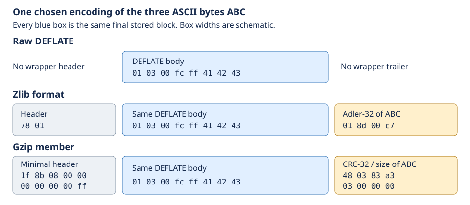
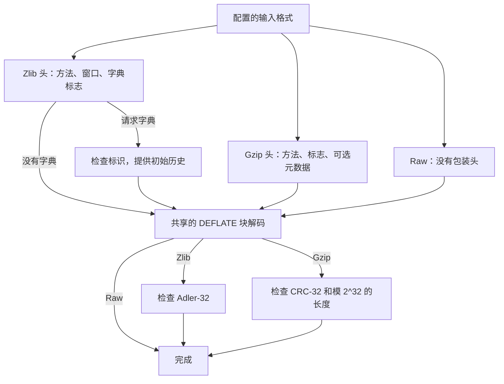
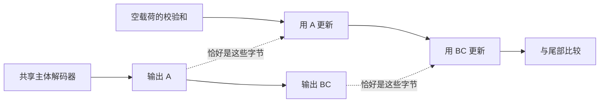
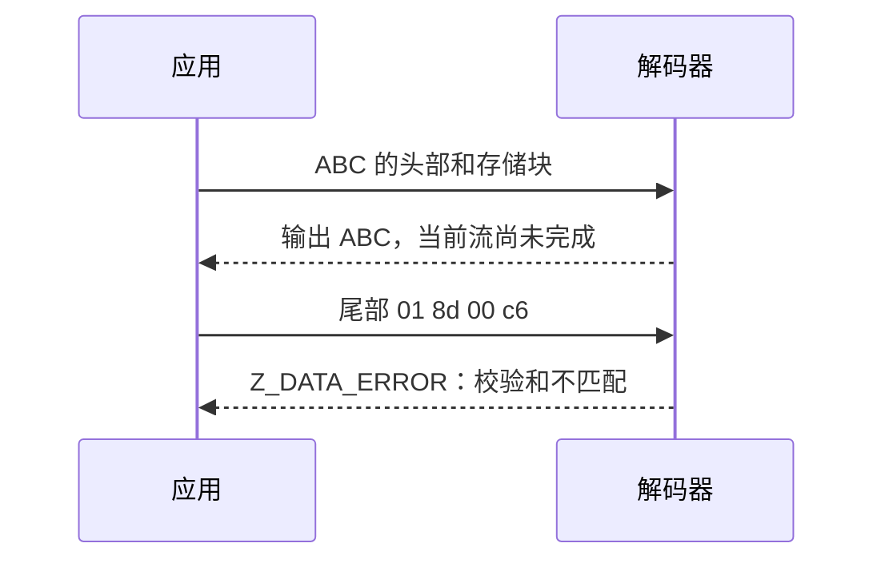

# 4. 一个 DEFLATE 主体，三条格式路径

raw DEFLATE、zlib 和 gzip 可以为 `ABC` 携带相同的主体。
不同的头部和尾部建立解码起始条件，并验证结果。这样就能把共享的解码论证与各包装格式的要求区分开。

## 目录

- [4.1 把同一个主体放入三种包装](#41-put-the-same-body-in-three-envelopes)
- [4.2 头部建立解码器的起始条件](#42-headers-establish-the-decoders-starting-conditions)
  - [4.2.1 窗口与可选的初始历史](#421-a-window-and-an-optional-initial-history)
  - [4.2.2 Gzip 元数据有独立的接收位置](#422-gzip-metadata-has-a-different-destination)
- [4.3 沿着字节追踪校验和](#43-follow-the-bytes-into-the-checksum)
- [4.4 输出可以先于检查失败发生](#44-output-can-precede-a-failed-check)
- [4.5 结束一个成员，再开始下一个](#45-finishing-one-member-and-starting-another)

## 4.1 把同一个主体放入三种包装

一个最终**存储块**可以不使用 Huffman 编码，直接携带这三个字节：

```text
01 | 03 00 | fc ff | 41 42 43
     LEN=3  NLEN     A  B  C
```

`01` 包含最终块标志、存储块类型和填充位；`03 00` 是长度；`fc ff` 是它的 16 位反码。
这份选定的编码不一定是压缩器的选择。[编码](encoding.md)一章解释其他选择。



*图 4.1。蓝色表示共享主体，灰色表示头部，琥珀色表示尾部。宽度是示意性的，
十六进制值是实际字节。颜色表示数据角色，不表示状态。*

三条路径必须对这个块作出相同解释。包装格式的证明定位主体边界，确保尾部既不变成输出，也不被解释为下一个块。
[格式规则](../spec/format/README.md#layers-and-stream-boundaries)定义字节含义；
内存边界论证则分别证明每次输入读取有效。

## 4.2 头部建立解码器的起始条件

各路径共享块解码模式，但历史和窗口参数可能不同。



*图 4.2。这是普通流程的概念路径，不表示各自独立的 C 函数。
头部和尾部都可以跨越多次调用；格式错误的字段会转入错误路径。*

在 `inflate()` 内部，`HEAD` 和 gzip 模式解析头部；`TYPE`、表和符号模式解码主体；
`CHECK` 与 `LENGTH` 处理尾部。这些源码解读仍**待确认**，需要执行证明。
辅助函数分别负责表（`inflate_table()`）、快速片段（`inflate_fast()`）和历史（`updatewindow()`），
没有哪个辅助函数包含整个核心。[模式证明](../proof/inflate.md#the-mode-proof)沿着这些边界展开，无需重写翻译。

### 4.2.1 窗口与可选的初始历史

如果 zlib 头声明 32 KiB 窗口，而解码器最多允许 16 KiB，就必须拒绝这个头部。
若请求采用头部指定的窗口，则从头部取得大小。
`INFLATE_STRICT` 还会把头部的最大距离用于主体检查；这一选项不属于最初的默认构建。

如果两端都以末尾为 `AB` 的字典开始，距离为二的引用可以在当前流尚未输出两个字节前使用这段历史。
没有初始历史时，同样的引用就没有依据。

因此，核心命题要带上有效的初始历史和窗口条件，由实际的头部、字典操作建立。
Adler-32 字典标识可能碰撞：恢复预期内容需要匹配的字节，不能仅凭相等的标识。
精确范围见[窗口请求](../spec/api/inflate-stream.md#inflateinit2_)和
[字典条件](../spec/api/inflate-stream.md#inflatesetdictionary)；
[状态操作](state-operations.md)一章解释 raw 字典。

### 4.2.2 Gzip 元数据有独立的接收位置

Gzip 的名称、注释和额外字段不会改变字面量、匹配或 Huffman 规则。
Gzip 没有 zlib 式的预置字典请求。

`inflateGetHeader()` 登记调用者拥有的接收位置；后续 `inflate()` 才解析并写入。
名称跨越输入缓冲区时，需要保存解析进度、遵守容量边界，并确保借用的存储在调用之间仍然有效。
[头部契约](../spec/api/inflate-stream.md#inflategetheader)同时定义这些内存效果和字节含义。

可选的头部检查保存先前头部字节的 CRC-32 低 16 位。
载荷 CRC 则从未压缩数据重新开始累计。即使 CRC 函数正确，混淆这两段历史也会拒绝有效输入。

## 4.3 沿着字节追踪校验和

对于 `ABC`（65、66、67），Adler-32 从 `s1 = 1`、`s2 = 0` 开始。
逐字节把字节值加到 `s1`，再把 `s1` 加到 `s2`，都对 65521 取模：

| 已处理前缀 | `s1` | `s2` |
| --- | --- | --- |
| 空 | 1 | 0 |
| `A` | 66 | 66 |
| `AB` | 132 | 198 |
| `ABC` | 199 | 397 |

结果是 `397 * 65536 + 199 = 0x018d00c7`；zlib 按最高有效字节在前的顺序写出。
CRC-32 是 `0xa3830348`；gzip 按最低有效字节在前的顺序写出 CRC 和长度（图 4.1）。
这些计算示范了独立的[校验和定义](../spec/format/README.md#checksum-mathematics)，不是实现证明。



*图 4.3。解压对已输出字节计算校验和；压缩对已接受输入计算校验和。
两者都不把压缩后的字节当作载荷来计算校验和。*

先用 `A` 更新、再用 `BC` 更新，必须等于用 `ABC` 更新。
不变量要求累加值恰好等于已处理前缀的校验和：不能跳过、重复，也不能混入头部字节。
[Adler-32](../proof/adler32.md)和 [CRC-32](../proof/crc32.md)论证算术与读取；
调用者的证明再把那些实际输入范围连接到主体证明中的输出前缀。

## 4.4 输出可以先于检查失败发生

先提供图 4.1 中 zlib 格式的头部和主体，不提供四个尾部字节。
输出 `ABC` 后，再提供 `01 8d 00 c6`，而非正确的 `01 8d 00 c7`。



*图 4.4。已经输出的字节不能撤回；完整流的验证发生在后面。*

普通验证必须安全地拒绝不匹配，并允许清理。
校验和相等本身既不能证明字节相等，也不能证明真实性；还需要主体解码关系。
不完整的尾部则需要继续输入。详见[结果契约](../spec/api/inflate-stream.md#inflate)和
[尾部证明](../proof/inflate.md#table-and-trailer-statement-boundaries)。

## 4.5 结束一个成员，再开始下一个

在 `member("ABC") || member("DEF")` 中，`||` 表示拼接。
每个 gzip 成员都有自己的头部、主体、校验和和长度。
`inflate()` 在第一个 `Z_STREAM_END` 处停止；处理下一个成员前，重置活跃解码器，并保留未读输入。

```text
first member:  header → body ABC → CRC/size → Z_STREAM_END
                                               │ Reset
next member:  header → body DEF → CRC/size → Z_STREAM_END
```

组合证明必须按实际成员终点划分输入，重新开始历史和校验和，并把输出拼成 `ABCDEF`。
在第一个终点就停止会丢失 `DEF`。详见 [Reset](state-operations.md)；
[gzip 文件读取接口](interfaces.md)会管理连续成员。
共享的[范围与证据规则](../overview.md#7-how-the-arguments-become-checked-claims)适用于本章全部内容。
