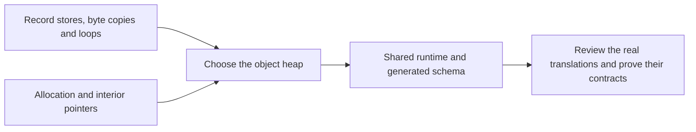

# Object-heap pilot

The pilot supported the choice to represent C structs as records in tables for each object kind.
It tested common access patterns before the full runtime and translations were built.
Its source is `ZlibF/Runtime/Pilot.lean`. This is a design experiment, not a proof of the public
functions with the same names. See [history](README.md), [current design](../design/README.md)
and [overview](../overview.md) for the evidence boundary and current work.

## What the experiment represented

The first heap had stream records, deflate-state records and byte arrays, each indexed by block
number. Later cases used the shared generated schema and added allocation state, word arrays,
embedded code arrays and static-table pointers. A record store changes one table entry. Byte
pointers carry a block and offset; embedded table pointers identify their containing record.

| Experiment | Result stated by the pilot | Deliberate limit |
| --- | --- | --- |
| `flush_pending_ok` | Copy `min(pending, avail_out)` bytes; update the stream and state; preserve the invariant and untouched objects | Omits `_tr_flush_bits`, null cases, read-only blocks and allocation behaviour |
| `update2_ok` | Ring-buffer copy in one or two pieces; preserve window shape and frame | Starts after allocation and needs a separate caller buffer |
| `updatewindow_ok` | Allocate an absent window or return allocation failure; preserve freshness and existing unrelated blocks | Does not establish caller preconditions or eventual `inflateEnd` cleanup |
| `slide_hash_ok` | Rescale every `head` and `prev` entry for arbitrary initial contents; frame all other objects | A loop experiment, not a hash-chain history proof |
| `fillC_ok` | Write a bounded interval of embedded code entries; frame the rest | Models the replicate-loop shape, not canonical table construction |
| `inflateCopy_ok` | Copy an embedded table and rebase its internal pointers; preserve dereferenced contents | Omits the window and uses dummy static entries |

The pilot's `memcpyB` required different source and destination blocks. Its pointer rules allowed
one-past positions and checked bounds. Static code-table stores faulted. These choices tested a
representation; the current translation domain must be read from the runtime, safety document
and deviations.

## Recorded measurements

These are the original experiment's measurements. They are not current build timings or a
controlled comparison of equivalent implementations.

| Measurement | Object-heap pilot | Earlier tagged-cell source |
| --- | --- | --- |
| Initial runtime, lemmas, translation, invariant and theorem | 208 lines | Shared runtime; no comparable total |
| Initial `flush_pending` theorem including proof | 74 lines, including a 67-line proof body | `PendingFull`: 148 lines; `PendingFlush`: 408 lines, counting both files |
| Initial theorem hypotheses | Three: two lookups and an invariant | Nineteen, mostly tagged-cell assertions |
| Recorded compilation time | 0.4 seconds | Not measured |
| Heartbeat overrides in that comparison | None | None |

The earlier pending-flush proof includes the tree bit flush and cases omitted by the pilot.
The line counts therefore measure proof shape, not an equivalent theorem or a guaranteed saving.

The ring-buffer experiment recorded 37 translation lines, 37 invariant/helper lines, 20 lines for
a shared copy step, and branch proofs of 28 and 95 lines. Its dispatcher proof used 27 lines;
the total was 247 lines. Adding allocation took about 115 lines, bringing that experiment to
about 360 lines. Later edits need not preserve those counts.

## What made the representation useful

A record update gave a direct frame: the updated key returns the new object and every other key
returns the old one. The proof could follow the statements and reduce range obligations to
integer arithmetic. Unsigned subtraction still required the usual bound showing that the
subtraction did not wrap in the intended arithmetic interpretation.

The ring invariant included `whave < wsize -> wnext = whave`. That clause supported the two-piece
copy and the partly filled window case. Allocation used a failure oracle and `Fresh`, which
made a new block distinct from every existing block. Quantifying over the heap covered either
outcome of that oracle.

The arbitrary-content hash experiment motivated the uninitialised-integer rule. It did not prove
that C and the model agree on every repeated uninitialised read. The exact limitation is in
[safety](../safety.md) and the [trusted base](../trusted-base.md).

## Decision and limits

The pilot supported adopting the object heap. It demonstrated usable proof patterns for fields,
arrays, ring copies, allocation and embedded pointers. It did not establish full C memory
semantics, all legal aliases, arbitrary allocator behaviour, file operations, lifecycle ownership,
or complete inflate/deflate correctness. A short pilot proof cannot predict the final proof size.

The runtime and generated [schema](../runtime-schema.md) subsequently used that representation.
Pilot theorem names remain local to the experiment. Their registration, if present, does not
turn an omitted operation into a theorem about the complete translated function. Current
acceptance requires the [project checks](../checking/README.md) on a named commit.
