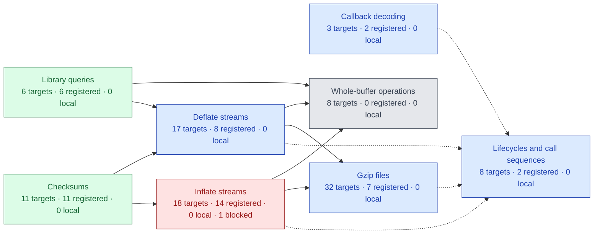
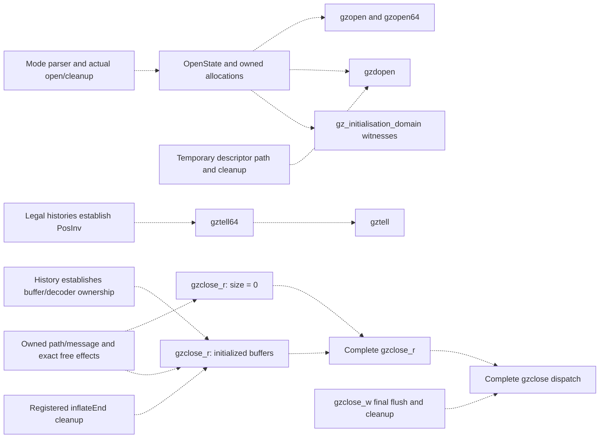
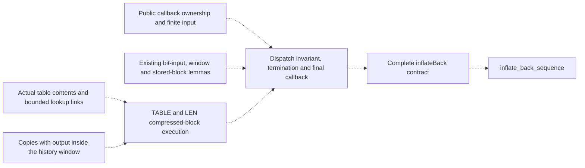
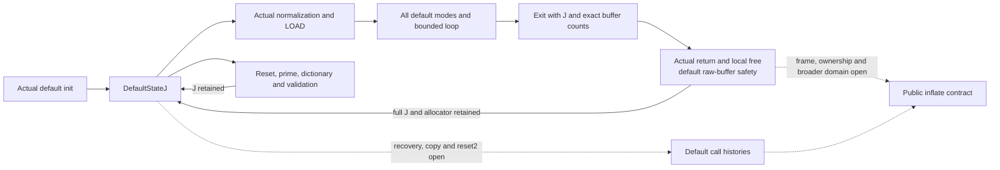

# Archived proof checkpoints

This is the preserved status document before consolidation. Its counts and
remaining-work statements are historical, not current acceptance claims.
Use [current status](../overview.md) for remaining work.

---

# Project status and remaining work

[Documentation](../README.md) · [API](../api/README.md) · [Checking](../checking/README.md)

**Work in progress. Full zlib verification is not complete.**
This is the single current-status and remaining-work page.
The first target is the default LP64 Linux static build with the default allocator.
Other upstream configurations remain goals. Compiler/OS correctness and performance
are outside the proof.

<!-- proof-progress:start -->
## Proof progress graph

**103 public API targets.** Registered proofs: 50 ·
locally checked but not registered: 0 ·
not proved without a recorded blocker: 52 ·
blocked: 1.
These are local snapshot counts, not final verification or a percentage of effort.

[Open the public API graph and proof references](../progress.md).
The scope is the public API manifest, including call sequences and initialization domains.
[Supporting proofs](../supporting-proofs.md) lists the other 78 audit targets
and their module dependencies. They do not change the public API counts.
🟩 **Registered proof** · 🟦 **Locally checked, not registered** · ⬜ **Not proved** · 🟥 **Blocked**.
Red groups contain a blocked target. Other mixed groups use blue when they contain
checked results; counts show what remains. Work on other targets can continue.
Solid arrows show calls from the called entry to its caller. Dotted arrows show
proof or target-definition references. [Status details](../progress.md#status-key).
Final acceptance still requires the full audit and CI on a named commit.

### Blockers

| Blocked targets | Reason and next step |
| --- | --- |
| [inflateInit2_](.././progress.md#target-zlibf-spec-public-goal-inflateinit2) | [Inflate initialization cleanup](.././overview.md#inflate-initialization-cleanup) |

Arrows aggregate actual implementation calls and proof/definition references.
An isolated node has no displayed links; it still needs its own proof. Helper and runtime
dependencies are detailed in [Public API proof readiness](.././overview.md#public-api-proof-readiness).
Green requires checked, registered proofs for every
target in a group. Readiness labels identify reviewed next work without changing proof
status. Unreviewed prerequisites remain explicit. See the [representation limits](.././trusted-base.md).

Click a group to open its specifications. If diagram links are disabled, use the
[group index](../progress.md#clickable-index). [The detailed graph](../progress.md) shows every
public API target separately, with links to its contract, statement and proof evidence.
Diagram links use the fixed GitHub snapshot `dba8cbb` and survive merges
and branch deletion. Table links remain relative to this document.
Refresh with `python3 scripts/proof-progress.py` after proof changes.
<!-- proof-progress:end -->

## Recorded checkpoint

The inventory has 95 default-build API entries, four lifecycle targets and four
initialisation-domain targets. A proposition's presence is not a proof.
The latest local declaration audit recognizes 77 registered targets across
396 listed theorems and 20,047 project declarations. The new registration batch
covers 59 existing exact proofs: six queries, nine checksum entries, 29 stream or
gzip entries, two initialization-domain goals and 13 abstract model goals.
The [registration review](../checking/registration-review.md) records scope and checks.
Earlier format/query and CRC/address/view registrations remain intact.
The audit also tracks 47 internal obligations that were already defined but missing
from the registry. They are internal targets, not additional public APIs.
These are local checks. Final acceptance requires the full audit and CI on a named commit.

The next registration batch has 33 locally checked targets: 31 internal obligations
and the two later dictionary/header model results. Review their exact scopes and
required mutation evidence before registration. Keep mathematical model results
separate from execution/refinement claims about the translated C.

Recorded local work also covers version/flags/error/bound/CRC-table queries;
gzip EOF, buffering, offsets and error queries; inflate state, mark and priming
queries; deflate used-bit, tuning, header and pending queries; internal fast-decoder
safety, bit-source composition and token-output refinement; and canonical-code/leaf/heap tree prefixes.
Further local proofs cover `gzrewind`, `inflateGetHeader`, `inflateResetKeep`,
`inflateReset`, `inflateReset2`, `inflateEnd`, `inflateBackEnd`, `deflateEnd` and
`deflateGetDictionary`, `inflateGetDictionary`, `deflateResetKeep` and `deflateReset`.
Their direct source mutants fail the corresponding function proofs.
The `inflateInit_`, `inflateBackInit_` and both corresponding initialization-domain goals
also check in Lean. Seven initialization mutants fail their function proofs.
The `inflateSetDictionary` goal also checks in Lean; seven source mutants fail
its function proofs.
The abstract-model goals `deflate_bound_adequate` and `deflate_completes` also
check in Lean. These model results do not establish refinement of the C translation.
The abstract `compress_roundtrip` and `gz_roundtrip` goals also check in Lean.
They do not prove the translated buffer or file operations.
The abstract `inflate_completes` goal also checks in Lean, including allocation
failure. It does not establish refinement of translated inflate.
The abstract `deflate_full_flush_resync` goal checks in Lean. It does not establish
refinement of translated deflate.
The abstract `roundtrip` and `roundtrip_completes` goals check in Lean for all
compatible wrappers. Refinement of the C implementation remains open.
The abstract `dict_roundtrip` goal also checks in Lean, including dictionary
identifier mismatches. It does not establish implementation refinement.
The abstract `header_roundtrip` goal also checks in Lean using gzip header
prefix uniqueness. The implementation-level header proof remains open.
The `adler32_combine` and `adler32_combine64` goals also check in Lean;
three negative-length and entry-point mutants fail their function proofs.
The `adler32` and `adler32_z` update goals check in Lean under the documented
zero-length NULL-query restriction. Five update and wrapper mutants fail their proofs.
Five CRC combination and generated-operator goals also check in Lean; one direct
mutation per entry fails its matching function proof.
Source-order corrections and direct proof mutants accompany their stated scopes.
These results do not complete public inflate/deflate or arbitrary call-sequence
correctness. Registration, reviewed locks and acceptance on a named commit remain
separate. A build count is not a completion percentage.

## Remaining work

Red targets have a documented blocker with evidence and a next step below.
A long proof attempt alone does not establish a blocker. Gray targets may be started;
their missing internal lemmas and history invariants are not all drawn in the graph.

### Public API proof readiness

**Gray means unproved, not blocked. Start independent work now.** Green callees do not
establish the caller's own preconditions, loops, results or memory effects. A directly
callable API can still have a false contract or a confirmed source defect; only evidence
of that kind warrants a red blocker. Do not infer readiness solely from missing arrows.

The [public target graph](../progress.md) records observed calls and theorem references.
The separate plans below expose missing proof work. Their arrows are proposed composition
requirements, **to confirm** against the exact targets. They are not new public assumptions,
checked proof references or extra public targets. Plan boxes carry no proof status. Colors in the progress graph keep their
existing meaning. This section is the maintained index of remaining prerequisites.

#### Open, query and close prerequisites

Opening a file does not require the complete engine. Its main work is the common `gz_open`
mode loop, real allocations, string copying, descriptor effects and invariant establishment.
For a tell query, the missing producer is the position invariant over permitted histories.
For close, it is ownership over those histories, including allocation failures.

Local execution proofs now cover:

- [Open entries](../../ZlibF/Proof/gzlib.c.open.lean): NULL arguments, negative descriptors
  and first-allocation failure. They give the unchanged file system and exact heap,
  including the allocation-attempt counter.
- [Reader close](../../ZlibF/Proof/gzread.c.close.lean): NULL, wrong mode and complete
  unbuffered execution under `GzGood`, including descriptor errors, freeing the message,
  path and handle, and a frame over unrelated allocations.
- [Priming entry](../../ZlibF/Proof/deflate.c.prime.lean): refused streams and invalid bit
  counts, before pending-byte compaction.

These are scoped internal results, not proofs of the complete public targets. In particular,
`GzGood` still has to be derived from the permitted public histories. Do not replace a gray
public node with green on the strength of one branch.

#### Callback decoder prerequisites

`inflateBack` need not wait for the complete ordinary `inflate` target. Setup and teardown
are already registered. Existing entry, bit-input, window-flush and stored-block arguments
can be reused. Compressed blocks and the full public callback protocol still need composition.

A fast-path theorem requiring separate output and history buffers does not cover output
inside the window. A table return-code theorem does not establish installed entry contents.
The [callback migration record](../migration/infback.md) locates the reusable arguments and
states the limits of their callback domain. These missing premises do not stop independent
work on another block type or error path.

#### Next work for every unfinished public target

"Start" means work can begin without a complete engine theorem. "Compose" names a
prerequisite for full closure; independent branches can still proceed. No row grants
checked status or assumes a callee's specification.

<!-- proof-readiness:start -->
| Public targets | Proof work shown in graph | Next work and missing prerequisite |
| --- | --- | --- |
| `gzopen`, `gzopen64`, `gzdopen`, `gz_initialisation_domain`  | Start: open and cleanup |  **Start:** common mode loop, allocation outcomes, path formatting/copy, descriptor effects, `OpenState` and witnesses. Entry/failure branches are locally checked above. |
| `gztell64`, `gztell`  | Needs: position history |  **Compose:** derive `PosInv` from reads, writes, seeking and pushback; then reuse the existing arithmetic execution proof. |
| `gzclose_r`  | Needs: resource history |  **Start:** initialized-buffer cleanup and its ownership producer over histories. Unbuffered execution and frame are locally checked; `inflateEnd` alone is insufficient. |
| `gzclose_w`, `gzclose`  | Needs: flush and cleanup |  **Compose:** actual zero-fill/final compression and file writes, all cleanup/error paths, then dispatch using both complete close results. |
| `gzseek64`, `gzseek`  | Needs: seek and history |  **Start:** position/pointer history invariants, buffered and transparent paths, exact error frames. Negative-position reachability and historical overflow reports remain **to confirm**. |
| `gzdirect`, `gzread`, `gzfread`, `gzgetc`, `gzgetc_`, `gzgets`, `gzungetc`  | Needs: reader path proofs |  **Start:** common lazy setup, transparent reads and buffer/history invariants. **Compose:** actual decoder execution for compressed paths, then EOF/count/pushback/error clauses. `gzdirect` needs detection and init, not the full data-decoding loop. |
| `gzwrite`, `gzfwrite`, `gzputc`, `gzputs`, `gzvprintf`, `gzprintf`, `gzflush`, `gzsetparams`  | Needs: writer path proofs |  **Start:** buffering, formatting, transparent writes and failures. **Compose:** actual compressor execution for compressed output and parameter changes. |
| `deflateInit2_`, `deflateInit_`, `deflate_initialisation_domain`  | Start: init and allocation |  **Start:** parameter normalization, five allocations, all failure cleanup, actual `DGood`/tree establishment and witnesses. Reset proofs require the invariant; they do not establish it for fresh storage. |
| `deflatePrime`  | Start: compaction and bits |  **Start:** pending-byte compaction, checked shifts, bit insertion/flush and invariant/frame preservation. Refusal branches are locally checked; accepted counts remain open. |
| `deflateBound_z`, `deflateBound`  | Start: bound and header review |  **Start:** connect existing execution formulas to the saturated mathematical bound, including header strings and extra lengths. The historical extra-length report is **to confirm**, not a newly confirmed blocker. |
| `deflateSetDictionary`  | Start: window and hash |  **Start:** window fill, hash-chain insertion, saved-input restoration, then checksum and exact state/frame effects. Green checksum calls cover only that part. |
| `inflateCopy`, `deflateCopy`  | Start: copy and relocation |  **Start:** allocation failures, buffer copies, pointer relocation and independent ownership. Resolve the recorded copy/history investigations before claiming the full domain; do not add silent premises. |
| `deflateParams` | Needs: block flush and parameter state |  **Compose:** actual old-block flushing, return-code handling and canonical tuning-row updates. Check exact state preservation on refusal before full closure. |
| `inflateSync`  | Needs: scan and history |  **Start:** compose existing first/resume scans, held bits, marker search, reset and accounting/frame results. Derive window/reset premises from histories. |
| `compress2_z`, `compress2`, `compress_z`, `compress`  | Needs: compressor execution |  **Start:** arguments, scalar lengths and cleanup. **Compose:** actual init/compress/end with exact output, then wrappers. Abstract roundtrip is insufficient. |
| `uncompress2_z`, `uncompress2`, `uncompress_z`, `uncompress`  | Needs: decoder execution |  **Start:** scalar results, insufficient space and cleanup. **Compose:** actual init/decompress/end, exact consumption/output, then wrappers. |
| `inflate`, `deflate`  | Needs: dispatch invariants |  **Compose:** decoder-table or hash-chain meaning, dispatch invariants, loop termination and output/accounting. Green checksums do not establish these premises. |
| `inflate_sequence`, `deflate_sequence`, `inflate_back_sequence`, `gz_sequence`  | Needs: execution and format |  **Compose:** actual per-call safety, history preservation, independent format refinement and completion across input/output splits. |
| `inflateBack` | Needs: tables, window and callbacks |  **Compose:** compressed TABLE/LEN execution, output inside the window, public callback ownership, loop termination and exact input/output accounting. Existing stored and entry paths can progress independently. |
| `inflateInit2_`  | Blocked: cleanup contract |  The confirmed cleanup-contract counterexample is [recorded below](#inflate-initialization-cleanup). Successful init and independent targets can proceed. |
<!-- proof-readiness:end -->

The immediate order is independent entry/cleanup and arithmetic paths, then common open,
position and ownership invariants, then complete function composition. Callback compressed
blocks can progress alongside these. Record an unknown prerequisite here with its exact
question; do not invent a dependency or treat elapsed time as evidence of a blocker.

### Stream proof route

The proposed [stream proof architecture](../proof/stream-composition.md) organizes
work around actual initialization, preserved boundary relations and execution
at each source point. The explicit platform-domain change is recorded below;
the architecture adds no other public premise. Public
`inflate` and `deflate` call targets require safety, accounting and ownership;
their sequence targets additionally require format refinement and completion.
The stages below replace helper-count growth as the order for stream work.

| Stage | Work and exit evidence |
| --- | --- |
| 1. Establish the development baseline | Integrate the existing untracked tree work through the proof import point in small reviewed changes. Check its complete dependency closure, mutants and audit. Explicit local builds of `ZlibF` and `trees.c.compress-source` passed during this review; the previously reported payload compile error did not recur. This is neither a fresh-kernel audit nor CI acceptance. |
| 2. Check the history boundary | Resolve the recorded false init contract and investigate the copy and borrowed-header cases below. Retain separate evidence for a false target, a translation mismatch and a real source defect. Stop the proof of any disproved target; keep independent successful-init work moving. |
| 3. Establish construction and boundary relations | Define the auxiliary inflate and deflate relations without altering `Good` or `DGood`. Keep internal table and mode facts out of public caller premises; the separately requested platform scope is explicit below. Derive successful initialization and exact cleanup from actual writes. For deflate, start with construction storage, `TreesBase`, `resetKeep_run'`, `tr_init_spec` and `lm_init_run`; do not assume `DGood` before it has been established. Every clause needs an establishing source point and a preservation obligation. |
| 4. Exercise full call composition early | Prove internal stored-block inflate and literal-only deflate milestones through actual entry, loop, exit and buffer replacement. Include tiny output buffers, repeated calls, refusal and cleanup. Keep all restrictions explicit; these milestones do not prove the public targets. Adapt existing reset/query frames to the added clauses. |
| 5. Discharge the central engine premises | For inflate, connect actual table construction to installed table meaning, then derive slow and fast decoder premises at dispatch. For deflate, connect real arrays to `HashChains`, prove actual `fill_window` preservation, and derive H0 and the F9 emission-prefix bound for all permitted memory levels. No table-validity, positive search-budget or output-room premise may be left to a public caller. |
| 6. Close every history constructor | Cover every admitted operation, error outcome, rebuffer and copy transition. Include reset variants, dictionaries, priming, recovery, validation, tuning and parameter changes. Prove each actual call returns from the boundary relation, then induct over `StreamReachable`. Derive the exact public call and sequence-safety targets and end cleanup. |
| 7. Close semantic refinement and acceptance | On the same runs, connect supporting bits, retained history, tokens, pending output, wrappers and checksums to the independent format. Prove the exact data-trace and completion clauses. Register only proved targets, run their direct mutants and all required checks, and name the accepted commit. Broader functional histories and other configurations remain explicit obligations. |

Stages describe proof dependencies, not one large pull request. Each change
must deliver a compiling, reviewable argument and name both the producer of
its premises and the consumer of its result. Table construction and F9 are
central risks; success of the early restricted milestones does not settle them.
The full operation-preservation proof need not be complete before its first
clauses are implemented. Conversely, a history theorem cannot be reported while
any admitted constructor still assumes an unproved preservation result.

Existing work is reusable. The inflate successful initialization-domain proof
already constructs actual reachable states for every accepted window parameter.
The false invalid-parameter cleanup target does not invalidate that success
result. Deflate already has `HashChains`, insertion/slide preservation and a
conditional actual `longest_match` theorem. Their connection to initialized
heaps and every engine path is open. Exact frames can transport new invariant
clauses; all local function proofs do not need to be discarded.

#### Inflate route readiness

Default initialization is the baseline for downstream call composition.
`inflateInit_` fixes `windowBits = 15` and selects the zlib wrapper. Accepted
arguments to `inflateInit2_` also have the complete contract proved below;
default composition need not wait for the false invalid-argument target. The existing
default initialization contract includes allocation failure. The local
`inflate_default_init_boundary` additionally connects actual successful
default initialization to Good, the guarded table clause, platform scope and
reachability on one returned heap. The concrete public caller witness also
satisfies the platform scope and reaches this boundary. These results do
not depend on the false
invalid-window cleanup contract. This milestone does not change the public
goals or restrict `StreamReachable`: that history still admits other window
parameters and later `inflateReset2` calls. A result for the default route
alone must not be reported as the unrestricted public inflate theorem.

The architecture has support from [public proof sources](../proof/stream-composition.md#evidence-and-limits-of-the-architecture).
Its complete instantiation for the fixed public target is not yet established.
Pause further branch expansion until the producer/consumer obligations below
are explicit. This is a readiness decision, not a new claim that a target is
false. Existing proof terms remain useful.

| Component | Existing evidence | Obligation before public composition |
| --- | --- | --- |
| Successful init | `inflate_domain_general` constructs the actual successful run and `Good` for every accepted window parameter. | Establish each added persistent invariant clause from these writes. The known invalid-parameter cleanup target remains a separate blocker. |
| Representation | `Good` includes allocation shape, window indices, array sizes, a bit-count bound and pointer alternatives. `DataTableInvariant` now states one guarded table clause. Successful actual init establishes it, the fixed TYPEDO branch activates it, and actual caller rebuffering preserves it. | Complete the other guarded mode facts, initialized ranges and semantic table facts. Record the producer and all modifying transitions for each clause. |
| Table construction | The actual constructor now has local proofs of the existing content, decoder-safety and read-extent goals. All table kinds and return classes are covered. The actual DISTS call preserves the earlier length table and its read extent. | Complete the canonical-symbol meaning relation needed for format correctness. Safety and bounded reads alone do not identify the decoded symbol. |
| Fast decoding | `inflate_fast_safe` proves the actual fast call under `Env`; later results track bit origin and individual tokens. The local platform entry now derives both array-size fields from `ByteObjectsFit` and preserves that condition after the call. | Derive the remaining `Env` premises from the current dispatch relation. Integrate the explicit platform scope with reviewed public targets and histories. Cover caller views beyond separate byte blocks. Complete whole-call output refinement. |
| Remaining modes | Stored modes, type handling, bit macros, LENLENS and trailers have local execution results. Actual CODELENS, slow LEN/LENEXT/DIST/DISTEXT and MATCH now have local boundary proofs. | Complete the header cases and connect all mode boundaries to one persistent dispatch relation. Retain caller output views and input-cursor origins through the same execution. Compose actual fall-throughs, not an unfolded copy of the whole function. |
| Window and exit | Public window-update safety, ring-content and frame results exist. The complete all-wrapper inf_leave boundary now retains pending/table clauses and static library data, including genuine allocation failure. | Compose caller frame and ownership with the complete persistent relation and broader caller domain. Default raw-buffer return/accounting composition is checked below. |
| Termination and histories | General bounded loop rules exist. `StreamReachable` records actual returning histories. | Derive a rank for every continued dispatch and bounds for nested loops; cover all history constructors without assuming public call correctness. |

There are concrete domain mismatches in the fast-call interface. `Env.hsep`
requires distinct input/output blocks. Public `Separate` admits disjoint
intervals in one block. `Env.hnin` and `hnout` require byte-block pointers,
while public ranges use the represented byte views. `hINbig` and `hAbig`
bound entire array sizes below `2^63`; those bounds are not premises of
`StreamBuffers`. Do not claim these follow from reachability. `Goal.inflate`
now states the platform premise explicitly. The new `PlatformEntry` derives
the size fields from that same environment premise.
The other domain mismatches remain.

The whole-array size bounds are coarse sufficient conditions for signed
pointer differences, not evidence of a practical large-buffer defect.
`avail_in` and `avail_out` are 32-bit counts even when the backing object is
larger. In the fast epilogue's `ptr_avail_cont`, its remaining-count and
constant bounds already bound the actual pointer distance independently of
the whole array size. Treat size-bound removal as localized proof-interface
work and check its other uses. It is not a main architectural blocker.

The selected platform scope now has an explicit `ByteObjectsFit` predicate
in `Spec/PlatformMemory.lean`. It bounds every live byte view, including
static and embedded views, by `PTRDIFF_MAX = 2^63 - 1`. This is not the
unsigned `2^64` address bound. The
[glibc allocator change](https://sourceware.org/pipermail/glibc-cvs/2019q2/066509.html)
supports the bound for successful malloc-family allocations. A bound for
caller storage from other origins is stated as an extra scope requirement,
not attributed to malloc.

The new local lemmas discharge actual pointer subtraction, preserve the
scope under bounded returning allocation outcomes, and derive the original
fast-entry array bounds. The actual default `zcalloc` uses a 32-bit unsigned
product for its request, so its returning byte-allocation outcomes preserve
the scope without a separate size premise. This does not prove that a
wrapped product provides the intended capacity.
`inflate_fast_safe_platform` retains the existing
execution/accounting postcondition and proves that the returned heap still
satisfies `ByteObjectsFit`. `inflate_domain_general_platform` also composes
the actual successful initializer with the existing initial-state relation
and reachability witness for every accepted window parameter. Its returned
heap preserves the platform condition. The new modules are imported through
the proof index. These are local checks, not registered or CI-accepted results.

The requested public domain change is explicit: `Goal.inflate` now has
`ByteObjectsFit h` as an additional entry premise. Its execution, safety,
accounting, frame and ownership conclusions are unchanged. This restricts
the former unbounded heap domain and requires semantic review. It does not
prove the former target. Other public targets, including the sequence goal,
and `StreamReachable` are unchanged. Review their scope consistently before
claiming lifecycle coverage; regenerate semantic locks only through the
audit. The unrestricted allocator has not been changed to reject oversized
requests. Complete init failure paths, caller rebuffering and each history
transition for the selected scope;
do not assume a callee's preservation result as a history premise. The old
unbounded target is not discharged by the new platform entry.

The root build and no-placeholder check pass locally with these additions.
Both new decoder proof modules pass fresh kernel replay. The five inspected
platform lemmas use only the permitted axioms. A changed fast-input constant
is rejected in the final writeback proof during a mutation build. A changed
buffered-byte shift is rejected by replaying the original exact fast proof
against the mutated translation; the same original proof passes its positive
replay. The duplicate full rebuild of that second mutation was stopped, so
the full mutation-list runner is not reported as passing.
The missing-import coverage issue is resolved. The root imports the stored
continuation and its completed header witness. Coverage passes locally.
Registration and reviewed lock regeneration remain separate; no gate was
changed to bypass acceptance.

The implementation readiness packet is: exact interface statements from
[the composition outline](../proof/stream-composition.md#checking-that-the-pieces-compose);
a per-mode table of required, established and preserved clauses; a map from
each callee premise to a producer on the same returned heap; and a numerical
termination argument. Review the packet before implementing more modes.
The table bridge, fast-domain coverage and history consistency questions must
have explicit resolutions or clearly scoped independent work. A missing fact
must not be concealed as an extra public assumption.

The recent `inflate.c.stored-call` module has a locally checked restricted
continuation theorem: final raw COPY, `Z_FINISH`, nonempty remaining data,
enough separated input/output storage and no saved window. It states exact
byte copying, counters, `Good` preservation and unchanged live allocations.
Three direct return, local-cleanup and input-total mutants were rejected.
It does not establish the complete public frame or all reachable COPY entries.
The initialization/header witness now has a local checked execution chain.
Actual raw initialization is followed by a call with zero output capacity.
It consumes the five-byte stored header, returns BUF_ERROR at COPY and
frees its local buffer. The COPY continuation and this witness are imported
by the root. They do not establish the full public frame, all COPY entries
or the default wrapped-stream theorem. No new result is CI accepted.

The default-history bridge now has local Lean checks for the actual
`inflateResetKeep`, `inflateReset`, `inflateReset2(15)`, `inflatePrime`,
`inflateValidate` and `inflateSetDictionary` calls. Each preserves
`DefaultStateJ` and extends `StreamReachable` through the translated call.
For dictionary installation, caller ownership now derives the internal
window-separation premise. Actual caller rebuffering also preserves J and
extends reachability under the explicit byte-object platform scope.
The dictionary-read call now preserves J and extends reachability for every
publicly admitted caller range. The three scalar queries preserve J without
changing the heap. Full history closure still needs the remaining admitted
operations, especially inflate and copy. The public inflate
call also still needs general caller byte views, its frame and live-allocation
ledger. A locally checked byte-view transport preserves J under a
size-preserving write to caller storage outside the window and supports the
dictionary-read result. These local modules are not CI accepted.
The existing sync first/resume proofs require `SyncAt` for a resumed search
and `SyncIn` over raw byte blocks. Public `CallerRange` also admits other
byte views. A generic byte-view companion now locally proves scanner
execution, pointer advancement, and actual first/resumed sync execution
with `Good` for every represented byte view. Both first and resumed
marker-found and marker-missing branches now locally preserve `DefaultFlagJ`
and extend the actual history for these views. One locally checked total call
theorem combines all returns when the public input is non-null or empty.
For a null pointer with positive `avail_in`, the translated search faults
when it tries to read a byte. If the marker was already found, it reads zero
bytes and may succeed. Separate locally checked first and resumed proofs
cover that success. Thus every actual successful sync history step preserves
`DefaultFlagJ`; this does not assert that every null-positive call is safe.
`syncAt_exists_of_bounded` now constructs a legal search witness from
`have ≤ 4`; `DefaultSyncJ` records that bound and is locally established by
default init and preserved by rebuffering, dictionary reads and writes,
validation, reset-keep, reset, default-parameter reset2 and priming. These proofs also
extend actual reachable histories where the operation is a call.
The translated `syncsearch` now has a locally checked successor bound from
that state and a `SyncIn` input block.
For a public raw byte input block, the locally checked `inflateSync` history
theorem covers the early BUF_ERROR, continued search, marker found and marker
missing returns. It proves actual execution, `Good`, the successor count bound
and reachability. Its raw-input scope is extended by the generic theorem above.
The early BUF_ERROR return now separately preserves the complete `DefaultSyncJ` after allocation
and release of the local four-byte buffer, for every public input view.
The resumed search's DATA_ERROR return also preserves the complete
`DefaultSyncJ` on the actual returned heap for `SyncIn` input, including the
platform bound and reachable-history step. The first search now proves that
discarding the normalized held bits leaves zero in its cleared bit buffer;
its DATA_ERROR return also preserves the full invariant and reachability.
Both marker-found Z_OK returns now preserve `DefaultFlagJ` and reachability
for `SyncIn` input, including the TYPE reset and release of the local buffer.
The successful reset's TYPE-phase clause needs `flags = -1 ∨ flags = 0`.
The current `DefaultSyncJ` does not contain that fact. A locally checked
conditional state theorem shows that the two default-wrapper flag values
re-establish the TYPE invariant, and a separate heap theorem shows that the
default 15-bit window avoids freeing its window on this reset. The flag fact
at default init is proved from actual execution. Preserve it
through every admitted history step before using the conditional theorem in
a public result.
`DefaultFlagJ` now records the flag fact. Actual default init, rebuffering,
scalar queries, reset-keep, reset, default-parameter reset2, validation,
dictionary reads and writes, gzip-header refusal, undermine refusal, priming,
the no-input sync return and both
marker-missing and marker-found sync returns preserve it locally. Copy and
the general public `inflate` history still need the bridge.
The actual HEAD, DICTID/DICT, TYPE/TYPEDO, stored-block, data, CHECK and terminal dispatch
groups now have locally checked `DefaultFlagJ` successor lemmas. HEAD accepts
a zlib header by writing flag zero; partial and rejected headers keep the
old flag. The LENGTH trailer exit also keeps it.
The actual TABLE, LENLENS and CODELENS constructor chain now locally proves
that no boundary or LEN_ continuation enters SYNC. All default dispatch
cases therefore preserve `DefaultFlagJ`. The actual default `inflate_run`
entry and raw mode loop now preserve it through every iteration and at the
final exit. The translated public `inflate` call now locally preserves
`DefaultFlagJ` and the default allocator for distinct raw caller byte
blocks, every signed flush and every returning result. General public byte
views, the result/frame/ownership contract, copy and all-history closure
remain open.
At the fast-path guard, the public dispatch packet now locally yields input
and writable output byte views, their platform size bounds and their exact
interval separation. This includes disjoint slices of one byte object. The
same public packet now locally proves the three actual fast-callee entry
pointer expressions (`last`, `beg`, `end`) safe on these general views. The
translated fast `pull` also has a generic one-byte proof. A caller-range
output-byte write preserves the unread input packet and permits the next
actual `pull`, including disjoint slices of one object. The fast loop still
uses a raw-block heap model, so these entry and one-step facts are not yet a
generic fast execution theorem. `FastInputPacket` now synchronizes the public
unread-input `BitInv` with the actual fast registers. One `pull`, the source's
two-`pull` branch and an output-byte write preserve this packet and its bit
stream. The actual `store8` followed by `pull` is checked on that packet.
One actual `copy1` back-reference step also reads before writing, advances
both pointers and preserves the packet on general byte views. The actual
multi-byte `copyOp` loop now locally terminates and preserves the packet for
both a different source object and a source in the output object. It handles
sequential overlapping back-references. It also computes the exact final
source and output cursors and the output array, using the same `blitN` and
`cpyN` byte semantics as the raw fast proof. It retains a writable output
view. The generic fast proof still needs the length/distance branches and
the enclosing `inflate_fast` call before it can replace the raw interface.
The actual three-byte copy body used by match loops now has the same general
byte-view proof. Both distinct-object and overlapping same-object branches
preserve the input packet and produce the exact `blitN`/`cpyN` bytes. The
loop around that body remains open.
The actual short tail is now locally checked for zero, one and two remaining
bytes on those same views. Both three-byte repetition loop forms and their
source-identical `tailW`/`tailD` helper computations are locally checked on general views,
including sequential overlapping output back-references. The enclosing
length/distance branches remain open.
The direct-output branch of the actual translated `copyMatch` now has a
general-view execution proof. It uses `tailD` after the checked pointer
subtraction and gives the exact overlapping copy bytes. The no-wrap,
contiguous and wrapped window branches of the actual `copyMatch` now have
general-view execution proofs. They cover matches sourced entirely from the
window, matches crossing into output, and wrapped matches that use both ends
of the window before continuing from output. The valid-distance case split
now yields one shared packet and writable-buffer postcondition. The invalid
distance branch also has a general-view execution proof: it writes the BAD
state and message while preserving input and output byte views. A combined
`copyMatch` theorem covers both outcomes. `copyMatch_view_of_good` derives its
window geometry and private-buffer separation from the actual `Good`
invariant and public caller range; invalid distances do not need a window.
The actual fast-loop pointer guard now yields the output room needed for a
match of at most 258 bytes. The actual `out - beg` pointer difference yields
the produced-prefix bound. The public output counter bounds that difference
below `2^32`. A checked theorem composes the real pointer-difference and
`copyMatch` suffix on general caller byte views, including disjoint slices
of one allocation.
The actual one-byte fast copy now has a checked default-state preservation
step. It keeps `DefaultStateJ`, the dispatch buffer packet, byte-view sizes,
the exact output heap update and the public caller-buffer frame.
The actual three-byte fast-copy body now has the same locally checked result
for both distinct source objects and overlapping output back-references.
The complete `while (len > 2)` repetition loop now locally retains
`DefaultStateJ`, the dispatch buffer packet, exact copied bytes, its output
heap update and the public caller-buffer frame on general byte views.
The direct-output `do` loop now locally retains the default state, caller
buffer facts, byte-view sizes, exact sequential bytes and output frame through
all three-byte repetitions. The zero-, one- and two-byte direct-output
tails now locally retain the default state, caller buffer facts and exact
bytes. The complete direct-output `tailD` now composes these with the `do`
loop and retains the default state, caller buffer facts, exact bytes, the
exact output heap update and the public output frame. The actual translated
direct-output `copyMatch` branch now retains those facts after pointer
subtraction. The `tailW` suffix and window-source
`copyOp` loop now retain those facts. The complete contiguous whole-window
branch and no-wrap mixed window/output branch of actual `copyMatch` now do too.
The no-wrap whole-window, contiguous mixed, wrapped whole-window, and wrapped
two-stage window branches now have the same locally checked result. The
wrapped three-stage window/output branch does too. All eight valid
`copyMatch` branches and their shared case split are locally checked with
the default state invariant, caller buffer facts and output frame. The
invalid-distance branch is also locally checked: it changes the message and
enters `BAD` while preserving the default relation and buffer facts. A
combined `copyMatch` theorem now covers both valid and invalid distances.
The actual pointer-difference prefix also composes with this result and
retains the default relation through the full match-copy suffix.
The distance-extra-bit suffix now locally checks on the same general caller
views: dropping held bits preserves the synchronized input packet, and the
following pointer difference and match copy preserve the default relation.
A single fast input pull also preserves the complete caller buffer packet,
including exact unread-input advancement. The actual `dodistBase` refill
suffix now composes its zero-, one- and two-pull branches on these caller
views. It retains the exact unread bit stream, default state relation,
caller buffer facts and the valid-copy or BAD-distance outcome. Distance
table base-entry selection in the actual translated `dodist` now also
composes the table load, code-bit drop and this suffix on caller views.
The invalid-distance-code leaf also runs the actual diagnostic write and
enters `BAD` while preserving the default state and caller buffers.
The second-level distance-table link now has an actual bounded pointer
calculation and retains the same packet. `dist_table_root_cases` derives the
three root-entry classes from `DistTableSafe`. The actual `dodist` root
theorem composes their execution on caller views and retains the default
state, input packet and buffer extents. A link target is a bounded distance
leaf whose bits fit after the root code is consumed. Repeating link lookup
is now checked by a second actual `dodist` execution: its base and invalid
leaf outcomes retain the caller packet and exact unread bit suffix. The
actual distance `do ... while` now composes the one- and two-pass cases,
proves that `againD` clears on exit, and bounds code and extra-bit use by
28 bits. The length branch's distance-table selection and zero- or two-byte
distance refill now compose with that loop on caller views. Reading length
extra bits is also checked on caller views, including the optional one-byte
pull and the zero-extra-bit path. The updated match length remains 3..258;
the actual distance suffix retains the same packet. `len_table_root_cases`
now classifies each safe root entry as a literal, length base, second-level
link or terminal entry; a link target is a bounded leaf with total code width
at most 15. The actual `dolen` length-base branch now executes the table
load, code-bit drop, base and extra-bit selection, then the complete checked
distance suffix on caller views. The actual literal branch now executes the
table reads, code-bit drop, byte store and output-pointer increment on caller
views. It preserves the default state relation, caller buffer facts, exact
output byte and public output frame. The actual second-level
length link now has a locally checked first pass: it preserves the default
state and caller buffers, reaches a bounded leaf, and shows its code bits
fit the remaining held bits. The actual invalid-code exit also consumes its
code bits, writes the diagnostic and enters BAD while retaining the default
state relation. The actual block-end exit consumes its code and writes TYPE
while retaining the same default state and caller buffers. The linked leaf's
literal second pass now composes with the first pass through the actual
two-iteration `dolen` loop and retains the byte write, bit stream and default
state. Linked block-end and invalid-code leaves also compose through the
actual two-iteration loop while retaining TYPE or BAD and the default state.
The linked length-base leaf also composes through the actual two-iteration
loop into the checked distance-copy or BAD-distance suffix. It retains the
input stream and default state or BAD outcome. All four linked leaf classes
now have local execution proofs. A root literal leaf now composes through the
actual one-iteration `dolen` loop with its byte write and output frame.
The root length-base, block-end and invalid-code leaves now also compose
through one actual loop iteration. All root and linked leaf classes have
locally checked execution paths. A locally checked classification lemma now
turns each safe root entry into the exact literal, length-base, block-end,
invalid-code or bounded-link branch tested by the translation. The execution
case split for every bounded link is now locally checked: all four linked
leaf classes terminate the actual two-pass `dolen` loop with bounded input
consumption and a preserved default caller relation. The root case split
is also locally checked: every safe root entry terminates the actual
`dolen` loop with bounded input consumption, caller buffer facts and a
preserved default state relation. Exact byte and heap effects remain in the
branch proofs; the combined safety result does not yet expose them.
The enclosing fast loop remains open. The first combined root theorem needs five unread
input bytes at `dolen`. The legal fast-body entry has six bytes, but its
initial refill can consume two. A locally checked arithmetic lemma proves
that after this refill, at most four further byte pulls are needed for a
complete length/distance pair: the refill establishes at least 16 held bits.
The sharper bound now has locally checked execution proofs through the
length-extra, distance-refill and distance-extra branches. The actual
`dolen` loop now covers every safe root and linked leaf with four unread
bytes and at least 16 held bits, retaining caller buffers and the default
state relation. A locally checked entry lemma now runs the two actual
fast-body pulls from six caller bytes, leaves four
unread bytes, establishes 16..30 held bits and retains the default state,
buffer packet and exact unread bit stream. A separate checked lemma proves
that the actual root-table pointer lookup selects a bounded entry without
changing the packet. The actual `inflate_fast_body` now has a locally
checked single-iteration theorem for both the refill and no-refill branches
from the legal six-byte input margin. It retains the default state relation,
caller buffer packet and exact unread bit stream. A second checked theorem
proves that this iteration either breaks or advances the output cursor by
at most 258 bytes. It covers root and linked literals, length/distance copies,
and terminal codes in both input-margin cases. A checked guard lemma shows
that these 258 bytes fit in the current output range. The remaining-output
measure therefore decreases on every nonbreaking iteration, even if a table
entry consumes zero input bits. The outer loop still needs a frame and geometry
invariant that can be re-established after each successful iteration.
The checked body-rank theorem combines actual single-iteration execution
with that decreasing measure. A checked guard lemma recovers the six unread
bytes needed at the next entry when the fixed `last` pointer tracks the
current unread range. The packet already gives the exact remaining input
count; a checked arithmetic lemma keeps `last` aligned after matching pointer
and count advances. The body postcondition must still expose the input pointer
advance and unchanged caller output cursor/count to re-establish those
relations after each iteration.
The root and second-level literal branches now have checked frame theorems:
they keep the input cursor/count and the caller output cursor/count unchanged
while writing one output byte. Length/distance copies still need this frame
exposed through their combined branch result. The distance suffix now has a
checked conditional frame through its actual distance loop and root lookup:
on a nonbreaking result, the caller output registers stay fixed and the input
pointer advances by exactly the number of pulled bytes. The length side of
the match remains to be composed with it. The four-byte distance-refill
branch now also carries this conditional frame through its zero- or two-pull
path. The three-byte refill path now carries the same frame through the
one-byte distance suffix. The length-extra-bit selection and its optional
input pull now carry the frame through the length-base leaf, both with four
unread bytes and with the full five-byte margin. The length-base root loop
and linked second-level base loop also carry it. The combined root and linked
classifiers now expose the same conditional frame across literal, length,
terminal and invalid codes, with four or five unread bytes. The actual
`inflate_fast_body` single iteration now exposes it through both its refill
and no-refill branches. The outer fast loop must use it to retain the input
margin and output register relation across iterations. A checked combined
body theorem pairs this frame with the strict remaining-output measure for
every nonbreaking iteration.
The body step now also carries the exact remaining input count and fixed
`last` pointer geometry. A checked theorem executes the translated loop
condition after that step: a nonbreaking iteration continues precisely when
six input bytes and 258 output bytes remain; a breaking iteration exits.
The full loop induction still needs to re-establish its table and state
relations at each continuing step. A checked helper shows that a byte-only
output write leaves the stream and inflate-state records unchanged. The
distance-copy postcondition supplies that byte-only write on every
nonbreaking result. This heap fact now reaches the combined fast-body and
actual loop-condition theorems: on a continuing step, the same stream and
inflate-state records remain and only the caller output byte view is written.
The outer induction must carry the decoder-table views and output geometry
from each continuing step to the next.
An exact checked bit-accounting lemma relates the held-bit count before and
after a body step to the number of input bytes read and bits consumed, when
the consumed count is within the available bit stream. A second checked
lemma gives an upper bound without that condition. The decoder branch guards
now establish the held-bit bound for the next iteration. The
distance-base suffix and a base distance-table leaf now have checked
`bits ≤ 30` preservation through their actual translated calls. Linked
distance entries and the complete distance loop now preserve this bound on
every nonbreaking exit. The distance-table selection from a length
code and its zero- or two-byte refill now preserve the same bound on
nonbreaking exits. The length-extra-bit suffix and complete length-extra-bit
selection, including its optional pull and zero-extra-bit branch, now
preserve the bound on nonbreaking exits. A root base length-table entry now
preserves the bound through its one-pass `dolen` loop. A linked base length
entry now preserves it through its two-pass `dolen` loop. The complete
five-byte root/linked length loop now preserves the bound on nonbreaking
exits, including literal, terminal, and invalid table entries. The
four-byte entry after the fast body's initial two pulls also preserves the
bound. The complete fast body now retains `bits ≤ 30` on every nonbreaking
exit. A checked step interface now combines the actual body result, loop
condition and bit bound. Separate checked lemmas re-establish the output
pointer guard, writable view, table views and `out - beg` span on a continuing
step. The actual `cdoWhile` fast loop now has a checked termination and
state-retention theorem from an established `FastLoopReady` entry. The
initial synchronized caller packet now establishes `FastLoopReady` and
executes that loop on general byte views, including disjoint slices of
one allocation. Actual RESTORE now establishes that packet and executes
the same loop from the default data-mode caller. The translated
`inflate_fast` prelude now runs on those views, and its exact source split
returns the concrete context and registers accepted by the checked loop.
The complete fast call now has an exact cut after that loop. Every possible
exit also safely normalizes the bit count to fewer than eight bits, including
error breaks. Pointer rollback across all exits, final counters, fast-call
writeback and the public `inflate` composition remain open.
The current loop-exit packet does not retain input cursor and bit-budget
accounting back to the call entry. Existing body frames give the exact cursor
advance on continuing steps; error breaks need the same accounting before
the byte rollback can be proved. This is the next proof obligation.
The actual fast body now yields a per-step bit budget and exact cursor advance
on continuing steps. The complete `cdoWhile` retains the call-entry budget
through every nonbreaking exit. Its translated whole-byte input rollback is
safe and stays at or after the call-entry cursor on those exits. Complete
cursor accounting on the remaining error-break branches, then prove their
rollback and the remaining output/count writeback.
The actual end-of-block, invalid length, invalid distance and
distance-too-far leaves now retain the call-entry account through their
breaks. One actual `pull` and the fast body's initial two-pull branch also
preserve that account. Both the no-refill and initial two-pull end-of-block
and invalid-length root cases now execute the actual fast body and enclosing
`cdoWhile`, then safely perform the translated whole-byte input rollback.
The checked root table classifies these two cases alongside every link,
literal and length-base continuation; the case premises do not restrict
caller input. The composed `dolen`/`dodist` loops still need to carry the
account through additional pulls and intermediate lookups for the other
broken-loop exits.
From an actual fast-loop-ready state, a checked first two-pull root split now
either proves the whole-byte rollback for end/invalid roots or identifies a
link, literal or length-base continuation. This is an exhaustive case split,
not a public proof of the complete fast call.
The actual first `dolen` pass through a linked root now preserves the
call-entry input account and checked leaf geometry. If the second-level
length leaf ends the block or is invalid, the actual two-pass `dolen` loop
also preserves that account. For both cases after two initial input pulls,
the actual fast body and outer loop exit. The translated whole-byte input
rollback stays within the caller range. Linked literal and length-base
continuations, distance decoding, output writeback and public composition
remain open.
An actual fast-loop-ready first step now has an exhaustive six-case length
split. Root or linked block-end and invalid-code cases all run the actual
outer loop and return held input bytes safely. Root or linked literal and
length-base cases are the remaining normal continuations. This classification
does not assume that a terminal or invalid code occurs in caller input.
With at least fifteen bits already held, linked block-end and invalid-code
leaves also execute the actual fast body and outer loop, then return whole
input bytes within the call-entry range. The remaining normal literal and
length-base branches still need the same exit accounting when they later
reach an error or block end.
The no-refill first length lookup now has the same exhaustive six-case split
as the two-pull lookup. Root or linked block-end and invalid-code cases
execute the actual fast loop and byte rollback. Literal and length-base
continuations still need whole-loop accounting across later iterations.
One consumer-facing first-lookup theorem now combines both refill choices.
The actual `copyMatch` distance-too-far error leaf also retains the call-entry
input account and permits whole-byte rollback. Its length and distance
callers, invalid distance-table leaves, and the complete outer-loop break
account remain to be composed.
No source defect has been confirmed at this
boundary.
The surrounding decode loop remains open. It must retain the live
representation invariant and the caller frame through each byte write,
then compose the table-driven length and distance steps on general caller
views. The current combined match result records output size and writability;
the whole-loop proof still needs its exact byte and heap effects.
The public entry's invalid-buffer guard also has a locally checked early-return
proof for null output or null input with nonzero available input. It returns
`Z_STREAM_ERROR`, frees its automatic object and preserves `DefaultFlagJ`.
For this raw-buffer scope, a locally checked theorem also adds the actual
`inflate` call to `StreamReachable` while retaining `DefaultFlagJ`.
The `inf_leave` suffix now locally preserves `DefaultFlagJ`, including the
window-allocation failure branch. The raw mode loop and public return now
connect through this suffix on the same actual execution.
The full invariant still needs preservation through general public
`inflate` inputs and copy.
The raw-only `SyncIn` interface has a generic execution and history companion;
the successful-call sync history boundary is now locally closed. The public
`inflate` dispatch and copy history boundaries remain open.

#### Checked table-clause composition

The first persistent table clause is now explicit in
`Spec/InflateTableInvariant.lean`. `DataTableInvariant` requires
`DataTablesSafe` only in LEN_, LEN, LENEXT, DIST, DISTEXT, MATCH and LIT.
HEAD does not require initialized decoding tables. This is one safety
clause, not the full J or a canonical-code meaning theorem.

The locally checked producers and transports are:

| Execution point | Retained evidence |
| --- | --- |
| Successful initialization | `inflate_init_dataTableInvariant` covers every accepted window parameter and retains Good, platform scope and actual reachability. `inflate_default_success_sane` derives sane = 1 from actual default initialization and its returned state. |
| Accepted-parameter init outcomes | `inflate_init2_valid_public` proves the existing `InflateInitContract` at every accepted window argument. It includes version/size refusal, a null stream and allocation failure, as well as successful init. The accepted-parameter premise is explicit; the false invalid-window postcondition is not used. |
| Fixed installation and dispatch | `inflate_fixed_tables_safe` resolves the actual installed pointers to the reviewed static arrays. `typedoTail_fixed_tableInvariant` connects the actual fixed TYPEDO branch to the active clause at LEN_. |
| Caller buffer replacement | `rebuffer_dataTableInvariant` uses the existing public Rebuffer frame and Good's pointer alternatives. It preserves the state and table clause without retaining caller input/output bytes. |
| Bit priming | `inflatePrime_table_clauses` executes the actual call for every signed bits/value pair. Bit clearing, refusal and successful insertion preserve Good and both current table clauses. |
| Dynamic-table installation | `clTables_lens_run` establishes length-table safety and read extent from the actual LENS call. `clAfterLens_distance_run` executes the following DISTS call and preserves the first table. `clTables_run_good_full` covers both actual calls and their refusals, restores Good and retains the exact heap, stream and table-field update. The active data-table clause holds at LEN_. |
| Complete CODELENS mode | `inflate_CODELENS_boundary` executes the actual reading loop, every repeat branch, both constructor calls and the mode/end-of-block checks. It returns safely or reaches the actual LEN_ continuation with Good and the active data-table clause. `inflate_CODELENS_trees_safe` closes every exit for Z_TREES. The other flushes still need the decoder continuation. |
| Construction input and buffers | `lookup1_codes_run_cursor`, `clZeroSetup_run_cursor`, `clNeedDrop_run_cursor` and `clRepeat16_nonempty_run_cursor` retain exact input cursors and held-bit budgets. `clReadBody_run_cursor` composes them on each actual code-length iteration. `clRead_run_full_cursor` carries both facts through the entire bounded reading loop. Earlier interfaces remain projections. `clRead_buffers` joins actual execution with Good, pending/table clauses, exact source counts, public interval separation and byte extents. `clTables_buffers` and `clTail_buffers` retain the same packet across both constructor calls, error-message writes and the end-of-block check, up to the actual LEN_ continuation or Z_TREES exit. `ll1_run_cursor` also retains the exact input cursor and bit cap through the entire LENLENS reading loop. `inflate_LENLENS_default_J_boundary` and `inflate_TABLE_default_J_boundary` now compose the actual constructor chain to an exit or LEN_. `inflate_dispatch_construction_default_J_rank` also executes the real LEN_ continuation for every flush, with J, exact counts and the common strict rank. Its fast branch retains the explicit distinct-raw interface. Full main-loop composition remains open. |

| Code-length lookup | `lookup1_codes_run` executes the actual root lookup. The constructed table makes it stop after at most one pulled input byte, or leave on input exhaustion. The bit stream, positive entry width and unchanged heap are retained. |
| Slow data lookup | `lookup1_len_run` and `lookup1_dist_run` resolve actual root cells and retain their leaf/link classification. `lookup2_data_run` executes the actual mask, shift and second-level reads. Each loop pulls at most two bytes and preserves the bit stream, including exhausted-input exits. New companions retain the exact input byte view and offset advance through root/subtable lookup, both complete symbol lookups and their mode-prefix boundaries. |
| Slow LEN classification | `inflate_LEN_slow_boundary` executes the actual slow branch through literal, block-end and malformed-code exits, or to the actual LENEXT continuation. It retains Good, the table clauses, state/register frames and at most 15 consumed code bits. Its stronger companion also retains the exact back value required by LENEXT. |
| Length extra bits | `inflate_LENEXT_boundary` covers zero extra bits, exhausted input and successful extra-bit decoding. `inflate_LEN_slow_to_DIST` composes it with the actual slow LEN branch, deriving its premises from the selected leaf. Valid lengths are between 3 and 258; at most 20 code/extra bits are consumed. |
| Complete slow distance chain | `inflate_DIST_to_MATCH` consumes the actual root/leaf code bits, rejects invalid codes and executes zero, short-input and successful DISTEXT paths. `inflate_LEN_slow_to_MATCH` composes actual LEN, LENEXT, DIST and DISTEXT. It reaches a safe exit or the actual MATCH call with length 3..258, a positive distance and back at most 48. Stronger companions retain the precise scalar frame and show that a continuing chain changes only the same inflate record in the original heap. |
| MATCH copying and source selection | `matchCopyLoop_run` proves termination and the exact final bytes for the actual do-while, including self-overlap and all writable byte views. `matchSelect_segment` derives a positive segment and pointer bounds for current-output, linear-window and wrapped-window sources. Unavailable history takes the actual BAD branch before a window pointer is formed. |
| Complete MATCH mode | `inflate_MATCH_boundary` executes the real mode, including output exhaustion, BAD refusal, counter updates and the final LEN test. It retains Good, guarded tables, unread input and the exact heap/write frame. `inflate_MATCH_step` also admits NULL empty output and preserves the pending match's length bounds, distance, original length and sanity value. A normal copy strictly decreases output room. Its internal pending-length, distance, sanity, cursor and separation premises still need the common dispatch/history producers. |
| Complete slow dispatch step | `inflate_LEN_slow_step` composes the actual LEN, LENEXT, DIST, DISTEXT and MATCH calls on one execution. It derives every successor's counter, heap and cursor premise. It retains Good, guarded tables, exact input consumption and remaining bit stream, and proves output-room progress after a normal match. `inflate_LEN_slow_step_buffers` derives output views and private-window separation from the existing public CallerRange. It admits public interval separation, including shared allocations and empty input. Common dispatch/history producers, fast decoding, full output refinement and whole-call composition remain open. |
| Actual dispatch entry | `inflate_run_dispatch_entry` executes TYPE normalization, LOAD and the initial counters. The public buffer domain establishes `DispatchBuffers`, combining readable input, writable output, separation and the bit-source relation. The private held-bit bound remains explicit; `inflate_initial_hold` derives it from actual initialization. |
| Persistent dispatch buffers | `inflate_LIT_dispatch` and `inflate_MATCH_dispatch` retain the same buffer relation, byte-view extents and scalar frames. MATCH also retains the positive residual length and original distance when it resumes. Empty input and disjoint slices of one allocation remain admitted. |
| Slow-chain buffer composition | `inflate_LEN_slow_lookup_buffers` retains the buffer relation on both exhausted-input and continuing lookup paths. `inflate_LEN_slow_dispatch` carries it through the complete actual LEN, LENEXT, DIST, DISTEXT and MATCH chain, including exhausted-input and malformed-code returns. It retains byte-view extents, the scalar frame and exact input/output accounting. Earlier theorem statements are preserved by projection from stronger heap-frame companions. These are internal boundaries, not the complete guarded dispatch invariant or a public inflate proof. |
| Actual data dispatch | `inflate_dispatch_data_buffers` connects slow LEN, LIT and resumed MATCH to the actual switch. Each returns the same buffer relation, table clause, scalar frame and input/output accounting. Positive pending length/distance, sane mode and the slow-path guard remain explicit internal premises. Other dispatch entries and the fast LEN guard remain outside this result. |
| Guarded pending scalar phases | `DataPendingInvariant` states the sane value and mode-specific length, extra-bit, distance and signed back-counter obligations. `inflate_default_pending_boundary` establishes it by actual default initialization, with a concrete reachable witness. `inflate_dispatch_pending` retains it together with the table and buffer clauses through all seven active data modes, excluding the fast LEN branch by an explicit internal guard. Actual LENEXT, DIST, DISTEXT and MATCH continuations supply each other's premises. Input exhaustion and malformed-code exits are included. This is a data-decoder clause, not the full persistent stream invariant. |
| Data-mode bit counts | New bounded companions retain the actual NEEDBITS and distance-lookup upper bounds without changing their earlier statements. The assembled `inflate_dispatch_pending` returns `regs.bits ≤ max l.bits 22`. Thus an incoming bound of 39 is retained for state writeback. Header, construction and fast paths still need the corresponding common interface. |
| Combined persistent entry | `inflate_run_pending_entry` executes normalization and LOAD on the same heap and establishes the table, pending-scalar, buffer and local bit-count clauses together. `inflate_initial_pending_entry` supplies the private held-bit premise from the actual initialization postcondition. |
| Complete default HEAD | `inflate_HEAD_default_boundary` executes NEEDBITS and every real zlib-header check under the initialized default wrap/window/header fields. Its stronger zlib-window companion also admits wrap 1 after validation is disabled. Partial input leaves the exact unread cursor; bad headers reach BAD; accepted headers reach DICTID or TYPE. It retains Good, guarded tables, pending scalars, the common buffer packet, byte-view extents and static library data. The stronger frame companion also retains every unchanged state and stream field. Header reading writes no output. The accepted-head state and both message/error paths are derived from the actual source. Other wrapper/header configurations remain outside this internal result. |
| Complete block-type switch | `inflate_TYPEDO_boundary` and `inflate_TYPE_boundary` retain Good, guarded tables, pending scalars, the complete caller-buffer packet, byte-view extents and static library data through every actual block-type branch. They include exhausted input, fixed-table installation, dynamic/stored entrances, malformed types, final-block alignment and Z_BLOCK/Z_TREES exits. Exact cursor/count and held-bit equations retain the three consumed header bits for loop progress. `BlockHeaderFrame` retains all other state fields. These are internal boundaries, not whole-loop or history proofs. |
| Dictionary dispatch | `inflate_DICT_wait_boundary` executes the direct Z_NEED_DICT return, including RESTORE and input-only accounting. It retains Good, guarded tables, pending scalars, the common buffer packet, held bits and static data. `inflate_DICT_ready_boundary` executes the actual checksum reset and complete TYPE continuation once a dictionary is present. Four actual DICT source mutants are rejected without resource failures. DICTID and all-return default raw-buffer accounting are composed below. Full caller frame/ownership and history closure remain open. |
| Public-view stored copying | `inflate_COPY_boundary` and `inflate_COPY_start_boundary` execute the complete COPY/COPY_ modes on every supported writable caller byte view. They retain the common packet, guarded table/scalar clauses, byte extents, exact cursor/count updates and unread bytes, including disjoint slices of the same allocation. A positive copy strictly consumes input and output and decreases the stored residual length. `inflate_STORED_boundary` also composes byte alignment, NEEDBITS, the actual length/complement check and COPY_ fall-through on the same relation. Its stronger frame companion and the two copy companions retain the static image and exact live-object shape. Four synchronized stored-copy source mutants fail directly without resource failures. `inflate_dispatch_stored_boundary` joins all three cases through the actual switch. Main-loop and history composition remain open. |
| Validation history transition | `inflateValidate_zlib_clauses` executes the real validation call and retains Good, guarded data/code-length tables, pending scalars and the zlib wrapper alternatives 1 or 5. `inflate_HEAD_zlib_window_boundary_frame` covers both alternatives under the default window/header fields. This includes disabling checks during a partial header; it does not assume wrap remains 5 after every legal call. Other history constructors still need their corresponding closure proofs. |
| Terminal/error dispatch | `inflate_dispatch_terminal_boundary` executes DONE, BAD, MEM and SYNC through the actual switch. DONE/BAD take ordinary leave with their exact return-register update; MEM/SYNC use their exact direct API returns. The heap, state and caller buffers are retained. Whole-call allocation cleanup and accounting still need composition. |
| Actual return boundary | `inflate_leave_all_wrappers_boundary` executes the complete inf_leave path for every wrapper flag: RESTORE, window allocation/copy/failure, both checksum callees, counters, data_type and return selection. It retains Good, guarded data tables, pending scalars and held bits, and leaves static library data unchanged. The CRC-table premise is an internal library invariant. All readable byte views and arbitrary seeds are admitted. No flags-or-zero-output restriction is needed by this general boundary. Whole-call accounting, frame, ownership and format refinement still need composition. |
| Raw fast source composition | `inflate_fast_raw_entry` derives every existing fast-callee premise from Good, the dispatch buffer packet, guarded scalar fields and platform scope after actual RESTORE. `inflate_LEN_fast_raw_run` executes the real fast branch, including the callee, LOAD and TYPE back-counter update. `inflate_LEN_fast_raw_retained` also retains Good, guarded tables, pending scalar fields and normalized held bits. This internal case requires distinct raw byte blocks. `inflate_LEN_fast_raw_buffers` now also retains the complete DispatchBuffers packet, exact cursor/count advances and all byte-view extents. `fast_loop_wp_progress` now proves monotone output and strict nonterminal progress from the first actual loop body. `inflate_fast_safe_progress` retains it through real normalization and writeback. `inflate_LEN_fast_raw_buffers_progress` and its LEN_ companion carry it through actual RESTORE, LOAD and the TYPE back write while retaining the complete buffer packet. These results cover the existing distinct-raw-buffer entry. `inflate_fast_safe_progress_origin` identifies the same actual fast execution with the existing exact input-origin theorem. `HasOrigin.bit_budget` derives the returned held-bit budget after byte rollback from that source relation. `inflate_LEN_fast_raw_buffers_budget_progress` now carries that budget through actual rollback, LOAD and the mode boundary on the same returning execution. Broader public fast caller views and final public-call composition remain open. The internal default-loop rank is assembled below; the public goal is unchanged. |
| Combined slow/fast data dispatch | `inflate_dispatch_raw_pending` composes all seven actual data modes with both slow and fast LEN/LEN_ branches. It retains Good, guarded tables, pending scalars, the complete buffer packet, byte-view extents, exact input/output advances and the local bit-count bound. The internal raw-interface condition applies only when fast LEN/LEN_ is selected. The internal default-loop theorem below composes progress and the other default mode groups. Broader fast caller views and final public-call composition remain open. |
| Bounded data-loop progress | `inflate_dispatch_data_rank` connects all seven actual data modes to one strictly decreasing rank on each normal continuation. Source-suffix lengths bound held/input bits; actual slow and fast bodies supply positive output or a lower-credit boundary. The silent LIT/LEN cycle is handled by the actual one-byte store. `dispatchRank_fuel` proves the existing 64-bit fuel exceeds the rank for all admitted local bit counts and all 32-bit public input/output counts. This includes both fast guards under the existing explicit raw-view bridge. All default mode groups and their common loop are composed below. General fast views and final public-call composition remain open. |
| Control-mode progress | `inflate_HEAD_zlib_window_rank`, `inflate_dispatch_type_rank` and `inflate_dispatch_stored_rank` retain the same buffer packet and decrease the data-mode rank on normal continuation. `inflate_DICT_rank` and `inflate_DICTID_rank` include actual direct dictionary returns and the TYPE fallthrough. `inflate_CHECK_default_rank` executes all readable output views, actual checksum calls for every seed, output pre-accounting, validation failure and the default LENGTH/DONE fallthrough. CHECK's output base is rebased after accounting. Raw recovery skips the trailers. `inflate_LENGTH_default_boundary` closes the default LENGTH path. The default loop below now composes these cases with construction and the persistent relation. Broader fast caller views and final public-call composition remain open. |
| Common default relation | `DefaultDecodeJ` combines Good, guarded data tables, pending scalars, construction phases, held bits and explicit default wrapper/window clauses. Actual init, validation, rebuffering, rejected gzip-header registration and the sane toggle have checked transports. Construction reads and both actual constructors retain it through the complete TABLE/LENLENS/CODELENS chain and real LEN_ continuation. `DefaultStateJ` separately adds requested reset bits/wrapper and the active-header flag relation; the existing J definition is unchanged. Actual default initialization and a concrete witness establish this stronger relation. Validation and rebuffering preserve it. `inflate_dispatch_HEAD_state_rank`, `inflate_dispatch_type_state_rank`, `inflate_dispatch_stored_state_rank` and `inflate_dispatch_data_state_rank` retain it together with buffers, exact counts and one strict bounded rank on actual executions. Stored copying admits the full separated-view domain. Fast data decoding still requires its explicit internal distinct-raw interface. `inflate_dispatch_construction_default_state_rank` now also carries the extra history fields through the whole constructor chain and actual LEN_ call for all flushes. `inflate_dispatch_dictionary_state_rank` and the default CHECK/LENGTH transports close the remaining default mode groups. The actual full default dispatch has a common state/rank result. The full actual inf_leave and local cleanup now preserve this relation under the existing raw-buffer bridge. Reset, reset-keep, prime, dictionary installation, validation, rejected header registration, undermine and rebuffering also have checked transports. Full legal API-history closure, whole-call total accounting, frame/ownership and sequence format refinement remain open. |

`inflate_default_raw_loop` proves termination and no runtime fault for the
actual mode loop. One persistent relation and exact accumulated input/output
cursors and remaining counts hold across every default mode. Its rank fits
the existing fuel for all 32-bit public counts. `inflate_run_default_raw`
adds the actual TYPE normalization, LOAD and initial counter assignments.
It covers the whole translated `inflate_run` body for all signed flush
arguments. This is an internal distinct-raw-buffer result. It does not
establish `Goal.inflate`, the final public frame/ownership contract or
sequence format refinement. Actual init establishes the incoming default
relation; its preservation through all admitted public histories is open. The fixed-stream projection
and composition rules now also pass local checking. `StreamRootFrame.fields`
retains the state root, allocator functions, opaque argument and reserved
field. The rules cover sequential execution, both loop wrappers, private
state writes and checked partial stream writes. Closed source frames now
cover both checksum implementations, the table constructors, the complete
fast decoder, all 29 modes, actual dispatch and the whole `inflate_run`.
`inflate_run_default_raw_framed` derives default allocator identity on that
same successful execution. `inflate_default_raw_return` composes direct
returns with the complete actual inf_leave boundary.

`inflate_run_direct_codes` separately classifies all actual direct API
returns as dictionary requests, memory errors or stream errors. Its source
proofs cover every translated macro, all modes, the complete switch and
whole `inflate_run`, including non-default wrappers. This successful-run
classification assumes no invariant, input domain, termination fact or
callee safety contract. It does not classify the ordinary leave return
register or prove direct-return cursor accounting.

`MemoryMetaFrame` independently retains read-only flags and the allocation
frontier through the real body and every callee. The four-byte local allocation
preserves the initialized default relation and public buffer domain. The actual
window update and final suffix preserve that local object and its writable flag.
Its size excludes the default window. `inflate_default_raw_safe` now executes the
actual public `inflate`, including local allocation, entry checks, the whole mode
loop, direct returns, inf_leave and the final local free. It returns without a
runtime fault, retains Good, guarded tables, pending scalars and normalized held
bits, and removes the local object. Malformed input, every signed flush and
window allocation failure are included. The explicit internal domain still
requires `DefaultStateJ` and distinct raw input/output blocks. This does not
establish the full `Goal.inflate`: general fast views, all legal histories,
whole-call frame/ownership and functional format refinement remain
open. `inflate_default_raw_state_safe` additionally retains the complete
`DefaultStateJ` and the default allocator through actual return and local
cleanup. `inflate_leave_default_state` covers window success and genuine
allocation failure, while the new platform transport retains the byte-object
bound across the real allocation and copies. A concrete actual-initialization
witness also satisfies the stronger returning relation. `inflate_default_raw_safe_witness`
constructs a concrete caller by actual default initialization and ordinary
buffer rebinding to the existing version/input and output byte blocks. It
satisfies every new premise and executes the actual public call and local
cleanup. This supplements universal initialization; it does not replace
history closure.

`inflateResetKeep_default_state`, `inflateReset_default_state` and
`inflatePrime_default_state` retain the same full relation. Prime covers all
signed counts and values, with its accepted mask and normalized held-bit
bound derived from the source operations. Its heap-free append arithmetic
is separate mathematics. Existing validation and rebuffering transports,
plus actual unchanged-heap header/undermine refusals, retain the relation.
`inflateSetDictionary_default_state` now covers actual dictionary installation
on the existing readable-source and interval-separation domain. It retains
the full relation for null/wrong-state refusals, wrong-checksum refusal,
accepted window copy and genuine allocation failure. Empty dictionary ranges
may alias the window; no raw-source exclusion is added. Requested bits,
requested wrapper, tables, scalar phases, static data and platform bounds
survive. Recovery, copying and parameter-changing reset history closure
remain open.

`leaveStream_accounting` connects exact loop cursor/count facts to the public
accounting relation at RESTORE. The checked CHECK charge/rebase equation
conserves the output total-plus-base ledger even when the lifetime total wraps.
The final counter expression follows from that ledger.
`inflate_run_default_output_ledger` now establishes the ledger through the
actual entry and complete bounded default loop. Every non-CHECK source mode
preserves total_out and the local output base. Actual CHECK retains their
sum on exhausted input, checksum rejection, raw recovery and normal LENGTH
fallthrough. These facts are proved from the translated callees. They are
not public caller assumptions. `inflate_leave_accounting` carries the actual
loop cursor/count equations through the complete RESTORE, window update,
checksum and return suffix to `StreamAccounting`. The same actual execution
retains full J and allocator identity. It also exposes exact total-counter
charges and mode/return selection, including an uncharged MEM failure.
`inflate_run_default_input_base` now connects the literal default entry
assignment to every actual macro, mode and whole-loop execution. The local
input base remains exactly the original public avail_in, including dictionary
direct returns. The separate counter-frame rule tracks captured get/set
pairs; lifted C calls cannot modify local registers. No caller counter-base
premise is added. `inflate_run_input_total` now also proves that the actual
whole body preserves the public lifetime input total except its direct
NEED_DICT exit. The strict source frames include both checksums, constructors,
the entire fast decoder, macros and all other modes. DICT's actual ordinary
C prefix followed by its direct exception skips the real join point; its
ready branch and DICTID use the same checked frame composition.

`inflate_default_raw_input_accounting` now joins these facts with the actual
public entry, complete body/leave and local free. For OK, STREAM_END,
DATA_ERROR and BUF_ERROR it proves public cursor/count accounting and charges
total_in by exactly the original consumed input. Full J and allocator identity
remain available on the same returning execution. Its explicit domain is the
existing initialized/default relation and distinct raw buffers. No caller
counter-base or lifetime-total premise is added.
`inflate_default_raw_counter_accounting` now also proves exact total_out
charging on the same actual public execution, including its leave and local
free. Both 64-bit lifetime totals may wrap. An actually initialized concrete
caller witnesses the full scope. Full caller frame/ownership, general fast
views and complete history closure remain open. This is not `Goal.inflate`.
`inflate_default_raw_counter_result` additionally derives the seven-code
public return range on the same actual execution. Its input is unchanged:
the code range is not a caller premise. The source frames cover every
non-construction mode. Actual CHECK/LENGTH/DONE introduce only STREAM_END.
All three real constructors couple a temporary code to a normal BAD exit,
or continue with zero. The bounded loop retains that phase relation. BAD
writes DATA_ERROR before leaving, and the final selector introduces only
BUF_ERROR. An actual-init witness accompanies the combined public result.
`inflate_default_raw_mode_result` now connects original-call progress and
the four return-mode links to this same complete source execution. OK implies
consumed input or produced output and a non-FINISH flush. END implies DONE,
DATA_ERROR implies BAD, NEED_DICT implies DICT, and MEM_ERROR implies MEM.
The loop derives these facts from the real dispatch and final selector.
An actual-init witness covers the combined result.
`inflate_default_raw_memory_result` also derives MEM_ERROR's exact original
total_in and total_out, and readable produced bytes for ordinary returns.
The actual loop proves that early CHECK charging leaves an empty terminal
segment. The actual leave path proves that a memory failure needs a nonempty
segment. Direct MEM returns retain the original counters as well. No lifetime
counter bound is added. The caller's original raw output allocation retains
its capacity on every return and survives the final local free. The combined
scope has an actual-init witness.
`inflate_default_raw_accounted_result` now combines unconditional public
cursor/count accounting and readable produced bytes with all the previous
return-code, progress, mode and lifetime-counter clauses. This covers every
return, including NEED_DICT, direct MEM/STREAM_ERROR and late window failure.
Actual normal dispatches stay at or below BAD. Therefore non-dictionary
direct returns retain the original public stream. DICT and DICTID publish
the exact final local cursors. The real bounded loop and public cleanup
connect these facts to one actual execution. Remaining counts identify
the same used/produced amounts as the earlier lifetime proofs. An actual
default-init witness covers the combined result. Caller frame/ownership,
general fast views, full history closure and sequence format refinement
remain open. This is still not `Goal.inflate`.

The isolated [internal decoder review](https://github.com/cla7aye15I4nd/zlib-f/pull/16)
at commit `aee55a2ddc53d7128a886745bd23f585076f5a75` has all four CI jobs
passing in [run 42359966313](https://github.com/cla7aye15I4nd/zlib-f/actions/runs/42359966313).
This covers that review's concrete table/decoder interface, not the root
public inflate theorem. Independent review remains pending. The
[platform-scope parent review](https://github.com/cla7aye15I4nd/zlib-f/pull/11)
at commit `321769f103744c6c51c75ac887c9e1867bd7f1af` also now has all four
CI jobs passing in [run 42359696386](https://github.com/cla7aye15I4nd/zlib-f/actions/runs/42359696386),
attempt 2. The [table-content parent review](https://github.com/cla7aye15I4nd/zlib-f/pull/15)
at commit `b751568e98ce9e7e1fd79dde320674a49127a943` also has all four jobs
passing in [run 42359722550](https://github.com/cla7aye15I4nd/zlib-f/actions/runs/42359722550),
attempt 2. Both first audit attempts exceeded the three-hour job limit during
model/public proof mutation checks, after their audit selftests completed.
Only the cancelled audit jobs were rerun. No CI budget or gate was changed
for these retries. Independent review remains open on both parent reviews.

The isolated [code-length lookup review](https://github.com/cla7aye15I4nd/zlib-f/pull/18)
is commit `df0821c932df73ec700a69c5478c07d1631f61a2`, stacked on the
internal decoder review. Its full build, fresh kernel replay and declaration
audit pass locally. Two synchronized source mutants are rejected directly.
Its generated locks add four helper definitions and nineteen generated
matcher/splitter declarations. Existing locked entries and registered targets
are unchanged. The ordinary locked check also passes on this commit, covering 20,931
declarations and 401 listed theorems. All four CI jobs now pass on this commit
in [run 42367948411](https://github.com/cla7aye15I4nd/zlib-f/actions/runs/42367948411).
Independent review remains pending. This review covers the internal lookup,
not public inflate.

The isolated [fixed-stream frame review](https://github.com/cla7aye15I4nd/zlib-f/pull/20)
is commit `41b6088d1d5aec0f199756db3fe5a4a7acf74662`, stacked on the
code-length lookup review. It includes only byte-view prerequisites, the
fixed-stream projection and primitive/sequential/loop rules. Its full build,
fresh full kernel replay and regenerated audit pass locally, covering 21,080
declarations and 401 listed theorems. Three actual helper-body mutants fail
directly, with checked positive source copies. Generated locks add four helper
definitions and 29 generated declarations without changing existing entries or
registered targets. [CI run 42380239813](https://github.com/cla7aye15I4nd/zlib-f/actions/runs/42380239813)
passes build, no-sorry and differential tests. Its first audit attempt passes
declaration audit, audit self-tests and auditor acceptance/rejection tests,
then reaches the three-hour job limit during proof mutants. That cancelled
attempt is not passing. Only the audit job was rerun; acceptance and
independent review remain pending. It does not include the later whole-call
safety composition in this workspace.

The isolated [window platform review](https://github.com/cla7aye15I4nd/zlib-f/pull/21)
is commit `debe558262063e920a983f6057afcf088fdaa1f5`, stacked on the
platform-scope review. The actual window update retains byte-object bounds
and static storage across existing copies, successful allocation and genuine
allocation failure. The full 370-job build, fresh full kernel replay and
regenerated audit pass locally (20,499 declarations, 398 listed theorems).
Three source mutants fail directly. The sole generated policy-lock addition
is the new mutant file hash; no trusted declaration or registration changed.
[CI run 42384206599](https://github.com/cla7aye15I4nd/zlib-f/actions/runs/42384206599)
passes build, no-sorry, differential tests, declaration audit, audit self-test
and auditor acceptance/rejection tests. Its audit job reaches the three-hour
total limit during proof mutants. Protected-path checking is skipped. This is
not a passing full audit. CI acceptance and independent review remain pending.

The common-relation, complete construction and default-state modules pass
local full builds and inspected declarations use only permitted axioms. Five
CHECK, six code-length lookup/repeat/dispatch, two LENLENS prefix and seven
TABLE construction/dispatch source mutants are rejected directly. The newer
state composition also passes four actual fast-entry, seven data-dispatch,
six block-type and four public-view stored-copy mutants with no resource failures in those completed runs. Five actual main-entry/loop mutants also fail directly in the entry execution proof, with the complete default `inflate_run` result in the positive baseline. An initial omitted-load mutation hit a source elaboration error and was not counted; the corrected mutation and full five-case rerun pass.
The first new dispatch run stopped on an unrelated process exit 143; its
separate rerun passes all seven cases. Imported-module replay passes for the
seven decoder/construction/default-state modules, including stored-block state closure. The six later constructor/dictionary/trailer/full-loop modules also pass imported-module replay. The newer complete local build passes with 835 jobs, including all new fixed-stream and memory-metadata frames and the actual default raw-buffer public entry. Thirty fixed-field source-copy mutants fail directly in their corresponding mode or main-body frame proofs. Five public-entry source-copy mutants also fail directly: omitted free, wrong free, double free, null state cast and an explicit main-body fault. Their exact unmodified source copies check first. An initial nonprogressing-loop variant reached the recursion limit and was not counted; the corrected five-case suite rejects only direct, non-resource failures. Thirty allocation-metadata source-copy mutants also fail directly. The new primitive frame and complete actual memory-metadata body frame both pass fresh kernel replay after removing unnecessary dependencies on the full default proof chain. The nineteen new composition modules and the concrete public-entry witness pass imported-module replay. The inspected new source frames and public-entry declarations use only the three permitted axioms. Earlier frame rules also pass imported-module replay and permitted-axiom inspection. All inspected declarations use only permitted axioms.
The newer complete return-state composition passes a full local build.
Its four source modules pass imported-module replay, and the actual window
platform transport passes fresh kernel replay. Five deliberately corrupted
requested/configuration/header writes fail directly in the actual return
counter proof, with the complete public state result in the positive baseline.
An initial negative build also had unrelated process exits 143 and was not
counted. The corrected suite checks the affected callee first and rejects all
five cases without resource failures. The stronger public entry also passes
five direct fault/cleanup mutants. Nine actual reset/prime source mutations
fail directly in those functions' proofs, with both full-J transports and the
complete public state result in the positive baseline. These checks do not
establish the remaining public accounting or ownership clauses.
The complete actual leave/accounting boundary and dictionary-history
transport pass the full 791-job local build. Their four new source/math
composition modules pass imported-module replay. Ten inspected declarations
use only the three permitted axioms. Six dictionary API source
mutants fail directly in that function's proof, with the full-J transport
in the positive baseline. The first attempt stopped on an unrelated ring
module process exit 143 and was not counted. The passing rerun rebuilds
prerequisites in dependency order and rejects only direct, non-resource
function-proof errors. Fresh replays of the new leave/accounting module
and its smaller source suffix also ended with status 143 and no diagnostic;
neither establishes fresh replay. The smaller suffix omits dependencies
on the full public-call composition. Whole-root audit/CI acceptance remains
open.
The separate direct-return classification passes fresh kernel replay.
Four forged source return codes fail directly in the corresponding mode
or dispatch proof, after the exact full-body baseline checks. The isolated
[direct-exit review](https://github.com/cla7aye15I4nd/zlib-f/pull/22), commit
`849d8e07d5189efea9713a05ba4e50824a56cc25`, also passes the complete
368-job build, fresh full-root replay and declaration audit (20,480
declarations, 398 listed theorems). Its isolated four-mutant suite passes.
Regenerated locks add three predicate definitions and fifteen generated or
macro declarations without changing existing trusted entries. The policy
lock adds the mutant hash and updates its trusted-lock hash. CI and independent
review remain pending. It is independent of the larger default-state proof
chain and does not claim the public inflate contract. The candidate is now rebased onto
dev `87f9868`, with both proof imports retained and locks regenerated by the
auditor. The isolated four-mutant suite also passes on this new baseline.
The conflict is resolved. [CI run 42390287297](https://github.com/cla7aye15I4nd/zlib-f/actions/runs/42390287297)
passes build, no-sorry, differential tests and declaration audit on the named
candidate. Its audit job reaches the 90-minute total limit during the audit
self-test. Later audit tests and proof mutants are skipped. This is not a
passing audit. The job-budget constraint needs CI maintenance; acceptance
and independent review remain pending.
The input-base frame, actual macros, modes, loop and default-entry
composition pass local checking and imported-module replay. The complete
source loop frame passes fresh kernel replay. Five actual counter-corruption
mutants fail directly in their function proofs with no resource failures,
after the full default-entry baseline checks. The three inspected loop/entry
declarations use only permitted axioms. The full local build now passes
816 jobs.
The new input-total source chain and public normal-return input-accounting
composition pass the complete 835-job local build. The source chain passes
fresh kernel replay; the public composition and complete source run pass
imported-module replay. Five inspected primary source/public declarations
use only the three permitted axioms. Five actual CHECK, dictionary and fast
input-total mutants fail directly in their function proofs with no resource
failures, after the exact full public-call baseline checks. The first attempt
stopped while copying an unrelated concurrently replaced cache file and is
not counted. The corrected harness lets the build recreate missing cache
artifacts; it does not skip source files or proof checks. A separate closed
computation of an empty-stream example ended with status 143 and no diagnostic;
it is not an execution or witness result. The earlier actual-init/default
public caller witnesses remain available.
The new output source frames, actual CHECK ledger, complete loop/entry
ledger and full public two-counter composition pass the complete 867-job
local build. The output-total source chain passes fresh kernel replay.
The full composition and entry ledger pass imported-module replay after
rebuilding their dependencies; an earlier replay during the rebuild found
a missing object and is not counted. Seven inspected primary declarations,
including the actual-init witness, use only the three permitted axioms.
Six actual output-charge/base mutants fail directly in the affected function
proofs with no resource failures, after the exact full public-call baseline
checks. No-sorry and the whitespace check pass. These are local checks;
the complete larger proof stack still needs registration and CI acceptance.
The combined seven-code/two-counter result and actual-init witness pass the
complete 903-job local build. Thirteen inspected return-phase, whole-loop,
entry and public-result declarations use only permitted axioms. The light
trailer-return source chain passes fresh kernel replay. All nine new dispatch,
construction, whole-loop, entry and public-result modules pass imported-module
replay. Four suites reject
thirteen actual output/register/trailer/BAD source mutants directly in the
affected function proofs, with no resource failures. Their positive baseline
is the complete public seven-code/two-counter result. An initial dispatch
mutant harness did not recognize a multiline theorem header and is not
counted; its corrected declaration lookup and complete rerun pass.
The complete public progress/four-mode composition passes the 946-job
local build. Its twenty new modules pass imported-module replay, and
eighteen inspected primary declarations use only permitted axioms. The
no-direct-return source chain also passes fresh replay. Five actual
return-mode mutants fail in their affected function proofs; six actual
counter/metadata/selector mutants pass with the complete combined result
as their positive baseline. Initial malformed mutants and declaration-span
harness failures are not counted.
The newer output-storage and MEM_ERROR counter-timing composition passes
the 965-job full local build. All seven new modules pass imported-module
replay. Thirteen inspected primary declarations, including the combined
actual-init witness, use only permitted axioms. No-sorry and whitespace
checks pass. These are local results, not registration or CI acceptance.
Five actual window-return/counter mutants fail directly in the affected
function proof, with the complete public memory/output result as their
positive baseline. They include erroneous input and output charges on
allocation failure. No resource failures are counted. An initial run was
interrupted to correct multiline mutation indentation and is not counted;
the complete corrected five-case run passes.
Fresh replays of the larger leave-memory source and output-charge-phase
modules exit with status 143 and no Lean diagnostic. Neither is a passing
fresh replay; their separate imported-module replays pass. The complete
larger stack still needs its full audit and CI acceptance.
The complete all-return cursor/output composition passes the 975-job full
local build. Its ten new modules pass imported-module replay. Seventeen
inspected primary declarations, including the actual-init witness, use only
permitted axioms. Six actual source mutants fail directly in their affected
function proofs, with the full all-return public result as the positive
baseline. They cover normal dispatch entering MEM/SYNC, omitted DICT
RESTORE, an incorrect DICT output count and corrupted direct terminal
cursors. No resource failures are counted. No-sorry and whitespace checks
pass. Registration, full audit and CI acceptance remain open.
The separate dictionary direct-cursor source chain also passes fresh
kernel replay after dropping an unused counter-composition import.
The isolated output-total source-frame candidate passes its full 394-job
build and all three source-frame mutants. Both its unchanged parent and
the candidate pass a separate, serial full-root fresh kernel replay, using
about 8.7 GB peak memory. Two complete lock-regeneration attempts nevertheless
stop in fresh replay with status 143 and no Lean diagnostic. Their cause
remains unconfirmed. They are not passing full audits and no locks were
edited by hand. A third complete attempt, with the other heavy checks from
this work paused, also ends with status 143 during fresh replay. Its cause
remains unconfirmed. The separate successful replay does not replace the
unfinished complete lock audit. The isolated stack is not yet a CI-accepted
result.
Selected fresh replays of the earlier default-history and newer stored-state
modules ended with status 143 and no diagnostic; neither is a passing check.
A timed retry also ended with status 143 after 33.64 seconds at about 6.8 GB peak resident size. A separate subprocess diagnostic returned 143 after about 40 seconds with no child diagnostic. The cause remains unconfirmed; these do not establish fresh replay. Fresh full-root
replay, complete history closure and CI acceptance of this larger work remain open.

The common-buffer modules pass a local full build and fresh kernel replay.
The inspected new declarations use only permitted axioms. Twenty direct
source mutants are rejected in the entry, literal, length, distance and
match execution proofs with the complete slow-buffer result in the build
target. Synchronized source cuts still check where those suites use cuts.
The actual data-dispatch module also passes fresh kernel replay. Three
wrong-dispatch mutants fail its selection proofs; their unmutated baseline
passes. These checks include the assembled data-buffer theorem.
The zero-placeholder scan also passes. The guarded scalar composition passes
a local full build and fresh replay. Expanded source-mutant checks run against
the assembled seven-mode dispatcher. A dedicated dispatch suite rejects
resource failures; all seven wrong-selection mutants produce direct proof
errors. The complete return boundary passes a local full build and permitted-axiom
inspection. Seven direct RESTORE/checksum mutants and six counter/metadata/return
mutants are rejected without resource failures. Three window-branch mutants also
fail directly, and fresh kernel replay of the assembled return boundary passes.
Complete the general
fast-buffer interface, other dispatch modes, whole-loop termination, persistent
history induction and whole-call accounting/frame/ownership composition.
The raw fast composition passes local compilation and permitted-axiom
inspection. Four direct fast-call/continuation mutants fail without resource
exhaustion. Fresh replay of the combined raw slow/fast dispatcher passes;
its seven wrong-selection mutants also fail directly. The whole fast-callee progress module passes fresh kernel replay, and four updated caller-cut mutants fail directly without resource failures.
The block-type boundaries pass local compilation and permitted-axiom inspection.
Six actual TYPE/TYPEDO mutants fail in their execution proofs without resource
failures. The full library build passes. A selected fresh replay was interrupted
with exit 143 and no kernel error; it is not counted as a passing check.
The complete all-wrapper return extension also compiles locally. It uses the
actual generic CRC and Adler proofs, retains static library data and covers
initial headers and recovered/raw states without a wrapper-flag restriction.
Its two CRC-branch mutants fail directly. Imported-module replay passes.
Selected fresh replays of this closure, including an unchanged CRC dependency,
have been interrupted with exit 143 and no kernel error; they are not counted
as passes. An isolated replay is being checked. The default HEAD boundary
compiles; its source mutants and fresh replay are being checked.
No new result is registered or CI accepted.

The root build and no-placeholder check pass locally. Fresh kernel replay
passes for the prefix-construction and rebuffer proof modules. The inspected
new proof dependencies use only permitted axioms. Two direct fixed-installer
mutants, a wrong root width and a wrong table pointer, fail its function proof.
No new result is registered or CI accepted.

The canonical geometry now supplies `Env.geometry`. Companion execution
proofs retain content through the actual outer constructor loops and prove
the existing `inflate_table_content` goal locally. Actual CODES construction
also establishes `CodeLengthTableSafe`. The actual LENLENS reading loops,
constructor and installation carry that fact to the CODELENS continuation.
These results do not assume a constructor contract or geometry premise
from a public caller. They are not registered or CI accepted.

The existing `inflate_table_decoder_safe` and `inflate_table_read_extent`
goals now also have local proofs. All three table kinds, empty and accepted
single-symbol alphabets, rejected lengths and capacity-error returns are
included. New last-iteration proofs retain the actual final descriptor and
the singleton invalid-cell write. Subtable coverage derives from canonical
groups. A layout budget proves that link offsets fit their 16-bit fields.
Restricting the retained array to the returned extent proves that every
decoder read stays before the returned pointer. No table or extent premise
is supplied by a public caller.

The root build, zero-placeholder scan, fresh kernel replay of the extent
module and allowed-axiom inspection pass locally. Two synchronized mutants
are rejected in the content proofs: a literal changed to a link, and a
singleton invalid entry changed to consume zero bits. The source/cutpoint
equalities still check under both mutations. These results are not registered
or CI accepted. The complete CODELENS boundary proof now composes the
reading loop with actual data-table installation. The stronger semantic
table relation and the decoder continuation remain open.

The CODELENS reading loop has a local terminating execution proof. Its
rank is the number of unfilled length slots. Literal and repeated lengths
advance that rank; input exhaustion and malformed repeats leave safely.
The unsigned repeat counter's final failed condition is included. Only
initialized lens cells are read. The actual loop retains its exact private
record update, stream message changes and input consumption.

The root build, zero-placeholder scan and inspected allowed-axiom closure
pass locally. Fresh kernel replay of the CODELENS dispatch module passes.
Two synchronized root-lookup mutants and two repeat-counter mutants are
rejected in their execution proofs. Two further synchronized dispatch
mutants change the BAD guard or invert the end-of-block check; both are
rejected in the suffix proof. Source/cutpoint equalities still check for
these mutants. No translation or fixed goal was weakened. These are local
checks, not registration or CI acceptance.

The slow length boundary also passes local root compilation, fresh kernel
replay and allowed-axiom inspection. Four synchronized lookup mutants are
rejected at the actual root/subtable execution proofs. Three more mutations
omit leaf-bit consumption, change the back increment or choose the wrong
literal mode. Their synchronized source cuts still check; the corresponding
execution proof rejects each change. The extra-bit suffix rejects omitted
bit consumption and a wrong back update. These are local results, not
registration or CI acceptance. The complete slow LEN/LENEXT chain and
distance-lookup module also pass fresh kernel replay. Two synchronized
DIST root-consumption/back mutants are rejected in the actual execution
proof while its complete source cut still checks. The new NEEDBITS
companion retains the existing stream facts and proves that it returns normally or leaves on
input exhaustion; it cannot introduce an arbitrary direct API return.

The complete distance chain and MATCH boundary pass local root compilation,
fresh kernel replay and inspected allowed-axiom closure. The zero-placeholder
scan and import coverage pass locally. Four synchronized distance mutations
omit code-bit consumption, invert invalid-code refusal, omit extra-bit
consumption or omit the distance base update; all fail their execution proofs.
Three MATCH loop mutations change a written byte, omit source advancement or
omit the copy decrement. Five more change source selection, the history check,
the ring origin or either copy counter. All are rejected in the corresponding
execution proofs while their complete synchronized source cuts still check.
These results are local, unregistered and not CI accepted.
The complete slow-step/public-buffer bridge and the default-init sanity
producer also pass fresh kernel replay and inspected allowed-axiom checks.
The twelve distance/MATCH mutants above were rerun with the complete
slow-step/public-buffer module as their build target; all are rejected.

The current distance-table safety relation yields the conservative decoded
bound 1..73726. Safety follows from MATCH's real available-history check,
not an assumed format distance cap. Derive the format's tighter distance
meaning in the semantic table proof. The continuing slow chain now retains
its exact private-record-only heap update. Full step composition must also
retain input-cursor origins and output views on early exits; bit-stream
equality alone cannot establish those pointer/frame facts.
The actual PULLBYTE, NEEDBITS and generic lookup loop now have local
cursor-origin companions. Root and subtable data reads, both complete
symbol lookups and the actual slow LEN/DIST lookup boundaries retain this
evidence. Both extra-bit modes and the full slow chain now retain it too.
Advancing that cursor preserves the public interval-separation premise even
for one shared allocation. Range-aware MATCH companions admit empty input
without constraining its pointer's position. The complete slow-step theorem
then derives MATCH's premises from actual symbol decoding. Connect that
step to the persistent dispatch relation and the full call.

The latest development-check attempt completes root compilation, import
coverage and public mutation-span validation. Full-root fresh replay exits
with status 143 and no kernel diagnostic. Initial stored-witness and
stored-call replays also terminated without a diagnostic. Isolating
main.check reproduces the termination. The raw stored
proof now proves its two actual unchecked trailer branches directly and
avoids importing the unused checksum proofs. Its complete stored-witness
closure then passes fresh replay. The prior terminated attempts are not
passing replays or counterexamples. The declaration audit and lock checks
were not reached by the full-root run. CODELENS dispatch also passes its
separate fresh replay.

The current evidence supports the overall decomposition. It does not settle
all helper premises, the full dispatch rank or every history constructor.
The false invalid-parameter init contract, pending copy/header investigations,
fast buffer-domain coverage and audited baseline remain separate obligations.

#### Copy and borrowed-header investigations

The pinned unmodified `inflateCopy` compares static fixed tables with its
state-table allocation. A fresh default-init/fixed-block/copy execution
produces an invalid-pointer-pair sanitizer diagnosis on an LP64 build; the
[retained reproduction](../findings/inflate-copy-fixed/README.md) records its scope.
[Upstream PR #1369](https://github.com/madler/zlib/pull/1369) was confirmed
applied by the maintainer. The publicly fetched upstream heads still retain
the old expression, so the verified source uses the exact submitted fix as a
[temporary patch](../../patches/README.md). The translation has the same equality
test and statement-ordered table relocation. The C differential driver now
calls the real fixed-table copy instead of reporting a synthetic fault.
The full copy safety/frame/ownership and successful-history preservation
proofs remain open. Default Linux execution of the retained reproduction
also remains open. No pointer-model relaxation or fixed-block exclusion is used.
The accepted-fix composition passes the full 975-job local build. Its first
parallel rebuild lost two large frame compilations with status 143; rebuilding
those source modules sequentially and then the full library passes. The complete
inflate differential suite matches all 2,685 C/Lean rows. Eleven focused copy
cases also match in ordinary, address/undefined-behavior and address/pointer-pair
builds, including full decompressed payloads after freeing the original stream.
Two differential mutants, a restored relational comparison and a stale internal
table pointer, are detected after their exact unmutated baselines pass. These
are execution/fidelity checks, not a full copy proof. An initial combined
undefined-behavior/pointer-pair build reports additional pointer diagnostics and
is not counted as passing; those checks pass in separate instrumented builds.
The isolated source-fix branch passes its 355-job build. Its complete lock
regeneration audit rebuilds that library, then exits with status 143 during
full-root fresh replay, with no Lean diagnostic. No locks were hand edited.
The same isolated branch then passes an independent timed full-root fresh
replay in 210.89 seconds at about 8.7 GB peak resident size. This does not
replace the complete audit, which is being retried. Generated-lock review,
publication and CI acceptance remain pending.
`StreamReachable` includes only successful copies; a copy that faults does not
automatically make its destination reachable. Copy totality and successful-copy
history preservation are distinct obligations.

The current `Rebuffer` frame protects stream-owned objects, but allows changes
to unowned caller header records and buffers. `ActiveHeader` is checked for
selected calls; it is not part of the rebuffer constructor. **to confirm**:
whether these definitions preserve the lifetime and content required during a
partial gzip header. In particular, deflate's `DGood` requires a live `gzhead`,
and resumed header reads require a valid `gzindex` for the current contents.
Compare `Rebuffer`, `HeaderMemory`, `DStInv.gz`, `deflateSetHeader` and
`gz_string_loop` before claiming unconditional history closure. No checked
counterexample is recorded by this review. If the history relation admits a
counterexample, stop the affected target for separate contract review. A
stronger invariant alone cannot repair an overly permissive history relation.

### Integration

Review the focused function-manual scopes and regenerate the documentation source-policy lock in a
reviewed audit update. Independently review the new source and kernel-syntax locks and the first
verification baseline. Maintain repository protections for the four checks and protected-path
review. Register newly checked results only after their required checks.

### Public contracts

Independently approve the 103 target statements, caller domains and representation limits before
accepting a verification baseline. Extend the ordinary data-epoch refinement to advanced raw
dictionary replacement and all header/priming/recovery combinations; retain their exact per-entry
effects and unconditional sequence safety. No final correctness claim may silently drop those
obligations.

### Specification review

#### Gzip seek mode
<!-- proof-blocker: ZlibF.Spec.Api.Goal.gz_seek_read -->

The abstract `gz_seek_read` goal is false: `GzSeek` permits the resulting handle
to change from read mode to write mode, so the subsequent modeled read can return no data.
The [checked counterexample](../../tests/verification/counterexamples/gz-seek-mode.lean)
uses an opened two-byte reader. Review the seek relation before proving this goal.
This is a model issue, not a confirmed zlib issue.

#### Inflate initialization cleanup
<!-- proof-blocker: ZlibF.Spec.Public.Goal.inflateInit2_ -->

The current `inflateInit2_` goal is false for an invalid window parameter. Its
`SameObjects` postcondition requires a structurally unchanged state table, but allocation
followed by free expands that table. The [checked counterexample](../../tests/verification/counterexamples/inflate-init2-table-shape.lean)
uses a valid caller heap and proves the sizes are four and zero. Review the contract and
model before proving this goal. This is not a confirmed zlib issue.

This counterexample uses `windowBits = 1`. The default `inflateInit_`
entry fixes it to 15 and has an existing checked public contract, including
allocation failure. Continue the selected default-entry route without
waiting for a correction to the invalid-window target. Successful
initialization at other accepted parameters also has independent proof
evidence; it does not require this false error-path postcondition.
The local `inflate_init2_valid_public` now retains the full existing contract
at every accepted argument, including allocation failure and entry refusals.
Fresh kernel replay of that module passes. Three direct initialization
mutants are rejected in the original initialization function proofs: changed
default window bits, changed ABI size and changed allocation-error return.
The default-entry boundary and its concrete platform witness also pass fresh
kernel replay. The root build, zero-placeholder scan and allowed-axiom
inspection pass locally.
These local checks do not establish CI acceptance of the new results.

Review the corrected shared `Uncompress2` relation independently. The deferred-distance and
exact-free corrections have independent counterexamples and checked regression proofs;
implementation refinement remains open. Its former empty-output clause on memory failure and
extension clause on buffer error have been removed using the existing paired counterexample.
Complete the older abstract gz and dictionary models before using them as complete operational
refinements; the concrete public targets do not assume their callee contracts.

### Translation review

Continue the statement-by-statement review beyond the corrected compressor automatic storage. The
compressor slide now checks signed subtraction in source order. Its
[internal-state regression](../../tests/regression/deflate-slide/README.md) compares three defined
boundaries and rejects an artificial overflow in both C and Lean. Restoring unchecked subtraction
changes only the overflow observation. Reachability of that artificial state is not claimed;
derive the signed bound from legal call histories. The source-level selected-depth reread in tree merging has been restored with a
[six-case regression](../../tests/regression/trees-depth-read/README.md) and a required structural
check that rejects the former cached expression. Prove the temporal initialization history of
internal depth reads. Review scalar-pointer aliasing and the null-minus-null special case in
compressor pointer subtraction (**to confirm**).

### CRC address model

The CRC translation now observes a stable origin residue for every represented static or
embedded byte array. Local proofs cover all residues, seeds and readable lengths for both
public CRC update entries, with the same immutable-heap result. The original 47-byte static
input is now a [positive regression](../../tests/verification/regressions/crc-static-address.lean).
The public contracts and caller domains are unchanged. Local evidence still needs final
acceptance checks on the integrated commit.

Extend the representation relation to general ABI layout, effective types, scalar-cell aliases
and byte views of other records. The current address abstraction represents only the low
three bits observed by the CRC alignment test; it is not a complete address-space model.

### Inflate causal model

Complete the universal output and unknown-dictionary refinement against the C. The earlier
whole-lookahead consistency is false; the supporting-bit-prefix correction is reviewed. The fixed
data-error detection lag of eight bytes also has a counterexample; derive a justified replacement
rather than raising the constant without proof. Register the checked `inflate_decodes` model proof,
then establish these conditions for actual decoder runs. Prove the general negative-value priming
bridge, beyond the checked model witnesses and finite execution matrix.

### Differential harness

Keep the new allocation-failure and negative-prime regressions in automated validation. The
test-owned gz handles, input line and deflate buffers are now released. Normal and unsuppressed
sanitizer runs compare all 47,890 inputs. A cleanup mutation confirms that the harness still reports
library state leaked by a missing end call.

### Proof mutants

Complete the remaining legacy lists. Every newly proved public entry must supply direct translation
mutants in the locked mapping and demonstrate failure in its function proof. Unproved entries
acquire their records with their proofs.

### Decode tables

Connect the proved canonical-code coverage and entry-shape lemmas to the heap written by
`inflate_table`; establish the table predicates used by the decoders.

### Inflate

The locally checked internal fast body now emits one independent literal/copy token, ends the
block, or rejects an invalid length code, invalid distance code or too-far match without output.
The actual distance result preserves exact remaining bits and equates copying with independent
bytewise history copying. The token relation has checked composition, decomposition and rejection
results against the original format grammar. Whole-fast-call bit origin also checks through the
loop, byte rollback and final writeback. All these results retain the original safety conclusions.

Establish table meaning, suffix stability, compatible leaf flags and saved-window history from
actual construction, installation and init. Complete whole-fast-call output composition and cover
all legal buffer views. Finish the other decode modes, across-call composition, copy and recovery.
These remain internal-domain results, not registered public proofs. The public inflate and sequence
goals remain open.

### Inflate back

Finish table construction, compressed blocks, callback composition and the complete function.

### Deflate

Finish initialisation and its failure cleanup, dictionary setting, priming, copying, `fill_window`,
strategy loops and the complete function. The recovered dictionary-query proof builds and rejects
three translation mutants in its own proof; registration remains.

#### Default-memory overlay route

Use the pinned reference's Fibonacci and overflow-push argument for an
explicit memLevel 8 milestone. Keep all memory levels 1 through 9 in the
public target. No callee contract becomes a caller premise.

Prioritize complete restricted execution milestones before extending the
hard dynamic-tree bound. `memLevel` controls memory, not compression level.
The default build uses `memLevel = 8` and `lit_bufsize = 16384`.
`Z_DEFAULT_COMPRESSION` selects `level = 6`; the default strategy is separate.
Changing proof order does not remove any public parameter case.

The complete actual fixed-table `compress_block` now has a local literal-only
execution proof in `trees.c.compress-literals`. It covers zero through
`lit_bufsize - 1` symbols, the source do-while guard and END_BLOCK. The proof
derives output room and preservation of every original three-byte symbol
read from nine-bit literal costs. It assumes `TreesInvAt`, zero pending bytes,
at most ten buffered entry bits and zero distance bytes for the symbols.
It assumes no callee contract or output-room premise. The result holds for
all permitted buffer sizes. Its explicit default-memory corollary bounds
pending output by 18433 bytes in the 65536-byte buffer. This is a complete
internal payload-call result, not default deflate or a history theorem.
Actual entry headers and successful initialization still need composition.

The root build, fresh kernel replay, allowed-axiom inspection and
zero-placeholder scan pass locally for this literal milestone. The
dropped-literal-write mutation preserves the complete source decomposition
equality but fails with a type mismatch in the literal execution proof.
Resource exhaustion is excluded from that mutation check. The shared coverage check now passes after the stored inflate modules were
completed and imported. Registration and acceptance on a named CI commit remain.

The exact `Goal.deflateInit_` is proved in `public-deflate-init`.
CI passed on `7b3a3ac7ddbb1cc2054a667bfc317eaf724672d9`. It expands the actual fixed-parameter call at window
15, memory level 8 and strategy 0. Compression level remains arbitrary.
The proof covers version and parameter refusal, all five allocation
outcomes, failure cleanup, the old-object frame and the exact live-object
ledger. Successful execution establishes `DGood`; it is not a caller
premise. A concrete default caller successfully returns that invariant.
The universal `deflateInit2_` theorem remains open and is not a dependency.

The targeted build, fresh kernel replay, allowed-axiom inspection and
zero-placeholder scan pass locally. A separate checkout containing only
this initialization work also passes the complete root build. The shared checkout now passes the root build and coverage check, including
the completed code-length loop and stored-block witness. Three direct wrapper mutants reject the original exact public proof in a
fresh kernel. Wrong-symbol-limit and dropped-cleanup mutants retain the
synchronized whole-source equality but fail their execution proofs with
type errors. Resource failures are not counted. The exact default-entry
proof and its concrete witness are registered. The full
[CI run](https://github.com/cla7aye15I4nd/zlib-f/actions/runs/42364774047)
on the named commit passed build, no-sorry, audit and differential tests.
This accepts the default entry and witness, not the later engine increments.
Differential tests are fidelity evidence, not proof.

Then close fixed-code match payloads, the default-memory dynamic path
without length overflow, and its length-repair case. Keep each completed
scope explicit. Default memory still permits dynamic trees and length
overflow, so the literal-only result does not close that configuration.
Compose the initialized engine paths, headers, trailers, errors and all
admitted history operations for the default milestone. Keep all levels and
memory levels in the public target, with the small-memory branch scheduled
afterward.

The pure tree, Fibonacci, count-repair, rank and `FibPushR` proofs are now
adapted into `Math/Huffman*.lean`. `fibPlus_of_merges`, `fibPush_rank` and
`fibPush_of_fibPlus` are local kernel-checked mathematics. They do not yet
describe the actual tree returned by this translation.

`trees.c.build.fib-step` connects the actual selection prefix to two minimum
frequencies and the pure comparator. Its complete actual merge-loop theorem
conserves mathematical queue weight and returns that weight at the singleton
root, under an initial weight below `2^16`. The selected-pair addition bound
is derived from queue membership and total weight. It is not assumed for
each call. Existing forest and execution theorems are retained unchanged.

`Math/DeflateOverlay.lean` proves prefix accounting from total positive
symbol excess. With entry bits at most seven, header cost at most 2283 and
`1000 * excess ≤ 6257 * (symbol_count + 1)`, it reserves fifteen bits before
each unread-symbol boundary for buffers with `lit_bufsize ≥ 4096`. The
default `lit_bufsize = 16384` is a corollary. These numeric antecedents must
still come from the same actual block; no full F9 result is claimed.

For the dynamic-tree branch, establish the initial queue budget from actual
tallies and forced leaves. Preserve the ordered removal trace and ancestor weights throughout
the actual merge loop. Then relate the actual length-cap repair and final
reassignment to `FibPushR`, including the forced two-leaf cases. Derive exact
frequency/cost accounting and the integer excess certificate for the same
stored symbols. Finally combine the prefix budget with actual emission and
unread-symbol preservation. Keep the block-entry H0 obligation explicit.
The low-memory LP embedding remains a separate obligation for levels 1–3.
Keep the frequency snapshot before code generation: the final `fc` fields
hold code words, so they cannot be read back as the construction weights.

Local validation completed the root build, fresh kernel replay of the new
bridge, allowed-axiom inspection and the zero-placeholder scan. The root
selection mutant is rejected. The dropped-child-frequency mutant is rejected
with a type mismatch in its frequency execution proof, while the synchronized
complete source equality still checks. A source-only mutation had merely
exhausted elaboration heartbeats; that timeout is not counted as rejection.
The separate fresh replay of that source-only mutant was stopped without a
diagnostic and is inconclusive. See the two `trees-fib-*` mutation checks.
The coverage check rejected other work-in-progress modules outside the root
import closure. These auxiliary results are not registered or CI-accepted.

The first engine boundary is now locally checked in
`deflate.c.engine.initial`. It establishes the actual head/prev/window
hash-chain relation from initialization and connects successful default
initialization to the real reachable-state constructor. The previous
array stays arbitrary. Actual `INSERT_STRING` preserves representation,
chains and the primed rolling hash on the same returned heap.
Rebuffering preserves private state and chains for the default no-header
case; general gzip-header lifetime remains separate.

The symbol ledger is now locally checked from the actual default public
initialization. Stronger execution lemmas retain the initial leaf
frequencies through tree initialization, reset and allocation. Both real
inline tallies append the same symbol to the packed byte buffer and the
natural-number frequency histogram. Their frequency increments cannot
wrap, as derived from the actual symbol capacity. Unused internal tree
nodes remain unrestricted.
The actual literal/length leaf weights now sum to the stored symbol count
plus the end marker. Distance leaf weights sum to at most that count.
Their total budgets follow from B rather than from per-leaf assumptions:
at most B for literal/length and strictly less than B for distance.
The initial Huffman queue and its complete tree-building refinement still
need to carry these budgets into the shared-buffer output argument.
The block-balance lemmas relate represented bytes, the current position
and signed block_start, with explicit intermediate tally credit. The
ledger and balance imply a finite negative block_start bound and safety
of the actual signed slide subtraction. They do not assume that
block_start is nonnegative. Full strategy-loop preservation of this
ledger and balance across input refill and block emission remains open.
These are local supporting proofs, not acceptance of public deflate.
The full builds, fresh kernel replay and allowed-axiom checks pass locally.
Three direct packing/subtraction mutants fail the new semantic proofs;
the packing mutant first passes its synchronized execution proof.

The complete first `fill_window` call now has local execution proofs for
empty and arbitrary nonempty input. The nonempty call reads at most the
65536-byte window room, updates the actual checksum and cursors, primes
the hash, terminates its outer and insertion loops and pads through the
high-water limit. Its exact returned heap satisfies `DGood`, hash chains,
the window range and the next insertion's rolling-hash condition. The
proof admits both stream views and every readable input byte reference.
Resumed nonempty fills without sliding or deferred insertion are now
locally checked at arbitrary current positions. The actual guard supplies
free room; the read, checksum, cursors, lookahead update, re-priming, outer
loop stop and final padding are composed on the exact returned heap.
Nonempty fills with deferred insertion remain open.
A no-input, non-sliding resumption is locally checked when its padding
has already been established. The first-fill result supplies that padding,
and consuming a byte preserves it because the valid-data endpoint stays
unchanged.
Generic high-water execution now covers both zeroing branches and both
no-op branches. It writes only beyond the valid endpoint, preserves H,
and derives the initialized extent from the old mark and window bound.
The resumed call retains DGood, H, window range and the conditional hash
for its next insertion on that same copied and padded heap.

The resumed caller boundary uses StreamBuffers to derive input-array
extent and copy separation; DGood supplies private writability. No new
caller buffer restriction is assumed. Accounting describes exactly the
accepted bytes and unchanged output cursor. The logical input extends
only after the old valid endpoint, retaining earlier lazy-match witnesses.
The actual returned window represents that extension and retains the
deferred-byte bound, so another strategy iteration can use these facts.
These resumed results still require the source's no-slide, insert=0 path.
Six synchronized resumed-read and padding mutants retain the whole source
equality and fail the actual execution proofs. Fresh kernel replay checks
the complete caller boundary. Resource failures do not count as rejections.
Complete taken-slide calls are now locally checked as well. The source
guard derives disjoint same-array copy ranges, non-wrapping counts and
the post-slide room. The actual copy, position updates, signed block
subtraction, insertion clamp and both slide_hash loops preserve DGood,
chains, the symbol ledger, block balance and logical lazy matches.
Their exact returned heap composes with input accounting, checksum,
priming, loop termination and generic high-water padding when insert=0
and wrap=1. The caller's public buffers supply input extent and separation.
The no-input sliding path also completes, including required padding,
for every admitted wrapper and insertion count. It needs no input pointer
or already-padded-window premise. Conditional rolling-hash facts and
logical input views are retained. These theorems still take the internal
ledger/balance/history boundary; strategy-loop and public-history
preservation of that boundary remain open.
Seven synchronized slide mutants pass both complete source equalities
and fail the sliding execution proof. The complete caller paths also
pass fresh kernel replay and allowed-axiom inspection locally. Both full
builds pass; registration and CI approval remain separate.
The first short-input `NO_FLUSH` slow-strategy call also composes the
actual fill and returns `need_more`, retaining its data for later matching.
These are supporting results, not the public deflate theorem.

Initialization CI on `d6a9bec` passes build, no-placeholder and differential
jobs. The audit passes its kernel, declaration and semantic-lock stages,
then rejects the source policy. The main auditor still uses the former
documentation paths; dev already protects the sixteen migrated pages.
Synchronize that reviewed baseline without dropping protected paths.
The matcher bridge now retains the actual old head returned by insertion.
The checked `insert_published_chain` derives candidate order from the old
chain, then reads back the new head and predecessor from the actual heap.
`longest_match_chains` derives comparison room and the chain environment
from those facts and the window range. It preserves representation and H
and returns the existing byte-equality matching result. Position zero is
NIL; arbitrary prev contents at that position are never used as evidence
for candidate order.

The actual slow-search prefix is locally checked as a whole: insertion,
lazy-field preparation, conditional matching and short-match filtering.
Its complete body source equality retains all remaining strategy branches.
The search preserves DGood, H and the length bound on one returned heap.
The source expression `MIN_MATCH - 1` is normalized by a checked equality
before using the record-update model; no translation statement changes.

The actual inline `tally_lit` now has an execution proof. It does not call
`_tr_tally`, so no such call is assumed. Its three symbol stores, frequency
increment, count and full flag are exact. The aligned strict entry count
supplies room. The result retains DGood, the tree invariant and H. A false
full flag supplies the next strict count. The slow strategy's non-flushing
deferred-literal branch composes that real tally and the cursor update,
preserving the window endpoint and honoring the output-full return.
Six direct search/tally/deferred-byte mutants fail their execution proofs;
synchronized strategy mutants retain the complete slow-body source equality. Resource
failures do not count as rejections.

The first slow iteration with enough lookahead now composes actual search
with the deferred-byte branch. A complete first NO_FLUSH strategy call
with exactly 262 arbitrary caller bytes is locally checked: actual first
fill, search, one-byte consumption, resumed fill and need_more return.
Its returned state has strstart 1, lookahead 261 and match_available 1,
with DGood and H on that same heap. This supporting case leaves the
public deflate domain unchanged.

The actual inline tally_dist is now locally checked too. Its UInt16
distance narrowing, pre-decrement and distance-code table reads are
bounded for 1 through 32768. The exact symbol bytes, both frequency
updates, count and full flag are proved. DGood, the tree invariant and H
hold on the real returned heap. The inline macro does not increment
matches; no execution of the separate _tr_tally function is assumed.
Three synchronized match-tally mutants pass the complete source equality
and then fail the corresponding execution proof: omitted distance
pre-decrement, incorrect high byte and wrong distance frequency index.
The logical matching history supplies the caller distance and length
facts. The non-flushing source branch now composes that actual tally
with the complete match-consumption loop.

The search now retains conditional matching evidence, not only safety:
when the selected length improves the previous lazy length, its bytes
really match. A stale match_start at an unchanged length is not used as
that witness. The previous preservation theorem keeps its statement and
is derived from this stronger execution result.

The lazy-match history is now written in Lean. Initialization establishes
it with match_length 2. Window-based witnesses imply logical-input
witnesses. The logical form records a real distance and absolute input
positions, so unsigned match_start subtraction during sliding is allowed.
The two source position updates preserve that logical witness, including
wrapping stored match positions. After lazy-field preparation, the actual
match-emission test and the logical history derive the tally distance,
length and consumption bounds and compose the real inline tally.
Block emission remains open.
The match-emission insertion loop is now locally checked: its real
heap counter decreases to zero in at most 256 iterations. All guarded
insertions have three valid bytes even after lookahead falls below 262.
The loop changes only ins_h, strstart and prev_length in the record.
Its final source reset restores the consumed-data endpoint and the
rolling hash needed at the next engine boundary.

The complete slow loop body is now locally checked when lookahead is at
least 262 and a tally will leave symbol room. All three source decisions
are covered: match emission, pending literal and newly deferred byte.
Their exact returned heap preserves DGood, H, window contents, matching
history, the deferred-byte bound and the next insertion hash. Every
branch advances strstart and reduces lookahead. The literal branch also
retains the source output-full return. DeferredByte is initialized by
actual init and prevents reading strstart - 1 before any byte was consumed.
The full-buffer case, general resumed fill and outer call sequence are
not concluded from this supporting body theorem. Five synchronized
consumption mutants retain the complete source equality and then fail
the actual execution proofs. Together with search and tally checks, all
fourteen current mutants are rejected without counting resource failures.

The stronger slow boundary now connects actual initialization to this
complete body. It includes DGood, H at the current position, window range,
the logical input view and lazy match history, the deferred-byte bound,
the symbol ledger and block balance. Credit is exactly zero or one as
determined by the real match_available field. A concrete default entry
establishes the boundary on the existing caller witness heap.
Actual search and all three non-flushing decisions preserve the same
boundary when lookahead>=262 and one tally will leave symbol room. The
result records the unchanged symbols or the appended literal/match symbol.
An exact record frame also retains every configuration and storage field
that this source path does not write. Stronger insertion and consumption
helpers retain the whole byte heap and leaf-frequency frames. The earlier
helper theorem statements are unchanged and follow from those stronger
execution proofs. The complete NO_FLUSH and FINISH strategy results,
including short-lookahead block output, are connected below. PendingBoundary
extends that boundary with insert<=strstart, H at strstart-insert, and
insert=0 whenever lookahead>=3. Actual default initialization establishes
it, including a concrete witness. Legal caller rebuffering preserves it.
The complete real deferred-insertion loop terminates by the heap counter.
Priming returns exactly min(old insert, 2-lookahead) pending positions.
Complete fill_window calls preserve this stronger boundary with wrap=1,
short lookahead, public caller buffers and the public null-input refusal
already discharged. Empty/nonempty input and both slide branches are
covered without an insert=0 premise. Empty-input calls also retain the
previous unrestricted-wrapper supporting result. The real slide clamps
the pending count and maps its earlier hash frontier. The final result
retains the symbol ledger, block balance, matching history and logical
input prefix. It accounts for accepted bytes and returns enough lookahead
or exhausts input. These are internal execution results, not a public
deflate call-sequence theorem.
The complete Z_NO_FLUSH slow iteration now composes the actual refill
with the search/body result. It returns need_more before search if refill
leaves short lookahead, or advances the absolute input position otherwise.
Its symbol-room premise remains explicit. The returned heap retains the
same pending boundary and accepted-byte accounting. An exact refill
record frame supplies unchanged symbol capacity and configuration fields.
Four source refill/return mutants pass the complete body source equality
and fail the actual ready/wait execution proofs.
A complete resumed deflate_slow call also checks when lookahead plus
caller input is below 262 under Z_NO_FLUSH. The proof composes the real
fill, loop exit and function return. Every caller byte is accepted into
the window and the symbol sequence remains unchanged. This result covers
sliding and pending insertion as well as the first call. A direct strategy
return mutant fails this complete-call execution proof.
The stronger initialization/body/refill chain passes fresh kernel replay
and allowed-axiom inspection locally. Five consumption, six resumed-read
and padding, and seven sliding mutants are rechecked against this
stronger baseline. All eighteen are rejected at their actual execution
proofs after the corresponding source equalities check. Both full builds
and the zero-placeholder scan pass. This is not CI acceptance.

The root build and allowed-axiom/zero-placeholder checks pass locally for
this engine work. Fresh kernel replay checks the complete body and its
actual search, tally, insertion and first-fill dependencies. The new engine
proofs have not been registered or accepted by CI.

The new pending-boundary chain also passes local kernel replay and
allowed-axiom inspection. Six new synchronized insertion mutants pass
source equality and fail the actual step, loop or priming proofs. The
full builds and zero-placeholder scan pass locally. No new engine proof
has CI acceptance.

The new engine work remains local and unregistered. The later strategy
composition includes full loops, short lookahead and block output.
Default public call-sequence composition remains open. ContentBoundary now adds a trace
of the actual stored symbols and their absolute input positions. The
trace expands with the independent format copyBack to exactly the input
prefix before the deferred byte, including overlapping matches. Actual
initialization establishes this boundary and has a concrete witness.
Rebuffering and every supported refill branch preserve it. The full
non-flushing slow body appends the actual literal or retained match with
its incoming source-branch evidence. The complete Z_NO_FLUSH iteration
and short resumed strategy call retain this same content boundary.
The earlier slow_body_with_symbols theorem statement is unchanged and
follows from the stronger emitted-value execution result.
Local fresh replay, allowed-axiom inspection, full builds and the
zero-placeholder scan pass for this chain. Five actual slow-consumption
mutants are rechecked against the complete content-preserving baseline.
Four separate heap-free decoding/trace mutants fail the independent
content bridge; they are not C-source mutations. These are local results,
not registration or CI acceptance. The bit-emission refinement from the
actual packed symbols to the independent format grammar remains open.
The complete actual fill_window result also retains caller-buffer validity.
A byte-storage frame covers raw blocks, static tables and embedded depth
arrays. Public ranges advance to the unread suffix without imposing new
separation requirements. DGood identifies the unchanged five-object
ownership graph. Actual pending insertion, read, padding and sliding
establish the frame on the same heap as the content proof. Empty input,
nonempty input and both slide branches are included for wrap=1 and short
lookahead. All four earlier insertion/priming/call theorem statements
remain unchanged. Local full builds, fresh replay, allowed-axiom checks
and the zero-placeholder scan pass. Six actual insertion mutants are
rechecked against the complete content-and-caller-buffer baseline.
The real slow coding decisions now carry the same external-storage frame.
Actual insertion, match search, the complete match-consumption insertion
loop and both tally branches retain every external byte array and other
state record. The complete Z_NO_FLUSH iteration composes this frame with
the refill result, content trace, accepted-byte accounting and valid
caller buffers on the same returned heap. Its exact iteration record
frame retains every field outside the union of actual refill/coding
writes. Return values are constrained to the old return or need_more.
All nine earlier insertion/search/symbol theorem statements are unchanged.
The complete outer loop now has a scoped execution proof before block
output. Its explicit byte budget derives tally room from the real symbol
ledger on every iteration. A heap-dependent rank uses remaining input and
lookahead; the proof derives its bound below runtime fuel. The returned
heap retains decoded content, caller buffers, cumulative input accounting
and both storage and record frames. A precise stop reason proves that all
caller input is accepted when the caller output count is nonzero. Actual
default initialization supplies a 300-byte witness with a nonempty symbol
trace. This witness calls the internal strategy, not public deflate.
The full-symbol-buffer block-output path, flush tails, remaining public
entry paths and arbitrary call histories remain open. Earlier local full builds, fresh
kernel replay, allowed-axiom inspection and the zero-placeholder scan pass. Fourteen actual search,
consumption and tally mutants are rechecked against the complete
content-and-caller-buffer baseline. This is not CI acceptance.
Seven actual loop/control-flow mutants are rejected with the complete
initialized before-block loop as the baseline. The four earlier theorem
statements retain their exact types. A full isolated build, fresh replay
of all seven affected modules, allowed-axiom checks and zero-placeholder
checks pass locally. Registration and CI acceptance are separate.

Actual flush_pending execution now covers fewer than eight buffered bits
and distinct raw caller-output/pending allocations. Its zero-length branch
leaves the heap unchanged without dereferencing output. The nonempty branch
copies exactly min(pending, avail_out) bytes, advances both pointers, updates
the wrapping output total and resets pending_out exactly when pending is
exhausted. Both stream representations are included. Other output views
and wrapper-header emission on other accepted states remain open.
Six actual pending-copy mutants fail this function's execution proofs.
Source compilation succeeds before each rejection. Fresh kernel replay,
allowed-axiom inspection, the full isolated build and zero-placeholder
checks pass locally. This is not registration or CI acceptance.

The actual first public deflate call now composes entry checks, zlib-header
emission and default slow-strategy dispatch. The exact source equality
retains all other refusal, header and trailer branches. The scoped call
assumes default level six, Z_NO_FLUSH, raw output with at least three bytes
and the explicit before-block byte budget. Empty input is included. The
same returned heap has the content boundary, accepted-byte endpoint,
public buffer validity, exact input/output accounting and the two actual
wrapper bytes 0x78,0x9c. A concrete actual default initialization followed
by public deflate accepts 300 bytes and retains a nonempty symbol trace.
It no longer calls the strategy directly. Logical size transport includes
all caller byte views and disjoint input/output ranges sharing an object.
Six actual public-source mutants fail their affected execution proofs;
the synchronized whole-function source equality still checks. These are
local supporting results, not a proof or registration of Goal.deflate.
Full isolated and shared builds, fresh replay of all eight new modules,
allowed-axiom inspection and zero-placeholder checks pass locally.
No runtime, translation, existing specification or public goal is changed.
The symbol relation is over the constructed logical input. Exposing its
exact extension by each accepted caller byte slice remains required for
independent end-to-end functional correctness. Full block output, finish,
other accepted entry paths and legal histories remain open.

The complete actual flush_pending publishing phase now covers every
legal 0..16 buffered-bit count and arbitrary raw-output capacity, including
zero and partial copies. Actual complete-byte flushing preserves the writer
bit stream and gives exact quotient/remainder counters. Actual copying
retains DGood, public caller ranges and exact input/output accounting.
Written caller bytes followed by the public PendingBits relation equal
the original writer bits. The old-object frame names only the caller stream,
private state, pending block and output block. All allocation identities,
next block and allocation-attempt count are unchanged. The cursor starts
at pending_buf and the writer's complete bit room is explicit. Actual
default initialization followed by real send_bits calls establishes two
publishing witnesses: one byte 0xa5 and two bytes 0xa5,0x3c. Both retain
DGood and valid caller ranges after the flush. Five actual publication and
copy mutants fail their function execution proofs.
Fresh replay of all six publication modules and twelve allowed-axiom
inspections passed. All five mutants were rejected. The full isolated
build and the combined working-copy build passed, with no proof
placeholders in the isolated sources. These are local checks; this
checkpoint has no CI acceptance yet.
This completes the publication consumer, not block selection or encoding.
Its room premise still needs production by every actual block-output path.
The resumed low-bit phase now derives its actual advanced cursor and
pending allocation from DGood. It has no base-cursor or block-room premise.
Legal caller buffer replacement preserves the public PendingBits relation.
A checked composition executes a complete publication, permits an arbitrary
legal replacement, and executes a second flush on its raw output. Both
written byte lists followed by the remaining bits equal the initial stream.
Both copies preserve DGood, caller ranges, allocation identities and frames.
The rebuffer composition assumes no registered gzip header, as established
by default initialization. General caller-output views and phase preservation
over all legal histories remain open. These internal publishing results do
not replace Goal.deflate.
Fresh replay, five allowed-axiom inspections and both advanced-cursor
source mutants passed. The full isolated and combined builds passed.
The isolated source scan found zero proof placeholders. These remain
local checks without CI acceptance for this checkpoint.

The actual public deflate entry now has a checked pending-output path.
Existing pending bytes fill all positive raw caller-output capacity,
starting from any pending cursor admitted by DGood and fewer than eight
residual bits. Every accepted flush flag is covered; FINISH_STATE is
included on Z_FINISH, as required by the source entry check. The actual
call returns Z_OK, sets last_flush to -1 and consumes no input. Written
bytes followed by remaining PendingBits equal the prior pending sequence.
DGood, caller ranges, exact accounting and allocation/frame facts survive
the entry marker, actual flush_pending and returned retry marker.
The actual idle continuation also checks: in BUSY_STATE on Z_NO_FLUSH,
with no input or lookahead, positive pending output drains completely
when caller output has more room. The call continues through the real
header and data checks and returns Z_OK. It leaves output capacity,
resets pending_out to its base and retains exact bit content, ownership
and the normal flush marker. Continuation with new data or finish/trailer
processing remains required.
This supporting public path does not prove Goal.deflate or legal histories.
Fresh replay and seven allowed-axiom inspections passed. Three actual
public-source mutants were rejected in this entry execution proof; the
complete synchronized source equality checked first. Full isolated and
combined builds passed. This checkpoint remains locally checked, without
CI acceptance.
The idle continuation also passed fresh replay, allowed-axiom inspection,
full isolated and combined builds, and its actual premature-return source
mutant. The source equality checked before that execution-proof rejection.

The complete actual fixed-table compress_block payload now includes all
legal literals and matches, empty blocks and END_BLOCK. The source-order
proof executes length lookup/code, conditional length extras, distance
lookup/code and conditional distance extras on one heap. The length-258
entry correctly skips its unused base. At most 31 bits per symbol derive
every unread-symbol boundary and output-room check for the shared buffer.
The actual do-while loop terminates without an output-room premise.
For default memLevel 8, the final pending-byte count is at most 63486
in the 65536-byte allocation. Exact bit content and the full writer frame
are retained. These are execution results under drained block-entry
pending and at most ten buffered bits, including the fixed-block tag.

The actual engine PackedSymbols and SymbolLedger now supply the writer's
original-symbol order and legality. Fixed payload emission followed by
real flush_pending retains DGood, public caller ranges, exact accounting
and allocation identities/frames. Written caller bytes followed by public
PendingBits equal the entry bits plus precisely those packed symbol bits
and END_BLOCK. Publication room is derived from payload execution rather
than assumed. Raw caller output may have zero, partial or full capacity.
The independent payload bridge also checks. Stored fixed code words
agree with independent canonical codes and decode on every trailing
suffix. Length/distance extra fields agree with the independent tables,
including zero-width length 258. The complete actual payload and its
publication produce an independent Body.fixed relation for the exact
logical input prefix. The trace proof includes overlapping matches.
The following results extend the payload through the fixed tag, reset,
alignment, computed fixed choice and wrapper trailer. Dynamic-tree overlay
bounds, other choices and full public composition remain open. This does
not complete or register Goal.deflate.
Fresh replay of the six new modules and 33 allowed-axiom inspections
passed. Five actual match-source mutants and the dropped-literal mutant
were rejected in their execution proofs. Complete source and match-suffix
equalities checked first. Earlier resource failures were inconclusive;
the final width mutant has a type rejection. Full isolated and combined
builds and the zero-placeholder scan passed. These are local checks;
there is no CI acceptance for this checkpoint.

The complete _tr_flush_block source now has an exact checked cut for
its fixed branch and common tail. The actual fixed tag, full payload,
init_block reset and conditional bi_windup compose in source order.
Both final and non-final flags are covered. The reset retains output
and restores the empty real symbol ledger. Final alignment appends the
terminal bits and clears the bit buffer. Every step retains DGood,
public caller ranges, allocation identities and the full old-object frame.
The non-final pending bound is 63486 bytes; the final aligned bound is
63488 bytes. Publication room and a sufficient full-copy capacity follow
from these actual output bounds. Arbitrary raw caller capacity, including
zero and partial copies, retains exact written bytes plus PendingBits.

For a selected final fixed block that starts at a byte boundary, actual
execution followed by full publication produces independent Deflate.Valid
bytes for the exact logical input trace. This includes overlapping matches,
BFINAL/BTYPE, END_BLOCK, real reset and terminal alignment. The conservative
63488-byte caller capacity scopes only this complete-output corollary;
partial output is covered by the preceding execution theorem. The later
preparation, fixed-choice and wrapper proofs extend this branch. Full
stored/selection coverage, public composition and histories remain open.
The constructed dynamic fragment is covered below.
This is a selected source branch, not Goal.deflate or whole-function
_tr_flush_block safety. Existing public targets and their domain are unchanged.
The stronger checked result also retains an exact BlockOutputFrame and
the empty leaf frequencies after publication. Every window, hash, match,
position and configuration field of the state record is unchanged. The
reset counters are zero. These explicit field facts and the heap frame
allow later reachability invariants to be transported without repeating
the payload proof. Earlier theorem statements remain exact wrappers.

Local validation for this fixed-block increment: the full isolated library
build passed with 489 jobs. A fresh replay of thirteen affected modules
and 53 axiom inspections passed with only the allowed axioms. Seven actual
source mutants failed in the corresponding execution proofs. Synchronized
whole-function equality still checked for the four flush-body mutants.
The Lean source scan found no placeholders or forbidden proof shortcuts.
These are local checks. This increment is not registered or CI-approved.

The actual default zlib trailer now has checked execution and publication
proofs. Its two word stores produce the independent big-endian checksum
bytes, without an assumption about unused high machine-word bits. Actual
flush_pending preserves written bytes plus the pending suffix for arbitrary
raw output capacity, and the actual wrapper update changes 1 to -1. A public
Z_FINISH call on an already-finished engine with drained block output
executes these statements and gives the source return code. Further public
calls drain a queued suffix, or return STREAM_END without output once it is
drained. The existing exhausted-capacity path covers the other pending case.
The exact field and heap frames retain representation, ownership and caller
ranges. A pure wrapper composition also relates the default header, final
fixed body, padding and Adler trailer to independent Zlib.Valid.

These are scoped finishing results. The entry needs the reachable phase's
last_flush range -2..5; history must supply it. The final strategy result,
its status transition, output sequence across calls and checksum of accepted
input still need composition. The wrapper format lemma does not itself
execute those phases. None of these results proves the public Goal.deflate.

Local finishing validation passed: the full library build, fresh replay of
five modules, fourteen allowed-axiom inspections and seven source mutants.
For the negative-wrapper mutant, the unchanged positive-wrapper path gets
its elementary guard fact before testing rejection in the finished-path
proof. The complete synchronized public-source equality checks in every
variant. No placeholder or forbidden proof shortcut was found. Registration
and CI acceptance of this increment are still separate.

Each actual installed build_tree call now also preserves the compressor's
DGood, caller ranges and exact allocation/frame ledger. The construction
footprint includes changed tree arrays, descriptor maxima, work arrays and
costs. Embedded depth bytes may change, but their actual extent is retained.
The adjacent literal and distance calls compose on one heap and establish
BLInput for the next constructor while preserving all existing output bits.
Their exact record footprints remain available for stronger engine history
invariants. The BL, computed fixed-choice and dynamic-fragment compositions
are described below. Complete stored/selection coverage remains open.
These are supporting execution results,
not a public compression theorem.

Local validation for this engine bridge passed: the full isolated library
build and combined workspace build, a fresh module replay and four
allowed-axiom inspections. Existing tree-builder execution proofs remain
its dependencies. No source translation, public specification or theorem
statement changed. The new results are not registered or CI-approved.

The complete actual BL call now preserves the same engine and caller
representation through both sentinel scans, BL construction, descending
search and unsigned header-cost update. Its exact frames retain the code
arrays and output history, with the generic index range 2..18. A complete
preparation frame names every changed field and preserves window, hash,
matching, position, configuration and symbol/output fields.

Actual detect_data_type is also checked for termination, all literal-tree
read bounds, unchanged heap and the binary/text return domain. Exact hint
classification is not claimed. The actual conditional stream-hint store
preserves known hints and replaces UNKNOWN with an allowed result. It
composes with all three constructors on one heap. A universal whole-source
equality places this preparation exactly in _tr_flush_block, retaining all
cost computations and all three choices.

The full actual _tr_flush_block now has a checked fixed-choice execution
result. Actual preparation produces its cost state. If the computed static
byte cost is no larger than the computed dynamic cost, and the earlier
stored choice is false, the whole function emits the fixed body, resets the
real ledger and conditionally aligns. Both last flags are included. No
strategy is forced to Z_FIXED. The returned frames preserve the stronger
engine facts and exact logical-input trace. For a final block starting at a
byte boundary, actual whole-function execution followed by full pending
publication produces independent Deflate.Valid bytes. The sufficient output
capacity is 63488, derived from the default-memory payload bound.

This is conditional branch coverage with actual computed costs. It does not
prove that every default block selects fixed coding. Stored and dynamic
selection and short-lookahead strategy composition are connected below.
Public histories remain required. The later construction proof derives dynamic room and the
format's four-code minimum from the original ledger and retained BL-zero
history. These facts still need the complete public loop/caller boundary.
The actual scan, at-most-two dummy writes and heapify now derive the
merge budget from the original leaf frequencies. The live queue weight is
its leaf mass. Every actual merge conserves that natural budget. The full
root-store prefix retains all internal parent sums, exact modular depth
updates, nondecreasing removal weights, positive leaves and their initialized
zero depths. Literal and distance symbol ledgers discharge the budget from
legal buffer capacity. The ancestor-chain Fibonacci argument then bounds
all mathematical levels and actual source depth bytes by 22. Every parent
depth addition fits UInt8. No natural-height or separate queue-budget premise
is assumed. These are internal source-prefix results, not a completed
dynamic branch.

Actual gen_bitlen now has an execution sibling that retains its clamped
first pass, exact repair count and count vector, and actual final
reassignment data. The real repair loop agrees with the pinned pure repair
model. The actual reassignment step, inner scan and outer loop preserve
sorted final leaf lengths in heap-position order. Scanned-count totals
establish that every used leaf was assigned when the outer loop ends.

The actual used leaves now have rank indices and inverse positions. The
source clamped histogram agrees with histR. Actual final repaired lengths
agree with lenOfRank. A proved gen_bitlen execution sibling for the 15-bit
alphabets derives FibPushR in both branches from the input tree's positive
weights, natural parent sums and ordered removals. Those are data already
produced by the actual heap-prefix proof. No callee contract is assumed.

The complete actual build_tree now composes that length result through
canonical-code assignment. Final stored lengths retain FibPushR; the
frequency/code union is no longer used as the weight source after code
assignment. An installed literal/distance constructor on the real compressor
heap derives the leaf budget from its actual symbol ledger, retains the
engine/caller representation and establishes that quantitative result.

Actual dummy-leaf repair now proves exact preservation of every original
positive frequency, using freshness at each actual short-queue step. Scan,
heapify, complete merging and root storage retain those source frequencies
and their used-symbol rank positions. The complete constructor carries
these original-symbol facts alongside its final FibPush data.

The adjacent literal and distance constructors now compose on the actual
compressor heap with both quantitative results and BLInput. Each numeric
budget is obtained from the original symbol ledger before construction.
The literal frame retains the distance frequency data. The distance frame
retains literal final code lengths. The old full SymbolLedger is not assumed
after a frequency union has been reused for code words.

Actual retained leaf ranks now give symbol-level FibPush classes for every
originally used symbol. The finite integer cost certificates use the actual
extra-bit tables. The actual literal/distance constructors derive the whole
positive-excess bound from the original symbol ledger. No separate frequency
budget or callee contract is assumed. Original used symbols are bounded by
the actual descriptor maxima. The complete BL scans, constructor, search
and cost store therefore preserve each stored symbol's cost despite their
unused sentinel writes.

The actual constructed dynamic header has at most 2283 bits. A finished
run costs at most seven bits per represented source length, including its
repeat code and extra bits. The actual three constructors now establish
both that header bound and every unread-symbol prefix bound for default
memLevel 8, retaining fifteen bits of room. Header, payload, end marker
and final alignment also fit the earlier fixed-path caller capacity.
These are actual construction and space results, not yet dynamic writer
execution or independent payload validity.

Actual default initialization now has an execution sibling that retains
all zero BL frequencies and both reset cost counters. Actual block reset
restores those same facts with the empty symbol ledger. Non-flushing slow
and refill record frames preserve them. The full loop/caller boundary still
needs to carry this data through every public transition.

Actual preparation supplies dynamic-header writer and independent reader
data together with its space bound on the same heap. The actual tag and
complete header writer retain packed symbols and establish payload room.
Original used-symbol words are safe and independently decodable through
both source builders, the BL sentinel writes and bit output. The original
ledger and actual packed bytes instantiate the complete dynamic payload
loop, including literals, matches, the empty case and END_BLOCK. No separate
code-fit, header-size or prefix-room premise is assumed in that composition.

Actual source construction, dynamic header and payload now compose through
reset, optional final alignment and pending publication. The independent
Body relation reproduces the exact logical input trace. Arbitrary caller
output capacity retains exact written bytes plus PendingBits. A final block
starting at a byte boundary has an independent Deflate.Valid result when
its derived complete-output capacity is available. This is the internal
dynamic fragment, not proof that the actual selection chooses it or proof
of the complete public deflate target. The source equality retains the
actual selection separately.

Next derive the actual static-cost counter from the original ledger,
including cancellation of temporary unsigned dummy-leaf subtraction. The
stored-copy branch needs its length/room bound from actual selection. The
source reading that static_len bounds the selected byte cost is **to
confirm** in that execution proof. Complete stored-branch coverage,
strategy completion, wrapper/caller accounting and public histories remain
open. The full loop/caller boundary must retain cleared block data and the
existing input/output/history invariants through every admitted transition.

Local checks for the weight/order/depth increment passed: the full isolated
library build and combined workspace build, fresh elaboration of all 22 new
proof/math modules, 45 allowed-axiom inspections and the no-sorry check.
Three source mutants were rejected in the matching selection, frequency
and depth execution proofs. The synchronized frequency/depth variants also
passed the complete build_tree source equality. No translation, runtime,
public specification or audit registration changed. These results are not
registered or CI-approved.

Local validation for this preparation/fixed-choice increment passed: the
full isolated library build and combined workspace build, fresh replay of
four modules and nineteen allowed-axiom inspections. Eight BL mutants,
six detector mutants and five preparation/selection mutants were rejected
in their matching execution proofs. Every applicable complete source
equality still checked. Benign comparison/step-size variants were excluded
from this evidence; final tests use stalled counters, an inflated static
cost and reversed cost preference. The source scan found no placeholders or
forbidden proof shortcuts. These results are not registered or CI-approved.

The later exact gen_bitlen stage/order increment also passed both full
library builds, fresh checks of its six proof modules, fifteen allowed-axiom
inspections and no-sorry. Three synchronized source mutations of the repair
overflow decrement, split count and assigned length were rejected in the
matching execution proofs. Each complete gen_bitlen source equality still
checked. This increment is also unregistered and not CI-approved.

The later rank/FibPush composition passed both full library builds, fresh
checks of ten proof/math modules and 28 allowed-axiom inspections. Three
repair/reassignment mutants and three canonical-code mutants were rejected
with the complete compressor tree/FibPush construction as the positive
caller. Every synchronized complete gen_bitlen or gen_codes source equality
still checked. A cache-copy race was rerun after the base build finished;
it was not counted as a proof rejection. This increment also remains
unregistered and not CI-approved.

The later original-frequency/adjacent-constructor increment passed both
full library builds, fresh checks of its three proof modules, twelve
allowed-axiom inspections and no-sorry. The two counted source mutants
force selection of an already-used leaf and incorrectly run repair with
two live leaves. Both were rejected in the function's execution proof;
the complete synchronized build_tree source equality still checked.
An additional zero-frequency variant is not counted: it produced a local
type error followed by recovery diagnostics that exhausted their budget.
The ineffective single-alternative diagnostic wrapper was removed. This
increment remains unregistered and not CI-approved.

The later symbol-excess/header-space increment passed both full library
builds, fresh elaboration of twelve modules, 46 allowed-axiom inspections
and no-sorry. Five synchronized source mutants were rejected in the
matching dummy-leaf, count-repair or length-reassignment execution proof.
Their complete source equalities still checked. The positive baseline was
the complete actual compressor dynamic-budget caller. Resource failures
were not counted. This increment remains unregistered and not CI-approved.

The later cleared-block/dynamic-header increment passed both full library
builds, fresh elaboration of seven modules, 21 allowed-axiom inspections
and no-sorry. Three synchronized dynamic-tag mutants were rejected in the
header execution proof while complete flush-source equality still checked.
Three actual init_block mutants made BL frequencies or either cost counter
nonzero; each failed its directly unfolded function proof. No resource
failure was counted. This increment remains unregistered and not CI-approved.

The later complete dynamic-payload/body/tail/publication increment passed
both full library builds, fresh elaboration of ten modules, 28 allowed-axiom
inspections and no-sorry. Four actual payload mutants failed the matching
literal/match execution proof while complete and applicable suffix source
equalities still checked. Removing reset or reversing the final-alignment
gate failed the actual dynamic-tail composition with complete synchronized
flush-source equality still checking. Two actual publication/cursor mutants
failed their matching function execution proofs. The positive callers were
the complete constructed dynamic payload, tail and output results. No
resource failure was counted. This increment remains unregistered and
not CI-approved.

The actual static-cost counter now has an exact original-frequency
refinement. Fresh dummy subtraction and its later contribution cancel
modulo the unsigned word, including temporary underflow. Actual scan,
heap ordering, merging, root storage, gen_bitlen and code stores compose
this balance. Both source constructors add their original fixed-code
costs. The BL scans, null-static constructor and final header-cost store
preserve that result. The real hint/preparation prefix therefore has
`static_len ≤ 31 * symbols + 7`, derived from the original symbol ledger
and cleared-block data. Default-memory byte rounding and actual selection
imply `stored bytes + 6 ≤ 63488` when stored wins. The strategy's checked
signed block-length subtraction supplies the required non-wrapping word
bound from the ledger and block balance, including negative block_start.
The complete stored writer now has a local execution result below.
Its window-content refinement and complete flush branch composition remain
open. These are local supporting results, not a public deflate theorem or
CI-approved registration.

The static-counter/selection increment passed both full library builds,
fresh elaboration of eleven modules, 41 allowed-axiom inspections and
no-sorry. Dropping the actual dummy static deduction, with its source,
fragment and exact-state effect synchronized, failed the new static-balance
proof. Dropping the actual leaf static contribution failed its matching
execution proof. Complete synchronized source equalities still checked.
The positive caller included the constructed cost and actual signed
stored-length bound. No resource failure was counted. This increment
remains unregistered and not CI-approved.

The complete actual `_tr_stored_block` now emits its tag, padding,
little-endian length, complement and concrete source bytes in source
order. Both final flags and zero length are covered. The copy reads a
distinct live source allocation, changes only its pending destination
range and advances the unsigned pending count by the natural copied
length. The real output bits equal the exact header followed by those
source bytes. Starting with at most seven held bits uses at most six
header bytes. This local writer result assumes its explicit readable
source range and total pending room. Connect the strategy's actual window
slice to input history, instantiate the derived selection room on that
same heap, and compose reset/publication with complete flush selection.
The actual stored-body grammar is now locally connected below. The public goal remains open.

The stored-writer increment passed both full library builds, fresh
elaboration of three modules, nine allowed-axiom inspections and no-sorry.
Writing LEN twice instead of its complement failed the header execution
proof. Dropping the pending increment failed the actual copy execution
proof. Complete synchronized stored-source equalities still checked.
The positive caller was the complete actual stored writer with exact
source-byte bits. No resource failure was counted. This increment remains
unregistered and not CI-approved.

The stored-format increment connects that real source-byte writer to the
independent stored-body grammar. It proves exact byte reading, the LEN
and NLEN conversions, and the alignment skip for every byte-multiple
trailing suffix. Both final-block and continuation grammar rules follow.
The complete actual writer's emitted body decodes to its concrete copied
source bytes. This still needs the strategy's window/input correspondence,
actual branch selection and caller-history invariant.

Both full library builds, fresh elaboration of two modules, eleven
allowed-axiom inspections and no-sorry passed. Both stored-source mutants
were rejected again with the complete stored-format result as positive
caller. Complete synchronized source equalities checked separately. No
resource failure was counted. This increment remains unregistered and
not CI-approved.

At a zero-credit flush cutpoint, block balance and the accepted-input
count now identify the nonnegative block_start window slice with exactly
the next input prefix. Readability follows from the initialized window
extent and current input range. Actual stored emission on the engine heap
then independently decodes to that prefix and retains DGood, caller
buffers, allocation accounting and the exact output frame. Its size bound
is still an explicit internal premise. Full flush must derive it from
actual preparation/selection on this same state, establish the cutpoint
through every flushing strategy branch, and compose reset/publication.

Both full library builds, fresh elaboration of two modules, five
allowed-axiom inspections and no-sorry passed. Both actual stored-source
mutants were rejected again with the complete engine/input-prefix caller
as positive baseline. Complete synchronized source equalities checked
separately. No resource failure was counted. This increment remains
unregistered and not CI-approved.

The complete actual `_tr_flush_block` now has a stored-choice result.
Hint handling, all three constructors, both rounded-cost choices, the
real stored comparison, stored emission, reset and optional final windup
execute on the same heap. The original ledger and cleared data derive
`static_len ≤ 31 * symbols + 7`; actual stored selection then supplies
pending room without a separate size premise. The output independently
decodes to the next accepted input prefix. Reset restores the empty
ledger and cleared BL/cost data for either final flag. This result is
conditional on the actual computed state selecting stored coding. The
strategy must still supply its flush cutpoint, pointer and length data;
the three source choices must be joined into one unrestricted flush result.

Both full library builds, fresh elaboration of two modules, three
allowed-axiom inspections and no-sorry passed. Five actual source mutants
of the complement, pending count, reset, final gate and stored-cost
threshold failed their matching writer, tail or dispatch proof. Complete
synchronized source equalities checked independently. No resource failure
was counted. This increment remains unregistered and not CI-approved.

The complete actual `_tr_flush_block` now also has a dynamic-choice
result. Hint handling, all builders, rounded-cost tests, dynamic header
and payload, reset and final alignment compose on one heap. Code fits,
header space and symbol overlay bounds derive from the original ledger
and cleared data; no callee contract or selected output replacement is
assumed. The result is conditional on the actual computed dynamic choice.
A separate fixed-branch execution sibling now retains the reset BL zeros
and both cost counters missing from its earlier output contract. Static
dispatch also covers the actual force-fixed strategy condition.

Both full library builds, fresh elaboration of two modules, five
allowed-axiom inspections and no-sorry passed. Reversing the real static
cost preference or fixed-branch comparison failed the dynamic dispatch
proof. Complete synchronized source equality checked independently for
both mutants. No resource failure was counted. This increment remains
unregistered and not CI-approved.

The complete actual positive-level default-memory flush now joins all
three computed choices without a selected-branch premise. It derives the
stored bound from original static costs, uses the proved fixed/dynamic
writers, and restores an empty ledger plus cleared BL frequencies and
cost counters in every case. Exact independent body meaning is retained
for the accepted input prefix. Stored bodies explicitly require aligned
continuation suffixes and have no terminal padding. Fixed/dynamic bodies
retain arbitrary suffixes and their real final padding.

Actual pending publication now composes after this unrestricted flush for
zero, short and full caller output capacities. Written bytes plus remaining
PendingBits equal the entire actual encoded output. At an initial byte
boundary, a final block with at least 63488 caller bytes publishes a valid
independent raw DEFLATE stream for every real selected encoding. This is
an internal block-entry result. The strategy must still establish each
zero-credit flush cutpoint, execute the macro's argument/update steps,
retain the stronger hash/window/history frame and complete the outer
loop, wrappers and legal public histories.

Both full library builds, fresh elaboration of two modules, three
allowed-axiom inspections and no-sorry passed. Two actual branch-comparison
mutants and two pending-publication/cursor mutants failed their matching
execution proofs, with the unrestricted full flush/publication as the
positive caller. Complete synchronized branch-source equalities checked
separately. No resource failure was counted. This increment remains
unregistered and not CI-approved.

The complete actual `FLUSH_BLOCK_ONLY` macro now composes the real
argument loads, signed source branch, checked pointer addition, narrowing
offset casts and checked signed length subtraction with unrestricted
flush, the real block_start store and pending publication. The pointer
and word length equal those used by the proved flush from the actual
zero-credit block balance. Both final flags and arbitrary caller output
capacity retain exact bytes plus remaining bits, input-prefix meaning,
empty leaf frequencies and cleared BL/cost data. The returned block_start
equals the returned strstart cast. At an initial byte boundary and enough
caller output capacity, the actual final macro produces an independently
valid raw DEFLATE stream. The full strategy must still establish these
cutpoints and complete its flushing control flow, outer loop and wrappers.

Both full library builds, fresh elaboration of two modules, six
allowed-axiom inspections and no-sorry passed. Actual source mutants of
the source offset, signed subtraction order and block_start store failed
the matching macro argument or complete execution proof. Synchronized
whole-macro source equality checked independently for all three. No
resource failure was counted. This increment remains unregistered and
not CI-approved.

The same actual flush macro now simultaneously restores ContentBoundary
and retains its independently decoded block meaning. This joins the real
source run with its output bytes, remaining PendingBits and the next empty
symbol ledger. All three computed coding choices and zero/short caller
output are covered. The real nonfinal wrapper retains both properties on
either output-full branch. A continuation theorem extends an independently
valid later block sequence by this actual emitted nonfinal block. The
stored choice keeps its byte-alignment condition. The later parser
continuation is a mathematical premise, not an assumed C callee contract.

Three supporting results in one module pass full library build (863 jobs),
allowed-axiom inspection, no-sorry and independent fresh kernel replay
locally. All three actual macro mutants and both nonfinal control mutants
are rejected in their affected execution proofs. Their positive baselines
retain the original complete execution proofs; the three joint results are
built separately. No resource failure counts. These results are unregistered and not
CI-approved. The full strategy still needs to carry this joint encoding
property through each actual iteration, including deferred-literal cuts,
then through public wrapper and output histories.

All three actual empty flush markers now also retain independent block
continuation meaning. PARTIAL is the real ten-bit empty fixed block.
SYNC and FULL use LEN=0, NLEN=65535 and their actual alignment padding.
They add no decoded bytes. The real marker/publication runs keep that
meaning together with their buffered content boundary, exact caller bytes
and remaining PendingBits. FULL includes the real hash and position reset;
its logical origin changes while encoded input history does not. Stored
continuations still require byte-aligned later bits.

Together, all nine joint content/encoding and marker results in three
modules pass full library build (865 jobs), separate allowed-axiom checks
and no-sorry. Both existing nonfinal wrapper mutants are rejected in their
affected execution proof, as are all three macro mutants and all three
PARTIAL/SYNC marker mutants. Complete synchronized source gates check
independently; no resource failure counts. The final nine-result
whole-library fresh/audit replay also passes: 27,166 declarations, 400
listed theorems and 78/181 goals. Semantic/statement locks, the theorem
registry and compiler execution exceptions match the reviewed scoped
default contract parent. Only root imports and the two explicit scope
rows change policy. This extends the joint
content/encoding cutpoint above; it does not yet propagate that property
through every complete strategy/public call or prove flush completion.
These results are unregistered and not CI-approved.

Every actual selected-match decision now retains the independent encoding
alternative together with both loop frontiers. The real tally and match
consumption handle all initialized remaining-input lengths, including the
two-byte insertion path. Nonfull tallies extend the symbol ledger, retain
all pending bits and write no caller bytes. Full tallies execute the real
computed block encoding and publication, return an empty ledger and
identify the decoded input prefix. Exact written and remaining bits,
byte counts, positions, configuration and resume phase are retained on
the same returned heap. Every output capacity and all three coding choices
are covered. Stored continuations retain their explicit alignment rule.

Six supporting results in four modules pass full library build (869 jobs),
separate allowed-axiom checks and no-sorry locally. Both actual full-match mutants and all five short-insertion mutants are
rejected in the matching execution proofs with synchronized source gates
checked separately. Their existing complete execution baselines are kept;
the new combined encoding result is built separately. No resource failure
counts. Fresh
kernel replay and canonical audit are still required. These results are
unregistered and not CI-approved. The literal and defer branches, complete
strategy accumulation and public encoded histories remain open.

The actual complete slowDecision now returns a DecisionResult together
with exact caller bytes, remaining PendingBits and the independent block
meaning. Source guards choose match, literal or defer; there is no selected
branch premise. Every full/nonfull tally and initialized positive lookahead
length is covered. A nonpublishing decision keeps all held bits. A flushing
decision publishes the real computed block, restores its empty ledger and
identifies its decoded input prefix. Both frontiers, configuration, strict
symbol count, progress, output-full controls and resume facts refer to the
same actual returned heap. The full literal half-step repays the deferred
byte before flush and advances only afterward.

Five further supporting results in three modules pass full library build
(872 jobs), separate allowed-axiom checks and no-sorry locally. Both actual full-literal mutants and the nonfull output-return mutant
are rejected in their affected execution proofs with the existing complete
execution baselines. Both synchronized full-match mutations are also
rejected with the new complete decision encoding as positive caller.
Complete source gates check separately; no resource failure counts. Fresh replay,
canonical audit, independent baseline review and CI acceptance remain
required. These results are unregistered. Search/insertion and refill must
retain this joint encoding property before it can be folded through the
complete strategy loop, EOF, wrappers and public encoded histories.

The complete actual slow body now retains independent encoding through
refill, window sliding, padding, pending insertions, search and every
match/literal/defer decision. Refill publishes no bytes, keeps every held
bit and extends logical input consistently with every previously accepted
prefix. The resulting block body therefore starts from the original
accepted history even after sliding. Ready, short-input NO_FLUSH stop,
true EOF break and every real full/nonfull output choice retain the same
strategy boundary, both frontiers, precise accounting and continuing-rank
facts. All signed flush scalars and zero/short output are admitted at the
explicit initialized publishing phase. A stop need not clear the old
bflush flag; the encoding alternative follows actual publication rather
than that retained control field.

Three supporting results in three modules pass full library build
(875 jobs), separate allowed-axiom checks and no-sorry locally. Both actual
refill/output-return mutants and both synchronized full-match mutants are
rejected; the latter use the new complete body encoding as positive caller.
Complete source gates pass; no resource failure counts. Whole-library fresh
kernel replay and canonical audit pass: 27,219 declarations, 400 listed
theorems and 78/181 goals. Semantic records, theorem types, registry and
compiler execution exceptions are byte-identical to the reviewed decision
parent. Policy changes only the three root imports and explicit scope row.
Independent baseline approval and green CI remain required. Fold the retained encoding
through the actual loop, including stored-block alignment, then compose
EOF, wrappers and public encoded histories. Original Goal.deflate and the
public sequence target are unchanged.

Actual nonfinal publication now returns a composable independent block
prefix, with the stored branch's byte boundary derived from the actual
held-bit count. The complete three-way dispatcher retains zero held bits
for its stored choice through checked macro arguments, block-start update
and short/zero pending publication. The absolute block position agrees
modulo eight with the held word. Its next position is proved from the exact
written and remaining bit lengths, not assumed. Fixed and dynamic blocks
can end between bytes. The parser continuation composes such prefixes and
turns a final block plus real padding into a complete independent raw
stream. This mathematical continuation assumes no C callee contract.

Nine supporting results in four modules pass full library build (879 jobs),
all nine allowed-axiom checks and no-sorry locally. Both stored-writer,
both selection and both publication mutants are rejected in their affected
execution proofs. Complete source gates pass; no resource failure counts.
Whole-library fresh kernel replay and canonical audit pass: 27,249
declarations, 400 listed theorems and 78/181 goals. Two semantic records
are added: the mathematical BlockPrefix definition and an ordinary monad
splitter. The latter's full type and body are definitionally equal to its
locked counterpart, with kernel reflexivity checks. Existing semantic
records, theorem types, registry and compiler execution exceptions are
unchanged. Independent baseline approval and green CI remain required. Carry the new prefix and held-bit position through
all decisions and the actual loop before composing EOF/wrappers and public
encoded histories. The original public targets remain unchanged.

The actual complete slow loop now accumulates independently meaningful
nonfinal blocks and the exact combined caller byte slice on its final
heap. This includes every signed flush scalar, refills, window slides,
short remaining input, all match/literal/defer branches, all three real
encoding choices and output exhaustion. The proof derives each stored
boundary from actual held bits, composes the parser continuation, and
keeps earlier published bytes across later adjacent writes. Its returned
bit position matches the remaining held word. The final theorem includes
the actual terminating run, using the previously proved NO_FLUSH and
nonzero-scalar executions; it assumes no successful run or callee contract.
Accepted input history stays consistent across every refill.

Twelve supporting results in nine modules pass full library build
(888 jobs), all twelve allowed-axiom checks and no-sorry locally. All seven
loop, both match-publication and both literal-publication mutants are
rejected in their affected execution proofs with the new whole-loop
encoding module as positive caller. Complete source gates pass; no resource
failures count. Whole-library fresh kernel replay and canonical audit pass:
27,305 declarations, 400 listed theorems and 78/181 goals. Five ordinary
generated helpers have full types and bodies definitionally equal to locked
equivalents, with kernel reflexivity checks. Existing semantic records,
theorem types, registry and compiler execution exceptions are unchanged.
Independent baseline approval and green CI remain required. Compose the actual EOF literal
settlement, insertion reset, final block and padding, then wrappers and
public encoded histories. Advanced API histories and embedded output still
remain outside the scoped default request contract. Original public targets
are unchanged.

The actual FINISH EOF tail now retains final-block meaning through the
last deferred literal, insertion reset, computed final encoding, padding
and pending publication. All caller capacities, including zero and short
output, retain exact written and remaining bits and the actual return
control. Its independently decoded body ends at the accepted EOF input
prefix. Given the mathematical block prefix established by the loop, a
further theorem closes a complete independently valid raw stream from the
previous bytes, actual new caller bytes and remaining pending bytes.
Pending output is included explicitly; it need not already have reached
the caller. No C callee contract is assumed.

Three supporting results in three modules pass full library build
(891 jobs), all three allowed-axiom checks and no-sorry locally. All eight
EOF-literal, insertion-reset and final-control mutants are rejected in
their affected execution proofs with established complete execution
callers. Complete source gates pass; no resource failures count. The new
encoding results are built separately. Whole-library fresh kernel replay and
canonical audit pass: 27,314 declarations, 400 listed theorems and 78/181
goals. Both ordinary generated helpers have complete types and bodies
definitionally equal to locked equivalents, with kernel reflexivity checks.
Existing semantic records, theorem types, registry and compiler execution
exceptions are unchanged. Independent baseline approval and green CI
remain required. Compose this actual EOF execution with the loop's same-run
output prefix and retain earlier caller bytes across the tail. Then connect
pending resumes, wrappers, flush markers and public encoded histories.
The original public targets remain unchanged.

The actual complete NO_FLUSH and FINISH strategy calls now carry
independent encoding through the same terminating loop and real EOF tail.
NO_FLUSH returns need_more without entering EOF settlement. A FINISH
output stop retains a composable block prefix; reaching EOF completes an
independently valid raw stream from prior bytes, actual new caller output
and exact remaining pending bytes. Earlier loop output remains readable
on the final tail heap. No successful-run or C callee contract is assumed.

A new explicit RawPrefix representation records the published raw bytes,
actual pending bits and independently decoded nonfinal-block history.
Actual successful default-parameter initialization establishes it empty.
Legal caller buffer replacement preserves it, and actual partial pending
publication moves bytes into its published history without changing its
meaning. The complete NO_FLUSH/FINISH results are packaged against this
same initialized representation. Pending wrapper header/trailer bytes
have separate phases; this raw invariant does not silently treat them as
raw block bits.

Nine supporting results in four modules pass full library build
(895 jobs), all nine allowed-axiom checks and no-sorry locally. All seven
loop-control, both match-publication and both pending-publication mutants
are rejected in their affected execution proofs. The new complete
strategy/representation modules are positive callers. Complete source
gates pass; no resource failures count. Whole-library fresh kernel replay and canonical audit pass:
27,329 declarations, 400 listed theorems and 78/181 goals. RawPrefix is an
explicit new representation established by actual initialization. Its raw
pending bits and independent parser meaning are preserved by the proved
caller edits/drain/strategy executions. One ordinary generated monad helper
has a full type and body definitionally equal to its locked counterpart,
with kernel reflexivity checks. Existing semantic records, theorem types,
registry and compiler execution exceptions are unchanged. Independent
baseline approval and green CI remain required. Connect
public header/drain/dispatch/trailer phases, preserve Adler meaning across
accepted input, extend marker flushes and close actual public encoded
histories. Advanced API histories and embedded output remain open. Original
public targets are unchanged.

Actual public BUSY NO_FLUSH requests now preserve the initialized
RawPrefix encoding history on the same returned heap. This includes no
old pending bytes, all-output pending drains, a drain followed by actual
compression, new input and empty-input retry. Real entry guards, last-flush
stores, header skip, computed dispatch and return markers execute in source
order. Both earlier pending output and later strategy bytes form the exact
combined caller slice on the final heap. Accepted inactive dispatch keeps
the raw history unchanged. A separate public pending-exhaustion theorem
covers every accepted flush scalar in the same raw encoding phase.

Six supporting results in three modules pass full library build (898 jobs),
all six allowed-axiom checks and no-sorry locally. The expanded positive
caller first failed outside the mutant runners' required execution spans;
those two batches are inconclusive and are not counted. All three real
public-entry and all three pending-return/control mutations are rejected
in their affected execution proofs with the unchanged runners' established
complete function callers. Source gates pass; no resource failure counts.
New encoding modules are built and replayed separately. Whole-library fresh
kernel replay and canonical regeneration pass: 27,339 declarations, 400 listed
theorems and 78/181 goals. Compared with the reviewed parent, all semantic
records, registered theorem types, registry and compiler exceptions are
unchanged. Independent baseline approval and green CI remain required.
These results are unregistered. Duplicate/refusal requests, initial and
split wrapper headers, FINISH/trailer phases, checksum history and marker
flushes still need encoding composition before closing public histories.
The scoped safety contract and original public targets are unchanged.

The encoding route now includes zero strategy-entry output capacity.
This is needed when the actual first wrapper header consumes exactly two
caller bytes and still reaches data dispatch. A new continuation fact
retains PublishReady directly through every actual body; the loop invariant
therefore carries readiness instead of deriving it from positive capacity.
Actual terminating NO_FLUSH/FINISH loops and calls retain exact raw encoding
for all output capacities and every signed loop scalar. Existing positive
entry results and public targets are unchanged.

The actual first public NO_FLUSH call with at least two output bytes now
returns the exact final-heap slice [120,156] followed by its actual raw
output. The completed header leaves no wrapper bits in the raw pending
sequence. The real data dispatch may have zero remaining output and still
accept input or produce pending raw blocks. Its independent raw history,
initialized boundary, counters and actual retry control are retained.
The one-byte header branch remains a distinct header-pending phase.

Twelve supporting results in eight modules pass full library build
(906 jobs), all twelve allowed-axiom checks and no-sorry locally. Seven
actual loop mutations are rejected with the new first-header encoding module
as positive caller. Three header mutations are rejected using the unchanged
established complete entry/header caller. Source gates pass; no resource
failure counts. Whole-library fresh kernel replay and canonical regeneration
pass: 27,364 declarations, 400 listed theorems and 78/181 goals. All semantic
records, registered types, registry and compiler exceptions are unchanged
against the reviewed parent. Independent baseline approval and green CI
remain required. These results are unregistered.
Compose the one-byte header/pending phase, public refusals, FINISH/trailer,
Adler history and marker flushes before closing actual public encoded
histories. Original public targets are unchanged.

The actual first public NO_FLUSH request now retains exact encoding at
every positive output capacity. A one-byte caller receives [120] and
retains [156] in a separate HeaderPending phase, without consuming input.
Caller replacement preserves that phase. Actual private pending publication
appends exactly the remaining header bytes and establishes the empty raw
history when the header drains. With at least two caller bytes, the actual
first call returns [120,156] followed by raw output, including zero-space
data dispatch. Initial empty encoding follows from EngineStart fields;
it is not an additional execution-contract premise.

Seven supporting results in four modules pass full library build
(910 jobs), seven allowed-axiom inspections and no-sorry locally. Three
actual header and three pending-publication mutants are rejected in their
affected execution proofs using the unchanged established complete callers.
New encoding modules are separately built and replayed. Whole-library
fresh kernel replay and canonical regeneration pass: 27,381 declarations,
400 listed theorems and 78/181 goals. The only new semantic record against
the reviewed parent is the explicitly established HeaderPending relation;
old semantic records, registered types, registry and compiler exceptions
are unchanged. Independent baseline review and green CI remain required. These
results are unregistered. Public pending-header continuation, refusals,
FINISH/trailer, Adler history and marker flushes still need composition
before actual public encoded histories close. Original targets are unchanged.

The next actual positive-output NO_FLUSH request after a one-byte
header now completes the wrapper and enters the raw encoding phase.
The remaining pending byte count follows from HeaderPending itself.
With one caller byte, every accepted flush emits exactly [156], consumes
no input and establishes RawPrefix empty. With more room, real NO_FLUSH
entry, pending publication, header skip and strategy dispatch emit [156]
followed by raw bytes. That header byte remains readable after compression.
The combined result covers every positive caller capacity, retains the
same final-heap slice and accounts for the accepted input endpoint.

Six supporting results in one module pass full library build (911 jobs),
six allowed-axiom inspections and no-sorry locally. Three actual header
and three pending-publication mutants are rejected in their affected
execution proofs with the unchanged established complete callers. Source
gates pass; no resource failure counts. New encoding results are separately
built and replayed. Whole-library fresh kernel replay and canonical
regeneration pass: 27,392 declarations, 400 listed theorems and 78/181 goals.
All semantic records, registered types, registry and compiler exceptions
are unchanged against the reviewed parent. Independent baseline review
and green CI remain required. These results are unregistered. Refusals,
FINISH/trailer, Adler history, markers and complete encoded public histories
still need composition. Original public targets are unchanged.

Actual Adler meaning now follows each complete ordinary loop body.
Canonical machine checksums agree with the independent bytewise recurrence,
including the special single-byte path. The complete fill_window execution
checksums exactly the consumed slice of the original caller input. Sliding,
pending insertion, padding and empty input are covered. Actual pending
publication, every computed block encoder, flush macros, match/literal/defer
decisions and initialized search preserve that checksum. The NO_FLUSH and
FINISH body conclusions therefore checksum earlier accepted bytes followed
by exactly the current consumed caller slice on the same execution.

Twenty-five supporting results in seven modules pass full library build
(918 jobs), all 25 allowed-axiom inspections and no-sorry locally. Three
direct read checksum mutations reject stale stores, reset seeds and omitted
final bytes in the actual read execution proof after a separate synchronized
whole-source gate. The first gate invocation lacked a helper import and
was inconclusive; it is not counted. After fixing that import, all three
source gates and execution rejections pass. Six resumed-read/padding and
two pending-cursor mutations also pass, with the new body checksum module
as positive caller. No resource failure counts. Whole-library fresh kernel
replay and canonical regeneration pass: 27,467 declarations, 400 listed
theorems and 78/181 goals. Six ordinary generated helpers are added; their
complete types and bodies match already locked counter-proof counterparts,
with kernel reflexivity checks. Existing semantic records, registered types,
registry and compiler exceptions are unchanged. Independent baseline review
and green CI remain required. These results
are unregistered. Establish and retain the checksum relation through init,
complete loops, EOF and public histories, identify the accepted-byte ledger
with the raw encoding input, and compose the actual trailer and markers.
Original public targets are unchanged.

Actual default-parameter initialization now establishes raw encoding and
Adler meaning together on the same heap. Legal caller replacement preserves
both. Every complete refill, including sliding and deferred hash insertion,
retains the checksum of the exact logical input used by its returned
compression boundary. Window views, actual consumed caller slices and
earlier-prefix agreement identify that input; ghost choices cannot change it.

Every actual signed-flush body preserves this same meaning. The complete
terminating slow loop now carries raw BlockPrefix encoding, the exact
final-heap caller output and the Adler checksum for one shared logical
accepted input. Zero and positive output capacities are included. Existing
positive-capacity and encoding-only results are unchanged. No loop bound,
callee execution contract or initial checksum invariant is assumed by the
actual initialization theorem.

Fifteen supporting results in five modules pass full library build
(923 jobs), all fifteen allowed-axiom inspections and no-sorry locally.
Seven actual loop and six resumed-read/padding mutants are rejected in
the affected execution proofs with the new combined loop module as positive
caller. Complete source gates pass; no resource failure counts. Fresh canonical audit,
independent baseline review and green CI remain required. These results
are unregistered. Compose EOF/final-block publication and public header,
pending, refusal, trailer and marker phases with this joint history before
closing complete default encoded public histories. Original targets are unchanged.

Actual complete NO_FLUSH and FINISH strategy calls now retain raw
encoding and Adler meaning for the same accepted logical input on one run.
The final EOF literal, insertion reset, computed final block and pending
publication preserve the loop's checksum. A FINISH output stop retains
RawPrefix; completing EOF yields an independently valid raw stream,
including remaining pending raw bytes, and the checksum of exactly that
stream's decoded input. Exact caller bytes remain readable on the final
heap. Zero and positive strategy-entry output capacities are covered.

Seven supporting results in four modules pass full library build
(927 jobs), seven allowed-axiom inspections and no-sorry locally. Nine
actual EOF literal, insertion and final-control mutants are rejected in
their affected execution proofs with unchanged established complete callers.
Complete source gates pass; no resource failure counts. New combined encoding
and checksum modules are separately built and replayed. Fresh canonical
audit, independent baseline review and green CI remain required. These
results are unregistered. Public wrapper/header/pending/refusal/trailer
composition, marker encoding and complete public histories remain open.
Original public targets are unchanged.

Actual accepted public BUSY NO_FLUSH calls now preserve raw encoding and
the checksum of the same accepted logical input together. This covers
ready entry, old pending exhausting the caller output, draining pending
before real compression, new input and empty-input retry. Actual entry
guards, retry stores, header skip and dispatch remain in source order.
Earlier pending bytes and new raw bytes form the exact caller slice on
the final heap. The pending-exhaustion supplement preserves the checksum
for every accepted flush scalar. Prepared dispatch also admits zero output.

Four supporting results in three modules pass full library build
(930 jobs), four allowed-axiom inspections and no-sorry locally. Three
actual entry and three pending-control mutants are rejected in their affected
execution proofs with unchanged established complete callers. Complete source
gates pass; no resource failure counts. New joint encoding/checksum modules
are separately built and replayed. Fresh canonical audit, independent
baseline review and green CI remain required. These results are unregistered.
Compose first/split headers, refusal/duplicate requests, FINISH/trailer,
markers and complete actual public encoded histories. Original targets are unchanged.

Actual first and resumed NO_FLUSH wrapper-header calls now retain
exact encoding and Adler meaning together. Every positive first capacity
is covered. A one-byte call outputs [120], keeps HeaderPending [120] and
the empty accepted-input checksum. Larger buffers output [120,156] followed
by raw bytes, including capacity exactly two with zero-space data dispatch.
The checksum follows from the actual EngineStart fields. No incoming
encoding or checksum execution contract is assumed by the combined first-call result.

A subsequent positive NO_FLUSH call outputs [156] followed by its raw
bytes and retains the same accepted logical input's checksum. One-byte
pending-header output admits every accepted flush flag without consuming
input. Legal caller replacement retains HeaderPending and checksum together.
The final-heap caller slices and physical accounting remain exact.

Seven supporting results in four modules pass full library build
(934 jobs), seven allowed-axiom inspections and no-sorry locally. Three
actual header and three pending-control mutants are rejected in the affected
execution proofs with unchanged established complete callers. Source gates
pass; no resource failure counts. New joint results are separately
built and replayed. Fresh canonical audit, independent baseline review and
green CI remain required. These results are unregistered. Compose refusal
and duplicate requests, public FINISH/trailer, markers and complete actual
public encoded histories. Original public targets are unchanged.

Actual public error and duplicate paths now retain coupled raw/header
encoding and checksum meaning. A proved static-message error execution
changes the stream message while preserving private pending bits, the
logical content boundary, checksum, caller buffers and zero-byte accounting.
The initial EngineStart phase is retained too. Real stream guards and
zero-output refusals use this execution directly. Duplicate NO_FLUSH
records its actual last-flush value before the error return; invalid signed
flush values leave even the message and heap unchanged. No input or output
byte is advanced in these branches.

Nine supporting results in one module pass full library build (935 jobs),
nine allowed-axiom inspections and no-sorry locally. The actual public
refusal mutation batch is running with its unchanged complete ordinary
history caller. New encoding/checksum results are separately built and
replayed. Fresh canonical audit, independent baseline review and green CI
remain required. These results are unregistered. Compose the complete
public NO_FLUSH history and FINISH/trailer/marker phases, including the
finished-state encoding representation. Original targets are unchanged.

Complete refill and every actual signed slow-loop body now append exactly
the caller bytes they consume to the logical accepted input. Whole-object
frames and exact output intervals retain the original full input snapshot.
Disjoint caller input/output ranges may share one allocation. Static and
embedded input views are included; no fresh separation premise is added.

The terminating loop carries that byte equality together with independent
block encoding, checksum meaning and exact final-heap output on the same
actual states. Complete NO_FLUSH and FINISH strategies preserve it. At
FINISH completion, independent raw validity and Adler meaning now refer
directly to the old input prefix followed by the original caller snapshot's
consumed prefix. Checksum equality alone is not used to identify bytes.
Nine modules add sixteen supporting results. Full library build (944 jobs),
all sixteen allowed-axiom inspections and no-sorry pass locally. All seven
actual loop and six resumed-fill mutants are rejected in affected execution
proofs with complete source gates. The new complete raw-input module is the
loop runner positive caller; the refill runner retains its established
execution caller. Fresh canonical regeneration passes: 27,618 declarations,
400 listed theorems and 78/181 goals. Semantic and statement locks are
byte-identical to the reviewed parent. Registry and compiler execution
exceptions are unchanged. Only root imports and the explicit scope row
change policy. Independent baseline review and green CI remain required. These are unregistered and not CI-approved. Public wrapper,
trailer, marker and complete encoded histories remain open. Original
specifications, translations, runtime and targets are unchanged.

Actual accepted public NO_FLUSH calls now connect independent raw encoding
and checksum meaning to precisely the consumed original caller bytes.
Prepared BUSY dispatch, ready public entry, full old-pending output,
pending drain followed by compression, new input and empty retry are
included. The full readable input snapshot survives last-flush control
stores and pending output, including shared disjoint raw caller ranges.

Every positive first NO_FLUSH capacity derives the empty encoding and
checksum from actual EngineStart, then returns the consumed original input
prefix. Both completed two-byte headers and one-byte split headers are
included. The next positive split-header NO_FLUSH call has the same exact
input correspondence, with the real remaining header byte followed by
raw output on the final heap.
Six modules add nine supporting results. Full library build (950 jobs),
all nine allowed-axiom inspections and no-sorry pass locally. All six
actual entry/header and three pending mutants are rejected in affected
execution proofs with complete source gates and unchanged established
callers. New joint modules are separately replayed. Fresh canonical
regeneration passes: 27,640 declarations, 400 listed theorems and 78/181
goals. Semantic and statement locks are byte-identical to the reviewed
parent; registry and compiler execution exceptions are unchanged. Only
root imports and the explicit scope row change policy. Independent baseline
review and green CI remain required. These results are unregistered
and not CI-approved. Refusal/history composition, public FINISH/trailer,
markers and complete encoded histories remain open. Original runtime,
translations, specifications and targets are unchanged.

Any independently valid raw deflate stream now extends with exact trailer
bytes while preserving its parse. The default zlib header and matching
Adler trailer therefore give independent zlib validity for every block
kind and number of blocks. The existing proved byte-encoding injectivity
identifies the exact trailer bytes.

Actual zlib trailer stores, partial pending publication and wrapper
negation retain the checksum and exact written-plus-pending byte list.
These bytes are precisely the independent big-endian Adler trailer.
Combined with the matching raw input/output meaning, the same actual
returned heap carries a complete independent zlib stream in published
bytes plus pending bytes. When pending is empty, the published bytes
alone satisfy the wrapper grammar.
Two modules add four supporting results. Full library build (952 jobs),
all four allowed-axiom inspections and no-sorry pass locally. All seven
actual trailer mutants are rejected in affected execution proofs with
complete source gates and unchanged established callers. New joint modules
are separately replayed. Fresh canonical audit remains required. These results are unregistered
and not CI-approved. Compose complete public FINISH strategy/entry,
finished pending continuation, markers and actual encoded histories.
Original runtime, translation, specifications and targets are unchanged.

Complete actual BUSY FINISH calls now retain independent encoding for
exactly the consumed original caller input. The public result includes
ready entry, old pending exhausting output, pending drain followed by
compression, final-block output exhaustion and the one-time zlib trailer.
Prepared data dispatch admits zero output after a full header. Public
accepted calls admit every positive raw capacity and pending count.

Working early returns retain the logical input endpoint with raw encoding
and checksum meaning, so the next call can continue the same input history.
Completed final blocks retain exact pending raw bytes or exact pending
wrapper bytes. When the actual public call returns STREAM_END, the
previously published raw bytes and this call's exact final-heap output,
with the already emitted default header, satisfy independent zlib validity.
The checksum and format use the same accepted original input bytes.
Five modules add five supporting results. Full library build (957 jobs),
all five allowed-axiom inspections and no-sorry pass locally. Both actual
public finish-status and all three pending mutants are rejected in affected
execution proofs with complete source gates. The new complete accepted
encoding module is the finish-status positive caller; pending mutations
retain their established caller. Fresh canonical audit passes locally: 27,660
declarations and 400 registered theorems; 78 of 181 targets remain registered.
Existing semantic records, theorem types, registry and helper exceptions are
unchanged against the reviewed trailer parent. Generated source policy only
records the new imports and declared scope. Independent baseline review and
green CI remain required. These results are unregistered and not CI-approved. First/split-header FINISH, finished pending continuation,
refusals, markers and complete actual encoded histories remain open.
Original runtime, translation, specifications and targets are unchanged.

FinishedEncoding now records completed raw or wrapped meaning on exactly
the already published bytes plus the real pending suffix, with no held
bits. It distinguishes wrapper 1, which still needs its trailer, from
wrapper -1, whose trailer is included. This is the completed alternative
of the initialized working/header/finished proof route, not an assumed
callee contract or an assertion that arbitrary initial states are finished.

Actual pending publication partitions the old bytes into precisely the
written prefix and remaining suffix. Legal caller replacement and control
stores retain this meaning. Every accepted positive-output FINISH call
after the final block, with no new input, preserves the physical finishing
phase and independent completed encoding. This covers partial block output,
partial trailer output and repeated STREAM_END without another trailer.
The actual BUSY FINISH execution now supplies the correlated working or
finished representation directly. STREAM_END gives independent validity
for the cumulative actual zlib bytes and the same accepted original input.
Seven modules add ten supporting results and this explicit internal
representation. Full library build (964 jobs), all ten allowed-axiom
inspections and no-sorry pass locally. Both actual advanced-cursor pending
and all seven trailer mutants are rejected in affected execution proofs
with complete source gates. The pending positive baseline imports the new
complete finishing-call module; trailer mutations retain their established
callers. New joint modules are separately replayed. Fresh canonical audit
passes: 27,683 declarations and 400 registered theorems; 78 of 181 targets
remain registered. Six new semantic records describe only FinishedEncoding
and its generated constructor/eliminators. Earlier semantic records and
registered theorem types are unchanged. Independent semantic review and
green CI remain required. These results are unregistered and not CI-approved. First/split
FINISH headers, new-input/wrong-flush refusals, markers and full actual
encoded histories remain open. Original runtime, translation,
specifications and targets are unchanged.

Every positive first FINISH call now establishes the split-header,
working or completed encoding alternative for exactly the consumed
original caller input. Actual EngineStart fields establish the empty raw
encoding and checksum; no prior encoding or callee contract is assumed.
One-byte headers consume no input. Complete headers include exactly two
output bytes, so subsequent data dispatch may begin with zero output room.

Every positive FINISH request after a split header emits precisely the
remaining byte 156 and, when room remains, executes the complete strategy
and trailer path. The full caller input snapshot survives that header byte
and identifies accepted input exactly. Working/finished representations
match actual physical state, and a STREAM_END call's cumulative wrapper
bytes satisfy independent zlib validity. Earlier header bytes remain
readable after later output on the final heap.
Five modules add five supporting results. Full library build (969 jobs),
all five allowed-axiom inspections and no-sorry pass locally. Three header,
two FINISH-status and three pending execution mutants are rejected after
positive compilation and source gates. Fresh canonical audit passes:
27,696 declarations and 400 registered theorems; 78 of 181 targets remain
registered. All earlier semantic records, theorem types, registry and helper
exceptions are unchanged against the preceding finished-encoding baseline.
Independent baseline review and green CI remain required. These results are
unregistered and not CI-approved. Refusal and marker encoding, finite actual data histories
and broader public operations remain open. Original runtime, translation,
specifications and targets are unchanged.

The observed default encoding invariant now connects actual initialization,
legal caller rebuffering and finite NO_FLUSH/FINISH schedules. Successful
init itself implies that all five allocations succeeded. No allocation
success or representation invariant is added to the actual trace domain.
Initial, partial-header, working and completed phases carry the same
accepted input, emitted output and checksum. Actual byte observations and
accounting identify the log with each translated execution.

The ordinary history induction includes null/zero-output refusal,
duplicate calls, wrong flush after the final block and refused new input.
New input after the final block may first publish pending bytes; those
bytes remain in the actual log even when the call later returns BUF_ERROR.
When the latest result is STREAM_END, the unchanged cumulative log has
independent zlib validity and the public DecodesFor conclusion at default
parameters. The underlying trace admits all signed flush scalars and
proves structural preservation for them. The encoding induction currently
uses only NO_FLUSH and FINISH; its schedule restriction is explicit.

Twelve modules add 28 supporting results. Full library build (981 jobs),
all 28 allowed-axiom inspections and no-sorry pass locally. All eight actual
refusal, two FINISH-status and two advanced pending-cursor mutants are
rejected in affected execution proofs after their positive source gates.
The new complete ordinary-history module supplies each positive caller.
Fresh canonical audit passes: 27,772 declarations and 400 registered
theorems; 78 of 181 targets remain registered. The semantic delta adds 32
records for the explicit encoding invariant, actual data trace, schedule
predicate and their generated constructors/eliminators. One generated
init-contract splitter has complete type/body equivalence checked by the
kernel against the already locked default-init splitter. Every earlier
semantic record and registered theorem type is unchanged. Independent
semantic baseline review and green CI remain required. These results are
unregistered and not CI-approved. BLOCK/PARTIAL/SYNC/FULL
encoding, bound-based completion, other output references, dictionary and
advanced public operation histories remain open. Existing runtime,
translations, specifications and public targets are unchanged.

The complete nonzero non-FINISH slow strategy now preserves the raw
encoding representation, exact final-heap caller output and Adler for the
same consumed original caller prefix. Its real terminating loop includes
output stops and every refill, slide and block publication. At EOF it
settles the deferred literal, resets insertion and emits a nonfinal block
only when symbols remain. An empty symbol buffer takes the actual no-op
branch. Independent block-prefix meaning and the real held-bit position
compose through both branches. Every strategy-entry output capacity,
including zero space after a header, is admitted.

Five modules add seven supporting results. Full library build (986 jobs),
all seven allowed-axiom inspections and no-sorry pass locally. All seven
loop, three nonfinal-tail, three EOF-literal and two insertion execution
mutants are rejected after their positive source gates. The new complete
nonfinal raw-input module supplies the loop positive caller; the other
runners retain their established callers.
Fresh canonical audit passes across 27,795 declarations, 400 registered
theorems and 78/181 goals. All earlier 7,987 semantic records and registered
types are unchanged against the reviewed ordinary-history parent. Four
ordinary generated helpers are added. Their complete closed types and
bodies are definitionally equal to already locked EOF splitters; kernel
reflexivity checks pass for both equalities. Independent baseline review
and green CI remain required. These supporting results do not register a
new public goal. Public BLOCK/PARTIAL/SYNC/FULL marker
composition, their complete entry/header/pending guards, bound-based
completion and advanced operation histories remain open. Existing runtime,
translations, specifications and public targets are unchanged.

Actual PARTIAL/SYNC and FULL marker execution now preserves the cumulative
raw encoding representation and Adler on the same returned heap. Exact
caller bytes and pending bits retain the empty marker without adding
accepted input. Stored-marker alignment follows from the cumulative
encoded length and real held-bit count. FULL includes hash clearing and
physical position reset; the initialized boundary rebases its origin to
the global logical base while retaining earlier encoded input history.
Zero, short and complete caller output capacities are included.

Five modules add nine supporting results. Full library build (991 jobs),
all nine allowed-axiom inspections and no-sorry pass locally. Actual
PARTIAL/SYNC (three), FULL-reset (three) and pending-cursor (two) execution
mutants are rejected after their positive source gates.
The marker/reset runners retain their established complete public callers;
the new joint marker module is the pending runner's positive caller.
Fresh canonical audit passes across 27,815 declarations, 400 registered
theorems and 78/181 goals. All 7,991 semantic records, registered types,
theorem registry and helper exceptions are unchanged against the reviewed
nonfinal-strategy parent. Policy records only root imports and explicit
deviations. Independent baseline review and green CI remain required.
These supporting results do not register a new public goal. Composition
with complete public data dispatch and its entry/header/pending guards,
all-flush encoded history, bound-based completion and advanced operation
histories remain open. Existing runtime, translations, specifications and
public targets are unchanged.

Every valid non-FINISH BUSY call now retains exact encoding and Adler for
the consumed original caller input. This includes NO_FLUSH, PARTIAL, SYNC,
FULL and BLOCK with every old pending size and positive raw output. The
real rank check admits empty-input duplicate BUF_ERROR returns. Pending
output may exhaust the caller buffer or drain and continue into the real
compression/marker path; the duplicate check is not repeated after a drain.
Earlier output bytes remain exact on the final heap through later writes.

The real public data dispatch includes optional nonfinal EOF blocks,
marker emission, hash/position reset and exhausted-output retry stores.
PARTIAL/SYNC preserve the logical input endpoint. FULL rebases physical
origin to the global accepted endpoint without dropping earlier encoded
input. BLOCK adds no marker. Exact caller write intervals compose these
paths with earlier pending bytes. Zero strategy-entry capacity remains
covered internally, including the capacity left after a complete header.

Ten modules add 13 supporting results. Full library build (1001 jobs),
all 13 allowed-axiom inspections and no-sorry pass locally. All seven
actual loop mutants with the new complete accepted nonfinal caller and
all three public pending mutants with their established caller are
rejected. The pending runner override with the new complete caller is
inconclusive: another affected source proof reports the first error,
before the designated pending proof. That run is not counted as passing.
Fresh canonical audit passes across 27,840 declarations, 400 registered
theorems and 78/181 goals. All 7,991 semantic records, registered types,
registry and helper exceptions are unchanged against the reviewed marker
parent. Policy records only root imports and explicit scope. Independent
baseline review and green CI remain required. These supporting results
do not register a new public goal. Initial/split-header nonfinal calls, earlier entry
refusals, full all-flush observed encoding histories, bound-based completion
and broader public operations remain open. Existing runtime, translation,
specifications and public targets are unchanged.

Every signed flush schedule now retains the observed default encoding
invariant. Actual first calls and split-header continuations include every
positive output capacity for all five valid non-FINISH flags. Real pending
drains, rank-based duplicate refusal, nonfinal markers, FINISH, invalid
flags and finished-state refusals compose on the same accepted input and
cumulative output. At latest STREAM_END, the unchanged actual data log
satisfies the public DecodesFor conclusion. There is no flush-schedule
restriction. The trace still has the explicit default-parameter, null/raw
output and no-advanced-operation domain.

Seven modules add ten supporting results. Full library build (1008 jobs),
all ten allowed-axiom inspections and no-sorry pass locally. All three
actual header and all eight refusal mutants are rejected with the new
complete all-scalar encoding-history module as their positive caller.
Fresh canonical audit passes across 27,864 declarations, 400 registered
theorems and 78/181 goals. All 7,991 semantic records, registered types,
registry and helper exceptions are unchanged against the reviewed complete
nonfinal public parent. Policy records only root imports and explicit
deviations. Independent baseline review and green CI remain required.
These results do not register the full public deflate or
sequence targets. Other output references, dictionaries and advanced
operation histories remain open.

The earlier DeflateCompletes target admitted fresh input after an earlier
FINISH call had entered FINISH_STATE. The pinned header requires retries
after FINISH to provide no more input. A concrete default C execution with
ample output returns BUF_ERROR for that excluded caller behaviour. The
[reproduction and premise analysis](../proof/deflate-completion-input.md)
record the evidence. Human review authorized adding the explicit
FINISH_STATE input condition to completion. That one-line condition is now
applied. The data-trace constructors and safety domains are unchanged,
so refused calls remain covered. This corrects the completion caller
protocol; it is not a claimed zlib defect or a completed proof.
Full library build (1008 jobs) and no-sorry pass locally after the
correction. Fresh canonical audit passes across 27,864 declarations, 400
registered theorems and 78/181 goals. Among 7,991 semantic records, only
the authorized DeflateCompletes definition changes; its type remains Prop.
Registered theorem types, registry and helper exceptions are unchanged.
Policy changes only the specification file and semantic-lock fingerprint.
The sequence target's completion conjunct intentionally receives the new
caller condition; its safety and encoding clauses are unchanged. No target
is newly proved. Independent baseline acceptance and green CI remain required.
Connecting actual output length and remaining
publication to the documented bound remains open. The completed encoding
induction does not depend on completion. A full kernel counterexample to
the earlier target remains **to confirm**.

The actual observed default history now supplies allocator preservation and
cleanup, with no allocator or representation assumption added to its
constructors. Successful initialization establishes the default allocator
pair. Legal caller changes and every signed actual request retain it.
Ending after any such finite history frees exactly the five owned
allocations, clears the stream state and retains the public frame and
allocation counters. Unfinished and error histories are included.

The next request's encoding, accepted original input, actual final-heap
output, wrapping counters, error classification, terminal facts and full
heap/allocation frame are joined on the same actual run. Operational
determinism identifies the returned heap, state and observed bytes from
the existing execution and encoding refinements. No callee contract is
assumed. The readable next input slice and null/raw output domain remain
explicit. The unchanged full public and advanced-operation targets remain
open.

Two modules add four supporting results, including the necessary FINISH
input condition. Full library build (1010 jobs), all four allowed-axiom
inspections and no-sorry pass locally. All eight end execution mutants
and all eight refusal mutants are rejected with no known gaps. These
runners retain their established callers. Fresh canonical audit passes
across 27,873 declarations, 400 registered theorems and 78/181 goals. All
7,991 earlier semantic records and registered types are unchanged against
the reviewed all-scalar history parent. One ordinary init-contract splitter
is added. Its complete closed type and body are definitionally equal to
an already locked observed-init splitter; both equalities are checked by
kernel reflexivity. Independent baseline review and green CI remain
required. The necessary
condition is derived from actual scoped histories;
it does not by itself construct a reachable counterexample to the full
completion target. Its caller condition has separately received human
review; the data-trace domain is unchanged.

Actual empty-input FINISH now has a direct EOF execution result at every
prepared caller capacity. With zero space after the wrapper header, the
real final publication returns finish_started. Thus a first empty FINISH
call with exactly two caller bytes publishes its header, records
FINISH_STATE and returns OK. The proof composes actual refill, loop, EOF,
final block and public status stores; it does not normalize a concrete
allocated heap or assume an engine execution contract.

The finishing phase has a direct publication-space completion budget.
With no new input, space for the actual pending suffix plus four possible
trailer bytes makes the next real FINISH return STREAM_END. The proof
drains the queued suffix, establishes the remaining four-byte capacity
and executes the one-time trailer or the negative-wrapper return. This
local budget is not yet derived from the public deflateBound formula.

Three modules add six supporting results. Full library build (1011 jobs),
all six allowed-axiom inspections and no-sorry pass locally. Actual loop,
FINISH-status and pending-cursor mutation checks with the new complete
callers are running. Fresh canonical audit, independent baseline review
and green CI remain required. No full public target is newly registered.
The complete concrete history witness, whole-strategy output bound and
broader public operation histories remain open. The separately reviewed
completion caller condition is retained unchanged.

The actual tree preparation, all three selected block encoders, reset,
windup and macro publication now have an exact state-record frame.
Window/hash pointers, positions, configuration and logical match fields
retain their values except the real macro's block_start store. The
existing output allocation frame and caller ownership contract also
retain the concrete window, prev and head arrays. No extra allocation
size premise is imposed. Together these facts preserve both hash-chain
frontiers and input history. At an ordinary content boundary with no
deferred byte, the real macro restores the initialized ContentBoundary
with an empty block and its base advanced to the old block end. Both
final flags and arbitrary caller capacity are covered. The full literal
half-step and full-buffer ready-lookahead cases are connected below.
Short-lookahead paths, phase preservation and the outer loop remain open.

Both full library builds, fresh elaboration of five modules, 21
allowed-axiom inspections and no-sorry passed. Three actual macro mutants
that consume extra lookahead or lose the window/head pointer failed the
new macro-frame execution proof. Their complete synchronized macro
source equalities checked independently. No resource failure was counted.
This increment remains unregistered and not CI-approved.

The full deferred-literal decision now executes actual inline tally,
computed block selection, flush, publication, one-byte advance and the
output-full return. Tally repays the deferred byte before flush. Advance
restores credit one. The empty symbol ledger, exact block position,
window, hash chains and cleared BL/cost data survive on the actual heap.
Next-position hash and logical-match facts restore ContentBoundary with
an empty block. A complete deflate_slow_body case also includes real
insertion and longest-match search: incoming match_length=2, a deferred
byte, lookahead>=262 and one remaining symbol slot. The previous length
cannot select match emission, whatever the search returns. This internal
case does not cover other incoming lengths or the whole loop.

The actual nonfinal FLUSH_BLOCK wrapper now retains the restored content
boundary and returns need_more exactly when the returned caller output
capacity is zero. This supplies the control-flow result needed by a full
match branch. Final-wrapper decisions remain separate.

Both full library builds, fresh elaboration of three modules, four
allowed-axiom inspections and no-sorry passed. Dropping the full literal
flush or emitting a premature final block failed its actual decision
proof; complete synchronized slow-body source equalities still checked.
Dropping need_more or returning finish_started from the nonfinal flush
failed its own execution proof; the mutated translation compiled. All
four mutations were rejected without resource failures. These increments
remain unregistered and not CI-approved.

The actual full match decision now composes real tally_dist, complete
match consumption and hash insertion, nonfinal flush and the output-full
return. Its logical previous-match witness supplies the emitted symbol's
input meaning. The consumed-byte balance and empty post-flush block
restore the same ContentBoundary on the actual returned heap.

The complete ready-lookahead body now covers all decisions, including
full literal and match blocks. There is no incoming match_length=2
restriction in this result. Initialization's ContentBoundary, default
memory, positive compression level, publishing phase, cleared BL/cost
data and an aligned strict symbol count are explicit. The symbol count
derives tally room. Actual search chooses between match, deferred literal
and postponing emission. The result preserves caller ranges, exact output
accounting, cleared data and a strict symbol count. Its logical block base
may advance at flush. Lookahead strictly decreases and the valid-data
endpoint is unchanged. The earlier non-full body supplies the remaining
case. This closes the ordinary body cutpoint, not deflate_slow or deflate.

Both full library builds, fresh elaboration of two modules, three
allowed-axiom inspections and no-sorry passed. Dropping the real full
match flush and emitting it as a premature final block failed the matching
execution proof. Both synchronized complete slow-body source equalities
checked. Explicit execution rewrites avoid evaluating the wrong callee
when a mutation changes its argument; the earlier resource-only failure
was not counted. The final rerun rejected both mutants without resource
failures, with the complete ready-body proof as positive caller. These
increments remain unregistered and not CI-approved.

The internal StrategyBoundary now carries fixed configuration, clear
BL/cost data, strict symbol count, fewer than eight buffered bits and the
publication condition for another iteration. Actual default initialization
establishes it. The complete ready body preserves it on the same returned
heap. The fixed configuration includes private allocation keys. If output
space remains after publication, pending bytes are empty and the cursor
is at its base, including a zero-copy execution. Ready-body need_more can
only preserve an earlier return or report exhausted output.

This is an internal strategy boundary, not yet a public-history invariant.
Caller rebuffering with retained pending bytes must pass through the
public entry's pending-drain phase before strategy iteration can resume.
The complete NO_FLUSH and FINISH strategy calls are connected below.
Other flush flags, complete emitted-block output history, allocation/caller
frames and wrapper headers/trailers remain open.

Five earlier theorem statements are unchanged. Their proofs now project
stronger execution results, avoiding parallel copies of the same source
proof. Both full library builds, fresh elaboration of ten modules, 29
allowed-axiom inspections and no-sorry passed. The two full-literal and
two full-match mutants failed the moved actual execution proofs. All six
actual pending-publication mutants also failed their matching proofs,
with the stronger complete body as positive caller. No resource failure
was counted. These increments remain unregistered and not CI-approved.

The complete actual deflate_slow Z_NO_FLUSH call now has an execution
proof without an input/symbol byte-budget premise. Its initialized
StrategyBoundary permits repeated full stored/fixed/dynamic block output,
pending insertion, refill and sliding. The same returned heap retains
configuration, content, publication phase, valid caller ranges and exact
accepted/delivered counts. The logical input endpoint includes every read.
The body decreases available input plus lookahead whenever it continues;
the return marker takes the rank to zero. The initial rank is below the
runtime's 2^64 fuel.

A need_more return is justified by exhausted caller output or by zero
remaining input and lookahead below 262. If output room remains, every
initially available input byte was accepted. This is the full NO_FLUSH
strategy call, not the public deflate wrapper or completed format theorem.
The preceding open obligations still apply.

Both full library builds, fresh elaboration of two modules, four
allowed-axiom inspections and no-sorry passed. Returning the wrong block
state and bypassing the real loop failed matching deflate_slow execution
proofs after the mutated translation compiled. The unrestricted complete
strategy theorem was the positive caller. No resource failure was counted.
This increment remains unregistered and not CI-approved.

The actual search prefix now handles every lookahead length. It inserts
only with three valid key bytes and skips insertion below three bytes.
Longest-match comparison uses physical window room established by the
real refill, including empty input and both sliding branches. The chosen
match is clipped to real lookahead. No 262-byte input premise is imposed
on this prefix.

Fresh elaboration of three modules, twelve allowed-axiom inspections,
both full library builds and no-sorry passed. Two longest-match clipping
mutants passed complete source equality and failed the matching execution
proof. Two search guard/filter mutants and two slide mutants also failed
their matching execution proofs. No resource failure was counted.
This increment remains unregistered and not CI-approved.

Short match consumption now saves the real valid-data endpoint separately
from transient strstart/lookahead. Actual insertion runs only below
max_insert; the fewer-than-three-byte branch keeps the old candidate and
rolling key. The complete do-while decreases the positive heap counter,
runs at most 256 iterations and rejoins the ordinary chain invariant
after the final source increment. Only the selected match's remaining
bytes are required, without a 262-byte lookahead premise.

Clipped short matches now retain logical lazy history when one byte is
consumed. The actual search preserves the older pending-position frontier.
The full deferred-literal decision re-establishes ContentBoundary at
one-byte lookahead, including pending insertion and output-full returns.
The next rolling hash is required only if three key bytes remain.

Fresh elaboration of six modules, 21 allowed-axiom inspections, both full
library builds and no-sorry passed. Five actual consumption mutants
passed complete source equality and failed the new bounded execution
proofs. Their independent dependency graph excluded older long-input
execution proofs and also passed its unchanged positive baseline. Two
full-literal flush mutants failed the matching actual execution proof
with the short-input content wrapper as positive caller. No resource
failure was counted. This increment remains unregistered and not CI-approved.

The complete NO_FLUSH and FINISH slow strategy calls are connected below.
Public call-sequence proofs remain open.
The EOF insertion reset uses the earlier real insertion frontier below.
Emitted-block output history and public wrapper/history
obligations above also remain. The public theorem, translation and
existing contracts are unchanged.

The saved-endpoint match proof now retains a second, earlier frontier,
clamped below the final two valid input bytes. Actual short search and
complete match consumption preserve it. Default initialization establishes
it on the same concrete heap. With at least two lookahead bytes the
ordinary current-position frontier suffices. Preservation through the
complete refill/decision/strategy composition remains open.

Actual final FLUSH_BLOCK and the Z_FINISH finish_tail now also retain
the content boundary and exact accepted/delivered counts. For default
wrap=1, exhausted output returns finish_started because the wrapper
trailer remains; otherwise the finish tail returns finish_done.
This is the final-control cutpoint, not the whole FINISH strategy call.

Fresh elaboration of five modules, eight allowed-axiom inspections,
both full library builds and no-sorry passed. All five actual match
mutants failed the new clamped-frontier execution proofs, with older
long-input and weaker bounded execution proofs excluded from the
independent negative-test dependency graph. Four actual macro/tail
control mutants compiled and failed the matching new execution proofs.
No resource failure was counted. These increments remain unregistered
and not CI-approved.

The complete actual slow EOF tail is now connected. It settles the
remaining deferred literal, clears its credit, stores min(strstart,2)
pending positions and calls the real Z_FINISH tail. The last tally may
fill the symbol buffer. Both full and partial final publication retain
ContentBoundary, caller ranges, exact output accounting and configuration.
The input cutpoint is StrategyBoundary plus EndFrontier at zero lookahead.
Default init establishes it. The complete FINISH call below preserves it.

Search now reaches SearchBoundary directly from the initialized content
boundary and EOF frontier at every lookahead length. It retains all
three actual array frontiers, previous-match history, clipped current
match evidence, symbol content and caller storage. SearchWorkFrame
makes the unchanged input position, lookahead and deferred credit
explicit. The earlier all-lookahead theorem statement is unchanged;
its proof projects the stronger result.

Fresh elaboration of six modules, ten allowed-axiom inspections, both
full library builds and no-sorry passed. Two EOF insert mutants and
three final-literal mutants passed complete actual slow-function source
equality and failed the matching semantic/execution proofs. Two search
guard/filter mutants failed matching execution proofs with the new
initialized search boundary as positive caller. No resource failure
was counted. These increments remain unregistered and not CI-approved.

All positive-lookahead search/decision suffixes now restore the initialized
StrategyBoundary and earlier EOF frontier. Defer, literal and match
decisions are covered, with full and nonfull symbol buffers. The actual
computed block encoding and zero/short publication capacities are retained.
A continued decision strictly advances the input position and reduces
lookahead. need_more is justified by an earlier return or exhausted output.
The prefix is linked to the actual slow body in source order. The refill
stop checks and complete FINISH loop are connected below.

A retained three-byte match at two remaining bytes executes one consume
iteration and skips real hash insertion. Its exact no-word-write result
preserves arbitrary pending frontiers. Other selected matches use the
three-byte-ready boundary. No new insertion-count restriction is assumed.

Fresh elaboration of nine modules, fourteen allowed-axiom inspections,
both full library builds and no-sorry passed. Two bounded no-word-write
mutants, two full-match publication mutants, two full-literal publication
mutants and three defer/tally mutants failed matching execution proofs.
The complete initialized suffix was the positive caller for the latter
seven. Whole-body and selected-prefix source equalities passed before the
two full-match failures. Older execution proofs were excluded from the
independent two-byte-consumption negative-test graph. No resource failure
was counted. These increments remain unregistered and not CI-approved.

The earlier EOF frontier now survives the complete real fill_window call.
Empty/new caller input, both slide choices, pending hash insertion and
padding are included. Reading input extends the valid endpoint. Priming
either consumes pending keys up to that endpoint or takes the actual
no-op guard. Sliding transports the original earlier frontier through the
copied window and rebased hash arrays. The actual full refill, not a
successful callee assumption, supplies the result.

Fresh elaboration of four modules, eleven allowed-axiom inspections, both
full library builds and no-sorry passed. Six actual slide, read, padding
and pending-insertion mutants failed matching execution proofs after
their synchronized source equalities checked. The complete stronger refill
was the positive caller. No resource failure was counted.
These increments remain unregistered and not CI-approved.

Every actual Z_FINISH body now composes refill, all positive-lookahead
search/decisions and the EOF stop. It preserves StrategyBoundary and
EndFrontier on the actual returned heap. A continuing body decreases
remaining input plus lookahead. A new break means zero lookahead and no
remaining caller input. Output stays positive whenever no return marker
was produced. This is the complete body step; the loop is connected below.

Fresh elaboration of one module, three allowed-axiom inspections, both
full library builds and no-sorry passed. Two actual EOF stop mutants
passed independently checked whole-body and suffix source equalities.
The inverted stop failed the existing real fill-ready body execution
proof. The missing break failed the new FINISH refill-stop proof.
No resource failure was counted. This increment remains unregistered
and not CI-approved.

The complete actual deflate_slow Z_FINISH call is now locally checked.
The full loop terminates within the runtime fuel and preserves initialized
content, both EOF and pending frontiers, configuration and caller storage.
It composes the real EOF tail on the same returned heap. There is no
input/symbol byte-budget premise. Accepted/delivered counts and the logical
input endpoint are retained across repeated block output and window slides.

An early need_more return has exhausted output. Final-block finish_started
also has exhausted output, and all initially available input was accepted.
finish_done has positive remaining output and no remaining input. The
returned strategy and EOF boundaries hold in every case. This is the
translated slow strategy, not the public deflate wrapper or a complete
emitted-block format-history theorem.

Fresh elaboration of two modules, two allowed-axiom inspections, both full
library builds and no-sorry passed. Wrong early return and bypassed loop
mutants compiled and passed independent complete-function source equality
gates, then failed matching deflate_slow execution proofs. The complete
FINISH call was the positive caller. No resource failure was counted.
These increments remain unregistered and not CI-approved.

The complete accepted public Z_FINISH call now checks from a BUSY default
stream with the initialized StrategyBoundary and EndFrontier. The actual
entry records the flush flag, dispatches the unrestricted slow strategy,
sets FINISH_STATE and publishes the real Adler trailer when ready. Both
output-exhaustion returns and every positive raw output capacity are included.
The actual final block supplies zero lookahead and zero residual bits.
STREAM_END implies finished status, a written trailer, no caller input,
no lookahead, no pending bytes and no residual buffered bits.

This is an internal default-path theorem with its initialized boundary
explicit. Arbitrary public histories, resumed split-header paths,
complete emitted-block format history, total counters and the full heap
frame remain open. It does not establish public Goal.deflate.

Fresh elaboration of seven modules, seventeen allowed-axiom inspections,
both full library builds and no-sorry passed. Missing finishing-status
and wrong finishing-return-guard mutants compiled and passed independent
complete public-function and dispatch source equalities. Both failed the
new matching public deflate execution proof. The complete accepted public
FINISH call was the positive caller. No resource failure was counted.
These increments remain unregistered and not CI-approved.

The real FINISH strategy now also admits zero initial output capacity
when PublishReady is established at entry. Every continuing decision
retains that readiness. Nonfull decisions retain it through their actual
record frame. A full decision can continue only after its actual output
test leaves space. This invariant replaces the earlier dependence on
positive initial output in the new loop theorem. Existing statements are
unchanged. The complete loop and EOF tail retain the initialized content,
EOF frontier, termination rank and final zero-bit facts.

The first accepted default public Z_FINISH call now checks at every positive
raw output capacity. One byte returns after splitting the header, with
one pending header byte and no consumed input. Exactly two bytes completes
the header and enters the actual strategy with zero output capacity.
Larger capacities compose the full actual strategy and trailer on the
returned header heap. Input length is unrestricted. The initialized
boundary remains explicit; arbitrary histories and full output/frame
refinement are not established by this cutpoint theorem.

Fresh elaboration of nine modules, fifteen allowed-axiom inspections,
both full library builds and no-sorry passed. Nine actual C mutants
failed matching execution proofs after their synchronized source equalities
checked: two full-match flushes, two full-literal flushes, two public
finishing controls and three header generation/split controls. The first
six used the complete first-call path when the header fits as their
positive caller. The header mutants used the all-positive-capacity first
call. Earlier real full-match/literal proofs rejected their body mutants;
the new public finishing proofs rejected the control mutants. No resource
failure was counted. These increments remain unregistered and not
CI-approved.

The actual default deflateInit_ call, every legal caller buffer replacement
and the first accepted public Z_FINISH call now compose in one theorem.
Only the original heap/library/version/allocator conditions, successful
allocation and ordinary caller buffer conditions are premises. No engine
boundary or callee contract is assumed. Initialization establishes the
content and EOF facts. Rebuffering transports the private state and the
proof re-establishes readiness. The actual public call extends
StreamReachable on its actual return heap. Every positive raw output
capacity is included, including split and exact-fit headers.

Fresh elaboration of this composition module, its allowed-axiom inspection,
both full library builds and no-sorry passed. The actual init and public
callees retain their recorded mutation evidence. This composition remains
unregistered and not CI-approved. It establishes one initialized call,
not induction over later public calls or complete output/frame refinement.

BufferedBoundary now separates the initialized private content from the
caller's replaceable output capacity. It retains the configuration, block
clear state, bit and symbol bounds, both hash frontiers and the phase fact
that zero pending bytes imply a base pending cursor. Actual default
initialization establishes it. Every legal caller rebuffering retains it,
including replacement of exhausted output by positive-capacity output.

Actual low-bit flush_pending retains private window, pending-allocation
bytes and both hash arrays. It preserves BufferedBoundary for advanced
pending cursors, zero copies and every raw output capacity. The real cursor
reset proves the empty-cursor phase after a nonzero copy; execution
identity handles a zero copy. Positive remaining output then establishes
PublishReady on that same returned heap. Written bytes and remaining
PendingBits concatenate to the exact original pending sequence.

The actual public pending-exhaustion branch now retains BufferedBoundary
as well as the previous exact output, allocation and ownership results.
It includes every accepted flush flag and the source's finished-state
restriction. Its retry-marker store preserves the same boundary, so
another legal caller rebuffering can use it. This is the existing-pending
public path, not compression or arbitrary call-sequence induction.

Fresh elaboration of five modules, eleven allowed-axiom inspections,
both full library builds and no-sorry passed. All eleven actual C mutants
compiled and failed matching execution proofs: six low-copy/count/cursor
cases, two advanced-cursor cases and three public output-test/return/retry
cases. The three public mutants also passed synchronized complete-function
source equalities. The stronger public buffered-pending path was the
positive caller for all three groups. No resource failure was counted.
These increments remain unregistered and not CI-approved.

The actual first one-byte FINISH return now establishes BufferedBoundary
on its returned heap. Its complete source prefix has an exact heap
expression. The two generated pending bytes may overwrite unused symbol
storage because the symbol ledger is empty; window bytes, hashes and all
logical positions remain intact. This connects the real header producer
to the same boundary used by public pending publication.

Two actual one-byte FINISH calls now compose across an arbitrary legal
caller rebuffer. The first leaves one queued header byte. The second
drains it and returns with zero output space, zero pending bytes and
PublishReady. Both actual calls consume no input. The buffered boundary,
BUSY status and retry marker hold after the second call. This is the
split-header path, not arbitrary call-sequence induction.

Fresh elaboration of two modules, four allowed-axiom inspections, both
full library builds and no-sorry passed. Split-header return and public
pending retry-marker mutants compiled, passed synchronized complete-source
equalities, then failed their matching execution proofs. The complete
two-call path was the positive caller. No resource failure was counted.
These increments remain unregistered and not CI-approved.

The complete actual default-memory deflate_slow Z_FINISH call now
returns BufferedBoundary on every return heap. Actual low-bit and full-bit
pending publication establish its empty-cursor phase. The computed block
macro, both flush-control choices, every match/literal/defer decision,
search, refill, the complete loop and the EOF tail retain that phase.
Status and last_flush remain equal to their entry values throughout the
strategy. A continuing suffix retains PublishReady even at zero output.

The added forever-loop invariant transports these control facts over an
established actual run. It does not replace termination: the complete
execution theorem still supplies its proved rank/fuel bound, input/output
accounting, logical input extension, both hash frontiers and final zero-bit
facts. The returned caller-independent boundary is the same one that
actual initialization, legal rebuffering and public pending drain establish.
No input or symbol byte-budget premise is introduced. Zero raw output is
included at the prepared engine entry.

Fresh elaboration of fourteen modules, nineteen allowed-axiom inspections,
both full library builds and no-sorry passed. Fourteen actual C mutants
compiled and failed matching execution proofs: six pending-copy/count/
cursor cases, two full-match flushes, two full-literal flushes, two EOF
body stops and two whole-call return/loop cases. The eight strategy cases
also passed synchronized body/prefix or whole-function source equalities.
The complete buffered FINISH call was the positive caller for all groups.
No resource failure was counted. These increments remain unregistered
and not CI-approved.

The accepted default FINISH protocol now closes over arbitrary finite
actual call histories. The same DefaultFinishBoundary is established by
actual fixed-parameter initialization and a concrete initialization witness.
It covers the first header, every BUSY continuation and the finishing phase.
A legal caller rebuffer preserves it. Each accepted actual call preserves
it and extends the actual StreamReachable history. The history induction
assumes recorded executions and public caller guards, not callee contracts
or the invariant it proves.

Both one-byte and exactly-two-byte header capacities are included.
Existing pending bytes may exhaust output or drain with room for the
actual complete strategy. Once the final block is queued, the finishing
phase drains it, appends the one-time checksum trailer, drains that trailer
and handles repeated FINISH calls. Every positive raw public output capacity
is included; prepared internal dispatch and trailer publication also admit
zero remaining output. No input or symbol byte-budget premise is added.

Fresh elaboration of nine modules, twenty-two allowed-axiom inspections,
both full library builds and no-sorry passed. Sixteen actual C mutants
compiled and failed matching execution proofs: two header cases, three
public pending cases, two strategy-return cases, two whole-strategy cases
and seven trailer cases. Synchronized complete-source equalities also
passed; strategy-return and whole-strategy cases passed their independent
source gates. The complete history proof was the positive caller. No
resource failure was counted. This protocol remains unregistered and
not CI-approved.

Ordinary default NO_FLUSH calls now retain that same initialized
boundary. The complete actual strategy has its rank/fuel proof at every
prepared raw output capacity, including zero after a two-byte header.
Every body retains the EOF frontier, empty-cursor phase, status and
last_flush. Actual refill waiting, full stored/fixed/dynamic block output,
window sliding and the complete loop are included without a byte budget.
The actual public data dispatch also covers idle and exhausted output.

The complete first NO_FLUSH call preserves the working boundary at every
positive raw output capacity, including split and exactly-fitting headers.
A subsequent BUSY NO_FLUSH call with new nonempty input includes any old
pending suffix. It may return immediately for exhausted output or continue
through the real complete strategy. Each such call preserves the same
DefaultFinishBoundary and extends actual StreamReachable history.

DefaultCompressionSteps now mixes those actual NO_FLUSH calls, accepted
FINISH calls and arbitrary legal rebuffering. Actual default initialization
establishes the invariant for every finite such history. Its constructors
carry actual executions and caller guards, not the invariant or callee
contracts. NO_FLUSH requires new nonempty input before FINISH_STATE;
FINISH adds no input after FINISH_STATE. These scoped history results
leave the public Goal.deflate and caller-buffer domain unchanged.

Fresh elaboration of ten modules, eighteen allowed-axiom inspections,
both full library builds and no-sorry passed. Five actual refill/wait/
whole-strategy mutants and two public dispatch/return mutants compiled,
passed synchronized source equalities and failed matching execution proofs.
The complete mixed-history proof was the positive caller. No resource
failure was counted. Full development audit and CI acceptance remain open;
these increments are unregistered and not CI-approved.

The ordinary protocol now also covers every NO_FLUSH or FINISH request
with null or raw-array output, rather than only accepted requests.
Zero output, empty input, negative retry markers, duplicate NO_FLUSH,
null input/output arguments and requests after stream end are included.
Actual error-message stores retain the same private content and caller
ranges. Invalid signed flush flags also have their actual unchanged-heap
source refusal result.

FINISH_STATE with new input follows the real pending-first order.
Queued bytes may exhaust output and return Z_OK before the new-input
check. When output remains, the actual call returns Z_BUF_ERROR and
consumes none of that input. With no pending bytes it refuses immediately
after recording FINISH. No second trailer or strategy call is inserted.

DefaultOrdinaryRequests records all these actual ordinary calls and legal
rebuffering. Its constructors need caller memory, raw/null output and the
requested flag, but no positive capacity, nonempty input, accepted-request
condition, invariant or callee contract. Actual default initialization
establishes the same boundary for every finite such history. The separate
execution results show that the next request really returns, so this is
not merely preservation conditional on a successful history.

Fresh elaboration of thirteen modules, twenty-five allowed-axiom
inspections, both full library builds and no-sorry passed. Eight actual
public-function mutants compiled, passed synchronized complete-source
equalities and failed matching source-prefix execution proofs. They cover
all three stream guards, the zero-output code, duplicate-request guard,
both finished/new-input changes and the upper flush bound. The complete
ordinary-request history was the positive caller. No resource failure was
counted. These increments remain unregistered and not CI-approved.

The full development check on 173b604 passed its build and fresh kernel
replay, then rejected nineteen generated _unsafe_rec declarations as
partial. They belong to the Huffman mathematics and symbol mass/count
helpers. The existing compiler-helper policy requires independent review
for each exact added helper and locks its full exported syntax. That review
and the corresponding semantic/source lock review remain open. No compiler
helper exception, lock or audit rule has been changed to suppress this
rejection. This is a registration blocker, separate from the successful
local execution and invariant proofs.

The actual ordinary slow strategies now retain exact wrapping total_in
and total_out counters. The accepted and delivered byte counts are the
same natural counts used by StreamAccounting. Refill covers no input,
reading, sliding, deferred insertion and padding. Block publication covers
all computed stored, fixed and dynamic choices and arbitrary raw output
capacity. Every match, literal and defer decision composes these effects.
An additional invariant accumulates them through both actual loops.
The FINISH result also includes final literal settlement, insertion reset
and final block output. The NO_FLUSH result includes every real refill and
full-block retry. No byte-budget premise or callee contract is added.

Twelve theorem-only modules and thirty-three allowed-axiom inspections
check locally. The whole library build and no-sorry pass. Four actual
source mutants drop or increase each input/output total update. All four
translations compile and fail in the matching function execution proof,
without resource failures. The input source-extraction update is kept
synchronized with the mutant; the unchanged actual-copy result detects
the wrong total. The complete ordinary strategy counter theorem is the
positive caller. These additions are unregistered and not CI-approved.

Exact total counters now also compose through every ordinary public
request over that initialized boundary. Both first-call header splits and
exactly two output bytes are included. Old pending bytes, complete slow
strategies, one-time trailers, duplicate/refusal branches and all requests
after finishing use their real source order. The natural accepted and
delivered counts are exactly those in StreamAccounting. Each total uses
the actual wrapping UInt64 addition.

The default_init_ordinary_request_histories_with_counters theorem starts
with actual fixed-default initialization. After every finite actual
NO_FLUSH/FINISH and legal-rebuffer history, the next ordinary request
actually returns, preserves the same private boundary and caller ranges,
and has those exact totals. It assumes neither a successful call nor a
callee contract, and does not require positive output or nonempty input.
The configuration and null/raw-output scope are unchanged. Ten further
modules supply twenty-three theorem-only results. CI acceptance remains
separate from this local composition.

Fresh formal module elaboration, both full library builds, twenty-three
allowed-axiom inspections, independent kernel replay and no-sorry pass locally. Twelve actual-source
mutants cover header stores and splitting, trailer copy and one-time
writing, and pending output counts, cursors and resets. Every mutated
translation compiles and fails its matching function execution proof.
The complete initialized counter history is the positive caller.
No resource failure is counted. These counter increments are unregistered
and not CI-approved.

The separately reviewed ordinary-protocol registration is on 5f69f65.
CI build, no-sorry, differential testing and the normal audit passed.
The audit job exceeded its ninety-minute limit during the anti-cheating
self-test and was cancelled. Later audit stages did not run. A candidate
workflow-duration change is prepared and awaits the required protected-path
authorization. This is not CI approval. Later proof batches use a separate
stack and did not cancel this run.

The actual complete refill now retains its full heap frame, exact live
object set and unchanged allocation counters. Empty input, both window
slide branches, nonzero deferred insertions, hash seeding and padding are
covered. The combined execution theorem returns the existing content
boundary and exact public counters on the same heap. It assumes neither
a successful callee nor a zero pending-insertion count. Five theorem-only
modules contain eighteen additional locally checked results. The full
library build, eighteen allowed-axiom inspections, independent kernel
replay and no-sorry pass locally. Eighteen actual source mutants cover
pending counts, cursors, guards and seeding, plus window copy geometry,
position updates, signed subtraction, insertion clamping, hash sliding,
resumed read offsets and high-water padding positions and counts.
All mutated translations compile and fail the corresponding function
execution proofs; no resource failure counts as a killed mutant. These
results are unregistered and not CI-approved.

Exact output-byte slices now accompany every ordinary public request
and initialized history. Their lengths equal the accounting and total
counter increments. Returned caller storage justifies the slice at the
old output pointer. The actual null-output refusal establishes zero
movement; pointer accounting alone cannot establish it. Two additional
theorem-only modules contain four locally checked results. Their full
library build, allowed-axiom inspections, fresh kernel replay and no-sorry
pass. Six actual pending-publication mutants fail their matching execution
proofs, with the complete initialized output-history result as the
positive caller. These results do not assert output format correctness.
They are unregistered and not CI-approved.

Actual initialized search now also retains the full private heap frame,
exact live-object set and both allocation counters. This covers every
lookahead length: the short path skips insertion, while the other path
executes insertion, lazy-field preparation, guarded matching and the
short-match filter. The existing content cutpoint and caller storage are
returned on that same heap. A theorem-only module adds six locally
checked results. The whole library build, six allowed-axiom inspections,
independent fresh kernel replay and no-sorry pass. Two guard/filter and
two match-clipping source mutants fail matching function execution proofs,
without resource failures. These results are unregistered and not
CI-approved.

Actual match consumption, every decision and both ordinary strategy
loops now retain complete heap/object/allocation frames. Guarded match
insertion covers EOF skips and uses the positive real heap counter for
termination. Selected matches, full and nonfull literals and one-byte
deferral compose with actual computed block publication. Loop induction
retains the same private allocation keys from EngineConfig. All live
objects are preserved and both allocation counters remain exact.

Eight theorem-only modules add nineteen locally checked results. The full
library build, nineteen allowed-axiom inspections, independent fresh
kernel replay and no-sorry pass. Five EOF consumption and six search,
deferral and literal source mutants fail their matching execution proofs.
Two full-match publication source mutants also fail their corresponding
execution proofs; no resource failure is counted. The frame
currently permits the complete caller output allocation; exact untouched
byte intervals remain a separate obligation. These results are
unregistered and not CI-approved.

Both complete actual ordinary strategy calls now retain their full heap,
live-object and allocation frames. NO_FLUSH uses the real rank proof and
returns its content boundary, controls and exact wrapping totals on the
same heap. FINISH includes early output exhaustion and the complete EOF
tail: final literal settlement, insertion reset and final block output.
It composes the existing actual termination results and assumes no callee
execution contract. Three further theorem-only modules add seven locally
checked results. The full library build, seven allowed-axiom inspections,
independent fresh kernel replay and no-sorry pass. Three EOF literal, two insertion-reset and two full-literal source
mutants fail the corresponding actual execution proofs. Every mutated
translation compiles, and no resource failure counts as a killed mutant. These results are
unregistered and not CI-approved.

Actual pending publication now has the exact public BufferFrame for its
raw caller output region. Bit preparation retains the old caller array;
zero, partial and complete copies retain every byte outside the accounted
interval. The full heap frame supplies the non-byte slots after restoring
the output array. Array type uniqueness, heap shape and read-only flags
are derived from the existing actual state and buffer contracts. Caller
input and output ranges may still share a disjoint allocation.

A theorem-only module adds eight locally checked results, including
interval composition and private-only preservation. The full library
build, eight allowed-axiom inspections, no-sorry and six pending-output
source mutants pass. Independent fresh kernel replay of the logical
proofs also passes. Canonical registration remains pending. These results
are unregistered and not CI-approved.

Canonical regeneration for the decision, complete strategy and exact
pending-output frame batch passes. It audits 26,742 declarations and keeps
398 registered theorems and 78 of 181 targets. Eight ordinary generated
match helpers are added to the semantic lock. Existing semantic entries
and theorem statements are unchanged. Seven helper types and bodies are
definitionally equal to already locked helpers. The eighth is exactly the
explicit Option.casesOn eliminator for an optional byte array. No compiler
helper exception or checking rule changes. CI acceptance remains pending.

The complete actual ordinary public entry now retains its whole-object
frame and exact live-object and allocation ledgers. This includes the first
header at every positive output capacity, old pending output, both real
strategy calls, one-time trailer publication, finishing retries, new-input
refusals and entry/duplicate-request refusals. Actual default initialization
and every finite ordinary request/rebuffer history establish the result for
the next request. The same returned heap has its initialized boundary,
caller buffers, exact input/output counters and actual produced-byte slice.
No successful-run or callee contract is assumed by the history theorem.

Nine theorem-only modules add twenty-five locally checked results. The
full library build, allowed-axiom inspections and no-sorry pass. Independent
fresh kernel replay and source mutation checks are still running. These
results are unregistered and not CI-approved. The frame permits the whole
caller output allocation. It does not yet prove untouched output bytes.

The complete actual computed block-publication macro now has its exact
public BufferFrame. Preparation and stored, fixed or dynamic encoding
change only private storage. Its final real pending publication preserves
every caller byte outside the accounted interval, including zero and
short copies. Three theorem-only results compose these facts on the same
actual execution. The full build, allowed-axiom inspections and no-sorry
pass locally. Independent fresh kernel replay also passes. Mutation
checks, registration and CI acceptance remain pending for this extension.

Canonical regeneration for the complete ordinary public object-frame
batch also passes: 26,783 declarations, 398 registered theorems and 78 of
181 targets. Its generated locks are identical to the reviewed decision
frame locks. No additional semantic definition or helper exception is
added by these twenty-five theorem-only results. Two public FINISH, three
pending, eight refusal and seven trailer mutants fail the matching actual
execution proofs after successful source compilation. CI acceptance is
still pending.

Both actual complete ordinary strategies now preserve their exact raw
caller output interval. Private refill, search, tally and record writes
retain the caller array. Real block publication supplies the exact written
interval. Consecutive intervals compose at the accounted cursor through
both loops, early output exhaustion, the last deferred literal, insertion
reset and the final block. Zero and short output capacities remain included.
No new public precondition or callee contract is assumed.

Nine modules add twenty-one locally checked results and one internal effect
predicate. RawOutputInterval names array-size preservation and equality of
all bytes outside that interval. Caller buffers supply the actual array.
A general composition lemma recovers the public BufferFrame from this
fact and the already proved object frame. The full build, allowed-axiom
inspections and no-sorry pass. Fresh kernel replay and pending/search/tally
source mutation checks are running. Registration and CI acceptance remain
pending. These are supporting results, not Goal.deflate.

The one-byte and complete header heaps now preserve every caller byte
outside their copied intervals. Both actual pending-publication paths have
the same composable interval effect. Actual one-time zlib trailer queuing,
publication and wrapper negation also return that exact effect, with no
positive-capacity premise. Five further supporting results check locally;
the full build, allowed-axiom inspections and no-sorry pass. Fresh replay,
registration, mutation coverage and CI acceptance remain separate.

The actual default public ordinary request now has the precise
BufferFrame, not just a footprint allowing its complete output allocation.
The same returned heap retains its initialized boundary, caller buffers,
exact accepted/delivered counts, produced-byte slice, wrapping totals and
unchanged live-object/allocation ledger. First headers, old pending bytes,
strategy calls, trailers and all entry, duplicate and finishing refusals
are included. Actual default initialization and every finite ordinary call
and rebuffer history establish the result for the next request.

The scoped request contract also establishes the exact STREAM_ERROR guard
and every STREAM_END state condition from the public target. Every
out-of-range signed flush argument returns STREAM_ERROR on the unchanged
heap. That extension is a next-request result after ordinary histories;
it does not change their constructors. The scope remains level 6,
memory level 8, the zlib wrapper without a custom header, ordinary
NO_FLUSH/FINISH histories and null/raw caller output.

Eleven modules add twenty-four locally checked theorem-only results. The
full build, allowed-axiom checks, no-sorry and independent fresh kernel
replay pass. Twenty entry, refusal and pending source mutants are rejected
inside the affected execution proofs. Canonical regeneration passes with
26,916 declarations, 398 listed theorems and 78 of 181 goals. Semantic
locks, existing statement types and the registry are byte-identical to
the reviewed interval batch. The only generated policy change records the
updated scope row in deviations. No compiler-helper exception, translation,
runtime, specification or goal changes. These supporting results are
unregistered and not CI-approved. They do not prove Goal.deflate.

The other nonzero flush requests reuse the exact translated FINISH loop
before its flag-specific EOF tail. A checked source equality connects every
refill, search, decision and early output return to the same terminating
loop, counters, precise caller output interval, full object frame and
allocation ledger. The actual nonfinal tail settles the deferred literal,
resets insertion and publishes a block only when symbols remain. Its empty
symbol branch returns block_done even with zero output capacity. The
complete nonzero, non-FINISH strategy preserves the initialized content
and EOF frontiers and classifies need_more versus block_done. No successful
run or callee contract is assumed. These seven supporting results in four
modules are locally checked. The full build, allowed-axiom and no-sorry
checks and independent fresh kernel replay pass. All three nonfinal-tail
source mutants are rejected inside the affected execution proof after
their translated sources compile. Public flush markers, FULL_FLUSH history reset and new call-history
composition remain open. These results are unregistered and not CI-approved.

The actual BUSY default BLOCK data path now composes the complete strategy
with its public return. Nonfinal completion establishes an empty pending
buffer and a base pending cursor without assuming positive output room.
The proof derives that readiness through literal settlement, the insertion
reset and the actual terminating loop. It retains status, last request,
both hash frontiers, caller buffers and accepted/delivered counts. The
actual BLOCK return publishes no additional marker. Ten supporting results
in five modules pass local full build, allowed-axiom and no-sorry checks.
Independent fresh kernel replay passes. Both synchronized public-marker
source mutants are rejected inside the BLOCK execution proof after the
complete public source and dispatch equalities check. Complete entry/refusal handling, old-pending publication, first
headers and initialized BLOCK histories remain open. These results are
unregistered and not CI-approved. Other flush markers and FULL_FLUSH
history reset remain open.

Five further supporting results establish exact nonfinal tail, complete
strategy and BLOCK data-path effects. The same returned heap has exact
wrapping input/output totals, an accounted caller output interval, a
complete object frame and unchanged live/allocation ledgers. The BLOCK
data-path composition supplies its actual produced-byte slice and precise
public BufferFrame. It assumes the initialized default BUSY boundary and
raw caller buffers; the complete entry, header, old pending and initialized
call-history composition remain open. Full build, all fifteen allowed-axiom
checks, no-sorry and independent fresh kernel replay pass locally. Both
synchronized marker mutants and all five pending-publication mutants are
rejected in their affected execution proofs, with the precise BufferFrame
composition as their positive caller. Canonical regeneration passes as recorded below.
These results are unregistered and not CI-approved. Encoded-output
correctness is separate.

Canonical regeneration for the seven nonfinal strategy results passes:
26,933 declarations, 398 listed theorems and 78 of 181 goals. It adds two
ordinary generated matcher helpers whose types and bodies match already
locked equivalents. Existing semantic entries, theorem types and registry
are unchanged. The generated policy updates only the library import hash,
the trusted-lock hash and the new strict nonfinal-tail mutation script.
No compiler-helper exception, runtime, translation, specification or goal
changes. CI approval is pending.

Canonical regeneration for the BLOCK data-path and nonfinal-effects batch
passes: 26,968 declarations, 398 listed theorems and 78 of 181 goals. Its
eight added ordinary matcher entries include the two reviewed in the
nonfinal parent; all eight have types and bodies matching locked
equivalents. No existing semantic entry, theorem type or registry changes.
The generated policy records the library imports, explicit scope row,
trusted-lock hash and two strict mutant scripts. No compiler execution
exception, runtime, translation, specification or goal changes. Full
build, fresh kernel replay, no-sorry and seven relevant source mutants
pass locally. CI approval remains pending.

Actual default BLOCK requests now preserve the same initialized protocol
through the full public entry. This includes every input length, first
headers with one, two or more output bytes, old pending publication,
empty-input duplicate refusal, all output capacities, pointer-argument
refusals and BLOCK after finishing. A shared valid-entry proof computes
both actual ranks. Old pending continuation follows the original source
past its duplicate check. The same private boundary supports the next call
and legal rebuffering; no callee contract is assumed.

A new internal history relation admits actual NO_FLUSH, FINISH and BLOCK
calls and caller rebuffering. Actual default initialization establishes
its invariant, and induction retains it through every finite mixed history.
The next supported request returns, accounts for consumed/delivered bytes
and retains that invariant. After those mixed histories, the next ordinary
request also has the existing full counters, precise BufferFrame, refusal
and terminal contract, including the next invalid-signed-flush extension.
The complete public BLOCK counter/frame composition is connected below.

Twelve modules add twenty supporting results and one internal history
relation. Full library build, allowed-axiom, no-sorry and independent fresh
kernel replay pass locally. Both synchronized marker mutants, all eight
public-refusal mutants and all six focused entry/header mutants are
rejected in their affected execution proofs. Canonical regeneration passes:
27,023 declarations, 398 listed theorems and 78 of 181 goals. Its thirteen
semantic additions describe the explicit internal history relation and
its generated constructors and eliminators. Existing semantic entries,
registered theorem types and compiler execution exceptions are unchanged.
These supporting results are unregistered and not CI-approved. The scope
is successful default init at
level 6, memLevel 8, the zlib wrapper without a custom header and null/raw
caller output. Other valid flags, embedded output, advanced operations
and encoded-output correctness remain open. Goal.deflate is unchanged.

Every actual initialized BLOCK request now also has its complete public
counter and frame contract. The proof composes the real first-header,
BUSY data, old pending and duplicate/error branches on the same returned
heap. It supplies the produced-byte slice, precise BufferFrame, exact
wrapping input/output totals, complete object shape and unchanged live and
allocation ledgers. The STREAM_ERROR condition is exactly the public guard;
BLOCK cannot return STREAM_END. No successful run or callee contract is a
premise of the request theorem.

Actual successful default initialization and every finite mixed
NO_FLUSH/FINISH/BLOCK/rebuffer history establish the same full contract for
the next supported request. The next invalid signed flush is also refused
on the unchanged heap. These twelve supporting results in eight modules
pass local full build, allowed-axiom, no-sorry and fresh kernel replay
checks. Both synchronized marker mutants, all five publication mutants
and all four primitive counter mutants are rejected in the affected proofs. The marker/publication baselines
import the full mixed-history contract; counter mutants retain their
existing complete strategy baseline and matching function failure checks.
These results are unregistered and not CI-approved. The scope remains
level 6, memLevel 8, zlib wrapping without a custom header and null/raw
caller output. Other valid flags, embedded output, advanced operations
and encoded-output correctness remain open. Goal.deflate is unchanged.

The actual PARTIAL/SYNC marker path now retains the completed-block
content boundary. Zero-length stored output uses the actual no-copy branch
with a NULL source. Bit output preserves the window, hash frontiers and
empty symbol ledger. Complete-byte preparation and pending publication
split the exact marker bit stream into caller bytes and remaining bits.
The actual public block-done return includes its output-exhaustion retry
store. The complete BUSY data path composes slow compression and these
markers for every caller output capacity.

Six modules add nine supporting results. The full 831-job library build,
allowed-axiom and no-sorry checks pass locally. Independent fresh kernel
replay passes. Both public marker mutants and the zero-count off-by-one
mutant are rejected in their affected execution proofs after the actual
synchronized source gates check. The zero-count runner selects only the
source fragment and retains the full positive caller baseline. Canonical
regeneration is running. These results are unregistered and not CI-approved. The complete public PARTIAL/SYNC entry
and initialized history still need composition. FULL marker/reset,
encoded-output history, embedded output and advanced APIs remain open.
No runtime, translation, existing specification or target changes.

Complete public PARTIAL/SYNC requests now preserve that same initialized
protocol. The proof includes the first zlib header with one, two or more
output bytes; all old-pending sizes; empty-input duplicate refusal; every
output capacity; pointer-argument refusals; and calls after FINISH_STATE.
The drained-pending continuation follows the original source past the
duplicate check. A shared request theorem now covers NO_FLUSH, PARTIAL,
SYNC, FINISH and BLOCK from this same invariant, with actual execution,
public reachability and exact consumed/delivered byte accounting.

Five modules add six supporting results on top of the nine marker/data
results. The full 836-job library build, all six allowed-axiom checks and no-sorry
checks pass locally. The first five results pass independent fresh replay.
All eight refusal mutants pass with the full protocol as positive baseline.
All six focused entry/header mutants pass with their existing header-caller
baseline; the full protocol is built separately. Canonical regeneration
for the final six-result snapshot is running and will replay the sixth
shared request result too. These results are unregistered and not CI-approved.
Full counter/frame composition for PARTIAL/SYNC, mixed marker histories,
FULL reset and encoded-output correctness remain open. Goal.deflate is
unchanged.

The actual FULL marker/reset data path now preserves that same initialized
boundary. The completed slow call proves its deferred literal is settled.
The real empty stored marker, hash clear, zero position/insert reset,
pending publication and output-exhaustion store execute in source order.
Cleared hash heads establish empty chains without constraining old prev
cells. The reset moves the logical window origin to the absolute block
base, preserving the input endpoint. Caller buffers, pending bits and
allocation ledgers survive the hash/state reset. The complete BUSY data
path returns for every caller output capacity.

Five modules add seven supporting results. Full library build (841 jobs),
all seven allowed-axiom checks, no-sorry and independent fresh kernel
replay pass locally. All three FULL marker/reset mutants are rejected
in their affected public-return proof after synchronized source gates check.
The position-reset runner selects only the actual deflate function,
excluding the similar initialization store. These
Canonical regeneration also passes: 27,083 declarations, 398 listed
theorems and 78/181 goals. Semantic and statement locks, theorem registry
and compiler execution exceptions are unchanged from the reviewed parent.
Only root imports, the explicit scope row and the new strict mutant runner
change policy. These results are unregistered and not CI-approved.
Complete FULL public entry,
all-flags mixed histories, full public counter/frame composition and
encoded-output history remain open. No runtime, translation, existing
specification or target changes.

Complete public FULL requests now retain the same initialized protocol,
including initial headers of every positive capacity, old pending output,
empty-input duplicates, pointer refusals, zero output and calls after
FINISH_STATE. One request theorem covers every signed flush scalar: all
six valid flags and invalid-scalar refusals on the unchanged heap.

A new internal DefaultScalarRequests relation records real calls and legal
caller rebuffering. It admits every signed flush and real return code;
its constructors assume no representation invariant or callee contract.
Actual successful default initialization establishes the invariant.
Induction retains it through every finite such history, and the next
request returns with that same invariant and consumed/delivered accounting.
The scope remains level 6, memLevel 8, zlib without a custom header and
null/raw caller output. Advanced public operations are separate.

Six modules add eight supporting results and that explicit internal history
relation. Full library build (847 jobs), all eight allowed-axiom checks and
no-sorry and independent fresh kernel replay pass locally. All three FULL
marker/reset mutants are rejected in their affected execution proof with
the complete initialized history as positive baseline and synchronized
actual source gates checked first. Canonical regeneration also passes:
27,112 declarations, 398 listed theorems and 78/181 goals. The only 13
semantic additions are the explicit all-scalar history relation, its
constructors and ordinary eliminators. Existing semantic entries, theorem
types, registry and compiler execution exceptions are unchanged.
These results are unregistered and not CI-approved. Full public
counter/frame composition for PARTIAL/SYNC/FULL, encoded-output history,
embedded output and advanced operations remain open. Goal.deflate is
unchanged; this protocol result does not prove full functional correctness.

Every actual initialized raw PARTIAL/SYNC/FULL request now has exact
wrapping totals, the accounted caller output interval, complete object
shape/frame and unchanged live/allocation ledgers. This includes the full
marker/reset/publication return, complete BUSY data, old pending,
duplicates, initial headers of one/two/more bytes and entry refusals.
FULL hash clearing is included in the private footprint. No callee
contract is assumed; the existing initialized protocol supplies the real
run, and execution determinism identifies its exact counters and effects.

Eight modules add nine supporting results. Full library build (855 jobs),
all nine allowed-axiom checks, no-sorry and independent fresh kernel
replay pass locally. All five pending-publication mutants and four primitive
counter mutants are rejected in their affected execution proofs. Publication mutants use the complete raw marker
request effects as positive baseline. Counter mutants retain their existing
complete strategy baseline; the new marker effects are separately built.
These results are unregistered and not CI-approved. The next step composes
the produced-byte slice, precise public BufferFrame and return-control
clauses for all signed requests over initialized histories. Encoded-output
history, embedded output and advanced APIs remain open; Goal.deflate is
unchanged.

The complete default public request contract now covers every signed
flush scalar after actual initialization and any finite deflate/rebuffer
history. On the same returned heap it supplies DGood, caller ranges,
actual produced-byte slice, exact wrapping totals, precise BufferFrame,
unchanged live/allocation ledgers and the public STREAM_ERROR and STREAM_END
clauses. First headers, all pending phases, duplicates and all refusals are
included. A concrete public execution initializes normally, accepts 300
input bytes and produces two wrapper bytes with that complete contract.

Seven modules add eight supporting results, including the concrete witness.
Full library build (862 jobs), all eight allowed-axiom checks and no-sorry
and independent fresh kernel replay pass locally. All eight refusal
mutants and both synchronized BLOCK mutants are rejected in their affected
execution proofs, using the full all-scalar contract as positive baseline.
Complete synchronized source equalities check separately; no resource
failure is counted. The source and audit registration are not yet
CI-approved. The scope is default level 6, memLevel 8, zlib without a custom
header, null/raw caller output and deflate/rebuffer histories. This does not
replace the original Goal.deflate over broader public histories. Encoded
sequence correctness, embedded output and advanced public operations remain
open.

Next review and register the scoped default full contract and its concrete
witness, and complete the required audit and CI checks. Prove encoded-output
history separately. Extend public output references and the remaining
advanced histories before claiming the original Goal.deflate. The CI audit
job's execution-time limit remains a separate checking obstacle.

```mermaid
flowchart LR
  Init["Actual default initialization"] --> Caller["Legal caller rebuffer: locally checked"]
  Caller --> Entry["Content boundary and EOF frontier"]
  Entry --> Refill["Complete refill frontier: locally checked"]
  Refill --> Decide["Short decision suffix: locally checked"]
  Decide --> Refill
  Refill --> Tail["Complete EOF tail: locally checked"]
  Tail --> Public["BUSY public FINISH: locally checked"]
  Public --> First["First FINISH, every positive capacity: locally checked"]
  First -->|one-byte header| Retry["Two calls and legal rebuffer: locally checked"]
  Retry --> Protocol["NO_FLUSH/FINISH/BLOCK histories and refusals: locally checked"]
  Protocol -->|legal rebuffer and next call| Protocol
  Protocol --> Totals["All ordinary public counter effects: locally checked"]
  Totals --> Slices["Exact public output slices: locally checked"]
  Slices --> Frames["Precise three-flag public BufferFrame after mixed histories: locally checked"]
  Frames --> History["Encoded-output history: open"]
  Protocol --> BlockFrames["Complete public BLOCK counters/frame: locally checked"]
  Protocol --> Partial["PARTIAL/SYNC public protocol: locally checked"]
  Partial --> Full["FULL marker/reset data path: locally checked"]
  Full --> All["All signed requests and finite histories: locally checked"]
  All --> Effects["All marker raw request effects: locally checked"]
  Effects --> Contract["Complete scoped default request contract: locally checked"]
  Contract --> Markers["Encoded history and broader API histories: open"]
```

Complete encoded-output history, embedded output references and advanced
public operations. Register and validate the scoped default request contract.

### Trees

Actual `gen_codes`, leaf preparation, heap ordering, and the complete merge/root-storage
prefix have checked internal execution proofs. Node bounds and queue facts derive from the
actual descriptor/reset/scan/repair/order execution. Old heap contents, lengths and depths
remain unrestricted. Each merge executes child selection, tail stores, frequency/depth
updates, parent stores and sift-down in source order. The loop terminates and the final root
store has its exact state effect. Actual callee execution theorems are used.

The actual forest and final root store now establish the bit-length representation premises.
The complete actual `build_tree` executes both code-generation calls under explicit storage
and static-table conditions. The installed literal, distance and bit-length descriptors
discharge the table conditions. Every originally nonzero-frequency symbol receives a positive
limited length and its exact reversed canonical word, which fits that length. No callee
contract is assumed. The actual lengths and stored words now agree with the independent
format's canonical codes and complete-code rule. Its decoder returns each originally used
symbol and preserves every trailing bit suffix.

The constructor's exact frame preserves the caller's output invariant and existing bits.
Actual construction followed by sending one used symbol composes on the same heap, with
independently decodable output. Its fifteen-bit room condition is an explicit internal
obligation; derive it from the block/overlay bound. Initialization and arbitrary legal call
histories remain open. These are internal-state results, not a public deflate theorem.

Actual `scan_tree` terminates, writes its sentinel and records exact wrapping frequency
increments for every run. Actual `build_bl_tree` composes both scans, bit-length-tree
construction, the descending search and the unsigned cost update. Source-code words and
descriptors are preserved. Generic search returns 2..18. Actual block initialization and
source-tree construction establish the stronger 3..18 range, literal/distance count ranges
257..286 and 1..30, and all nineteen bit-length values at most seven. A new call-composition
proof retains the END_BLOCK frequency and unchanged bit-length tree through any list of valid
actual tallies that fits the current block. Actual `init_block`, those tallies and all three
constructors then establish the same header-field ranges on one returned heap. This proves
neither the strategy's input-to-tally history nor preservation across block flushes.

The complete actual `send_tree` now terminates and emits exactly the shared run-length
model. The direct-repeat loop includes its final signed decrement. All repetition branches,
the early continue, next-length reads and the final for-loop iteration execute in source
order. The exact heap frame retains both tree arrays and the existing output prefix.
Actual bit-length construction now supplies the two senders' source capacities, length
bounds and fitted words for every positively scanned symbol. Each such word also has its
independent symbol-decoding result on every suffix. These data follow on one returned heap
from actual `init_block`, any legal within-block tally list and all three constructors.
Exact total bit room remains an internal obligation. Finish `send_all_trees`, independent
run-length/header decoding and the output/symbol overlay bound; individual word decoding
does not establish decoding of the complete run-length sequence.

Three code-assignment, eleven scan/reset/repair, five heapify/descriptor, and seventeen
merge/guard/root-store mutants fail their execution proofs. Complete source equality still
checks independently for the synchronized variants. The three code-assignment mutants also
reject with the complete constructor in the build target. Three direct `send_code` mutations
of its length entry, code entry and emitted length fail its emission proof with the complete
build/send composition as the build target. Five scan and eight bit-length-construction
mutants fail their execution proofs while synchronized whole-function equalities still check.
Three tally mutations of the literal index, match index and full-buffer flag fail their
execution proofs while the complete source equality still checks. Eight `send_tree`
mutations of the repeat decrement, first-code decrement, zero-run threshold, extra-bit
width/base, continue guard, next read and final iteration fail their execution proofs.
Their complete synchronized source equalities still check. These results are not registered
or CI-approved. Finish tree-description emission, full bit-cost refinement, block compression
and the overlay bound, including the small memory levels.

### Other APIs

Finish the compression utilities and the gz read/write/open paths.

### End-to-end claims

Instantiate the heap API, connect the history invariant to the format model, and prove sequence
safety, ownership, termination and functional correctness on the supported configurations.

### Historical reports to recheck

Recheck gzip extra-length arithmetic, partial-read recovery, negative-position
seeking, lost parameter changes, failed-finish recovery and forward seek after EOF
against the current pin. Conditional seek fault lemmas do not prove reachability:
establish signed-position and borrowed-pointer conditions from actual call histories.
The `inflateBack` history report remains unconfirmed for that callback API;
ordinary-inflate sanitizer examples do not settle it.
The external string allocator and fixed loop fuel also need review before full
gzip ownership or arbitrary finite callback termination is claimed.
A suspected defect is not permission to exclude a public case.
[Findings](../findings.md) records evidence and confidence; current patches are in
[patches/README.md](../../patches/README.md). No blanket UB patch is applied.

The [architecture guide](../design/architecture.md#design-decisions) records design decisions
D1–D6, including D5's fresh-memory choice cited by the generated schema.

## Objectives

| ID | Required property |
| --- | --- |
| P1 | Safety and no leaks. |
| P2 | Termination without fuel exhaustion. |
| P3 | Frame: only permitted storage changes. |
| P4 | Invariants and ownership across legal call sequences. |
| P5 | Functional correctness against independent specifications. |
| P6 | Coverage of every upstream CI configuration. |
| C1 | Checksum updates and combinations match their definitions. |
| C2 | Decoding produces justified prefixes, completes under stated conditions and safely reports detected invalid data; memory failure and incomplete input remain explicit. |
| C3 | Completed compression encodes accepted input; compatible decoding recovers it across permitted parameters, splits and flushes. |
| C4 | Header capture and dictionary checks have exact API effects; checksum equality is not dictionary byte equality. |
| C5 | Output-bound adequacy under its documented conditions, separately from numeric equality. |
| C6 | Independent copied ownership and matching continuation; specified reset behaviour. |
| C7 | Gzip data, positions and cleanup across read/write/seek/close histories. |

## Working rules

| ID | Rule |
| --- | --- |
| R1 | Prove actual callees; never assume their contracts. |
| R2 | Init establishes the shared invariant; top-level claims also need witnesses. |
| R3 | Carry safety and functional history through the same actual states. |
| R4 | Connect execution, translation and independent specifications by refinement. |
| R5 | Allowed axioms only; no placeholders or unchecked proof shortcuts. |
| R6 | State narrower domains explicitly and record them in deviations. |
| R7 | Correct translation mismatches for fidelity, never to ease a proof. |
| R8 | Retain C naming/source correspondence; separate heap-free mathematics. |

## Acceptance

Fix the questions, review the baseline, prove exact targets with init/non-vacuity
and proof mutants, then pass final checks on a named commit. The
[checking guide](../checking/README.md) defines each stage. Tests are finite evidence.
Read [design](../design/README.md), [proof method](../proof/method.md),
[safety](../safety.md), [trusted base](../trusted-base.md) and [limits](../deviations.md)
for the full requirements.
