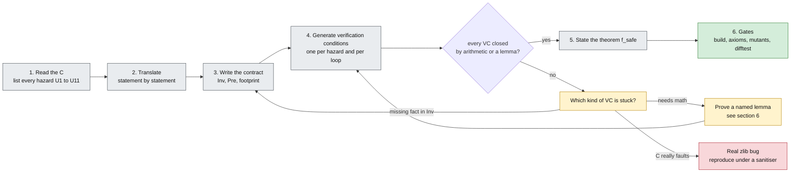
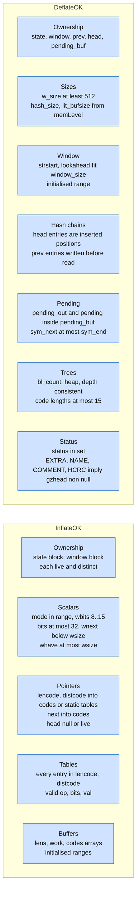
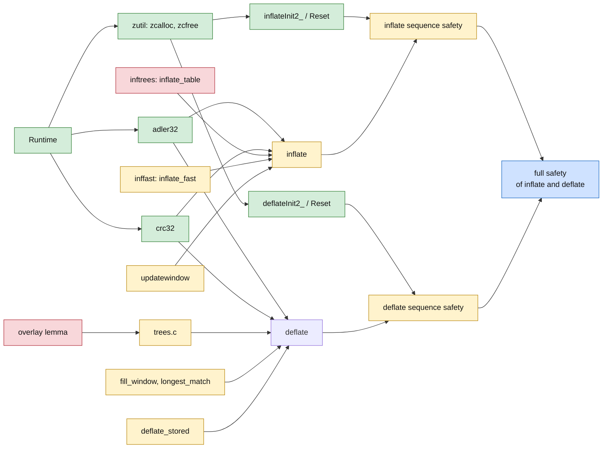
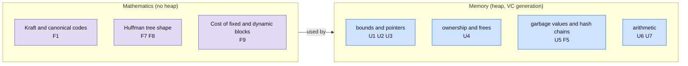

# Proof method

How we prove [safety.md](safety.md) and, on the same state, the correctness statements of [overview.md](overview.md) section 6a. This page is the method and the map. The per-function
detail is in [proof/inflate.md](proof/inflate.md) and [proof/deflate.md](proof/deflate.md).

## 1. The recipe for one function

Every function follows the same six steps. A function is done when step 6 passes.



Step 4 is the key change from the earlier attempt. Verification conditions are generated, not
written by hand. A conditional or a loop gives a fixed set of goals. Most goals close with
`omega` or `grind`.

### The four ways a stuck proof ends

| Cause | Sign | Action |
| --- | --- | --- |
| Missing clause in `Inv` | the goal mentions a field the invariant does not constrain | add the clause; check `Init` and every other function still preserve it |
| Missing math fact | the goal is a statement about counts, sums or trees | make it a named lemma at the lowest layer (section 6) |
| Translation bug | the Lean differs from the C | fix the translation, extend the difftest |
| Real zlib bug | the C itself reaches UB on a legal input | build the input, run the real C under ASan/UBSan/MSan, write a finding |

A fifth non-cause is forbidden: narrowing a precondition to make the goal go away.

## 2. Invariants: one per stream

Each invariant is a list of clauses, grouped by what they protect. Both invariants are
established by `Init` and preserved by every API function.



The clause `D7` comes from a real lesson. In the earlier attempt a weaker invariant admitted a
state with status "extra" and no gzip header. `deflate(Z_BLOCK)` then dereferenced null. The
invariant must tie `status` to `gzhead`.

### What an invariant is not

It does not describe the *data*. `InflateOK` says nothing about which bytes were decoded.
That is P5. It is stated over the same records, in a separate set of theorems, so that the safety proofs stay short.

## 3. Dependency graph and order

An arrow `A → B` means "B needs A's theorem". Colour is difficulty (section 7).



`inflate` side and `deflate` side share only `adler32`, `crc32` and `zutil`. After those three,
two people (or two agents) can work at the same time with no shared files.

## 4. What the safety proofs do *not* need

Several large pieces of the earlier attempt are not needed for safety. Leaving them out of the
safety proofs is most of the size saving. Correctness (P5) needs them, and they come then, on top of
the safety proofs and not mixed into them.

| Earlier work | Lines then | Why the safety proofs skip it |
| --- | --- | --- |
| Value of every CRC table entry (`BraidRow0..7`, 8 files of 1,384 lines) | 11,072 (of 15,207 for all of `crc32`) | Safety only needs each index below 256. The values matter for correctness (P5). |
| Combine functions (`adler32_combine`, `crc32_combine`) | not measured | Pure arithmetic, no memory; not on the path of `inflate` or `deflate`. |
| Round-trip and decoder specifications | not measured | P5. |
| `Witness/` per theorem | 28,876 (197 files) | `Init` gives non-vacuity (rule R2). |
| Callee contract families | 65 definitions | Rule R1: callee theorems, not assumptions. |

## 5. Facts that are not obvious

Some hazards need a fact that the code itself does not check. Each fact is a named lemma. The
table says where the fact comes from and which function depends on it.

| ID | Fact | Needed by | Source of truth | Difficulty |
| --- | --- | --- | --- | --- |
| F1 | Index into `table` stays below its size while `inflate_table` fills it | `inflate_table` | Kraft checks at the top of the function; guard on `used` | hard |
| F2 | `offs[len]` is a permutation: the sort writes each slot of `work` once | `inflate_table` | counting argument | medium |
| F3 | Distance is checked against `whave` before every window copy | `inflate`, `inflate_fast` | runtime check in the C | easy |
| F4 | Window ring buffer: `whave < wsize` implies `wnext = whave` | `updatewindow`, `inflate_fast` | maintained by `updatewindow` | medium |
| F5 | Hash chains read only positions that were inserted, and `prev` slots that were written | `longest_match` | maintained by `INSERT_STRING`, `slide_hash`, `CLEAR_HASH` | medium |
| F6 | Match comparisons stay inside the window: `strstart + 258 < window_size` | `longest_match` | `strstart ≤ window_size - MIN_LOOKAHEAD`, kept by `fill_window` | easy |
| F7 | Heap array indices stay below `HEAP_SIZE` | `build_tree` | `elems` is at most 286 | easy |
| F8 | In `gen_bitlen` overflow repair, a non-empty length class exists below `max_length` | `gen_bitlen` | tree structure | hard |
| F9 | **Pending output never reaches an unread symbol** | all block writers | compression ratio of fixed and dynamic codes | **hardest** |

F1, F8 and F9 are the only ones that need real mathematics. They are small enough to study
alone and large enough to be the main risk. Each has a pure statement that does not mention the
heap:

- F1: for lengths `l₁ … lₙ` that pass the Kraft checks, a loop that assigns canonical codes
  never produces an index at or above `2^root + Σ subtable sizes`.
- F8: a binary tree with `n ≥ 2` leaves, depth-clamped to `L`, has a non-empty class below `L`.
- F9: see [proof/deflate.md](proof/deflate.md) section 5.

## 6. Where each kind of proof lives



Mathematical lemmas are plain Lean about lists, arrays and naturals. They do not import the
runtime. This keeps them cheap to check and easy to reuse, and it lets someone work on them
before the memory proofs exist.

## 7. Difficulty tiers

| Tier | Meaning | Functions |
| --- | --- | --- |
| Easy (green) | Only bounds and arithmetic. Every VC closes by `omega`. | `adler32_z`, `crc32_z`, `zcalloc`, `zcfree`, `inflateReset*`, `inflateEnd`, `deflateEnd`, `deflateBound`, `flush_pending`, `put_*`, `send_bits`, `bi_reverse`, `gen_codes`, `scan_tree`, `send_tree` |
| Medium (yellow) | Needs an invariant on a structure or a ring buffer. | `updatewindow`, `inflate_fast`, `inflate`, `inflateCopy`, `fill_window`, `longest_match`, `deflate_fast`, `deflate_slow`, `deflate_stored`, `deflate`, `pqdownheap`, `build_tree`, `compress_block` |
| Hard (red) | Needs a mathematical lemma (F1, F8, F9). | `inflate_table`, `gen_bitlen`, `_tr_flush_block` (overlay) |

Roughly two thirds of the functions are easy. The hard ones are three. This is the shape that
makes short safety proofs plausible.

## 8. Per-function checklist (copy for each function)

```
Function:            name (file.c:line)
Hazards:             U1 ... U11 that occur, with C line
Inv clauses used:    ...
Pre (from zlib.h):   ...
Footprint:           objects written
Facts used:          F-numbers
Callees:             theorems used
Loops:               measure for each
Theorem:             f_safe  (listed in tests/audit/theorems.txt)
Mutants:             at least two: drop a bound check; off-by-one
Difftest:            input class covered
```

A function is not done until the mutants fail to check. A mutant that still checks means the
theorem does not constrain that code.

## 9. Metrics we track

| Metric | Earlier attempt | Target for the safety proofs (hypothesis, set after the pilot) |
| --- | --- | --- |
| Proof lines per translated line | about 22 | 3 to 5 |
| Largest heartbeat override | 40,000,000 | none above default |
| Callee contracts taken as hypotheses | 65 definitions | 0 |
| Witness files | 197 | 1 per top-level theorem |
| Functions with a vacuous top theorem | at least 1 (`deflate`) | 0 (`Init` establishes `Inv`) |
