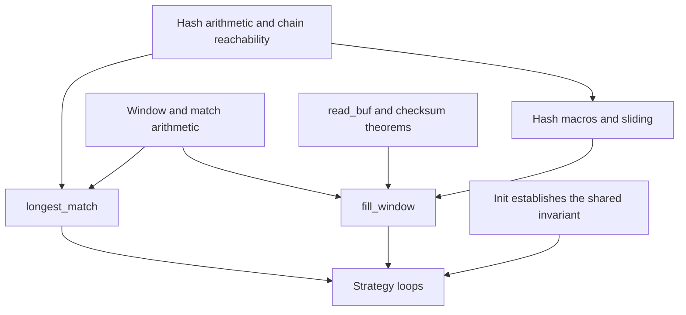

# Deflate engine migration

This record covers `slide_hash`, `read_buf`, `fill_window`, `flush_pending`, `putShortMSB`,
`UPDATE_HASH`, `INSERT_STRING`, `CLEAR_HASH` and `longest_match` in `deflate.c`. The strategy
loops and [lifecycle](deflate-lifecycle.md) are callers. See the [migration guide](README.md)
for evidence rules and [overview](../overview.md) for the current checkpoint.

The earlier `Engine*`, `Hash` and `LmInit` proofs occupied about 18,700 lines. The five block
functions used a further 13,900 lines. Those figures identify the source material, not the size
or acceptance status of its replacement.

## Representation changes

| Earlier representation | Present representation | Effect on the argument |
| --- | --- | --- |
| Tagged cells for state fields and hash entries | State records, byte blocks and 16-bit word blocks | Replace cell-tag facts with record updates and array bounds |
| Reading an unwritten cell faults | An unwritten integer has arbitrary content | Prove that unwritten `prev` entries are never followed; do not assume zero |
| Local-variable record in a fuel loop | `cwhile` and `cdoWhile` over loop locals | Restate loop invariants and termination measures |
| Whole-heap frame relations | Pointwise frames for each table | State exactly which records and byte or word ranges change |
| Callee contracts supplied as hypotheses | Theorems about translated callees | Discharge checksums and tree bit-buffer operations before composing callers |

The earlier restriction `lookahead < 262` at every `fill_window` call is unsuitable for dictionary
insertion. Its usable domain is expressed through the window range. A negative `nice_match`
must follow the signed C comparison. Neither restriction may be silently reintroduced.

## Reusable theorem families

| Source family | Mathematical or operational content | Present source family |
| --- | --- | --- |
| `EngineChains` | Rolling-hash forgetting after three updates; masked-key bounds; agreement of the third byte when keys and first two bytes agree | `deflate.c.engine.hash` |
| `EngineChains`, `Spec/deflate/Engine` | Ring-slot arithmetic; chain reachability; preservation by insertion and sliding; decreasing chain positions | `deflate.c.engine.chains` |
| `EngineFillSlide`, `EngineFill` | Slide threshold, read count, insertion count, `high_water` and disjoint slide-copy ranges | `deflate.c.engine.window` |
| `EngineMatch`, `matchChain_spec`, `innerLoop_spec` | First mismatch, the eight comparisons per round, maximal length 258 and result clamping | `deflate.c.engine.match`, `.lminner`, `.lmcond`, `.lmbody`, `.lmmain` |
| `PendingPut`, `DeflatePut`, `Hash`, `LmInit` | Pending-byte order, hash updates, insertion stores and clearing | `deflate.c.engine.macros` |
| `EngineSlide` | Every hash entry becomes `m >= w_size ? m - w_size : 0`; exact frame | `deflate.c.engine.slide` |
| `EngineReadBuf` | Copy `min(avail_in, size)` bytes, advance input counters and update the selected checksum | `deflate.c.engine.readbuf` |
| `PendingFlush` | Flush tree bits, copy pending bytes, advance output counters and reset an empty pending pointer | Pending-byte copy and the tree bit-buffer proof |

Present modules are under `ZlibF/Proof/`. Representative declarations include `slide_hash_ok`,
`lm_loop_ok` and `longest_match_ok`. Their internal domains must be read from their statements.
The presence of these declarations supersedes the old record's blanket “next” and “open” labels.
It does not establish the public deflate contract.

## Window and chain invariants

Let `ws = w_size`, `ss = strstart` and `la = lookahead`. For the selected build, the intended
window sizes are powers of two from 512 to 32768. The buffer has `2 * ws` bytes,
`MIN_LOOKAHEAD = 262`, `MAX_MATCH = 258` and `MAX_DIST = ws - 262`.

The window invariant relates bytes below `ss + la` to the input history, including every slide
and every `read_buf` copy. Its range clause is `ss + la <= 2 * ws`. The hash invariant describes
only reachable inserted positions. A nonzero position reached from `head[k]` has valid three-byte
input, hashes to `k`, and points to an earlier inserted position while its ring slot is live.
Arbitrary content elsewhere in `prev` is permitted.

`longest_match` uses explicit internal premises: candidate position below `strstart`, distance
within `MAX_DIST`, `prev_length <= 258`, the chain relation, and enough window room for the
unrolled reads. `fill_window` uses valid input, a writable window, `insert <= strstart` and
`high_water <= window_size`. The caller must establish those facts. Treating them as arbitrary
public preconditions would narrow the API domain.

## Fidelity and composition boundaries

The earlier record reported that `ZALLOC_words` allocated twice the intended number of words.
The present helper computes the wrapped byte count and divides it by two before `allocW`.
That old observation does not describe the present expression. Allocation fidelity still belongs
to translation review and its differential regressions; a size lower bound alone cannot prove it.

A pending-output proof must execute `_tr_flush_bits` before copying bytes. A copy-only
argument cannot replace that callee's execution theorem. Likewise, pure first-mismatch or chain lemmas do not establish the actual
window's input history. [Overview](../overview.md) records the remaining composition work.
