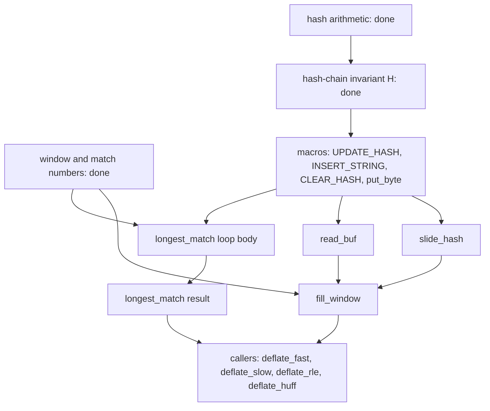

# Migrating the proofs of the deflate engine

This note covers the engine of `deflate.c`: `slide_hash`, `read_buf`, `fill_window`, `flush_pending`,
`putShortMSB`, the hash macros (`UPDATE_HASH`, `INSERT_STRING`, `CLEAR_HASH`) and `longest_match`. The loops that call
them (`deflate_stored`, `deflate_fast`, `deflate_slow`, `deflate_rle`, `deflate_huff`) and the life-cycle functions
(`deflateInit2_`, `deflateReset`, `deflateParams`, `deflateSetDictionary`, `deflateCopy`, `deflateEnd`) are separate
work and are only mentioned where they set the preconditions.

The earlier attempt proved the engine in about 18,700 lines (the files named `Engine*`, `Hash`, `LmInit`) and the
five block functions on top of it in a further 13,900 lines. This note says what each family of old theorems states,
whether it moves over unchanged (pure) or has to be stated again on the table-based object heap and the present
translation (memory-dependent), the order of the move, and where it stands.

## 1. What changed, and why most proofs are stated again

| | earlier attempt | now |
| --- | --- | --- |
| memory | typed blocks of tagged cells and raw byte blocks; the window is a byte block, `head` and `prev` are blocks of cells that may be "uninitialised" | tables of objects. `deflate_state` and `z_stream` are records. The window is a block of the byte table, `head` and `prev` are blocks of the word table (16-bit values) |
| uninitialised data | a cell has no value until it is written, and a read of such a cell is a fault | an integer of fresh memory has an arbitrary value. The hash invariant must say that a slot that was never written is never followed. Reading junk is not a fault |
| state access | cells addressed by field number | records read by projection and written by update |
| translation | a record of local variables threaded through a fuel loop | the loops are `cwhile` and `cdoWhile` over the loop-carried locals; the unrolled comparison of `longest_match` is one loop body repeated eight times |
| heap equality | frames stated by comparing whole heaps in places | frames are stated pointwise on each table |
| callee contracts | `fill_window_contract`, `flush_pending_contract`, `tr_flush_block_contract` taken as hypotheses | none: the callee theorem is used. `flush_pending` calls `_tr_flush_bits`, so its theorem needs the bit-buffer theorem of `trees.c` |
| narrowing | `nice_match` between 0 and 258; `lookahead` below 262 at every `fill_window` call; `head` and `prev` blocks distinct from the state block | `nice_match` is checked (a negative value is handled by the C comparison); `fill_window` needs only that `strstart + lookahead` fits the window (the dictionary function calls it with a longer lookahead); block distinctness is a heap fact, not an assumption |

Consequence: a theorem that only talks about numbers, byte functions or position functions is copied. A theorem that
mentions a heap, a pointer or a cell is stated again; the old proof is a guide to the argument.

## 2. Notation and the two invariants

Let `ws` be `w_size` (a power of two from 512 to 32768, because `deflateInit2_` changes a window size of 256 to 512),
the window has `2 * ws` bytes, `ss` is `strstart` and `la` is `lookahead`. `MIN_LOOKAHEAD` is 262, `MAX_DIST` is
`ws - 262` and `MAX_MATCH` is 258.

* **Window invariant W.** The window block has `2 * ws` bytes and is writable. The range `strstart + lookahead` is at
  most `2 * ws`. The bytes below `strstart + lookahead` are the input history: the content of the window is the old
  window shifted down by `ws` at every slide, followed by the bytes read with `read_buf`.
* **Hash invariant H.** Every position `p` other than 0 that can be reached from `head[k]` through `prev[p & wmask]`,
  as long as the slot has not been reused (`top <= p + ws`), was inserted: it is below `top`, its three bytes lie in the
  valid part of the window, the hash of these bytes is `k`, and its `prev` entry is a smaller position. `top` is one past
  the last inserted position. An entry of `prev` that was never written is never followed.

## 3. Families of old theorems

"Pure" means that no heap, pointer or cell is mentioned: it is copied with the names adapted. "Memory" means that it is
stated again and proved again.

### 3.1 Numbers and functions (pure)

| family (old files) | states | lines | new module | status |
| --- | --- | --- | --- | --- |
| rolling hash (`EngineChains`, first part) | three `UPDATE_HASH` steps forget the start value when `3 * hash_shift >= hash_bits`; with 8 or more hash bits the last byte of an update is determined by the result; the first step from 0 gives the byte itself; every key is below `hash_size`; equal key and equal first two bytes give an equal third byte (the reason `longest_match` need not compare `scan[2]`) | 110 | `deflate.c.engine.hash` | **done**, copied with the byte array replaced by a byte function |
| `prev` slot arithmetic (`EngineChains`) | `p & (ws - 1)` is `p mod ws`, is below `ws`, is unchanged by adding `ws`, and differs for two positions less than `ws` apart | 25 | `deflate.c.engine.hash` | **done** |
| hash-chain invariant H (`EngineChains`, `Spec/deflate/Engine`) | the definition of reachability and of H; unrelated writes and larger bounds keep H; a non-empty head entry is below `top`; one `INSERT_STRING` keeps H with `top = str + 1`; `slide_hash` with the window copy keeps H with every position lowered by `ws`; the chain that `longest_match` walks from the old head consists of positions in `[1, strstart)` that agree in the third byte whenever they agree in the first two | 230 | `deflate.c.engine.chains` | **done**; the heap tables are functions from index to value, so there is no "uninitialised cell" case |
| fill_window numbers (`EngineFillSlide`, `EngineFill`, the definitions in `Spec/deflate/Engine`) | the slide amount and the count read; `insert` after the insertion loop; the `high_water` rule; the room left after the call (`strstart < window_size - 262`); the slide copy stays in the window, its ranges do not overlap and its length is `strstart + lookahead - ws` | 120 | `deflate.c.engine.window` | **done** |
| longest_match numbers (`EngineMatch`, `Spec`) | the reads `scan[best_len]` and `match[best_len]` and the end pointer stay in the window when `strstart <= window_size - 262`; every chain position above `limit` is within `MAX_DIST`; the result is the smaller of `best_len` and `lookahead` | 60 | `deflate.c.engine.window`, `deflate.c.engine.match` | **done** |
| match length (`EngineMatch`, `matchChain_spec`, `innerLoop_spec`) | the eight-fold comparison stops at the first position where the two strings differ, or at 258; the length is the offset at which it stopped; the strings agree on `[0, length)` | 140 | `deflate.c.engine.match` | **done** as a function `firstMis` with its characterisation and uniqueness; the heap-level loop maintains the characterisation step by step |

### 3.2 Macros and small functions (memory)

| family | states | old lines | new module | status |
| --- | --- | --- | --- | --- |
| `put_byte`, `putShortMSB` (`PendingPut`, `DeflatePut`) | the byte goes to `pending_buf[pending]`, `pending` grows by one (two for `putShortMSB`, high byte first); nothing else changes | 240 | `deflate.c.engine.macros` | next |
| `UPDATE_HASH`, `INSERT_STRING` (`EngineFill`, `EngineFast`) | `ins_h` becomes the update of the old value with the byte; `INSERT_STRING` writes `prev[str & wmask]` with the old head entry and `head[ins_h]` with `str`, and returns the old head entry; the index into `head` is below `hash_size` because the hash is masked | 330 | `deflate.c.engine.macros` | next |
| `CLEAR_HASH` (`Hash`, `LmInit`) | all of `head` becomes 0 and `slid` becomes 0 | 220 | `deflate.c.engine.macros` | next |
| `slide_hash` (`EngineSlide`) | no fault; every entry of `head` and of `prev` becomes `m >= ws ? m - ws : 0`; `slid` becomes 1; nothing else changes | 290 | `deflate.c.engine.slide` | next after the macros; the pilot theorem `slide_hash_ok` is a model for the loop |
| `read_buf` (`EngineReadBuf`) | returns `min(avail_in, size)`; copies that many bytes from `next_in` to the buffer; `avail_in`, `next_in`, `total_in` move; `adler` becomes the Adler-32 or CRC-32 update (by `wrap`); nothing else changes | 250 | `deflate.c.engine.readbuf` | open; uses the checksum theorems of `adler32.c` and `crc32.c` |
| `flush_pending` (`PendingFlush`) | calls `_tr_flush_bits`, copies `min(pending, avail_out)` bytes to `next_out`, advances the pointers and counters, resets `pending_out` when nothing is left | 410 | with the stream functions | open; the pilot theorem `flush_pending_ok` is the model; the `_tr_flush_bits` call needs the bit-buffer theorem of `trees.c` |

### 3.3 `fill_window` (memory)

| family | states | old lines | new module | status |
| --- | --- | --- | --- | --- |
| insertion loop (`EngineFill`, `fw_ins_body`, `fw_ins_loop`) | the loop `while (insert)` inserts the strings that were left out when input was short, keeps H, and stops with `insert = 0` or `lookahead + insert < 3` | 840 | `deflate.c.engine.fillwindow` | open |
| window clearing (`zmemzero_wp`, `fill_hw_spec`) | the bytes beyond the data up to `high_water` are zero; `high_water` follows the rule | 200 | `deflate.c.engine.fillwindow` | open |
| slide and read (`EngineFillSlide`) | slide by `ws` when `strstart >= ws + MAX_DIST` (window copy, `match_start`, `strstart`, `block_start` lowered, `insert` clamped, `slide_hash`); read into `window + strstart + lookahead`; H preserved; the stream counters follow `read_buf` | 1,020 | `deflate.c.engine.fillwindow` | open; the longest piece |
| `fill_window_safe` and spec | no fault under W and H; the fields of the state that change, and only those | included above | `deflate.c.engine.fillwindow` | open |

### 3.4 `longest_match` (memory)

| family | states | old lines | new module | status |
| --- | --- | --- | --- | --- |
| comparison loop (`matchChain_spec`, `innerLoop_spec`) | eight pre-increment comparisons per round; stops at the first mismatch or at `strend`; reads at most `window[strstart + 258]` | 140 | `deflate.c.engine.lmloop` | open |
| loop body (`lm_body_spec`) | one candidate: the four early tests, the third byte assumed equal, the length from the loop, the update of `best_len`, `match_start`, `scan_end`, and the early exit when `len >= nice_match` | 170 | `deflate.c.engine.lmloop` | open |
| chain loop (`lm_loop_spec`, `chain_dist`) | the walk along `prev` ends after at most `max_chain_length` steps (a counter that falls) or at `limit`; every visited position is below `strstart` and within `MAX_DIST` | 70 | `deflate.c.engine.lmloop` | open |
| result (`lm_tail`, `longest_match_spec`) | no fault; the result is `min(best, lookahead)`; either `best = prev_length` and `match_start` is unchanged, or `best > prev_length` and `match_start` names a match: the bytes at `match_start` and at `strstart` agree up to `best`, `match_start < strstart`, the distance is at most `MAX_DIST`; only `match_start` changes | 130 | `deflate.c.engine.lmloop` | open |

### 3.5 What is not in this note

| family | old lines | where it goes |
| --- | --- | --- |
| `deflate_fast`, `deflate_slow` loops and their emitted symbols | 6,000 | the work on the block functions; they use the theorems above |
| `deflate_stored` | 4,900 | the same |
| `deflate_rle`, `deflate_huff` | 2,900 | the same |
| life-cycle functions (`Init`, `Reset`, `Params`, `SetDict`, `Copy`) | about 25,000 | the work on the life cycle; it establishes W and H (an empty `head`, an empty window) |

## 4. Order

1. Pure parts: hash, chains, window numbers, match length. **Done.**
2. The macros and `slide_hash`, which `fill_window` and the block functions call.
3. `read_buf`, then `fill_window` on top of it, `slide_hash` and `INSERT_STRING`.
4. `longest_match`: the comparison loop, the body, the chain loop, the result.
5. Each theorem is stated with W and H as explicit hypotheses until the invariant of the life-cycle work (`DGood`)
   exists; then the hypotheses are replaced by the projections of `DGood`.

## 5. Preconditions that are narrower than the caller needs

A theorem about the engine takes W and H, and the position facts that the callers establish:

* `longest_match`: `strstart <= window_size - 262` (the callers call `fill_window` whenever `lookahead < 262`, and
  `fill_window` leaves `strstart < window_size - 262`; if `lookahead >= 262` the window range gives the same bound); the
  candidate satisfies `1 <= cur_match < strstart` and `strstart - cur_match <= MAX_DIST` (the callers test this);
  `prev_length <= 258`; the chain facts come from H right after the insertion at `strstart`.
* `fill_window`: the window range `strstart + lookahead <= window_size`, `high_water <= window_size`, `insert <= strstart`,
  the stream's input buffer holds `avail_in` bytes and is not the window.

These are the conditions the callers establish. They are written in each theorem's docstring.

## 6. Observations from reading the translation

* `ZALLOC_words` allocates twice the number of words that the C allocates (the block is `2 * items` words; the comment
  says `allocW n`). The blocks of `head` and `prev` are therefore larger than the C blocks. This is harmless for
  safety (accesses stay in the smaller range) but it is a difference from the C that the translation owner should
  confirm. The engine theorems only assume that the blocks are at least as large as the C requires.
* `lm_cond` reads `window[strstart + 258]` on its last comparison; this is inside the window because the callers keep
  `strstart <= window_size - 262`.
