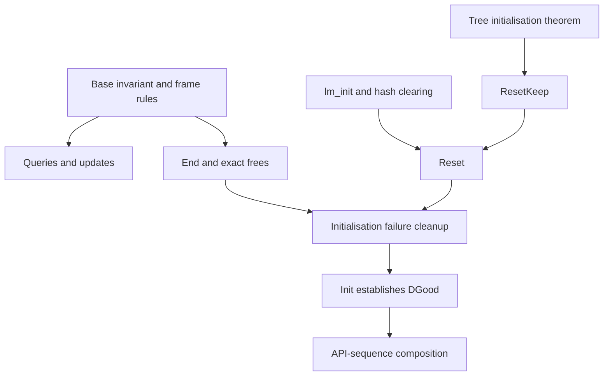

# Deflate lifecycle migration

This record maps the earlier lifecycle proofs to the object heap. It covers checking,
initialisation, reset, end, copy, bounds, tuning, header installation, priming and dictionary
queries in `deflate.c`. [Overview](../overview.md) owns progress and remaining work.
The [migration guide](README.md) explains what evidence transfers.

The source families occupied about 12,000 of the earlier 44,000 lines of deflate proofs.
Most statements mention cell tags or offsets. Their argument structure is reusable; their
heap-level proof terms are not interchangeable with proofs about the present translation.

## Representation and invariant

| Earlier form | Present form | Required adaptation |
| --- | --- | --- |
| `DSInv = DSHeap + DSVals` over tagged cells | `DGood` in `deflate.c.base`, with liveness, state facts, uniqueness and freshness | Restate every field, buffer and ownership condition |
| Field offsets and tagged stores | `deflate_state` records and stream references | Use record-update rules and frame each object table |
| Typed buffers and raw bytes | Byte buffers plus 16-bit `head` and `prev` blocks | Prove bounds in the units used by the translated operation |
| Separate embedded-stream theorem families | A stream reference can select `gz_state.strm` | Prove the reference operations once; check each theorem's domain |
| Allocator and callee contracts | Default allocator semantics and actual callee theorems | Account for every failed allocation and free; assume no library contract |

A definition of `DGood` does not show that initialisation reaches it. Conditional lifecycle and
engine theorems depend on that distinction. In particular, the state before the first reset has
`window_size = 0`; `lm_init` establishes the final window size. Allocation facts must support
that intermediate state rather than assume the final invariant too early.

## Source theorem families

| Earlier source | Content retained | Present source family |
| --- | --- | --- |
| `Inv`, `Inv7`, `Heap` | Back-pointers, buffer separation, ranges, store preservation and frames | `deflate.c.base` |
| `StateCheckQuick`, `End` | Null and invalid-stream refusals; exact state-check result | Base checking lemmas |
| `TuneQuick`, `HeaderQuick`, `UsedQuick`, `PendingQuick`, `Simple` | Four tuning stores; gzip-only header store; optional output stores; pending-count overflow | `deflate.c.life.check` |
| `Bound` | Wrapper length, low 16 bits of `extra_len`, terminated strings and the bound arithmetic | `deflate.c.life.bound`, including `boundTail` and `WrapLen` |
| `InitParams`, `Init*` | Parameter normalisation, powers of two, buffer sizes and configuration-table ranges | Arithmetic supporting init and the base invariant |
| `End` | Exact status-dependent result, five frees and clearing the stream state pointer | `deflate.c.life.end` |
| `LmInit`, `Reset*`, `ResetTr` | Hash clearing, tuning table, counters, wrapper status and tree reset | `deflate.c.life.reset` |
| `InitFail*`, `InitOk*`, `InitMem`, `InitFresh` | Each failing allocation and its cleanup; exact successful state | Initialisation argument structure |
| `Prime*`, `PrimeArith` | Move pending bytes; preserve their bit value; append the low requested bits | Priming arithmetic and execution decomposition |
| `Copy*` | Refusals, failure cleanup, independent buffers and rebased tree pointers | Copy argument structure |
| `DictGet`, `GetDictQuick` | Return `min(strstart + lookahead, w_size)` bytes from the end of the window | `deflate.c.life.getdict` |

Present modules are under `ZlibF/Proof/`. Examples include `deflateTune_safe`,
`deflateBound_z_safe`, `deflateEnd_safe`, `deflateResetKeep_safe`, `deflateReset_safe` and
`deflateGetDictionary_safe`. These names locate conditional execution results. They do not
assert acceptance of every corresponding public goal.

The recovered dictionary-query argument covers the length formula, no-copy branch, byte copy,
frame, invariant preservation and invalid-stream refusal. It takes `DGood` and an explicit
history-range condition. The migration record reports three direct translation mutants: wrong
length, omitted copy and shifted source. Registration and acceptance are tracked in the overview.

## Composition and scope

`_tr_init` and checksum specifications must be discharged by theorems about their translated
functions. A witness constructed independently of init cannot replace the init theorem.

The present allocator scope is the default allocator. Custom allocator behaviour does not follow
from these results. Header names and comments used by the bound calculation require a terminating
zero in readable memory. Copying requires the source and destination objects to satisfy the
translation's overlap rules. These domains must remain explicit and be compared with
[API requirements](../api/README.md) and [deviations](../deviations.md).

The numeric bound formula alone does not show that compression output fits it. That conclusion
also needs the actual compressor refinement. The earlier record's word-allocation warning is
addressed as a historical expression change in the [engine record](deflate-engine.md), rather
than retained as a current defect.
