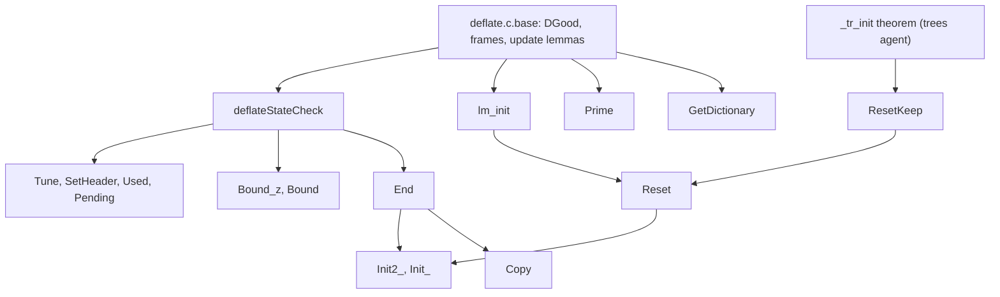

# Moving the proofs of the deflate lifecycle functions

The earlier attempt proved the lifecycle functions of `deflate.c` on a different runtime: byte blocks plus "typed
blocks" of tagged cells, a translation written over a local-variable record, and a stream invariant (`DSInv`, with
`DSHeap` and `DSVals`) stated cell by cell. The functions covered here are `deflateStateCheck`, `deflateInit_`,
`deflateInit2_`, `deflateEnd`, `deflateResetKeep`, `deflateReset`, `lm_init`, `deflateCopy`, `deflatePending`,
`deflateUsed`, `deflateBound_z`, `deflateBound`, `deflateSetHeader`, `deflatePrime`, `deflateTune` and
`deflateGetDictionary`. The old files are about 12,000 lines of the 44,000 lines of the old deflate proofs.

The honest summary comes first. Almost nothing in the old files is free of the old runtime: every old statement
mentions a block number, a cell index or a tag. What is reused is (a) the arithmetic and bit-list lemmas, which
are copied with the names adapted, and (b) the statement and the shape of the proof of every other theorem. The
old narrowings (the stream and the state are separate objects at offset zero, the allocator is the default one,
the gzip header strings are given as byte lists) are kept only where `zlib.h` forces them.

## 1. What changed

| | earlier attempt | now |
| --- | --- | --- |
| memory | byte blocks and typed blocks of tagged cells; a pointer is a block number and a cell offset | tables of objects: `z_stream`, `gz_header`, `deflate_state` are records; `window`, `pending_buf` are byte arrays, `prev`, `head` are arrays of 16-bit words; each lives under a block number |
| state | cells read with tags (`DSVals`) | the record `deflate_state` is read by projection; its arrays `dyn_ltree`, `heap`, ... are fields |
| invariant | `DSInv = DSHeap + DSVals` over cells | `DGood` of `deflate.c.base`: `DLive` + `DStInv` + `Uniq` + `Fresh`, the style of the inflate lifecycle |
| frame | a relation on whole heaps (`HFrame`) | pointwise: each table is stated entry by entry; no equality of whole tables |
| ownership | "the typed blocks of the state, `prev`, `head` are freed" | "the live blocks are exactly the old ones plus/minus ..." (`Heap.Owns`) |
| allocator | any `zalloc`/`zfree` was a hypothesis on cells | the default `zcalloc`/`zcfree` only (any other function faults in the translation) |
| callees | `_tr_init` and the checksum functions as contracts | no contracts: each callee has its own theorem |

Consequence: a theorem that only talks about numbers or bit lists is copied. A theorem that mentions a heap, a
pointer or a cell is stated again and proved again.

## 2. Families of old theorems

"Pure" means no heap and no pointer: the statement and proof are copied. "Adapt" means the mathematics is kept
and the heap part is replaced. "Memory" means stated and proved again on the table heap.

### 2.1 Arithmetic and bit facts

| family (old files) | what it states | class | new home | status |
| --- | --- | --- | --- | --- |
| the size bound formula (`Bound`: `boundFormula`, `extraCount`, `boundNoState`) | the closed form of `deflateBound_z` as a function of `w_bits`, `hash_bits`, `level`, the wrapper length and the source length; the extra-field term is `2` plus the low 16 bits of `extra_len`, with no wrap | pure | `deflate.c.life.math` | to do |
| the string loop (`strLoop_run`) | the loop `do { wraplen++; } while (*str++)` counts the string and its terminating zero | adapt: the string is a byte array in the heap | `deflate.c.life.bound` | to do |
| the parameter computation of `deflateInit2_` (`InitParams`) | after the argument rules the level is 0 to 9, the strategy 0 to 4, the method is 8, the window bits are 9 to 15, the wrapper is 0, 1 or 2, and window bits 8 become 9 | pure | `deflate.c.life.math` | to do |
| sizes and hash relations (`Init*` arithmetic) | `w_size = 2^w_bits`, `w_mask = w_size - 1`, `hash_bits = memLevel + 7`, `hash_size = 2^hash_bits`, `hash_shift = (hash_bits + 2) / 3`, `lit_bufsize = 2^(memLevel + 6)`, `sym_end = 3 (lit_bufsize - 1)`, all in range | pure | `deflate.c.base` | to do |
| the configuration table (`cfg_cell`, `cfg_isU16`) | the ten rows of `configuration_table`, indexed by level | pure | `deflate.c.life.math` | to do |
| bit arithmetic of `deflatePrime` (`PrimeArith`, 341 lines: `bytesVal`, `bsVal`, `biFlush_val`, `stream_math`, mask and shift lemmas) | the value of the pending bytes plus the bit buffer is kept by `bi_flush`; the bits moved in one step are `min (16 - bi_valid) bits`; `value & ((1 << put) - 1)` and `value >> put` for `put <= 16` | pure | `deflate.c.life.prime` | to do |
| the pending-bytes list (`pendL`, `moveN`) | the pending output as a list, and moving it to the start of the buffer keeps it | adapt (byte array of the heap) | `deflate.c.life.prime` | to do |

### 2.2 Stream invariant and frames

| family | what it states | class | new home | status |
| --- | --- | --- | --- | --- |
| `DSInv`, `DSHeap`, `DSVals` (`Inv`, `Inv7`, `Heap`) | the stream and the state point to each other; the four buffers are separate live blocks of the right size; the scalar fields are in range | memory | `deflate.c.base` (`DGood`) | to do, first |
| store rules (`DSHeap.wr_*`, `DSInv.wr_*`, 487 lines) | a store to a stream field, a state field or an unrelated object keeps the invariant | memory: becomes the update lemmas `setD`, `ZStreamRef.put` and `DGood.set...` | `deflate.c.base` | to do |
| `HFrame` | the heap outside the footprint is unchanged | memory: pointwise statements per table | `deflate.c.base` | to do |
| `DSInvAt`, `...At` theorems (`ResetDevAt*`, about 1,300 lines) | the same theorems for a `z_stream` that lies inside a `gz_state` (used by `gzwrite`) | not moved here: in the new heap this is the reference `in_gzstate_strm`, and the statements are about a stream reference, so they come for free | none | dropped |

### 2.3 Per-function theorems (memory)

| function | old files | lines | what the old theorems state | new theorems |
| --- | --- | --- | --- | --- |
| `deflateStateCheck` | `StateCheckQuick`, `End` (`deflateStateCheck_of`) | 150 | returns 0 exactly for a stream that points to a state that points back with a known status; 1 otherwise; the heap is never changed; a null stream is refused | `deflateStateCheck_total` (a total characterisation on the domain of streams, as `inflateStateCheck_total`), `..._safe` |
| `deflateTune` | `TuneQuick`, `Simple` | 130 | four assignments, all `int` values including negative ones; invalid stream gives the stream error | `deflateTune_safe`, `deflateTune_spec` |
| `deflateSetHeader` | `HeaderQuick`, `Simple` | 100 | gzip wrapper only: stores the header pointer; others give the stream error | `deflateSetHeader_safe`, `..._spec` |
| `deflateUsed` | `UsedQuick`, `Simple` | 130 | returns `Z_OK` and stores `bi_used` through the optional pointer | `deflateUsed_safe`, `..._spec` |
| `deflatePending` | `PendingQuick`, `Simple` | 180 | stores `bi_valid` and the pending count (saturating with `Z_BUF_ERROR` when it does not fit) | `deflatePending_safe`, `..._spec` |
| `deflateBound_z`, `deflateBound` | `Bound` | 416 | the closed formula for every wrapper (raw, zlib with or without a dictionary, gzip with or without a user header and its parts); no state gives the stream-independent bound; `deflateBound = deflateBound_z` on LP64 | `deflateBound_z_spec`, `deflateBound_spec`, `deflateBound_z_nostate` |
| `deflateEnd` | `End` | 264 | result `Z_DATA_ERROR` for status BUSY, else `Z_OK`; frees the four buffers and the state; clears `state`; frees nothing else | `deflateEnd_safe` (ownership: the live blocks are the old ones minus the state and its four buffers), `deflateEnd_spec` |
| `lm_init` | `LmInit` | 285 | `window_size = 2 w_size`; the hash heads are cleared; the match fields and tuning fields are loaded from the table | `lm_init_safe`, `lm_init_spec` |
| `deflateResetKeep` | `Reset*`, `ResetTr` | 1,100 | counters, `msg`, `data_type`, `adler` (1 or 0), `status` (zlib or gzip header), `last_flush = -2`, `gzhead = NULL`, trees reset (`_tr_init`), `matches` kept at level 0, `block_start`, `lookahead`, match state | `deflateResetKeep_safe`, `..._spec` (needs the theorem for `_tr_init` of the trees agent) |
| `deflateReset` | `Reset*` | (same) | `deflateResetKeep` then `lm_init` when it returned `Z_OK` | `deflateReset_safe`, `..._spec` |
| `deflateInit2_` / `deflateInit_` | `Init*` (about 3,500 lines: `InitFail*` for each failing allocation, `InitOk*` for the success state, `InitMem`, `InitFresh`) | 3,500 | release-string and size checks; parameter rules; `Z_MEM_ERROR` when the state or any of the four buffers fails (each case, with the cleanup of `deflateEnd`); on success the exact state, a good invariant, five allocations | `deflateInit2__safe`, `..._spec`, `deflateInit2__mem_fail`, `deflateInit__safe`, `..._spec` |
| `deflatePrime` | `Prime*` | 1,250 | refuses bits outside 0 to 16 and no room; moves the pending output to the start of the buffer; the bit stream after the call is the old bit stream followed by the low `bits` bits of `value` | `deflatePrime_safe`, `deflatePrime_spec` |
| `deflateCopy` | `Copy*` | 1,650 | null destination, bad source, memory failure; on success the copy is a good stream with its own four buffers, equal contents, and the trees pointers into the copy | `deflateCopy_safe`, `deflateCopy_spec` |
| `deflateGetDictionary` | `DictGet`, `GetDictQuick` | 350 | the length is `min (strstart + lookahead) w_size`; the bytes copied are the last ones of the window | `deflateGetDictionary_safe`, `..._spec` |

## 3. Order

1. `deflate.c.base`: the invariant `DGood`, so that the engine and strategy proofs can import it.
2. `deflate.c.life.math`: the pure arithmetic of 2.1.
3. `deflate.c.life.check`: `deflateStateCheck`, `deflateTune`, `deflateSetHeader`, `deflateUsed`, `deflatePending`.
4. `deflate.c.life.bound` and `deflate.c.life.end`.
5. `deflate.c.life.reset`: `lm_init`, `deflateResetKeep`, `deflateReset`.
6. `deflate.c.life.init`: `deflateInit2_`, `deflateInit_`.
7. `deflate.c.life.prime`, `deflate.c.life.dict`, `deflate.c.life.copy`.
8. `deflate.c.life.witness`: examples on a heap made by the real `deflateInit2_`.

## 4. Narrowings

| narrowing | reason | listed in |
| --- | --- | --- |
| `zalloc` and `zfree` are the defaults or absent | the translation models no other allocator function | each theorem docstring |
| gzip header `name` and `comment` end with a zero byte inside their array (`deflateBound`) | `zlib.h` requires strings | the docstring of the bound theorems |
| `dest` and `source` of `deflateCopy` are different streams | `memcpy` of overlapping objects | the docstring of the copy theorems |

## 5. Differences found while reading the translation

* `ZALLOC_words` allocates `items * 2` words, but `ZALLOC(strm, items, sizeof(Pos))` is `items` words of two bytes. The
  translation therefore makes `prev` and `head` twice as long as the C does. This hides nothing that the proofs
  need (every access is below `w_size` and `hash_size`), and the invariant `DGood` states a lower bound on the
  two array sizes. It should be fixed in the translation (reported to the coordinator).
