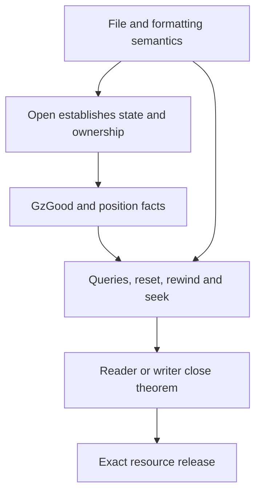

# Gzip file-management migration

This record maps earlier `gzlib.c` and `gzclose.c` arguments to the object heap.
[Overview](../overview.md) owns current status and unconfirmed reports. See the
[migration guide](README.md) for acceptance rules and [gzip API](../api/gz-file.md) for public behaviour.

The earlier source occupied about 9,300 lines across 48 gzip-management files and 800 lines
across eight close files. Its heap represented `gz_state` through cells and a rebuilt typed view.
The present state is a record in a table. Arithmetic and case decompositions remain useful;
field offsets, cell tags and heap proof terms need replacement.

## Source families

| Earlier family | Reusable content | Present source family or boundary |
| --- | --- | --- |
| `Basic` | Field layout and tags | Replaced by record access and stream references |
| `Simple` | Buffer setting, EOF, tell, error query and integer limits | `gzlib.c.simple` |
| `Error`, `ErrorMsg` | Free old message; store code; allocate and format `path: text`; allocation failure | `gzlib.c.error` covers the null-message path; formatted messages need exact formatting semantics |
| `Reset`, `Rewind` | Reset fields and errors, refusal rules, file seek and input-adjusted offsets | `gzlib.c.error`, `.rewind` |
| `SeekParts`, `SeekRaw`, `SeekFwd`, `SeekBack`, `SeekTail`, `SeekMain`, `SeekCor` | Target arithmetic and raw, forward and backward branches | `gzlib.c.seek` |
| `SeekNeg`, `SeekNegUb`, `SeekFault`, `SeekWitness` | Negative positions and signed-overflow paths | Conditional exact-fault lemmas, not a public safety theorem |
| `OpenMode`, `OpenParts`, `OpenRest` | Mode-character fold and cleanup on `+` | `parseMode` and the opening argument structure |
| `OpenPath`, `OpenDesc`, `OpenFinish`, `OpenEff*`, `GzopenEff*`, `Dopen*` | Path copy, descriptor flags, append/truncate effects and failure cleanup | Exact formatting, file effects and ownership must compose |
| `Close`, `Dispatch` | Reader/writer dispatch and live-block accounting | `gzclose.c`; actual reader/writer cleanup belongs to their files |

Present proof modules are under `ZlibF/Proof/`. Module names identify reusable arguments,
not acceptance of every public goal. In particular, the record's former blanket “done” labels
must not be read as whole-API verification.

## Invariant and external effects

`GzGood` describes the live state, separated strings and buffers, message state, uniqueness and
freshness. Position facts are separate: `PosInv` bounds the position and pending skip.
`NextOk` excludes a dangling `x.next` and a pointer into a message block that may be freed.
A direct read can expose a caller buffer, so that pointer lifetime must be checked across calls.

`gz_open` does not itself initialise inflate or deflate. Those calls occur in `gz_look` and
`gz_init`. Nevertheless, close dispatch cannot prove the reader's or writer's cleanup by assuming
its contract. Each actual callee needs its own execution theorem.

## Historical diagnostics and their limits

The seek module has exact `Fault.ub` results for selected negative-position, dangling-input and
near-limit raw-seek states. A fault under a heap premise does not show that a legal API sequence
reaches that state. A confirmed C issue needs a concrete reproduction under the repository's
finding policy. Earlier source patches also do not transfer automatically to the present pin.

The migration record reported this observation: after reading five bytes to EOF, seeking five
bytes relative to the current position returned ten, while `gztell` still returned five. Its
reading was that forward seek retained `past`; an older abstract `GzSeek` relation instead
required the target position and a cleared `past`. That abstract relation cannot be treated as
an established operational refinement from this record. The interpretation of the C remains
**to confirm**, and this page records no newly run experiment.

Formatted errors and opening use formats such as `%s`, `%s%s%s` and `<fd:%d>`. Their exact results,
allocation failures and ownership effects matter; a generic formatting refusal does not prove
the successful path. Witnesses, direct function mutants and the fixed public domains remain
acceptance requirements. Their current checkpoint is recorded in the overview.
